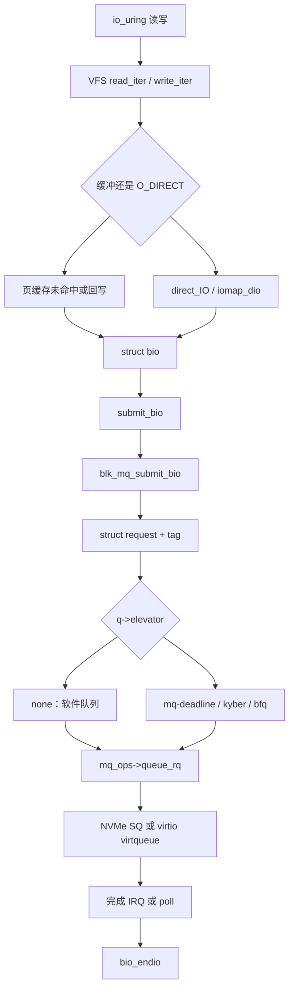

# 1. 总览

**结论**：一次磁盘读写在 VFS 或回写里变成 `struct bio`，`submit_bio` 做检查后交给 blk-mq；blk-mq 分配 `struct request`，调度器（或 `none`）决定何时调用驱动的 `queue_rq`，完成时从中断或轮询回到 `bio->bi_end_io`。

> 主路径锚点：`block/blk-core.c` 的 `submit_bio`（`:860`），`block/blk-mq.c` 的 `blk_mq_submit_bio`（`:3014`）。

C 新手先记五个名词，后面各节再展开字段。

| 名词 | 它是什么 | 定义 |
|---|---|---|
| `bio` | 一次传输：设备、扇区、操作码、若干内存段 | `include/linux/blk_types.h:265` |
| `bio_vec` | 其中一段内存：哪一页、从哪一字节、多长 | `include/linux/bvec.h:31` |
| `request` | 发给驱动的工单，可以合并多个 bio | `include/linux/blk-mq.h:80` |
| `blk_mq_ctx` | 提交 CPU 上的软件队列 | `block/blk-mq.h:18` |
| `blk_mq_hw_ctx` | 对着设备一条硬件队列的状态 | `include/linux/blk-mq.h:288` |

扇区在块层里是 512 字节。`SECTOR_SHIFT` 是 9，`SECTOR_SIZE` 是 `1 << 9`（`blk_types.h:30`、`:33`）。文件系统的逻辑块可以更大，进 bio 之前会换成扇区。

---

## 1.1 一张总图



读图时抓住三件事：

1. **VFS 停在函数表**。缓冲读未命中走 `a_ops->read_folio`，缓冲写标脏后由 flusher 走 `a_ops->writepages`，`O_DIRECT` 走 `a_ops->direct_IO`。这些入口在 [vfs/05](../vfs/05-read-write.md)。页怎么进 xarray、脏页怎么限速在 [MM §08](../memory-management/08-page-cache-and-writeback.md)。本章从「已经有一个填好的 bio」写起，并在 [10](./10-writeback-and-fsync.md)、[11](./11-direct-io.md) 把组 bio 的那一层接回来。
2. **调度器不是必经的一块代码**。`q->elevator == NULL` 时 sysfs 显示 `none`（`block/elevator.c:773`）。多硬件队列的盘默认就是这条，见 [04](./04-sched-none.md)。
3. **完成不一定在提交的那颗 CPU 上**。NVMe 的完成队列中断在 [13](./13-nvme-walkthrough.md)；中断怎么进 `common_interrupt` 在 [interrupts/02](../interrupts/02-x86-entry.md)。

---

## 1.2 和别的章怎么接

| 本章写到哪 | 别章接着写 |
|---|---|
| `generic_file_read_iter` 在 `IOCB_DIRECT` 上调用 `a_ops->direct_IO` | VFS 的 `kiocb` / `iov_iter`：[vfs/05](../vfs/05-read-write.md) §5.1、§5.5 |
| flusher 调用 `a_ops->writepages` 之前的脏页阈值 | [MM §08](../memory-management/08-page-cache-and-writeback.md) §8.3 |
| `bio->bi_blkg`、`io.max` / `io.weight` 文件由谁登记 | [cgroup/07](../cgroup/07-io-pids-misc.md) §7.1。请求上怎么限流见 [09](./09-ioprio-and-cgroup-io.md) |
| `nvme_irq` / `virtblk_done` 被哪条 IRQ 叫到 | 向量、MSI、`request_threaded_irq`：[interrupts/](../interrupts/README.md) |
| `file_operations.uring_cmd` 这个指针 | VFS 只点到它存在（[vfs/README](../vfs/README.md) 边界表）。提交环在 [12](./12-io-uring.md) |

tmpfs 的读写停在 shmem 页，没有 `submit_bio`。块层这张图对它不适用。

---

## 1.3 一条提交时间线

下面是 **blk-mq 盘**（`bd_has_submit_bio` 为假）上一次普通读写。叠层设备（md、dm）会走 `disk->fops->submit_bio`，见 `__submit_bio`（`blk-core.c:604`）。

```text
submit_bio                         block/blk-core.c:860
  读：task_io_account_read，PGPGIN
  写：PGPGOUT
  bio_set_ioprio                   :839     任务 ioprio，再 blkcg_set_ioprio
  submit_bio_noacct                :732
    只读检查、分区重映射、操作码是否支持
    blk_throtl_bio                 可能把 bio 挂起，本次返回
    submit_bio_noacct_nocheck      :695
      __submit_bio_noacct_mq       :682     普通 mq 盘
        __submit_bio               :604
          blk_mq_submit_bio        blk-mq.c:3014

blk_mq_submit_bio
  按 queue_limits 拆 bio               __bio_split_to_limits
  尝试并进 plug 或调度器里已有的 request
  __blk_mq_alloc_requests          :439     拿 tag，填 request
  blk_mq_bio_to_request            :2629
  带 REQ_PREFLUSH/FUA：blk_insert_flush
  当前任务有 plug：先挂在 current->plug 上
  否则：
    用了调度器，或硬件队列忙：插入软件队列，再 blk_mq_run_hw_queue
    否则：blk_mq_try_issue_directly 直接 queue_rq
```

plug 是当前任务栈上的一小段暂存（`struct blk_plug`，`include/linux/blkdev.h:976`）。循环里连续提交的 bio 先攒着，离开系统调用或主动 `blk_finish_plug` 时再一批交给设备，这样相邻的才能合并。

派发（硬件队列被跑起来之后）：

```text
blk_mq_run_hw_queue                blk-mq.c:2296
  blk_mq_sched_dispatch_requests   blk-mq-sched.c:319
    q->elevator 非空：
      e->type->ops.dispatch_request
    否则（none）：
      忙：blk_mq_do_dispatch_ctx     按软件队列轮转，一次一个
      闲：blk_mq_flush_busy_ctxs     把有请求的软件队列倒进一张表
    blk_mq_dispatch_rq_list        blk-mq.c:2045
      mq_ops->queue_rq             驱动。NVMe 是 nvme_queue_rq
```

驱动在真正交给硬件之前调用 `blk_mq_start_request`（`blk-mq.c:1252`）。它打 `block_rq_issue`，把 `rq->state` 写成 `MQ_RQ_IN_FLIGHT`，并 `blk_add_timer`。超时从这一刻算，见 [15](./15-errors-timeout-retry.md)。

完成：

```text
驱动 IRQ 或 poll
  blk_mq_complete_request        blk-mq.c:1237
    可能 IPI 到另一颗 CPU 的软中断
  mq_ops->complete
    blk_mq_end_request           :1056
      bio_endio                  bio.c:1578
        bio->bi_end_io           文件系统或 iomap 填的回调
```

---

## 1.4 调度器名字（6.6 里实际有的）

`/sys/block/<disk>/queue/scheduler` 的读写在 `elv_iosched_show` / `elv_iosched_store`（`block/elevator.c:764`、`:748`）。属性名是 `"scheduler"`（`block/blk-sysfs.c:496`）。

| 显示名 | 是什么 | 注册点 |
|---|---|---|
| `none` | `q->elevator == NULL`。不是一个 `.ko` | `elevator_change` 认字符串 `"none"`（`elevator.c:727`），`elevator_disable`（`:697`） |
| `mq-deadline` | `elevator_name` | `block/mq-deadline.c:1281`。别名 `deadline`（`:1282`） |
| `kyber` | 同上 | `block/kyber-iosched.c:1036` |
| `bfq` | 同上 | `block/bfq-iosched.c:7668` |

单硬件队列且没有 `BLK_MQ_F_NO_SCHED_BY_DEFAULT` 时，`elevator_get_default` 去找 `"mq-deadline"`（`elevator.c:567` 的注释，函数在 `:570`）。多队列或共享 tag 不成立时直接返回 `NULL`，也就是 `none`。初始化失败的警告文案是 `falling back to "none"`（`:648`）。

6.6 里没有名为 `mq-noop` 或 `noop` 的 elevator。`none` 就是「不挂 elevator」的那条路径，细节在 [04](./04-sched-none.md)。

---

## 1.5 关键函数表（总览级）

| 文件 | 符号 | 行号 | 作用 |
|---|---|---|---|
| `block/blk-core.c` | `submit_bio` | 860 | 文件系统和上层提交 bio 的入口 |
| `block/blk-core.c` | `submit_bio_noacct` | 732 | 叠层驱动重提交；做操作码与边界检查 |
| `block/blk-core.c` | `__submit_bio` | 604 | mq 走 `blk_mq_submit_bio`，否则 `fops->submit_bio` |
| `block/blk-mq.c` | `blk_mq_submit_bio` | 3014 | bio 变 request，合并、plug 或直接下发 |
| `block/blk-mq.c` | `blk_mq_run_hw_queue` | 2296 | 跑一条硬件队列 |
| `block/blk-mq-sched.c` | `blk_mq_sched_dispatch_requests` | 319 | 有 elevator 问调度器，否则走软件队列 |
| `block/blk-mq.c` | `blk_mq_dispatch_rq_list` | 2045 | 对每个 request 调 `queue_rq` |
| `block/blk-mq.c` | `blk_mq_start_request` | 1252 | 驱动声明开始处理，启动超时 |
| `block/blk-mq.c` | `blk_mq_complete_request` | 1237 | 完成入口，可能转到别的 CPU |
| `block/bio.c` | `bio_endio` | 1578 | 调 `bi_end_io`，处理 bio 链 |
| `block/elevator.c` | `elevator_init_mq` | 612 | 注册队列时选默认调度器 |
| `include/linux/blk-mq.h` | `struct blk_mq_ops` | 537 | 驱动必须填的回调，`queue_rq` 在第一项 |

---

## 1.6 本章覆盖 / 不覆盖

| 覆盖 | 不覆盖 |
|---|---|
| bio、request、四个调度器名字、blk-mq 派发 | dm / md 如何克隆 request |
| 回写和 Direct IO 接到 `submit_bio` 的那一层 | ext4 extent、XFS 分配组 |
| NVMe PCI 与 virtio-blk 各一条完成路径 | NVMe-oF、SCSI `sd` |
| `blk_status_t`、超时、`/sys/block/*/stat`、io_uring 环 | 编造一份 iostat 输出 |

---

**导航**：[章节目录](./README.md) · [bio →](./02-bio-and-bvec.md)
