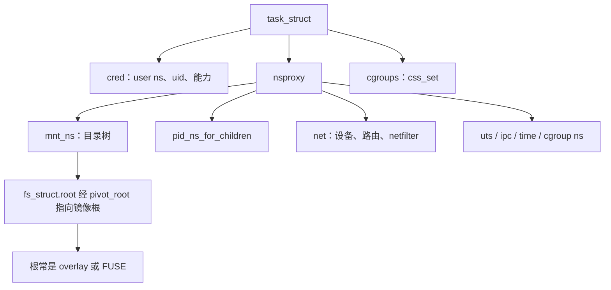

# 1. 总览

**结论**：容器在内核里是四段指针换掉之后的普通进程。`clone`/`unshare` 换命名空间，cgroup 把 `css_set` 钉到一棵限额树上，`pivot_root` 把 `fs_struct->root` 换成镜像根，net ns 让套接字和网卡只看见这一份 `struct net`。内核没有单独的容器对象。

> 主路径锚点：`kernel/nsproxy.c` 的 `copy_namespaces`（`:151`）与 `setns`（`:546`），`fs/namespace.c` 的 `pivot_root`（`:4276`），`kernel/cgroup/cgroup.c` 的 `cgroup_css_set_fork`（`:6435`）。用户态把这些串起来的是 runc v1.5.2，见 [09](./09-runc-create-path.md)。

---

## 1.1 一张总图



读图时抓住四件事：

1. **user ns 不在 `nsproxy` 里**。它挂在 `cred->user_ns`（`include/linux/cred.h:138`）。新 user ns 里的 `CAP_SYS_ADMIN` 只在这个 ns 及其子 ns 里算数，`cap_capable` 沿 parent 链往上走（`security/commoncap.c:66`）。
2. **pid ns 和 time ns 对调用者本人滞后**。`nsproxy->pid_ns_for_children` 和 `time_ns_for_children` 决定孩子看见的层。调用者自己的 pid 层看 `task_active_pid_ns()`。所以 `unshare(CLONE_NEWPID)` 之后必须再 `fork`，孩子才是新层的 1 号。细节在 [04](./04-pid-user-uts-ipc-time-ns.md)，号的分配在 [process-management/03](../process-management/03-pid-namespaces.md)。
3. **cgroup 限额和 cgroup 命名空间是两回事**。限额在 `css_set`。`CLONE_NEWCGROUP` 只改 `/proc/self/cgroup` 的路径起点。控制器怎么记账见 [cgroup/](../cgroup/README.md)，本章 [06](./06-cgroup-in-containers.md) 只写容器创建时怎么挂上去。
4. **网络虚拟化在本章停在「对象属于哪个 `struct net`」**。veth 的对端、bridge 的 FDB、CNI 插件怎么配地址，在 [networking/11](../networking/11-netns-veth-bridge.md)。[05](./05-net-ns.md) 只点到 `copy_net_ns` 和 `dev_change_net_namespace`。

---

## 1.2 和已有章怎么接

| 本章写到哪 | 别章接着写 |
|---|---|
| `copy_namespaces` 按 `CLONE_NEW*` 拆 `nsproxy` | `copy_process` 的第 14 步就是它：[process-management/04](../process-management/04-fork-clone.md) |
| 容器内外 PID 不同，是因为 `struct pid` 的 `numbers[]` | `upid`、`alloc_pid`：[process-management/03](../process-management/03-pid-namespaces.md) |
| `CLONE_INTO_CGROUP` 在 fork 曝光前定好 `css_set` | 函数体与委托文件表：[cgroup/04](../cgroup/04-lifecycle-hooks.md)、[cgroup/03](../cgroup/03-hierarchy-control.md) |
| `pivot_root` 要求新旧根都是挂载点，且父挂载不能是 shared | 传播四态与 `struct mount`：[vfs/07](../vfs/07-mount-and-ns.md) |
| overlay 通过 `d_real` / 自己的 inode 把名字落到 upper 或 lower | VFS 的 `dentry`/`inode`：[vfs/02](../vfs/02-core-objects.md)。VFS 章把 copy-up 留到这里 |
| FUSE 的 `read_iter` 把请求放进 `fuse_iqueue`，守护进程从 `/dev/fuse` 读走 | 页缓存仍可能夹在中间：[memory-management/08](../memory-management/08-page-cache-and-writeback.md) |
| 进入容器前丢掉的能力、挂上的 seccomp | 完整信号与 ptrace：[process-management/09](../process-management/09-signals.md)。本章 [10](./10-seccomp-caps-lsm.md) 只写容器常用的收紧 |

---

## 1.3 一条创建时间线（内核侧）

runc 的用户态顺序在 [09](./09-runc-create-path.md)。内核侧每次系统调用落在这些函数上：

```text
unshare / clone                         kernel/fork.c ksys_unshare :3394
                                        kernel/nsproxy.c copy_namespaces :151
  user ns 先建在新 cred 上               kernel/user_namespace.c create_user_ns :82
  其余 ns 由 create_new_namespaces 按序复制 :67
setns                                   kernel/nsproxy.c :546
mount / mount_setattr                   见 vfs/07。容器在新 mnt ns 里再挂 proc、sysfs、bind
pivot_root                              fs/namespace.c :4276
写 cgroup.procs 或 clone3 CLONE_INTO_CGROUP
                                        cgroup/04 已写；本章 06 只对容器用法
execve                                  进程章 06。seccomp 在这之前装上，能力在这之前丢掉
```

`copy_namespaces` 在没有 `CLONE_NEWNS|CLONE_NEWUTS|CLONE_NEWIPC|CLONE_NEWPID|CLONE_NEWNET|CLONE_NEWCGROUP|CLONE_NEWTIME` 时只给旧 `nsproxy` 加引用（`nsproxy.c:157`）。`CLONE_NEWUSER` 不在这张掩码里：user ns 走 `copy_creds` / `unshare_userns`，不走 `create_new_namespaces`。

---

## 1.4 关键函数表（总览级）

| 文件 | 符号 | 行号 | 作用 |
|---|---|---|---|
| `kernel/nsproxy.c` | `copy_namespaces` | 151 | fork 时共享或拆开 `nsproxy` |
| `kernel/nsproxy.c` | `create_new_namespaces` | 67 | 按标志复制 mnt/uts/ipc/pid/cgroup/net/time |
| `kernel/fork.c` | `ksys_unshare` | 3394 | 当前任务拆开共享资源 |
| `kernel/nsproxy.c` | `setns` | 546 | 用 nsfs fd 或 pidfd 加入已有 ns |
| `fs/namespace.c` | `copy_mnt_ns` | 3849 | `CLONE_NEWNS` 时复制挂载树 |
| `fs/namespace.c` | `pivot_root` | 4276 | 换当前 mnt ns 的根 |
| `kernel/user_namespace.c` | `create_user_ns` | 82 | 新建 user ns |
| `net/core/net_namespace.c` | `copy_net_ns` | 495 | `CLONE_NEWNET` |
| `kernel/cgroup/cgroup.c` | `cgroup_css_set_fork` | 6435 | `CLONE_INTO_CGROUP` |
| `fs/overlayfs/copy_up.c` | `ovl_maybe_copy_up` | 1179 | 写打开时把 lower 抄到 upper |
| `fs/fuse/dev.c` | `fuse_simple_request` | 485 | 同步 FUSE 请求 |

---

## 1.5 本章覆盖 / 不覆盖

| 覆盖 | 不覆盖 |
|---|---|
| 八种命名空间的对象和进入规则 | `task_struct` 全字段、调度选人 |
| `pivot_root` 与 mount ns 复制时把 shared 降成 slave | 新挂载 API 的 `fs_context` 全表（vfs/07） |
| user ns 的映射、一次写入、`setgroups` | 完整 `kuid` 在每个文件系统里的 idmap 挂载手册 |
| overlay copy-up / whiteout / opaque，FUSE 队列 | 具体镜像格式（OCI tar）的用户态解包 |
| runc v1.5.2 的 nsexec 与 init | 其它运行时，以及 containerd 的 shim 协议 |
| seccomp 过滤器、能力五集合、LSM 的 proc 属性入口 | 各发行版的策略文件 |

---

**导航**：[章节目录](./README.md) · [命名空间 →](./02-namespaces.md)
