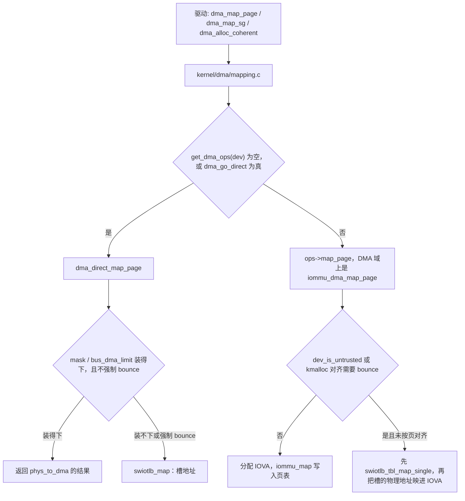

# 1. 总览

**结论**：CPU 用虚拟地址访问内存，内核用物理地址管理页，设备 DMA 用 `dma_addr_t`；6.6 里这个设备地址要么由 `dma_direct_map_page` 从物理地址换算（必要时换成 SWIOTLB 槽的地址），要么由 `iommu_dma_map_page` 分配一段 IOVA 再写入 IOMMU 页表。IOMMU 硬件在场，并不表示每台设备都走翻译域。

> 块层把 `bio` 收成 scatterlist 之后才碰到本章，见 [block-io/13](../block-io/13-nvme-walkthrough.md) 里的 `dma_map_sgtable`。网卡 ring 的填法在驱动里，网络章停在 skb / NAPI。

C 新手把一次磁盘读看成三次改名。页缓存里的 folio 有内核虚拟地址。`page_to_phys` 给出 CPU 物理地址。驱动调用 DMA API 之后，写进 NVMe PRP 或网卡描述符的是 `dma_addr_t`。设备按这个数发总线事务。中间有没有 IOMMU，决定这个数是「换算过的物理地址」还是「页表里的 IOVA」。

---

## 1.1 三种地址

| 名字 | 谁用 | 6.6 里对应的类型 |
|---|---|---|
| CPU 虚拟地址 | load/store、`virt_to_page` | 指针。`dma_map_single` 要求它落在直接映射里，vmalloc 地址会被拒绝（`include/linux/dma-mapping.h:331`） |
| CPU 物理地址 | 页分配器、`page_to_phys` | `phys_addr_t` |
| DMA / 总线地址 | 设备描述符、IOMMU 的输入地址 | `dma_addr_t`（`include/linux/types.h:149`） |

`include/linux/dma-mapping.h:65` 的注释写明：`dma_addr_t` 可以装下本平台任何合法的 DMA 或总线地址，它属于某一台设备，CPU 物理地址空间和总线地址空间之间可以有一层翻译。

direct 这条路径的名字来自 `kernel/dma/direct.c` 文件头：不用 IOMMU 把物理内存映出去。映出去的数仍经过 `phys_to_dma`。x86 与 arm64 没有 `select ARCH_HAS_PHYS_TO_DMA`（选这个符号的是 mips 和 powerpc，`arch/Kconfig:1333`），所以走通用函数（`include/linux/dma-direct.h:72`）：有 `dev->dma_range_map` 时先按区间减 `offset`，再 `__sme_set` 加上内存加密位。偏移是 0、也没有加密位时，DMA 地址才和物理地址相同。

---

## 1.2 三条组合，不是三套并列 ops

读图时抓住三件事：

1. **选路看 `dev->dma_ops`，不看「机器有没有 IOMMU」。** `get_dma_ops`（`include/linux/dma-map-ops.h:90`）在 `CONFIG_DMA_OPS` 下返回 `dev->dma_ops`，否则返回 `NULL`。`dma_map_page_attrs`（`kernel/dma/mapping.c:147`）在 `dma_map_direct` 为真时调用 `dma_direct_map_page`，否则调用 `ops->map_page`。
2. **SWIOTLB 插在两条路的里面。** 直接映射里，`dma_direct_map_page`（`kernel/dma/direct.h:84`）在强制 bounce、地址超出 `dma_capable`、或 kmalloc 缓冲需要对齐时调用 `swiotlb_map`。IOMMU 的 DMA 域里，`dev_use_swiotlb`（`drivers/iommu/dma-iommu.c:524`）在设备 `untrusted` 或同样的 kmalloc 条件成立时，先把数据拷进槽，再把槽映射成 IOVA。6.6 的通用路径没有一张名叫 swiotlb 的 `dma_map_ops`。x86 Xen 是例外：`pci_xen_swiotlb_init` 把全局 `dma_ops` 设成 `xen_swiotlb_dma_ops`（`arch/x86/kernel/pci-dma.c:88`）。
3. **IOMMU 开着，设备仍可能走 direct。** `iommu_setup_dma_ops`（`drivers/iommu/dma-iommu.c:1645`）只有 `iommu_is_dma_domain` 为真才把 `dev->dma_ops` 设成 `&iommu_dma_ops`。identity 域的类型是 `__IOMMU_DOMAIN_PT`（`include/linux/iommu.h:86`），`iommu_is_dma_domain`（`:116`）看的是 `__IOMMU_DOMAIN_DMA_API` 这一位，identity 没有这一位。VT-d 的 `intel_iommu_probe_finalize`（`drivers/iommu/intel/iommu.c:4473`）先 `set_dma_ops(dev, NULL)`，再调用 `iommu_setup_dma_ops`。identity 设备因此留在 direct。

IOMMU 关掉，也不等于每次映射都 bounce。x86 的 `pci_swiotlb_detect`（`arch/x86/kernel/pci-dma.c:44`）在 `no_iommu` 为真时不会因为内存超过 32 位地址而打开 SWIOTLB；`iommu=off` 会把 `no_iommu` 设为 1（`:123`）。池存在时，direct 仍然只在 `dma_capable` 失败或强制 bounce 时才进槽（`kernel/dma/direct.h:91`）。

---

## 1.3 和已经写过的章怎么接

| 问题 | 去哪 |
|------|------|
| folio 的物理页从哪来 | [memory-management/02](../memory-management/02-physical-layout.md)。`dma_alloc_coherent` 在需要重映射时可能落到 vmalloc，标志位 `VM_DMA_COHERENT` 在 [memory-management/05](../memory-management/05-vmalloc-and-kernel-va.md) |
| `bio` 怎样变成 scatterlist | `blk_rq_map_sg`（`include/linux/blk-mq.h:1149`）在块层。本章从这张表已经填好 `page` / `offset` / `length` 之后写起 |
| NVMe 提交队列何时调用 `dma_map_sgtable` | [block-io/13](../block-io/13-nvme-walkthrough.md) §13.2。PRP/SGL 的填法留在那里 |
| 网卡描述符里的 DMA 地址谁填 | 驱动自己的 `dma_map_page` / `dma_map_single`。skb 与 NAPI 见 [networking/](../networking/README.md) |
| VT-d 怎样重映射 MSI | [interrupts/05](../interrupts/05-irqdomain-hierarchy-and-matrix.md)。`dmar_fault` 里中断重映射 fault 和 DMA fault 是同一条 IRQ 的两个打印，数据页表在 [08](./08-page-tables.md) |

---

## 1.4 本章写到哪

写：`dma_addr_t` 的来历，coherent 与 streaming 的所有权和屏障，ops 分发，direct 与 SWIOTLB 的真实条件，scatterlist 的 nents 契约，IOMMU group / domain / 页表 / IOTLB，dma-iommu 的 default domain，VFIO type1 与 iommufd 在 6.6 里把映射留在内核的方式，fault 与 ACS 的边界，以及能在 tracefs / debugfs / sysfs 里对上的观测点。

不写：dmaengine channel、GPU/HMM、完整固件表、vIOMMU、KVM 与 virtio 队列、网络 ring 和块层调度。

*笔记生成对照源码：Linux v6.6.160。内核树不放进本仓库。*

**导航**：[目录](./README.md) · [一致与流式映射 →](./02-dma-address.md)
