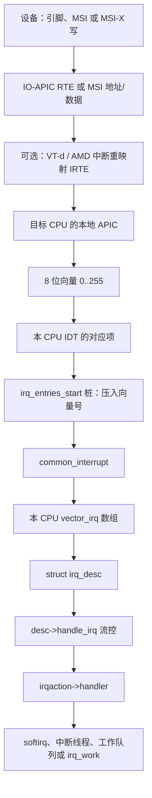

# 1. 总览

**结论**：一次设备中断是「硬件把一个 8 位向量送进这颗 CPU → IDT 跳到 `common_interrupt` → 用向量查出 `irq_desc` → 流控函数调用驱动注册的 `irqaction` → 重活推迟到 softirq 或内核线程」。

> 主路径锚点：`arch/x86/kernel/irq.c` 的 `common_interrupt`（`:249`），genirq 流控在 `kernel/irq/chip.c`。

---

## 1.1 一张总图

x86-64 上，Linux IRQ 号和 CPU 向量是两层编号。驱动看到的是 IRQ 号；CPU 硬件只认识向量。



读图时抓住三件事：

1. **向量是每 CPU 的**。同一向量号在 CPU0 和 CPU1 上可以指向不同的 `irq_desc`。数组是 `vector_irq`，`DEFINE_PER_CPU(vector_irq_t, vector_irq)` 在 `arch/x86/kernel/irqinit.c:49`。向量域把描述符写进去的地方是 `apic_update_vector`（`arch/x86/kernel/apic/vector.c:185`）。
2. **`irq_desc` 是全机一份逻辑中断**。它里面嵌着 `irq_data`，`irq_data` 可以串成父子链（向量域在最底下）。
3. **硬中断里只做短活**。驱动返回 `IRQ_WAKE_THREAD`，或者自己 `raise_softirq`，把重活挪走。

---

## 1.2 和别的章怎么接

| 本章写到哪 | 别章接着写 |
|---|---|
| 硬中断入口、`irq_enter_rcu` | 调度器何时 `__schedule`：scheduler/01 |
| `spin_lock` 必须在关中断下拿 | 锁的种类：locks-and-ds/05 |
| 中断栈是独立的内核栈 | 栈从哪 `vmalloc`：memory-management/05 |
| `RESCHEDULE_VECTOR` 只是一记 IPI | 选谁跑：scheduler/03 |

硬中断上下文里不能睡眠。睡眠会走到调度器，而调度器假定「当前不是在打断别人」。所以 `request_irq` 注册的主处理函数里不能 `mutex_lock`，不能 `kmalloc(GFP_KERNEL)`。要睡觉就用中断线程或工作队列，见 [09](./09-deferred-work-choice.md)。

---

## 1.3 两条时间线

**注册**（开机或驱动 probe，进程上下文，可以睡觉）：

```text
pci_alloc_irq_vectors          drivers/pci/msi/api.c:234
  -> 分配 Linux IRQ 号和 irq_desc
  -> 在域层次上申请 IRTE、向量（或先占位）
request_threaded_irq           kernel/irq/manage.c:2145
  -> 挂上 irqaction，按需创建线程，unmask 硬件
```

**到来**（任意上下文被打断，中断关闭进入）：

```text
CPU 收到向量
  -> irq_entries_start 桩          arch/x86/include/asm/idtentry.h:536
  -> common_interrupt              arch/x86/kernel/irq.c:249
  -> generic_handle_irq_desc       include/linux/irqdesc.h:159
  -> handle_edge_irq / handle_fasteoi_irq / ...
  -> 驱动 handler
  -> irqentry_exit 时可能抢占或跑 softirq
```

分配失败的返回值集中在 [07](./07-irq-alloc-failure.md)。到来路径的汇编和 RCU 在 [02](./02-x86-entry.md)。

---

## 1.4 关键函数表（总览级）

| 文件 | 符号 | 行号 | 作用 |
|---|---|---|---|
| `arch/x86/include/asm/idtentry.h` | `irq_entries_start` | 536 | 每个外部向量一个短桩，压入向量后跳 `asm_common_interrupt` |
| `arch/x86/kernel/irq.c` | `common_interrupt` | 249 | 设备中断 C 入口 |
| `include/linux/irqdesc.h` | `generic_handle_irq_desc` | 159 | 调用 `desc->handle_irq` |
| `kernel/irq/chip.c` | `handle_fasteoi_irq` | 687 | 电平 / MSI 常用流控 |
| `kernel/irq/handle.c` | `handle_irq_event` | 202 | 跑 `irqaction` 链 |
| `kernel/irq/manage.c` | `request_threaded_irq` | 2145 | 驱动注册处理函数 |
| `kernel/softirq.c` | `irq_enter_rcu` / `irq_exit_rcu` | 618 / 671 | 进出硬中断记账，出口拉 softirq |
| `drivers/pci/msi/api.c` | `pci_alloc_irq_vectors` | 234 | PCI 驱动申请一组中断 |

---

## 1.5 本章覆盖 / 不覆盖

| 覆盖 | 不覆盖 |
|---|---|
| x86-64 设备中断、IPI 向量名字、genirq 对象 | 32 位 x86 的栈切换细节（`irq_32.c` 只点到） |
| MSI/MSI-X 与 IO-APIC 如何汇合到向量域 | 每个网卡驱动的队列算法 |
| 向量耗尽怎么查 | 伪造一份 `/proc/interrupts` 数字 |

---

**导航**：[章节目录](./README.md) · [入口 →](./02-x86-entry.md)
