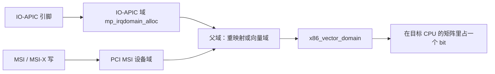

# 3. APIC 与向量布局

**结论**：x86-64 把 256 个向量分成「0–31 异常、32 起外部中断、`LOCAL_TIMER_VECTOR`（`0xec`）起系统向量」。设备中断只在 `[FIRST_EXTERNAL_VECTOR, FIRST_SYSTEM_VECTOR)` 里申请；本地 APIC 负责收下向量，IO-APIC 或 MSI 负责把设备的信号变成这条向量。

> 常量全在 `arch/x86/include/asm/irq_vectors.h`。LAPIC 编程在 `arch/x86/kernel/apic/apic.c`，IO-APIC 在 `io_apic.c`，MSI 消息在 `arch/x86/kernel/apic/msi.c`。

---

## 3.1 256 项怎么切

下面的数是头文件里的宏，不是某台机器 `/proc/interrupts` 的计数。开了 `CONFIG_X86_LOCAL_APIC` 时（x86-64 服务器内核如此）`FIRST_SYSTEM_VECTOR` 等于 `LOCAL_TIMER_VECTOR`。

| 范围 | 宏 | 值 | 谁用 |
|---|---|---|---|
| 0–31 | （异常，注释 `:18`） | — | 缺页、通用保护等，不进向量分配器 |
| 外部起点 | `FIRST_EXTERNAL_VECTOR` | `0x20`（`:36`） | 设备向量窗口的下界，含在窗口内 |
| ISA 固定公式 | `ISA_IRQ_VECTOR(irq)` | `((0x20+16)&~15)+irq` = `0x30+irq`（`:44`） | IRQ0–15 的旧 PIC 向量 `0x30`–`0x3f` |
| `int 0x80` | `IA32_SYSCALL_VECTOR` | `0x80`（`:38`） | 仅当编进 `def_idts[]`（要 `CONFIG_IA32_EMULATION` 或 32 位）才占 IDT |
| 本地定时器 | `LOCAL_TIMER_VECTOR` | `0xec`（`:100`） | 系统向量下界 |
| 系统起点 | `FIRST_SYSTEM_VECTOR` | `LOCAL_TIMER_VECTOR`（`:105`） | 矩阵分配的上界，**不含**这一项 |
| 向量总数 | `NR_VECTORS` | 256（`:102`） | |
| 外部窗口宽度 | `NR_EXTERNAL_VECTORS` | `FIRST_SYSTEM_VECTOR - FIRST_EXTERNAL_VECTOR`（`:110`） | `0xec - 0x20 = 0xcc`（十进制 204） |
| 系统侧宽度 | `NR_SYSTEM_VECTORS` | `NR_VECTORS - FIRST_SYSTEM_VECTOR`（`:111`） | `256 - 0xec = 20` |

没编 `CONFIG_X86_LOCAL_APIC` 时 `FIRST_SYSTEM_VECTOR` 改成 `NR_VECTORS`（`:107`），外部窗口一直拉到 256。x86-64 正常配置不会走这条。

窗口宽度 204 **不是**「每 CPU 还能再分 204 个设备中断」。矩阵还会扣掉落在窗口里的系统位和已分配位，见 [05](./05-irqdomain-hierarchy-and-matrix.md) 和 [07](./07-irq-alloc-failure.md)。

---

## 3.2 系统向量表

这些宏都在 `irq_vectors.h`。`idt.c` 的 `apic_idts[]`（`:129`）把其中一批装进 IDT，并 `set_bit` 到 `system_vectors`（`arch/x86/kernel/traps.c:79` 声明的位图）。

| 向量 | 宏 | 值 | 条件 |
|---|---|---|---|
| 伪中断 | `SPURIOUS_APIC_VECTOR` | `0xff` | `:54`，低 4 位必须是 `0xF` |
| APIC 错误 | `ERROR_APIC_VECTOR` | `0xfe` | `:62` |
| 重调度 IPI | `RESCHEDULE_VECTOR` | `0xfd` | `:63`，`CONFIG_SMP` 才进 `apic_idts` |
| 广播函数调用 | `CALL_FUNCTION_VECTOR` | `0xfc` | `:64` |
| 单播函数调用 | `CALL_FUNCTION_SINGLE_VECTOR` | `0xfb` | `:65` |
| 温度 | `THERMAL_APIC_VECTOR` | `0xfa` | `:66`，`CONFIG_X86_THERMAL_VECTOR` |
| MCE 阈值 | `THRESHOLD_APIC_VECTOR` | `0xf9` | `:67`，`CONFIG_X86_MCE_THRESHOLD` |
| 重启 IPI | `REBOOT_VECTOR` | `0xf8` | `:68` |
| 平台 IPI | `X86_PLATFORM_IPI_VECTOR` | `0xf7` | `:73` |
| irq_work | `IRQ_WORK_VECTOR` | `0xf6` | `:78`，`CONFIG_IRQ_WORK` |
| （空） | 注释：曾经是 UV BAU | `0xf5` | `:80`，本版没有宏 |
| AMD 延迟错误 | `DEFERRED_ERROR_VECTOR` | `0xf4` | `:81`，`CONFIG_X86_MCE_AMD` |
| Hypervisor 回调 | `HYPERVISOR_CALLBACK_VECTOR` | `0xf3` | `:84` |
| KVM posted | `POSTED_INTR_VECTOR` | `0xf2` | `:88`，`CONFIG_HAVE_KVM` |
| KVM posted 唤醒 | `POSTED_INTR_WAKEUP_VECTOR` | `0xf1` | `:89` |
| KVM posted 嵌套 | `POSTED_INTR_NESTED_VECTOR` | `0xf0` | `:90` |
| 托管中断关闭占位 | `MANAGED_IRQ_SHUTDOWN_VECTOR` | `0xef` | `:93` |
| Hyper-V | `HYPERV_REENLIGHTENMENT_VECTOR` / `HYPERV_STIMER0_VECTOR` | `0xee` / `0xed` | `:96`，`CONFIG_HYPERV` |
| 本地定时器 | `LOCAL_TIMER_VECTOR` | `0xec` | `:100` |

`MANAGED_IRQ_SHUTDOWN_VECTOR` 不在 `apic_idts[]` 里。向量域在「托管中断还没有在线 CPU」时把描述符指到这个向量（`vector_assign_managed_shutdown`，`vector.c:188`），避免误投到一条真的设备向量。

`alloc_intr_gate`（`idt.c:333`）拒绝 `n < FIRST_SYSTEM_VECTOR`。运行中追加的系统门只能落在系统区。

---

## 3.3 本地 APIC 与 x2APIC

本地 APIC 是每 CPU 一块，负责收中断、发 IPI、跑本地定时器。`apic.c` 里和本章有关的入口：

| 函数 | 行号 | 作用 |
|---|---|---|
| `native_apic_icr_write` / `native_apic_icr_read` | 244 / 254 | 写/读中断命令寄存器，用来发 IPI |
| `__setup_APIC_LVTT` | 307 | 编程本地向量表的定时器项 |
| `lapic_next_event` / `lapic_next_deadline` | 445 / 452 | 一次性时钟事件：计数或 TSC-deadline |
| `setup_local_APIC` | 1537 | 启动本 CPU 的 LAPIC |
| `setup_APIC_timer` | 604 | 注册 per-CPU clockevent |
| `enable_IR_x2apic` | 1937 | 先开中断重映射，再开 x2APIC |
| `__x2apic_enable` / `__x2apic_disable` | 1766 / 1750 | 翻 `IA32_APICBASE` 里的 x2APIC 位 |
| `x2apic_phys` 相关的 `try_to_enable_x2apic` | 1864 | 没有 IR 时只能用物理目标、且 APIC ID 有限制 |

x2APIC 把 APIC ID 加宽，MSI 地址里的目标 ID 也变长。`__irq_msi_compose_msg`（`apic.c:2479`）按当前模式填 MSI 消息。中断重映射打开时，消息里写的往往是 IRTE 索引，而不是最终的 APIC ID；重映射硬件再改写。见 [05](./05-irqdomain-hierarchy-and-matrix.md)。

关掉 LAPIC 的命令行是 `nolapic`（`apic.c:2803` 的 `setup_nolapic`）。本章排障不靠它，它会让整条 APIC 中断链消失。

---

## 3.4 IO-APIC

IO-APIC 把老的引脚（GSI）编成一条重定向表项（RTE）：向量、目标 APIC ID、触发电平、屏蔽位。一张 IO-APIC 有多条引脚，机器上可以有多张。

| 函数 | 行号 | 作用 |
|---|---|---|
| `mp_register_ioapic` | `io_apic.c:2819` | 登记一张 IO-APIC 的基址和 GSI 范围 |
| `mp_map_pin_to_irq` | `:1013` | 引脚 → Linux IRQ |
| `mp_irqdomain_alloc` | `:3006` | IO-APIC 域的 `alloc`：向父域要向量 |
| `ioapic_set_affinity` | `:1908` | 改 RTE 的目标 CPU |
| `ioapic_ack_level` | `:1768` | 电平中断的确认 |
| `setup_IO_APIC` | `:2385` | 启动时把引脚接上 |
| `parse_noapic` | `:195` | 命令行 `noapic`（`early_param` 在 `:201`） |

IO-APIC 的 irqdomain 父指针最终是向量域，或者中间再夹一层重映射域。引脚号是硬件号（`hwirq`），Linux IRQ 号是另一套。

旧 PIC 仍可能存在。`PIC_CASCADE_IR` 是 2（`arch/x86/include/asm/i8259.h:26`），从第一片 8259 级联到第二片。有 IO-APIC 时这个级联向量仍被标成系统向量，避免矩阵把它分给设备（`lapic_assign_system_vectors`，`vector.c:775`）。

---

## 3.5 MSI 与 MSI-X

MSI 不用引脚。设备对一个特殊的物理地址做一次写，写的数据里带着向量号。CPU 的芯片组把这次写变成中断。

| | MSI | MSI-X |
|---|---|---|
| 能力结构 | `PCI_CAP_ID_MSI` | `PCI_CAP_ID_MSIX` |
| 最多几条 | `pci_msi_vec_count`（`drivers/pci/msi/msi.c:482`）读 Multiple Message Capable，返回 2 的幂，最大 32 | `pci_msix_vec_count`（`drivers/pci/msi/api.c:71`） |
| 表在哪 | 能力结构内部 | 设备 BAR 里的一张表，一项一个地址/数据/控制 |
| 掩码 | 不一定有 per-vector mask | 每一项都能单独 mask |

`pci_msix_vec_count` 读 `PCI_MSIX_FLAGS`，再交给：

```c
/* drivers/pci/msi/msi.h:6 */
#define msix_table_size(flags)	((flags & PCI_MSIX_FLAGS_QSIZE) + 1)
```

表大小字段是「条数减 1」，所以要加 1。这就是 `lspci -vv` 里 MSI-X `Count` 的同一个配置字。命令本身是用户态工具，见 [07](./07-irq-alloc-failure.md) 的 RECIPE。

x86 上消息内容由 `__irq_msi_compose_msg`（`apic.c:2479`）填写，MSI 域在激活时调用芯片的 `irq_compose_msi_msg`。层次在 [05](./05-irqdomain-hierarchy-and-matrix.md)。

`NR_IRQS`（`irq_vectors.h:129`）在同时打开 `CONFIG_X86_IO_APIC` 和 `CONFIG_PCI_MSI` 时取

```text
NR_VECTORS + max(64 * NR_CPUS, 32 * MAX_IO_APICS)
```

这是描述符数组的编译期上限量级，不是每 CPU 向量数。运行时的 `nr_irqs` 还会被 `arch_probe_nr_irqs` 再砍一刀，见 [07](./07-irq-alloc-failure.md)。

---

## 3.6 从设备到向量（对照）



IO-APIC 和 MSI 的差别停在「谁把消息写进硬件」。往下都要在向量域里拿到一个没被占用的向量。

---

**导航**：[← 入口](./02-x86-entry.md) · [目录](./README.md) · [对象 →](./04-genirq-objects.md)
