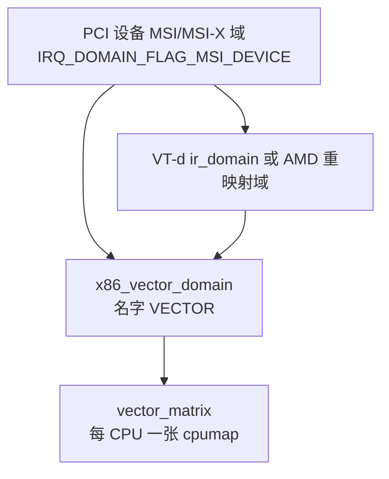

# 5. 层次域与向量矩阵

**结论**：x86 上一条 MSI 中断通常是「设备域 →（可选）重映射域 → 向量域」。向量域不保存「第几号向量」的全局表，而是用每 CPU 一张位图（`struct irq_matrix`）在 `[FIRST_EXTERNAL_VECTOR, FIRST_SYSTEM_VECTOR)` 里占一个空位。

> 向量域：`arch/x86/kernel/apic/vector.c`。矩阵：`kernel/irq/matrix.c`。`IRQ_MATRIX_BITS` 在 x86 上等于 `NR_VECTORS`（`arch/x86/include/asm/hw_irq.h:19`）。

---

## 5.1 层次长什么样



没有中断重映射时，设备域的父就是向量域。`native_create_pci_msi_domain`（`arch/x86/kernel/apic/msi.c:268`）给 `x86_vector_domain` 加上 `IRQ_DOMAIN_FLAG_MSI_PARENT` 和 `x86_vector_msi_parent_ops`，然后返回这个域本身。`x86_create_pci_msi_domain`（`:278`）把它记成默认 PCI MSI 域。

有 VT-d 时，每个 IOMMU 建一个层次域，父域来自 `arch_get_ir_parent_domain()`（`drivers/iommu/intel/irq_remapping.c:558`）。分配时 `intel_irq_remapping_alloc`（`:1309`）先 `irq_domain_alloc_irqs_parent`（向向量域要 IRQ），再 `alloc_irte` 占一条 IRTE。AMD 的路径在 `drivers/iommu/amd/iommu.c`，失败时打印同一句 `Failed to allocate IRTE`（`:3460`）。

`x86_init_dev_msi_info`（`msi.c:206`）看父域的 `bus_token`：`DOMAIN_BUS_ANY` 表示父就是向量域；`DOMAIN_BUS_DMAR` / `DOMAIN_BUS_AMDVI` 表示中间有重映射。设备域的流控被设成 `handle_edge_irq`，名字 `"edge"`（`:257`）。

---

## 5.2 向量域私有数据

```c
/* arch/x86/include/asm/hw_irq.h:90
 * 芯片真正写进 APIC/MSI 的那两个数。
 */
struct irq_cfg {
	unsigned int		dest_apicid;   /* 目标 APIC ID */
	unsigned int		vector;        /* 向量号 */
};
```

```c
/* arch/x86/kernel/apic/vector.c:26
 * 放在 irq_data.chip_data 里。
 */
struct apic_chip_data {
	struct irq_cfg		hw_irq_cfg;    /* 嵌进去的目标+向量 */
	unsigned int		vector;        /* 当前向量 */
	unsigned int		prev_vector;   /* 迁移中的旧向量 */
	unsigned int		cpu;
	unsigned int		prev_cpu;
	unsigned int		irq;
	struct hlist_node	clist;         /* 挂在旧 CPU 的清理链表上 */
	unsigned int		move_in_progress	: 1,
				is_managed		: 1,
				can_reserve		: 1,
				has_reserved		: 1;
};
```

`irqd_cfg()`（`hw_irq.h:96` 声明）从 `irq_data` 取出 `irq_cfg`。迁移时旧向量不能立刻释放：中断可能还在旧 CPU 上。`prev_vector` 非 0 表示这条旧向量还活着，清理走 `vector_schedule_cleanup`（`vector.c:1045`）。

分配参数：

```c
/* arch/x86/include/asm/hw_irq.h:75 */
struct irq_alloc_info {
	enum irq_alloc_type	type;     /* IOAPIC / PCI_MSI / PCI_MSIX 等 */
	u32			flags;
	u32			devid;
	irq_hw_number_t		hwirq;
	const struct cpumask	*mask;    /* 调用方指定的目标，可为 NULL */
	struct msi_desc		*desc;
	void			*data;
	union {
		struct ioapic_alloc_info	ioapic;
		struct uv_alloc_info		uv;
	};
};
```

`init_irq_alloc_info`（`vector.c:74`）把整块清零，只留下 `mask`。

---

## 5.3 `irq_matrix` 与 `cpumap`

矩阵是「位号 = 向量号」的每 CPU 位图。搜索范围在创建时钉死。

```c
/* kernel/irq/matrix.c:13 */
struct cpumap {
	unsigned int		available;          /* 这颗 CPU 上还能分的位数 */
	unsigned int		allocated;          /* alloc_map 里已置位的个数 */
	unsigned int		managed;            /* 托管保留了多少位 */
	unsigned int		managed_allocated;  /* 其中已经真正分出去的 */
	bool			initialized;
	bool			online;
	unsigned long		alloc_map[IRQ_MATRIX_SIZE];   /* 已经分出的位 */
	unsigned long		managed_map[IRQ_MATRIX_SIZE]; /* 托管保留的位 */
};

/* kernel/irq/matrix.c:24 */
struct irq_matrix {
	unsigned int		matrix_bits;        /* 位图总宽，x86 传入 NR_VECTORS */
	unsigned int		alloc_start;        /* 搜索起点，含 */
	unsigned int		alloc_end;          /* 搜索终点，不含 */
	unsigned int		alloc_size;         /* alloc_end - alloc_start */
	unsigned int		global_available;   /* 所有在线 CPU 的 available 之和 */
	unsigned int		global_reserved;    /* 只记账、还没占具体位的预约 */
	unsigned int		systembits_inalloc; /* 落在搜索窗里的系统位个数 */
	unsigned int		total_allocated;
	unsigned int		online_maps;
	struct cpumap __percpu	*maps;
	unsigned long		scratch_map[IRQ_MATRIX_SIZE]; /* 搜索时的临时位图 */
	unsigned long		system_map[IRQ_MATRIX_SIZE];  /* 全机系统向量 */
};
```

`IRQ_MATRIX_SIZE` 是 `BITS_TO_LONGS(IRQ_MATRIX_BITS)`（`matrix.c:11`）。`irq_alloc_matrix`（`:49`）在 `matrix_bits > IRQ_MATRIX_BITS` 时返回 `NULL`。

向量域这样创建（`vector.c:810`）：

```c
vector_matrix = irq_alloc_matrix(NR_VECTORS, FIRST_EXTERNAL_VECTOR,
				 FIRST_SYSTEM_VECTOR);
```

因此：

```text
matrix_bits = 256
alloc_start = FIRST_EXTERNAL_VECTOR = 0x20
alloc_end   = FIRST_SYSTEM_VECTOR   = LOCAL_TIMER_VECTOR = 0xec
alloc_size  = NR_EXTERNAL_VECTORS   = 0xec - 0x20 = 204
```

`matrix_alloc_area`（`matrix.c:110`）在 `[alloc_start, alloc_end)` 里找连续的 0 位。它先把 `managed_map | system_map | alloc_map` 或进 `scratch_map`，所以这三类位都不会被再次分出。

---

## 5.4 三条分配路径

| 路径 | 函数 | 行号 | 什么时候 | 失败 |
|---|---|---|---|---|
| 系统位 | `irq_matrix_assign_system` | `matrix.c:181` | 启动时把 `system_vectors` 钉死 | 用 `BUG_ON`，不返回错误码 |
| 普通分配 | `irq_matrix_alloc` | `:377` | 非托管中断要一个具体向量 | `-EINVAL` 空掩码；`-ENOSPC` 没有在线 CPU 或窗口里没有空位 |
| 托管保留 | `irq_matrix_reserve_managed` | `:210` | 托管中断在掩码里的每颗 CPU 上预留 1 位 | 任一 CPU 失败则回滚并 `-ENOSPC`（`:236`） |
| 托管分配 | `irq_matrix_alloc_managed` | `:286` | 激活时从预留位里挑一颗 CPU | `-EINVAL` / `-ENOSPC`（`:297`、`:305`） |
| 只记账 | `irq_matrix_reserve` | `:346` | 允许「先占描述符、激活再拿向量」 | 不失败；超额时 `pr_warn("Interrupt reservation exceeds available resources\n")` |

`irq_matrix_alloc` 的选 CPU 规则在 `matrix_find_best_cpu`（`:129`）：在掩码里挑 **在线且 `available` 最大** 的 CPU。托管则是 `matrix_find_best_cpu_managed`（`:150`）：挑在线且 `managed_allocated` **最小** 的 CPU。

CPU 上线：`irq_matrix_online`（`:78`）把 `cm->available` 加进 `global_available`。第一次上线时

```text
cm->available = alloc_size - cm->managed - systembits_inalloc
```

（`:84`）。下线 `irq_matrix_offline`（`:99`）只减掉这颗 CPU 的 `available`，不释放已经分出去的位。

`irq_matrix_assign`（`:322`）用来标记「启动时已经占用」的位，例如遗留 ISA 向量。它会把 `available` 减 1。这和 `assign_system` 不同：系统位通过 `systembits_inalloc` 在上线时一次性扣掉，不进 `alloc_map`。

---

## 5.5 向量域怎么调用矩阵

`x86_vector_alloc_irqs`（`vector.c:542`）对每一条：

1. `apic_is_disabled` 则 `-ENXIO`（`:551`）。
2. `alloc_apic_chip_data` 失败则 `-ENOMEM`（`:568`）。
3. 装上 `lapic_controller`，置单目标、强制中断上下文、激活时才改亲和。
4. 遗留 IRQ 走 `vector_configure_legacy`（`:514`）：向量固定为 `ISA_IRQ_VECTOR(virq)`。
5. 其余走 `assign_irq_vector_policy`（`:310`）：
   - 托管：`reserve_managed_vector` → `irq_matrix_reserve_managed`。
   - `info->mask` 非空：立刻 `assign_irq_vector` → `irq_matrix_alloc`。
   - 否则：`reserve_irq_vector` → 只 `irq_matrix_reserve`，并把向量暂时设成 `MANAGED_IRQ_SHUTDOWN_VECTOR`。

真向量经常在 **activate** 时才落下。`x86_vector_activate`（`:455`）：

| 状态 | 动作 |
|---|---|
| 既不能预约也不是托管 | `assign_irq_vector_any_locked` |
| `reserve` 参数为真，或已经是托管关闭 | 再标一次关闭向量 |
| 托管 | `activate_managed` → `irq_matrix_alloc_managed` |
| 有预约 | `activate_reserved` → `assign_irq_vector_any_locked` |

`assign_irq_vector_any_locked`（`:281`）按「节点∩亲和 → 亲和∩在线 → 节点 → 全部在线」四档放宽。放宽到亲和之外时打印：

```text
irq %u: Affinity broken due to vector space exhaustion.
```

（`vector.c:424`）。托管激活失败的两句在 `:439` 和 `:449`：

```text
Managed startup for irq %u, but no CPU
Managed startup irq %u, no vector available
```

`lapic_assign_system_vectors`（`:768`）在 `irq_matrix_online` 之前把 `system_vectors` 里每一位 `assign_system`。落在 `[alloc_start, alloc_end)` 的位才会增加 `systembits_inalloc`（`matrix.c:195`）。随后若 `nr_legacy_irqs() > 1`，把级联 IRQ（`PIC_CASCADE_IR`，向量 `ISA_IRQ_VECTOR(2)` = `0x32`）也标成系统位。再把其余遗留 IRQ 在**当前 CPU** 上 `irq_matrix_assign`（`vector.c:782`）。

`lapic_update_legacy_vectors`（`:748`）在 `apic_bsp_setup` 末尾调用（`apic.c:2542`）。若编了 IO-APIC 且 `nr_ioapics > 0`，函数直接返回，不再把全部 ISA 向量改成系统位。

因此每 CPU 的「空闲向量」不是一个写死的整数。搜索窗是 `NR_EXTERNAL_VECTORS`（204），再减去落在窗里的系统位，再减去已经 `assign` / `alloc` / 托管保留的位。怎么从 debugfs 读这个数，见 [07](./07-irq-alloc-failure.md)。

---

## 5.6 重映射表的容量（和向量不是同一个池）

| 实现 | 宏 | 值 | 位置 |
|---|---|---|---|
| Intel VT-d | `INTR_REMAP_TABLE_ENTRIES` | 65536 | `drivers/iommu/intel/iommu.h:505` |
| AMD | `MAX_IRQS_PER_TABLE` | `1 << DTE_INTTABLEN_VALUE`，`DTE_INTTABLEN_VALUE` 是 9，即 512 | `drivers/iommu/amd/amd_iommu_types.h:300` |

Intel 的 `alloc_irte`（`irq_remapping.c:106`）在位图里 `bitmap_find_free_region`。失败时：

```text
IR%d: can't allocate an IRTE
```

（`:133`，`%d` 是 `iommu->seq_id`）。AMD 的 `alloc_irq_index` 扫到表尾把 `index` 设成 `-ENOSPC`（`iommu.c:3108`）。两条路径随后都可能再打印 `Failed to allocate IRTE`。

IRTE 耗尽和向量耗尽是两回事：IRTE 是 IOMMU 表项，向量是每 CPU 的 APIC 向量。设备多、开了重映射时两个池都会满。

---

## 5.7 关键函数表

| 文件 | 符号 | 行号 | 作用 |
|---|---|---|---|
| `arch/x86/kernel/apic/vector.c` | `arch_early_irq_init` | 793 | 创建 `VECTOR` 域和矩阵 |
| | `x86_vector_alloc_irqs` | 542 | 域的 `alloc` |
| | `x86_vector_activate` | 455 | 域的 `activate` |
| | `x86_vector_debug_show` | 616 | debugfs：无 `irqd` 时打印矩阵 |
| `arch/x86/kernel/apic/msi.c` | `native_create_pci_msi_domain` | 268 | 向量域兼任 MSI 父域 |
| `kernel/irq/matrix.c` | `irq_matrix_alloc` | 377 | 普通向量 |
| | `irq_matrix_alloc_managed` | 286 | 托管向量 |
| | `irq_matrix_reserve_managed` | 210 | 托管预留 |
| | `irq_matrix_debug_show` | 490 | 打印 Online/Global/每 CPU 位图 |
| `drivers/iommu/intel/irq_remapping.c` | `intel_irq_remapping_alloc` | 1309 | VT-d 分配 |
| | `alloc_irte` | 106 | IRTE 位图 |

---

**导航**：[← 对象](./04-genirq-objects.md) · [目录](./README.md) · [注册与流控 →](./06-request-and-flow.md)
