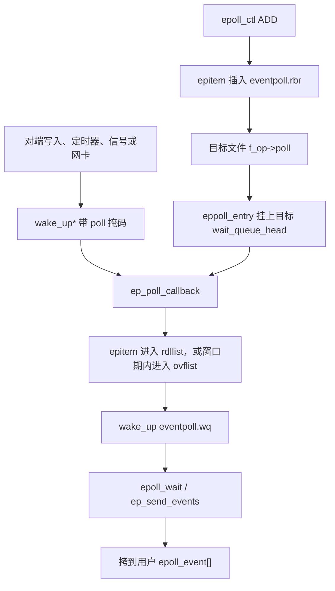

# 1. 总览与选型

**结论**：一个线程要等「许多文件里的任意一个就绪」，内核提供 select、poll、epoll 三条系统调用；进程之间传字节或传一次事件，则用 pipe、`AF_UNIX`、eventfd 这一类本身就实现了 `f_op->poll` 的文件。

> 主路径锚点：`fs/eventpoll.c` 的 `do_epoll_ctl`（`:2116`）和 `ep_poll_callback`（`:1133`）。等待队列的通用词汇在 [locks-and-ds/08](../locks-and-ds/08-wait-queue-and-completion.md)。

本章只建立选型。结构体字段在 [03](./03-epoll-objects.md)，注册和唤醒在 [04](./04-epoll-ctl-and-callback.md)，取事件在 [05](./05-epoll-wait-and-modes.md)。

---

## 1.1 两件不同的事

多路复用回答：这一排 fd 里，哪些现在可读、可写或出错。调用方阻塞在一次系统调用里，被唤醒后再去对那几个 fd 做 `read` / `write` / `accept`。

IPC 回答：字节或一次计数怎么从进程 A 到进程 B。pipe 和 `AF_UNIX` 搬字节，eventfd 搬一个 64 位计数，signalfd 把已挂起的信号变成一次读，timerfd 把到期变成一次读。它们都是文件，所以都能放进 epoll。

futex 不走这条文件路径。它等的是用户地址上的值，见 [locks-and-ds/09](../locks-and-ds/09-futex.md)。目录变化走 inotify / fanotify，见 [vfs/09](../vfs/09-locks-and-notify.md)。

---

## 1.2 选型

| 需求 | 首选 | 本章 |
|------|------|------|
| 一个线程盯大量网络 fd 或本地 fd | epoll | [03](./03-epoll-objects.md)–[05](./05-epoll-wait-and-modes.md) |
| fd 很少，而且每次集合都变 | poll，或 select | [02](./02-poll-select.md)。少量 fd 时 epoll 未必更便宜，见 [10](./10-perf-analysis.md) |
| 父子或线程之间传字节流 | `pipe2` | [06](./06-pipe.md)。带 `SCM_RIGHTS` 传 fd 时用 `AF_UNIX` |
| 同一台机器上的字节流或数据报，要传 fd | `socketpair` / `AF_UNIX` | [08](./08-unix-and-sysv.md) 只写 `unix_poll` |
| 跨线程或跨进程的计数事件 | eventfd | [07](./07-eventfd-signalfd-timerfd.md)。KVM irqfd 也消费它 |
| 把信号变成可读的 fd | signalfd | [07](./07-eventfd-signalfd-timerfd.md)，投递见 [process/09](../process-management/09-signals.md) |
| 把到期变成可读的 fd | timerfd | [07](./07-eventfd-signalfd-timerfd.md) |
| 用户态锁、条件变量的慢路径 | futex | [locks-and-ds/09](../locks-and-ds/09-futex.md)，本章不写 |
| 目录项的创建、删除、修改 | inotify | [vfs/09](../vfs/09-locks-and-notify.md)，本章不写 |
| 带优先级的消息队列，要一个路径名 | POSIX mqueue | [08](./08-unix-and-sysv.md) 薄写 |
| 遗留的 System V 消息、信号量、共享内存 | `msg*` / `sem*` / `shm*` | [08](./08-unix-and-sysv.md) 薄写。新代码优先用上面几行 |

---

## 1.3 就绪怎么走到 `epoll_wait`

select 和 poll 每次进入内核都对每个 fd 调用 `f_op->poll`，把当前任务挂进那个文件的等待队列，返回前再摘掉。epoll 把「挂回调」挪到 `epoll_ctl(EPOLL_CTL_ADD)`：回调留在目标文件的等待队列上，`epoll_wait` 只看本 epoll 自己的就绪链表。

对端唤醒时，跑的是 `ep_poll_callback`，不是 `default_wake_function`。它先把 `epitem` 放进就绪链，再叫醒睡在 `eventpoll.wq` 上的 `epoll_wait`。这就是 [locks-and-ds/08](../locks-and-ds/08-wait-queue-and-completion.md) 里「自定义 `func`」的生产例子，精读在 [04](./04-epoll-ctl-and-callback.md)。

---

## 1.4 epoll 自己也是一个 fd

`epoll_create1` 返回的 fd 指向匿名 inode 上的 `"[eventpoll]"` 文件，`file->private_data` 才是 `struct eventpoll`。用户态拿这个 fd 调用 `epoll_ctl` / `epoll_wait`。把这个 fd 再 `epoll_ctl` 进另一个 epoll，走的是它自己的 `f_op->poll`（`ep_eventpoll_poll`），嵌套深度有上限，见 [04](./04-epoll-ctl-and-callback.md)。

关闭目标 fd 不会自动做 `EPOLL_CTL_DEL`。`struct file` 的最后一次 `fput` 才经 `eventpoll_release` 把还挂着的项摘掉。`dup` 出来的两个 fd 号对应同一个 `struct file`，在红黑树里仍是两项，见 [03](./03-epoll-objects.md) 和 [05](./05-epoll-wait-and-modes.md)。
