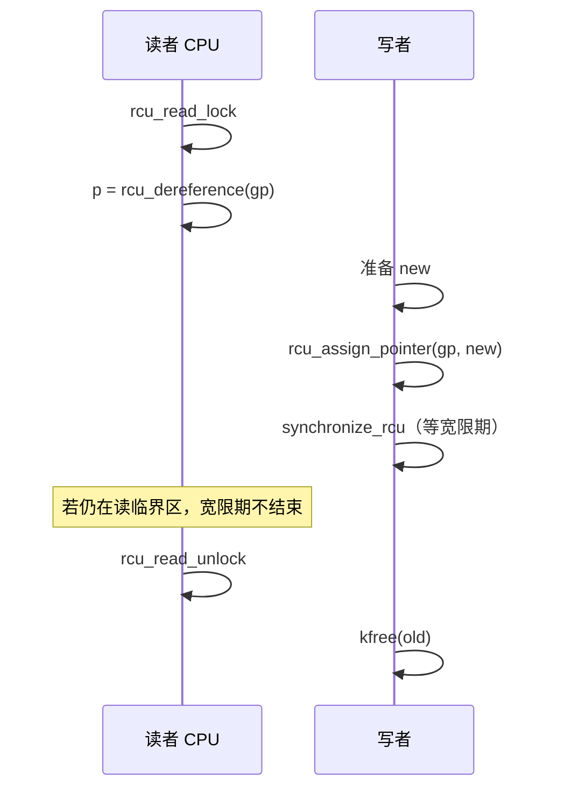

# 7. RCU（Read-Copy Update）

**结论**：RCU 让**读者几乎不互斥**——`rcu_read_lock` 极轻；写者更新指针后，必须等一个**宽限期（grace period）**，确保所有已经开始的读者都退出临界区，才能安全释放旧对象。写者之间仍要用 spinlock/mutex 等自己协调。

> 主头文件：`include/linux/rcupdate.h`；树形实现：`kernel/rcu/tree.c`（`call_rcu` `:3299`，`synchronize_rcu` `:3400`）。

---

## 7.1 模型一句话

```text
读者：rcu_read_lock() … 用 rcu_dereference 拿指针 … rcu_read_unlock()
写者：改好新对象 → rcu_assign_pointer 发布 → synchronize_rcu 或 call_rcu 延后释放旧对象
```

**没有 `rcu_write_lock`**——头文件 `:860` 一带写得很明白：写者不锁读者，这正是性能来源；写者只保证彼此不打架。



---

## 7.2 读者 API

```c
/* include/linux/rcupdate.h:844 */
static __always_inline void rcu_read_lock(void)
	__acquires_shared(RCU)
{
	__rcu_read_lock();
	__acquire_shared(RCU);
	rcu_lock_acquire(&rcu_lock_map);
	RCU_LOCKDEP_WARN(!rcu_is_watching(),
			 "rcu_read_lock() used illegally while idle");
}
```

| API | 说明 |
|---|---|
| `rcu_read_lock` / `rcu_read_unlock` | 普通 RCU 读临界区（可嵌套） |
| `rcu_read_lock_bh` / `_sched` | 与 BH / 调度相关的变体（进阶） |
| `rcu_dereference(p)` | 读 RCU 保护的指针（带依赖屏障 + sparse 检查）`:751` |
| `rcu_dereference_protected(p, c)` | 已在更新侧锁内，不需读锁时用 |
| `rcu_access_pointer(p)` | 非解引用式访问（如打印、比较） |

**读临界区内**：

- 可以跑很短的逻辑、遍历 RCU 链表
- **不要**阻塞（传统 RCU；PREEMPT 配置下可读侧被抢占，但仍不要主动睡在「以为持有 RCU 保护」的假设上乱来）
- 拿到的指针只在临界区内安全；出临界区后旧对象可能已被释放

---

## 7.3 写者：发布与等待

### 发布指针

```c
/* rcupdate.h:567 */
#define rcu_assign_pointer(p, v)	/* 内部：smp_store_release 或 NULL 特判 WRITE_ONCE */
```

### C 对照

```c
/* 错误：普通赋值，读者可能看见「指针已新、对象字段还没写完」 */
gp = new;

/* 正确：先初始化 new 的所有字段，再发布 */
new->x = ...;
rcu_assign_pointer(gp, new);   /* release 语义：字段写在发布之前 */
```

### 等读者走完再释放

| API | 位置 | 行为 |
|---|---|---|
| `synchronize_rcu()` | `tree.c:3400`（声明 `rcupdate.h:53`） | **同步**等到宽限期结束；可睡眠 |
| `call_rcu(head, func)` | `tree.c:3299` | **异步**：宽限期后调 `func`；不阻塞写者 |
| `kfree_rcu(ptr, rcu)` | 宏封装 | 对象内嵌 `struct rcu_head`，到期 `kfree` |
| `rcu_barrier()` | `tree.c:3893` | 等所有已提交的 `call_rcu` 回调跑完（模块卸载等） |

```c
struct foo {
	int x;
	struct rcu_head rcu;     /* 中文：挂回调用 */
};

/* 异步释放 */
old = rcu_dereference_protected(gp, lockdep_is_held(&upd_lock));
rcu_assign_pointer(gp, new);
call_rcu(&old->rcu, foo_free_cb);

/* 或同步 */
rcu_assign_pointer(gp, new);
synchronize_rcu();
kfree(old);
```

持 **spinlock** 时不能 `synchronize_rcu()`（它会睡）→ 用 `call_rcu` / `kfree_rcu`。

---

## 7.4 和 list / hlist 组合

RCU 友好的链表变体（同在 `list.h` 一带，名字带 `_rcu`）：

| API | 说明 |
|---|---|
| `list_add_rcu` / `list_add_tail_rcu` | 发布式插入 |
| `list_del_rcu` | 删除但不 poison 成可立刻复用的形态（等宽限期） |
| `list_for_each_entry_rcu` | 读侧遍历 |
| `hlist_add_head_rcu` / `hlist_del_rcu` / `hlist_for_each_entry_rcu` | 哈希桶版 |

写者删除节点后：

1. `list_del_rcu` —— 读者或还能走到，或走新链
2. `synchronize_rcu` / `call_rcu` —— 再 `kfree`

### `hlist_nulls`（点到）

`include/linux/list_nulls.h`：桶链结尾用「nulls 标记」而不是 NULL，查找时若发现链被并发搬迁可重试。网络协议栈里常见。细节多于本节密度；见到 `is_a_nulls` / `get_nulls_value` 知道与 RCU 查找有关即可。

---

## 7.5 Tasks RCU 与进程退出（衔接到 process-management）

普通 RCU 的宽限期与「CPU 经过 quiescent state」（如上下文切换、idle）相关。

**Tasks RCU** 盯的是**任务**是否离开了自愿调度点一类状态——适合「等某类代码区域」。

| API | 声明 | 说明 |
|---|---|---|
| `call_rcu_tasks` / `synchronize_rcu_tasks` | `rcupdate.h:188` | Tasks RCU |
| `exit_tasks_rcu_start` / `exit_tasks_rcu_finish` | `:205` | 退出路径记账 |

进程退出里（`kernel/exit.c`）：

- `:997` `exit_tasks_rcu_start();`
- `:1026` `exit_tasks_rcu_finish();`

与 [process-management/07-exit-reap](../process-management/07-exit-reap.md) 衔接：退出路径要参与 tasks RCU 的 quiescent 追踪，避免写者永远等不到「任务已离开某类读侧」。本章只钉挂钩点；完整 `do_exit` 仍在进程章。

另有 `synchronize_rcu_tasks_rude` 等变体——名字更凶、等待条件不同，用到再查。

---

## 7.6 经典用法模板

```c
/* ---- 读 ---- */
rcu_read_lock();
p = rcu_dereference(global_p);
if (p)
	use(p->field);      /* 中文：仅在临界区内使用 */
rcu_read_unlock();

/* ---- 写（假设更新锁 upd_lock 已保护写者互斥）---- */
spin_lock(&upd_lock);
old = rcu_dereference_protected(global_p, lockdep_is_held(&upd_lock));
rcu_assign_pointer(global_p, new);
spin_unlock(&upd_lock);
synchronize_rcu();          /* 或 call_rcu */
kfree(old);
```

---

## 7.7 函数 / 结构表

| 名字 | 位置 | 说明 |
|---|---|---|
| `rcu_read_lock/unlock` | `rcupdate.h:844` 起 | 读临界区 |
| `rcu_dereference` | `:751` | 读指针 |
| `rcu_assign_pointer` | `:567` | 发布指针 |
| `synchronize_rcu` | `tree.c:3400` | 等宽限期 |
| `call_rcu` | `tree.c:3299` | 延后回调 |
| `struct rcu_head` | 嵌在对象里 | 回调链节点 |
| `exit_tasks_rcu_*` | `rcupdate.h` + `exit.c` | 与退出衔接 |

---

## 7.8 常见误解（预习 08）

| 误解 | 事实 |
|---|---|
| 「RCU 读完全不用管并发」 | 仍须 `rcu_dereference` + 临界区；写者发布规则要守 |
| 「`synchronize_rcu` 立刻释放」 | 它只保证**旧读者**结束，不保证之后的新读者 |
| 「持 spinlock 也能 `synchronize_rcu`」 | 不能，它会睡 |
| 「`list_del_rcu` 后立刻 `kfree`」 | 必须先宽限期 |

---

*下一节：lockdep、lock_stat、以及 C 新手最容易踩的坑。*
