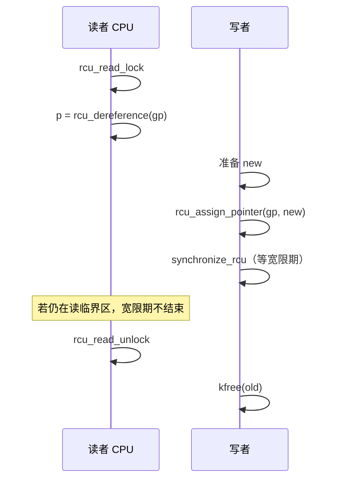

# 7. RCU（Read-Copy Update）

**结论**：RCU 让**读者几乎不互斥**——`rcu_read_lock` 极轻；写者更新指针后，必须等一个**宽限期（grace period）**，确保所有已经开始的读者都退出临界区，才能安全释放旧对象。写者之间仍要用 spinlock/mutex 等自己协调。

> 主头文件：`include/linux/rcupdate.h`。树形实现：`kernel/rcu/tree.c`（`call_rcu` `:2835`，`synchronize_rcu` `:3616`）。声明在 `rcupdate.h:42` 和 `:45`。

---

## 7.1 模型一句话

```text
读者：rcu_read_lock() … 用 rcu_dereference 拿指针 … rcu_read_unlock()
写者：改好新对象 → rcu_assign_pointer 发布 → synchronize_rcu 或 call_rcu 延后释放旧对象
```

**没有 `rcu_write_lock`**。`rcupdate.h:792` 的注释写明：写者没有办法把读者锁在外面，这正是性能来源；写者只保证彼此不打架，常用 spinlock，RCU 不关心你用哪一种。



---

## 7.2 读者 API

```c
/* include/linux/rcupdate.h:782 */
static __always_inline void rcu_read_lock(void)
{
	__rcu_read_lock();
	__acquire(RCU);
	rcu_lock_acquire(&rcu_lock_map);
	RCU_LOCKDEP_WARN(!rcu_is_watching(),
			 "rcu_read_lock() used illegally while idle");
}
```

配对的 `rcu_read_unlock` 在 `:813`：先检查 `rcu_is_watching()`，再 `__release(RCU)`、`__rcu_read_unlock()`、`rcu_lock_release()`。

| API | 行号 | 说明 |
|---|---|---|
| `rcu_read_lock` / `rcu_read_unlock` | `:782` / `:813` | 普通 RCU 读临界区（可嵌套） |
| `rcu_read_lock_bh` / `rcu_read_unlock_bh` | `:836` 起 | 同时 `local_bh_disable()` |
| `rcu_read_lock_sched` | `:874` | 等价于 `rcu_read_lock`，并 `preempt_disable()` |
| `rcu_read_lock_dont_migrate` | `:911` | 先 `rcu_read_lock`；仅 `CONFIG_PREEMPT_RCU` 时再 `migrate_disable()` |
| `rcu_dereference(p)` | `:695` | 读 RCU 保护的指针；转给 `rcu_dereference_check(p, 0)` |
| `rcu_dereference_protected(p, c)` | `:685` | 已在更新侧锁内，不走 `READ_ONCE` |
| `rcu_access_pointer(p)` | `:587` | 不准备解引用（比较、判空、打印） |

**读临界区内**（`rcupdate.h:768` 起的规则）：

- 可以跑很短的逻辑、遍历 RCU 链表
- 非抢占 RCU（`TREE_RCU` / `TINY_RCU`）：读临界区里阻塞是非法的
- `PREEMPT_RCU` 且开了 `CONFIG_PREEMPTION`：读侧可以被抢占，但主动阻塞仍然非法
- `CONFIG_PREEMPT_RT`：读侧可以被抢占；只有在获取「会做优先级继承的 spinlock」时才允许在读侧阻塞
- 拿到的指针只在临界区内安全；出临界区后旧对象可能已被释放
- 在 idle 里调用会触发 `rcu_read_lock() used illegally while idle`

---

## 7.3 写者：发布与等待

### 发布指针

```c
/* include/linux/rcupdate.h:531
 * 编译期常量 NULL：WRITE_ONCE。
 * 其他值：smp_store_release，字段写在发布之前对读者可见。
 */
#define rcu_assign_pointer(p, v)					      \
do {									      \
	uintptr_t _r_a_p__v = (uintptr_t)(v);				      \
	rcu_check_sparse(p, __rcu);					      \
									      \
	if (__builtin_constant_p(v) && (_r_a_p__v) == (uintptr_t)NULL)	      \
		WRITE_ONCE((p), (typeof(p))(_r_a_p__v));		      \
	else								      \
		smp_store_release(&p, RCU_INITIALIZER((typeof(p))_r_a_p__v)); \
} while (0)
```

### C 对照

```c
/* 错误：普通赋值，读者可能看见「指针已新、对象字段还没写完」 */
gp = new;

/* 正确：先初始化 new 的所有字段，再发布 */
new->x = ...;
rcu_assign_pointer(gp, new);
```

### 等读者走完再释放

| API | 位置 | 行为 |
|---|---|---|
| `synchronize_rcu()` | 声明 `rcupdate.h:45`；定义 `tree.c:3616` | **同步**等到宽限期结束；会睡眠。在 RCU 读临界区里调用会被 lockdep 抓住 |
| `call_rcu(head, func)` | 声明 `rcupdate.h:42`；定义 `tree.c:2835` | **异步**：宽限期后调 `func`。实现是 `__call_rcu_common(head, func, IS_ENABLED(CONFIG_RCU_LAZY))` |
| `call_rcu_hurry(head, func)` | 声明 `rcupdate.h:113` | `CONFIG_RCU_LAZY` 打开时是独立函数（`tree.c:2784`），把懒回调也冲掉；关掉时就是 `call_rcu` 的静态别名 |
| `kfree_rcu(ptr, rhf)` | `rcupdate.h:1013` | 对象内嵌 `struct rcu_head rhf`，到期 `kvfree`。成员偏移必须 `< 4096` |
| `kfree_rcu_mightsleep(ptr)` | `:1033` | 不嵌 `rcu_head`；调用点必须允许 `might_sleep()` |
| `rcu_barrier()` | `tree.c:4078` | 等所有已排队的 `call_rcu` 回调跑完（模块卸载）。没有排队回调时可以马上返回，它不等一个新的宽限期 |

`CONFIG_RCU_LAZY`（`kernel/rcu/Kconfig:309`）默认 n，还依赖 `RCU_NOCB_CPU`。默认构建里 `call_rcu` 不会走懒路径。打开之后，不着急的回调可能被攒到更晚，要尽快执行就用 `call_rcu_hurry`。

回调节点的真名是 `struct callback_head`，`rcu_head` 是它的宏：

```c
/* include/linux/types.h:233
 * 对齐到指针大小，保证正常排队时 next 的 bit 0 为 0。
 */
struct callback_head {
	struct callback_head *next;                 /* 中文：回调链的后继 */
	void (*func)(struct callback_head *head);   /* 中文：宽限期结束后调用 */
} __attribute__((aligned(sizeof(void *))));
#define rcu_head callback_head   /* types.h:237；写 struct rcu_head 就是它 */
```

```c
struct foo {
	int x;
	struct rcu_head rcu;     /* 中文：给 call_rcu / kfree_rcu 挂回调 */
};

/* 异步释放 */
old = rcu_dereference_protected(gp, lockdep_is_held(&upd_lock));
rcu_assign_pointer(gp, new);
call_rcu(&old->rcu, foo_free_cb);

/* 或同步 */
rcu_assign_pointer(gp, new);
synchronize_rcu();
kfree(old);
```

持 **spinlock** 时不能 `synchronize_rcu()`（它会睡）→ 用 `call_rcu` / `kfree_rcu`。`kfree_rcu_mightsleep` 同样会睡，不能放在原子上下文。

---

## 7.4 和 list / hlist 组合

RCU 链表在 `include/linux/rculist.h`，不在 `list.h`。

| API | 行号 | 说明 |
|---|---|---|
| `list_add_rcu` | `:104` | 头插；内部 `__list_add_rcu` |
| `list_add_tail_rcu` | `:125` | 尾插 |
| `list_del_rcu` | `:155` | 摘下来，但 **不** 把 `next` 写成 poison（读者可能还顺着 `next` 走）；只把 `prev = LIST_POISON2` |
| `list_for_each_entry_rcu` | `:418` | 读侧遍历；必须包在 `rcu_read_lock` 里，或满足宏的 `cond` |
| `hlist_add_head_rcu` | `:613` | 哈希桶头插 |
| `hlist_del_rcu` | `:540` | 哈希节点删除，同样不毒化还可能被读者跟着走的前向指针 |
| `hlist_for_each_entry_rcu` | `:733` | 哈希桶读侧遍历 |

写者删除节点后：

1. `list_del_rcu` —— 已经在读的人还能顺着 `next` 走完，新读者走新链
2. `synchronize_rcu` / `call_rcu` —— 再 `kfree`

### `hlist_nulls`（点到）

`include/linux/list_nulls.h`：链尾不是 NULL，而是一个「nulls 标记」（低位带编号，最多 2^31 种）。对象按字对齐，所以指针和标记分得开。

```c
/* include/linux/list_nulls.h:21 */
struct hlist_nulls_head {
	struct hlist_nulls_node *first;
};

struct hlist_nulls_node {
	struct hlist_nulls_node *next, **pprev;
};
```

| API | 行号 | 说明 |
|---|---|---|
| `is_a_nulls` | `:43` | 这个指针是不是链尾标记 |
| `get_nulls_value` | `:54` | 取出标记里的编号；只能在 `is_a_nulls` 为真时调用 |
| `hlist_nulls_add_head` | `:91` | 桶首插入 |
| `hlist_nulls_del` | `:113` | 删除 |

查找时如果发现链尾编号变了，说明桶被并发搬走过，应当重试。网络协议栈里常见。见到 `is_a_nulls` / `get_nulls_value` 知道和这种 RCU 查找有关即可。

---

## 7.5 Tasks RCU 与进程退出（衔接到 process-management）

普通 RCU 的宽限期与「CPU 经过 quiescent state」（上下文切换、idle、用户态等）相关。

**Tasks RCU** 盯的是**任务**是否离开了自愿调度点一类状态。`CONFIG_TASKS_TRACE_RCU` 是另一套（`rcupdate.h:180` 起），给需要更细 quiescent 的读者用。SRCU 在 `include/linux/srcu.h`，读者可以睡眠，每个 `struct srcu_struct` 自己一条宽限期（`synchronize_srcu` 在 `srcu.h:59`）。这三套本章只点名字。

Tasks 的声明包在 `CONFIG_TASKS_RCU_GENERIC` 里（`rcupdate.h:164`）。该选项关掉时，`call_rcu_tasks` 被定义成 `call_rcu`，`exit_tasks_rcu_start` / `exit_tasks_rcu_finish` 是空的 inline（`:225` / `:227`）。

| API | 声明 | 说明 |
|---|---|---|
| `call_rcu_tasks` / `synchronize_rcu_tasks` | `rcupdate.h:172` / `:173`（需 `CONFIG_TASKS_RCU`） | Tasks RCU |
| `synchronize_rcu_tasks_rude` | `:212`（需 `CONFIG_TASKS_RUDE_RCU`）；实现 `kernel/rcu/tasks.h:1346` | 等待条件更粗 |
| `exit_tasks_rcu_start` / `exit_tasks_rcu_stop` / `exit_tasks_rcu_finish` | `:216` / `:217` / `:218` | 退出路径记账 |

进程退出在 `do_exit`（`kernel/exit.c:818`）：

- `:901` `exit_tasks_rcu_start();`（在 `exit_notify` 之前）
- `:930` `exit_tasks_rcu_finish();`（在 `do_task_dead` 之前）

与 [process-management/07-exit-reap](../process-management/07-exit-reap.md) 衔接：退出路径要参与 tasks RCU 的 quiescent 追踪，避免写者永远等不到「任务已离开某类读侧」。本章只钉挂钩点；完整 `do_exit` 仍在进程章。

---

## 7.6 经典用法模板

```c
/* ---- 读 ---- */
rcu_read_lock();
p = rcu_dereference(global_p);
if (p)
	use(p->field);      /* 中文：仅在临界区内使用 */
rcu_read_unlock();

/* ---- 写（假设更新锁 upd_lock 已保护写者互斥）---- */
spin_lock(&upd_lock);
old = rcu_dereference_protected(global_p, lockdep_is_held(&upd_lock));
rcu_assign_pointer(global_p, new);
spin_unlock(&upd_lock);
synchronize_rcu();          /* 会睡眠；持 spinlock 时改 call_rcu */
kfree(old);
```

---

## 7.7 函数 / 结构表

| 名字 | 位置 | 说明 |
|---|---|---|
| `rcu_read_lock` / `rcu_read_unlock` | `rcupdate.h:782` / `:813` | 读临界区 |
| `rcu_dereference` | `:695` | 读指针 |
| `rcu_assign_pointer` | `:531` | 发布指针 |
| `synchronize_rcu` | 声明 `:45`；`tree.c:3616` | 等宽限期 |
| `call_rcu` | 声明 `:42`；`tree.c:2835` | 延后回调 |
| `call_rcu_hurry` | `rcupdate.h:113` | 懒 RCU 下尽快跑回调 |
| `kfree_rcu` / `kfree_rcu_mightsleep` | `:1013` / `:1033` | 到期释放 |
| `rcu_barrier` | `tree.c:4078` | 等已排队回调 |
| `struct callback_head` / `rcu_head` | `types.h:233` / 宏 `:237` | 回调链节点 |
| `exit_tasks_rcu_start` / `_finish` | `rcupdate.h:216` / `:218`；调用点 `exit.c:901` / `:930` | 与 `do_exit` 衔接 |
| `list_add_rcu` / `list_del_rcu` | `rculist.h:104` / `:155` | RCU 链表 |

---

## 7.8 常见误解（预习 08）

| 误解 | 事实 |
|---|---|
| 「RCU 读完全不用管并发」 | 仍须 `rcu_dereference` + 临界区；写者发布规则要守 |
| 「`synchronize_rcu` 立刻释放」 | 它只保证**旧读者**结束，不保证之后的新读者 |
| 「持 spinlock 也能 `synchronize_rcu`」 | 不能，它会睡 |
| 「`list_del_rcu` 后立刻 `kfree`」 | 必须先宽限期。`list_del_rcu` 留下 `next` 就是给还在走的读者用的 |
| 「`call_rcu` 总会马上在宽限期结束时跑」 | 默认会；打开 `CONFIG_RCU_LAZY` 后普通 `call_rcu` 可以再拖一阵，急的用 `call_rcu_hurry` |

---

*下一节：lockdep、lock_stat、以及 C 新手最容易踩的坑。*
