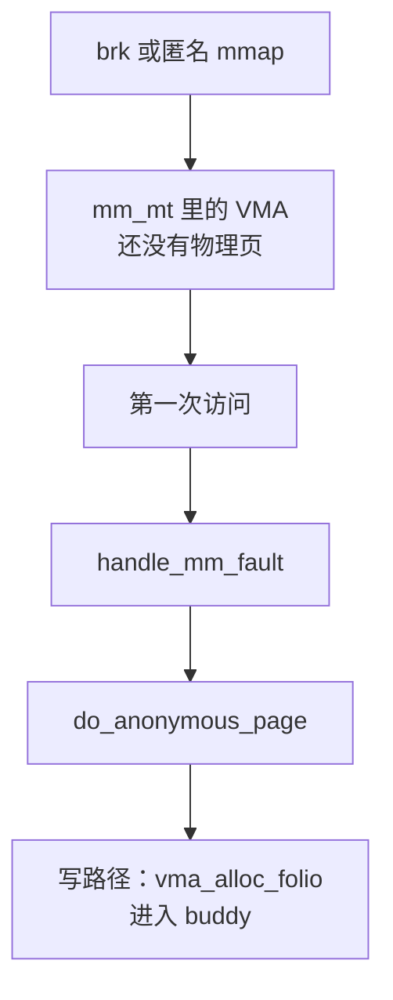

# 0. 从 malloc 到 buddy

**结论**：`malloc` 返回时，内核里常常还没有新的物理页。用户态分配器要扩大可映射范围，就调用 `brk` 或匿名 `mmap`。两条系统调用都只建立或拉长 VMA。进程第一次访问这块地址才缺页；匿名页进入 `do_anonymous_page`，写路径才向 buddy 要 folio。

> 版本：v6.6.160。源码对照 [elixir v6.6.160](https://elixir.bootlin.com/linux/v6.6.160/source)。
> 本页只串这条路径。VMA 怎么建在 [06](./06-mm-and-vma.md)，缺页怎么分派在 [07](./07-page-fault.md)，`alloc_pages` 的调用链在 [03-01](./03-01-overview.md)。结构体和函数体留在那些页。
> glibc 的 arena、tcache、堆块头部留在分配器里。本页从已经发生的系统调用写起。
> 导航：[目录](./README.md) · [下一节 总览](./01-overview.md)

---

## 内核看见的那几步

`malloc` 返回的指针若已经落在现有堆 VMA 里，这一次没有系统调用。上图要从「第一次访问」看起。

## 分配器可能调用 brk，也可能调用 mmap

堆的起点是 `mm->start_brk`，当前终点是 `mm->brk`。`brk` 把终点往后挪：相邻匿名 VMA 的标志合得上就拉长原来那只，否则新建一只匿名 VMA。匿名 `mmap` 走 `do_mmap`，在地址空间里找洞，写入 `mm_mt`；和邻居合得上就 `vma_merge`。

谁拉长堆、谁新建 VMA、缺页是不是同一条，对照表在 [06 §6.4](./06-mm-and-vma.md#brk-与匿名-mmap)。glibc `malloc` 可能走 `brk`，也可能走匿名 `mmap`。多大从堆换成 `mmap`，由分配器自己定。

`free` 之后这块虚拟地址常常还在。分配器可以留着，下次 `malloc` 再交出来。内核在 `brk` 缩小或 `munmap` 发生时才改 VMA、拆页表。

## 系统调用返回时只有 VMA

`do_mmap`（`mm/mmap.c:1219`）和 `do_brk_flags`（`mm/mmap.c:3149`）改的是 maple tree `mm_mt`。普通匿名映射没有 `MAP_POPULATE`，VMA 上也没有 `VM_LOCKED`，系统调用返回前不填页。带了 `MAP_POPULATE`（且没有 `MAP_NONBLOCK`）或 `VM_LOCKED`，才在放下 `mmap_lock` 之后 `mm_populate`。步骤在 [06 §6.4](./06-mm-and-vma.md#brk-与匿名-mmap)。

这段长度已经算进 `mm->total_vm`，也就是 `/proc/<pid>/status` 的 `VmSize`（`ps` 的 VSZ）。`Rss` 要等页表里真有页。VSZ、RSS、PSS 怎么对，在 [06 §6.5](./06-mm-and-vma.md#vsz-rss-pss)。

## 第一次触摸才缺页

访问一个还没有 PTE 的用户地址，进 `handle_mm_fault`（`mm/memory.c:5323`）。匿名 VMA（`vm_ops == NULL`）由 `do_anonymous_page`（`mm/memory.c:4104`）处理。从异常到这两支的分派在 [07](./07-page-fault.md)。

只读、而且这个 mm 允许零页：装一条指向全局零页的 special PTE，不向 buddy 要 folio，`RssAnon` 几乎不涨。写，或者禁止零页：`vma_alloc_zeroed_movable_folio` 要一页全零 folio。两条的条件写在 07 的匿名小节。

`brk` 扩大出来的堆是匿名 VMA，走上面这条。文件 `mmap` 的缺页是 `do_fault`，页在页缓存里，仍见 07。

## folio 从 buddy 来

写路径上的 `vma_alloc_zeroed_movable_folio` 在 x86 展开成 `vma_alloc_folio`（`mm/mempolicy.c:2166`），按这只 VMA 的 mempolicy 调用 `alloc_pages`。总入口在 [03-01](./03-01-overview.md)：先 `get_page_from_freelist`，失败再进 slowpath。本页停在这个入口。

只读且映了零页时，没有这次分配。

## 现在就看

[demos/01_maps_smaps.c](./demos/01_maps_smaps.c) 匿名 `mmap` 2MB，写下第一个字节，再打印 `maps` 里这段区间和整个进程的 `smaps_rollup`。区间长度是 2MB。rollup 的 `Rss` 是整个 mm 的常驻，里面包含刚写的那一页，也包含进程里原来就有的页。

[demos/02_fault.c](./demos/02_fault.c) 对匿名映射逐页写入，用 `getrusage` 看 `ru_minflt`。上升的是 minor fault：页先前不在内存里，这次也不读盘。

两条命令，以及「在 6.12 上采样、示例不读内核结构」的说明，在 [demos/README.md](./demos/README.md)。

---

[目录](./README.md) · [下一节 总览](./01-overview.md)
