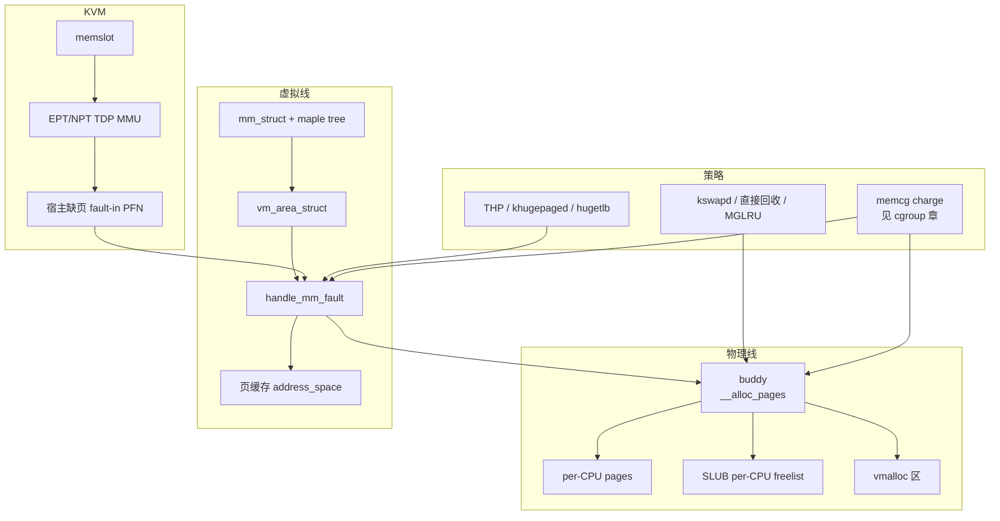

# 1. 总览

**结论**：内存管理是两条线。物理线回答「哪一页空闲、从哪个 zone 拿」；虚拟线回答「这个进程的这个地址现在映射到哪一页」。缺页是两条线的接头。KVM 再叠一层：guest 物理地址还要经 EPT/NPT 落到宿主物理页。

> 版本：v6.6.160。源码对照 [elixir v6.6.160](https://elixir.bootlin.com/linux/v6.6.160/source)。
> 导航：[目录](./README.md) · [下一节 物理布局](./02-physical-layout.md)

---

## 1.1 两条线

| 线 | 你真正在管的东西 | 入口 |
|---|---|---|
| **物理** | `struct page` / `folio`、node（`pg_data_t`）、`zone`、buddy 空闲链表、SLUB 对象 | `alloc_pages()` / `kmalloc()` / `vmalloc()` |
| **虚拟** | `mm_struct`、`vm_area_struct`、页表 | `mmap` / `brk` / 缺页 `handle_mm_fault()` |

物理页不认识进程。进程只认识虚拟地址。把两者接上的是页表项里的 PFN，以及 `folio->mapping`。指针就是一个地址，里面记着另一块内存在哪：匿名页的 `mapping` 带 `PAGE_MAPPING_ANON`（`include/linux/page-flags.h:656`），指向 `anon_vma`；文件页指向 `address_space`。

```text
用户访问虚拟地址
  → 硬件走页表
  → 没有映射：缺页异常
       → handle_mm_fault()              # mm/memory.c:5323
            → 匿名：do_anonymous_page     # mm/memory.c:4104
                 写：vma_alloc_zeroed_movable_folio → vma_alloc_folio
                 只读且允许零页：映射 zero page，不分配
            → 文件：do_fault             # mm/memory.c:4745
                 再进 do_read_fault / do_cow_fault / do_shared_fault，页在页缓存
            → 写只读页：do_wp_page（COW） # mm/memory.c:3355
  → 有映射：硬件直接访问物理页

内核自己要内存
  → 小对象：kmalloc → SLUB
       快路径（非 CONFIG_SLUB_TINY）：本 CPU 的 kmem_cache_cpu
         freelist 指向下一个空闲对象，tid 是这次操作的序号，slab 是当前这块 slab
       freelist 空了：___slab_alloc，先找 partial slab，再 new_slab 向页分配器要页
  → 整页、物理连续：alloc_pages → __alloc_pages → buddy
  → 虚拟连续、物理可以不连续：vmalloc
```

`kmem_cache_cpu` 在 `include/linux/slub_def.h:50`，只在没打开 `CONFIG_SLUB_TINY` 时存在。`CONFIG_SLUB_TINY` 的 `__slab_alloc_node`（`mm/slub.c:3443`）先找 partial，没有再 `new_slab`，没有这条 per-CPU freelist。

---

## 1.2 从分配到 KVM 的总图



`mm_struct` 里的 VMA 树是 `mm_mt`（`include/linux/mm_types.h:755`），类型是 `struct maple_tree`。

读图时记住三件独立的事：

1. **分配成功**不等于**已经映射进用户页表**。`alloc_pages` 只给你 `struct page`。
2. **回收**动的是 LRU 上的 folio，不是 buddy 空闲页。空闲页已经不在 LRU 上。
3. **KVM TDP** 缺的是 guest 物理页在 EPT 里的映射。填 EPT 之前，宿主往往还要先 fault-in 自己的页。

---

## 1.3 和 cgroup、调度器的边界

**cgroup memory** 不实现 buddy。它在分配和缺页路径上 **charge**：页记到某个 `mem_cgroup`，超过 `memory.high` / `memory.max` 就施压或失败。对象和接口见 [cgroup/06-memory.md](../cgroup/06-memory.md)。本章 [10-01-overview.md](./10-01-overview.md) 只讲 `shrink_node()` 里 global reclaim 与 memcg reclaim 怎么分叉，不重写 `try_charge_memcg`（`mm/memcontrol.c:2669`）。

**调度器**决定哪个任务占 CPU。内存子系统会让任务睡眠：直接回收、直接 compact、等回写、memcg high 节流、缺页等 folio lock。这些睡眠在 `ps` 里经常是 `D`。本章不讲调度器怎么选下一个任务。

**VFS** 拥有 inode 和具体文件系统。本章 [08](./08-page-cache-and-writeback.md) 只写 folio 如何进 `address_space->i_pages`，以及脏页为什么让回收变慢。

---

## 1.4 本章源码地图

| 路径 | 角色 |
|---|---|
| `include/linux/mm_types.h` | `page`、`folio`、`vm_area_struct`、`mm_struct`、`page_frag_cache` |
| `include/linux/mmzone.h` | `zone`、`pglist_data`、`zonelist`、`mem_section`、MGLRU |
| `include/linux/gfp.h` | `__alloc_pages` / `alloc_pages` 声明 |
| `mm/page_alloc.c` | buddy；`page_frag_alloc_align` 也在这里 |
| `mm/mempolicy.c`、`include/linux/mempolicy.h` | NUMA 策略、`alloc_pages`、`vma_alloc_folio`、`mbind` |
| `mm/cma.c` | CMA |
| `mm/slub.c`、`mm/slab.h`、`include/linux/slub_def.h` | SLUB。per-CPU 描述符是 `kmem_cache_cpu` |
| `mm/slab_common.c`、`include/linux/slab.h` | `kmalloc` / `__kmalloc` |
| `mm/vmalloc.c` | vmalloc |
| `mm/mmap.c`、`mm/rmap.c` | `mmap` / `munmap` / `brk`，反向映射 |
| `mm/mmu_gather.c`、`include/asm-generic/tlb.h` | TLB 批量刷新 |
| `mm/memory.c` | 缺页 |
| `mm/filemap.c`、`mm/page-writeback.c`、`mm/shmem.c` | 页缓存、脏页、shmem |
| `mm/vmscan.c`、`mm/oom_kill.c`、`mm/zswap.c` | 回收、OOM、zswap |
| `mm/migrate.c`、`mm/mlock.c`、`mm/memory_hotplug.c` | 迁移、mlock、热插拔 |
| `include/linux/mmu_notifier.h`、`mm/hmm.c` | mmu_notifier、HMM |
| `arch/x86/kvm/mmu/` | TDP MMU / shadow MMU |
| `mm/page_reporting.c`、`drivers/virtio/virtio_balloon.c` | FPR 与 balloon |
| `mm/ksm.c`、`mm/damon/core.c` | KSM、DAMON |
| `mm/page_owner.c` | 分配栈 |

page frag 的缓存描述符是 `struct page_frag_cache`（`include/linux/mm_types.h:532`），分配函数是 `page_frag_alloc_align`（`mm/page_alloc.c:4655`）。

---

## 1.5 关键函数表（总入口）

| 符号 | 位置 | 作用 |
|---|---|---|
| `alloc_pages` | 声明 `include/linux/gfp.h:264`（`CONFIG_NUMA`）；定义 `mm/mempolicy.c:2261`。非 NUMA 是 `include/linux/gfp.h:269` 的 inline | 按当前 mempolicy 分配，最后进 `__alloc_pages` |
| `__alloc_pages` | 声明 `include/linux/gfp.h:177`；定义 `mm/page_alloc.c:4465` | 页分配入口。先 `get_page_from_freelist`，失败再进 slowpath |
| `get_page_from_freelist` | `mm/page_alloc.c:3098` | 沿 zonelist 找空闲页 |
| `__alloc_pages_slowpath` | `mm/page_alloc.c:3947` | 直接回收、compact、重试 |
| `kmalloc` | `include/linux/slab.h:591` | 小对象入口。编译期常量尺寸走 `kmalloc_trace`，否则 `__kmalloc` |
| `__kmalloc` | `mm/slab_common.c:1018` | 非常量尺寸的 kmalloc |
| `kmalloc_trace` | `mm/slab_common.c:1096` | 编译期已知尺寸的 kmalloc |
| `kmalloc_large` | `mm/slab_common.c:1163` | 超过 kmalloc cache 的尺寸，改向页分配器要 |
| `kmem_cache_alloc` | 声明 `include/linux/slab.h:500`；SLUB 定义 `mm/slub.c:3540` | SLUB 分配入口 |
| `slab_alloc` | `mm/slub.c:3523` | `kmem_cache_alloc` 进来之后的内联包装 |
| `slab_alloc_node` | `mm/slub.c:3493` | 调用 `__slab_alloc_node` |
| `__slab_alloc_node` | `mm/slub.c:3368` | 非 `CONFIG_SLUB_TINY` 的快路径：读 `freelist` / `tid` / `slab` |
| `___slab_alloc` | `mm/slub.c:3129` | 快路径失败后的慢路径。先 partial，再 `new_slab` |
| `new_slab` | `mm/slub.c:2096` | 向页分配器要一块新 slab |
| `allocate_slab` | `mm/slub.c:2029` | `new_slab` 的实现，调用 `alloc_slab_page` |
| `alloc_slab_page` | `mm/slub.c:1895` | `alloc_pages` 或 `__alloc_pages_node` |
| `vmalloc` | `mm/vmalloc.c:3466` | 内核虚拟连续内存 |
| `do_mmap` | `mm/mmap.c:1219` | `mmap` 的地址空间工作 |
| `handle_mm_fault` | `mm/memory.c:5323` | 架构无关缺页入口 |
| `do_anonymous_page` | `mm/memory.c:4104` | 匿名缺页 |
| `vma_alloc_zeroed_movable_folio` | x86 宏 `arch/x86/include/asm/page.h:37` | 匿名写缺页要的零页 folio，展开成 `vma_alloc_folio` |
| `vma_alloc_folio` | `mm/mempolicy.c:2166` | 按 VMA 的 mempolicy 分配 folio |
| `do_fault` | `mm/memory.c:4745` | 文件缺页，再分到读 / COW / 共享 |
| `do_read_fault` | `mm/memory.c:4617` | 文件读缺页 |
| `do_cow_fault` | `mm/memory.c:4650` | 私有文件映射的写缺页 |
| `do_shared_fault` | `mm/memory.c:4694` | 共享文件映射的写缺页 |
| `do_wp_page` | `mm/memory.c:3355` | 写只读页，COW |
| `shrink_node` | `mm/vmscan.c:6532` | 一个 node 上的回收 |
| `try_charge_memcg` | `mm/memcontrol.c:2669` | memcg charge。本章不展开 |
| `out_of_memory` | `mm/oom_kill.c:1113` | OOM |
| `kvm_mmu_page_fault` | `arch/x86/kvm/mmu/mmu.c:5709` | KVM 缺页（含 EPT violation 转进来） |

---

[目录](./README.md) · [下一节 物理布局](./02-physical-layout.md)
