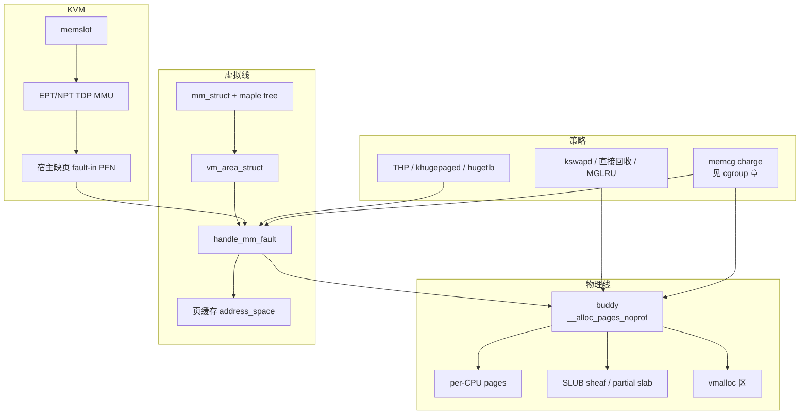

# 1. 总览

**结论**：内存管理是两条线。物理线回答「哪一页空闲、从哪个 zone 拿」；虚拟线回答「这个进程的这个地址现在映射到哪一页」。缺页是两条线的接头。KVM 再叠一层：guest 物理地址还要经 EPT/NPT 落到宿主物理页。

> 版本：v7.3 `c03c1a14507d`。
> 导航：[目录](./README.md) · [下一节 物理布局](./02-physical-layout.md)

---

## 1.1 两条线

| 线 | 你真正在管的东西 | 入口 |
|---|---|---|
| **物理** | `struct page` / `folio`、node（`pg_data_t`）、`zone`、buddy 空闲链表、SLUB 对象 | `alloc_pages()` / `kmalloc()` / `vmalloc()` |
| **虚拟** | `mm_struct`、`vm_area_struct`、页表 | `mmap` / `brk` / 缺页 `handle_mm_fault()` |

物理页不认识进程。进程只认识虚拟地址。把两者接上的是页表项里的 PFN，以及 `folio->mapping`（匿名页指向 `anon_vma`，文件页指向 `address_space`）。

```text
用户访问虚拟地址
  → 硬件走页表
  → 没有映射：缺页异常
       → handle_mm_fault()          # mm/memory.c:6841
            → 匿名：do_anonymous_page → 分配 folio
            → 文件：do_fault → 页缓存
            → 写只读页：do_wp_page（COW）
  → 有映射：硬件直接访问物理页

内核自己要内存
  → 小对象：kmalloc → SLUB（per-CPU sheaf，慢路径再向 buddy 要 slab）
  → 整页、物理连续：alloc_pages → buddy
  → 虚拟连续、物理可以不连续：vmalloc
```

---

## 1.2 从分配到 KVM 的总图



读图时记住三件独立的事：

1. **分配成功**不等于**已经映射进用户页表**。`alloc_pages` 只给你 `struct page`。
2. **回收**动的是 LRU 上的 folio，不是 buddy 空闲页。空闲页已经不在 LRU 上。
3. **KVM TDP** 缺的是 guest 物理页在 EPT 里的映射。填 EPT 之前，宿主往往还要先 fault-in 自己的页。

---

## 1.3 和 cgroup、调度器的边界

**cgroup memory** 不实现 buddy。它在分配和缺页路径上 **charge**：页记到某个 `mem_cgroup`，超过 `memory.high` / `memory.max` 就施压或失败。对象和接口见 [cgroup/06-memory.md](../cgroup/06-memory.md)。本章 [10-01-overview.md](./10-01-overview.md) 只讲 `shrink_node()` 里 global reclaim 与 memcg reclaim 怎么分叉，不重写 `try_charge_memcg`。

**调度器**决定哪个任务占 CPU。内存子系统会让任务睡眠：直接回收、直接 compact、等回写、memcg high 节流、缺页等 folio lock。这些睡眠在 `ps` 里经常是 `D`。本章不讲 EEVDF 怎么选下一个任务。

**VFS** 拥有 inode 和具体文件系统。本章 [08](./08-page-cache-and-writeback.md) 只写 folio 如何进 `address_space->i_pages`，以及脏页为什么让回收变慢。

---

## 1.4 本章源码地图

| 路径 | 角色 |
|---|---|
| `include/linux/mm_types.h` | `page`、`folio`、`vm_area_struct`、`mm_struct` |
| `include/linux/mmzone.h` | `zone`、`pglist_data`、`zonelist`、`mem_section`、MGLRU |
| `mm/page_alloc.c` | buddy |
| `mm/mempolicy.c`、`include/linux/mempolicy.h` | NUMA 策略、`mbind` |
| `mm/cma.c` | CMA |
| `mm/slub.c`、`mm/slab.h` | SLUB |
| `mm/page_frag_cache.c` | page frag |
| `mm/vmalloc.c` | vmalloc |
| `mm/mmap.c`、`mm/vma.c`、`mm/rmap.c` | `mmap` / `munmap` / `brk`，反向映射 |
| `mm/mmu_gather.c`、`include/asm-generic/tlb.h` | TLB 批量刷新 |
| `mm/memory.c` | 缺页 |
| `mm/filemap.c`、`mm/page-writeback.c`、`mm/shmem.c` | 页缓存、脏页、shmem |
| `mm/vmscan.c`、`mm/oom_kill.c`、`mm/zswap.c` | 回收、OOM、zswap |
| `mm/migrate.c`、`mm/mlock.c`、`mm/memory_hotplug.c` | 迁移、mlock、热插拔 |
| `include/linux/mmu_notifier.h`、`mm/hmm.c` | mmu_notifier、HMM |
| `arch/x86/kvm/mmu/` | TDP MMU / shadow MMU |
| `mm/page_reporting.c`、`drivers/virtio/virtio_balloon.c` | FPR 与 balloon |
| `mm/ksm.c`、`mm/damon/core.c` | KSM、DAMON |
| `mm/page_owner.c`、`mm/alloc_tag.c` | 分配栈与 allocinfo |

---

## 1.5 关键函数表（总入口）

| 符号 | 位置 | 作用 |
|---|---|---|
| `__alloc_pages` | 宏，`mm/page_alloc.h:259` | `alloc_hooks(__alloc_pages_noprof(...))`。v7.3 **没有**同名 C 函数 |
| `__alloc_pages_noprof` | `mm/page_alloc.c:5466` | 指定 nid 的页分配，内部调 frozen 分配再 `set_page_refcounted` |
| `__alloc_frozen_pages_noprof` | `mm/page_alloc.c:5383` | 快路径 `get_page_from_freelist`，失败进 slowpath |
| `kmem_cache_alloc` | 宏，`include/linux/slab.h:856` | 进 `kmem_cache_alloc_noprof` |
| `kmalloc` | 宏，`include/linux/slab.h:1056` | 进 `kmalloc_noprof` → `__kmalloc_noprof` |
| `vmalloc` | 宏包装 `vmalloc_noprof`，`mm/vmalloc.c:4198` | 内核虚拟连续内存 |
| `do_mmap` | `mm/mmap.c:338` | `mmap` 的地址空间工作 |
| `handle_mm_fault` | `mm/memory.c:6841` | 架构无关缺页入口 |
| `shrink_node` | `mm/vmscan.c:6239` | 一个 node 上的回收 |
| `out_of_memory` | `mm/oom_kill.c:1103` | OOM |
| `kvm_mmu_page_fault` | `arch/x86/kvm/mmu/mmu.c:6573` | KVM 缺页（含 EPT violation 转进来） |

---

[目录](./README.md) · [下一节 物理布局](./02-physical-layout.md)
