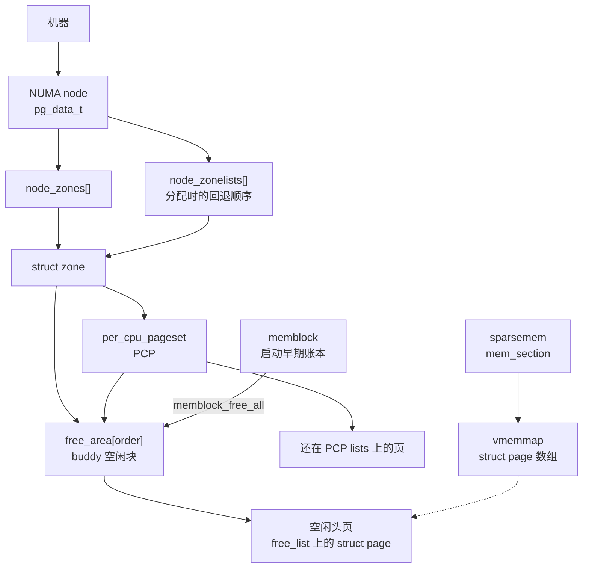

# 2. 物理布局：page / folio / node / zone / buddy / sparsemem

**结论**：每一页物理内存有一个 `struct page`；用户和页缓存看到的分配单位是 `folio`（可以是一页或多页）。页按 NUMA node（`pg_data_t`）再按 `zone` 分组。每个 zone 用 buddy 管空闲页：`free_area[order]` 上挂着 `2^order` 页的空闲块，PCP 是它前面的每 CPU 缓存。x86-64 默认用 sparsemem vmemmap 存放这些 `struct page`。启动早期的账在 memblock，`memblock_free_all` 之后空闲页才出现在 buddy 链表上。这一章给布局名词和 buddy 的拆/合概念；`rmqueue` 与 `__free_one_page` 的调用链在 [页分配](./03-00-page-alloc.md)。

> 定义：`include/linux/mm_types.h`、`include/linux/mmzone.h`。v7.3 `c03c1a14507d`。
> 导航：[上一节 总览](./01-overview.md) · [目录](./README.md) · [下一节 页分配](./03-00-page-alloc.md)

## 2.0 全貌

先把后面要碰到的名词排成阅读顺序，再进入结构体。

**node** 是拓扑。一台机器有一个或多个 NUMA node，`pg_data_t` 代表其中一个：这段物理内存离哪组 CPU 近。**zone** 是这个 node 里一段可以拿来分配的范围（DMA、DMA32、NORMAL 这一类），水位和保留按 zone 算。**buddy** 是挂在 zone 下面的空闲页管家，空闲内存按 `2^order` 页一块，放进 `zone->free_area[order]`。**PCP** 是 buddy 前面的每 CPU 小缓存，单页和便宜的高阶先在这里周转，热路径少碰 `zone->lock`。**page / folio** 是页的身份证：`struct page` 每页一张，`folio` 是一次分配的那一整块。**sparsemem** 决定身份证放在哪：`mem_section` 指向 vmemmap 上的 `struct page` 数组。**memblock** 是 buddy 醒来之前的账本；`memblock_free_all` 把还没划走的页交进 buddy 之后，运行时的空闲链表才算数。



虚线表示 `struct page` 放在哪。memblock 那条箭头只在启动交接时走一次。

本章后面的顺序：

```text
2.1–2.2  page / folio：身份证长什么样
2.3–2.4  node / zone，以及 zone 上的 free_area、PCP 成员
2.5      buddy 概念：阶、伙伴、拆、合、migratetype
2.6      zonelist：一次分配允许走哪些 zone
2.7      sparsemem：struct page 放在哪
2.8      x86-64 虚拟布局，点到为止
2.9      pfn_to_page 三种模型
2.10     folio 的 refcount 与 mapcount
2.11     memblock 怎么把页交给 buddy
2.12     关键函数表
```

自检：一页现在没人用，它挂在哪个 node、哪个 zone 的哪条链表上？能指到 `node_zones[]` 里的某个 zone，并说出它在 `free_area[order]` 上还是在该 zone 的 PCP 上，这一节就读完了。阶、以及具体是哪一条 `free_list`，在 [2.5](#25-buddy-概念)。

`memdesc_flags_t`（`mm_types.h:39`）只是包了一层 `unsigned long f`。v7.3 的 `page->flags` 不再是裸 `unsigned long`，nid / zone / section 从这层 flags 里拆（`memdesc_nid`、`memdesc_zonenum`、`memdesc_section`，见 `mm.h` / `mmzone.h`）。空闲页属于哪个 node、哪个 zone，就编码在这张身份证上。

---

## 2.1 `struct page`（`mm_types.h:80`）

文件头注释（`:43-73`）仍说：每页一个 `struct page`；`alloc_pages()` 之后 main union 里大约五个 word 可借给分配者用，**第一个 word 的 bit 0 必须保持 0**（`PageTail()` 用它）。当前结构体就是下面这些成员，不另造字段。

对齐：`_struct_page_alignment`。`CONFIG_HAVE_ALIGNED_STRUCT_PAGE` 时按两个 `unsigned long` 对齐，给 SLUB 的 `cmpxchg` 双字用（`:74-78`）。收尾的对齐属性写在最后一段。

### 标志与主 union

```c
/* --- 标志与主 union --- */
struct page {
	/*
	 * 原子标志。部分位会被异步改。
	 * nid/zone/section 也编码在这里。
	 */
	memdesc_flags_t flags;
	/*
	 * 下面几套解释叠在同一块内存上。
	 * 第一 word 的 bit 0 留给 PageTail()，其它用途不能占用这个 bit。
	 */
	union {
		/* 页缓存 / 匿名页、page_pool、复合页 tail、ZONE_DEVICE、rcu_head，见下 */
	};
};
```

**页缓存 / 匿名页**（union 第一臂，`:90-117`）：

```c
/* --- 页缓存 / 匿名页 --- */
struct page {
	union {
		struct {	/* 页缓存和匿名页 */
			union {
				/*
				 * 在 LRU 上时的链表节点。锁是对应 lruvec->lru_lock。
				 * 页的主人有时把它当通用链表。
				 */
				struct list_head lru;
				/* 与 lru 同 union。页在 buddy 空闲链表上时用 */
				struct list_head buddy_list;
				/* 与 lru 同 union。页在 per-CPU pageset 链表上时用 */
				struct list_head pcp_list;
				/* 与 lru 同 union。无锁 llist 形式的 pcp 链 */
				struct llist_node pcp_llist;
			};
			/*
			 * 文件页：所属 address_space。匿名页带 FOLIO_MAPPING_ANON
			 * 低位标记，指向 anon_vma。空闲或特殊页可能为 NULL。
			 * 最低位被复用，所以 address_space 要求按 long 对齐
			 * （fs.h:485 的注释）。
			 */
			struct address_space *mapping;
			union {
				pgoff_t __folio_index;	/* 在 mapping 里的页偏移 */
				/* 与 index 同 union。fsdax 的 share 计数 */
				unsigned long share;
			};
			/*
			 * 私有数据。PagePrivate 时常放 buffer_head；
			 * swapcache 时放 swp_entry_t；
			 * PageBuddy 或在 pcp_llist 上时表示 order。
			 */
			unsigned long private;
		};
	};
};
```

**page_pool（网络栈）**（`:118-128`）：

```c
/* --- page_pool（网络栈） --- */
struct page {
	union {
		struct {	/* page_pool，网络栈用 */
			/* 魔数，避免把不是 page_pool 分配的页回收进池 */
			unsigned long pp_magic;
			struct page_pool *pp;		/* 所属 page_pool */
			unsigned long _pp_mapping_pad;	/* 占位，垫出和 mapping 对齐的布局 */
			unsigned long dma_addr;		/* DMA 地址 */
			atomic_long_t pp_ref_count;	/* page_pool 引用 */
		};
	};
};
```

**复合页 tail**（`:129-131`）：

```c
/* --- 复合页 tail --- */
struct page {
	union {
		struct {	/* 复合页的 tail */
			/* tail page 用。bit 0 置位，这样 PageTail() 为真 */
			unsigned long compound_info;
		};
	};
};
```

**ZONE_DEVICE**（`:132-149`）：

```c
/* --- ZONE_DEVICE --- */
struct page {
	union {
		struct {	/* ZONE_DEVICE 页 */
			/*
			 * 第一 word。与 compound_info 或 folio 的 pgmap 叠在一起，
			 * 本臂不单独解释它。
			 */
			void *_unused_pgmap_compound_info;
			void *zone_device_data;	/* 设备私有数据 */
			/*
			 * 后面三个 word 与第一臂的 mapping / index / private 重叠，
			 * 本臂没有再给它们起新名字。设备私有页在迁移期间用它们保住
			 * 源匿名页或页缓存页的 mapping、index、private；
			 * MEMORY_DEVICE_FS_DAX 也用这三项。
			 */
		};
	};
};
```

**RCU**（`:152`）：

```c
/* --- RCU --- */
struct page {
	union {
		/* 用 RCU 延迟释放这一页时的回调头 */
		struct rcu_head rcu_head;
	};
};
```

### 映射计数、引用、可选尾字段

```c
/* --- 映射计数、引用、可选尾字段 --- */
struct page {
	union {		/* 这个 union 共 4 字节 */
		/*
		 * typed folio 的头页在这里放类型（列表在 page-flags.h）。
		 * 类型 folio 的 tail 不存类型（page_type == _mapcount == -1）。
		 * 主人可以复用低 16 位，清类型前必须把这 16 位恢复成 -1。
		 */
		unsigned int page_type;
		/*
		 * 非 typed、走 RMAP 的 folio：这一页被页表直接映射的次数。
		 * 初值 -1，这样 atomic_inc_and_test / atomic_add_negative(-1)
		 * 能看见进出 0 的边沿。注释要求不要拿它做私有存储。
		 */
		atomic_t _mapcount;
	};

	/*
	 * 引用计数。不要直接摸，走 page_ref.h。
	 * alloc_pages() 返回时已经是正数。
	 */
	atomic_t _refcount;

#ifdef CONFIG_MEMCG
	unsigned long memcg_data;	/* memcg 归属。和 cgroup 章的 charge 对得上 */
#elif defined(CONFIG_SLAB_OBJ_EXT)
	/*
	 * 占位，让 slab 对象扩展的布局和带 memcg 的构建对齐。
	 */
	unsigned long _unused_slab_obj_exts;
#endif

#if defined(WANT_PAGE_VIRTUAL)
	/*
	 * 高端内存需要单独记下内核虚拟地址。x86-64 直接映射，
	 * 通常不编译这个字段。注释说在 x86 上它甚至可以是 16 位，
	 * 那是历史口吻。
	 */
	void *virtual;
#endif /* WANT_PAGE_VIRTUAL */

#ifdef LAST_CPUPID_NOT_IN_PAGE_FLAGS
	/*
	 * 最后访问的 CPU/PID，NUMA balancing 用。
	 * flags 里放不下才落到这里。
	 */
	int _last_cpupid;
#endif

#ifdef CONFIG_KMSAN
	/*
	 * 影子页：对应 bit 表示原页该 bit 是否未初始化。
	 */
	struct page *kmsan_shadow;
	/*
	 * 起源页：每 4 字节一个栈轨迹 id，记录未初始化值从哪来。
	 */
	struct page *kmsan_origin;
#endif
} _struct_page_alignment;
```


`struct page` 到此结束（`:223`）。没有单独的 `index` 字段名在 `struct page` 里；index 叫 `__folio_index`，folio 侧才叫 `index`。

---

## 2.2 `struct folio`（`mm_types.h:404`）

**结论**：folio 是「这一次分配的那一整块页」的句柄。order 0 时它和单页重叠；高阶时头页后面还叠着第二、第三、第四个 `struct page` 的位置，用来放大页映射计数和 hugetlb 私有数据。

内核用 `/* private: */` / `/* public: */` 标文档可见性。下面**全部成员都列出**。标了 private 的是布局占位或过渡字段，不是给你当 API 用的。

### 第一页：与 `struct page` 同布局

外层 `union` 的第一臂（`:407-448`）与一个 `struct page` 对齐；同一 union 的另一臂就是 `struct page page`（`:449`）。`public` / `private` 是文档可见性，不是 `CONFIG`。

```c
/* --- 第一页：与 struct page 同布局 --- */
struct folio {
	/* private: 匿名 union，不当 API */
	union {
		struct {
	/* public: */
			memdesc_flags_t flags;	/* 同 page->flags */
			union {
				struct list_head lru;	/* LRU / 空闲链，语义同 page */
	/* private: 避免把占位写进文档 */
				/* Unevictable「LRU」槽 */
				struct {
					/* 躲开 compound_info 的 bit 0，给 mlock_count 腾位置 */
					void *__filler;
	/* public: */
					unsigned int mlock_count;	/* 这个槽里的 mlock 计数 */
	/* private: */
				};
	/* public: */
				/* ZONE_DEVICE 的 pagemap。与 lru / mlock 槽同 union */
				struct dev_pagemap *pgmap;
			};
			/* 文件 address_space 或匿名 anon_vma */
			struct address_space *mapping;
			union {
				pgoff_t index;		/* 在 mapping 中的偏移。对应 page 的 __folio_index */
				unsigned long share;	/* 与 index 同 union。fsdax share */
			};
			union {
				void *private;			/* 映射私有数据 */
				swp_entry_t swap;		/* 与 private 同 union。swap 项 */
				unsigned long migrate_info;	/* 与 private 同 union。迁移信息 */
			};
			atomic_t _mapcount;	/* 头页 mapcount，初值语义同 page */
			atomic_t _refcount;	/* 整 folio 引用 */
#ifdef CONFIG_MEMCG
			unsigned long memcg_data;	/* memcg */
#elif defined(CONFIG_SLAB_OBJ_EXT)
			unsigned long _unused_slab_obj_exts;	/* 占位 */
#endif
#if defined(WANT_PAGE_VIRTUAL)
			void *virtual;	/* 同 page */
#endif
#ifdef LAST_CPUPID_NOT_IN_PAGE_FLAGS
			int _last_cpupid;	/* 同 page */
#endif
	/* private: 和 struct page 的 union 是过渡 */
		};
		/* 把 folio 当 page 用时的视图。这条 union 是过渡 */
		struct page page;
	};
};
```

### 第二页槽（`__page_1`，`:451-482`）

```c
/* --- 第二页槽（__page_1） --- */
struct folio {
	union {
		struct {
			/* private。与第二个 struct page 的 flags 重叠，占位 */
			unsigned long _flags_1;
			/* private。与该页第一 word 重叠，占位 */
			unsigned long _head_1;
			union {
				struct {
	/* public: */
					atomic_t _large_mapcount;	/* 大 folio 的 mapcount */
					atomic_t _nr_pages_mapped;	/* 已被页表映射的子页数量 */
#ifdef CONFIG_64BIT
					/* 整个 folio 被一次映射（PMD/PUD）的计数。32 位放到第三页槽 */
					atomic_t _entire_mapcount;
					atomic_t _pincount;	/* pin_user_pages 一类长期 pin 的计数 */
#endif /* CONFIG_64BIT */
					/* 按 mm id 记的 mapcount，两个槽 */
					mm_id_mapcount_t _mm_id_mapcount[2];
					union {
						mm_id_t _mm_id[2];	/* 对应的两个 mm id */
						/* 把两个 mm id 当成一个字访问 */
						unsigned long _mm_ids;
					};
	/* private: 和 struct page 的 union 是过渡 */
				};
				unsigned long _usable_1[4];	/* 与上面这组同 union。过渡占位，长度 4 */
			};
			/* private。与该 struct page 的 _mapcount 重叠 */
			atomic_t _mapcount_1;
			/* private。与该 struct page 的 _refcount 重叠 */
			atomic_t _refcount_1;
	/* public: */
#ifdef NR_PAGES_IN_LARGE_FOLIO
			/*
			 * 这个 folio 含多少页。某些配置把页数放进 flags，
			 * 这个字段就不存在。
			 */
			unsigned int _nr_pages;
#endif /* NR_PAGES_IN_LARGE_FOLIO */
	/* private: 和 struct page 的 union 是过渡 */
		};
		struct page __page_1;	/* 第二个 page 的视图 */
	};
};
```

### 第三页槽（`__page_2`，`:483-496`）

```c
/* --- 第三页槽（__page_2） --- */
struct folio {
	union {
		struct {
			unsigned long _flags_2;	/* private。占位，重叠第三个 page 的 flags */
			unsigned long _head_2;	/* private。占位 */
	/* public: */
			/* THP 延迟拆分队列。khugepaged / shrinker 扫它 */
			struct list_head _deferred_list;
#ifndef CONFIG_64BIT
			/* 32 位上整个 folio 的 mapcount 放这里 */
			atomic_t _entire_mapcount;
			atomic_t _pincount;	/* 32 位上的 pin 计数 */
#endif /* !CONFIG_64BIT */
	/* private: 和 struct page 的 union 是过渡 */
		};
		struct page __page_2;	/* 第三个 page 的视图 */
	};
};
```

### 第四页槽（`__page_3`，`:497-509`），hugetlb

```c
/* --- 第四页槽（__page_3），hugetlb --- */
struct folio {
	union {
		struct {
			unsigned long _flags_3;	/* private 占位 */
			unsigned long _head_3;	/* private 占位 */
	/* public: */
			void *_hugetlb_subpool;		/* hugetlb 子池 */
			void *_hugetlb_cgroup;		/* hugetlb cgroup（用量） */
			void *_hugetlb_cgroup_rsvd;	/* hugetlb cgroup 预留 */
			void *_hugetlb_hwpoison;	/* 这一大页上的 hwpoison 记录 */
	/* private: 和 struct page 的 union 是过渡 */
		};
		struct page __page_3;	/* 第四个 page 的视图 */
	};
};
```

小 folio 不会去碰第二页以后的字段。把 order-0 folio 当成多页结构去写 `_deferred_list`，就是踩别的页的 `struct page`。

上面的源码片段已经列全。`_refcount` 和 `_mapcount` 是两本账，get/put 规则见 [2.10](#210-folio-的-refcount-与-mapcount)。

---

## 2.3 node：`pg_data_t` / `struct pglist_data`（`mmzone.h:1478`）

**结论**：一个 NUMA node 一个 `pg_data_t`。UMA 只有一个（`contig_page_data`，`:1770`）。它拥有本节点的 zone 数组和 zonelist，以及 kswapd/kcompactd。

`NODE_DATA(nid)` 在 `:1771`。

```c
typedef struct pglist_data {
	/*
	 * 只含本节点的 zone。没填满的槽可以是空的，但数组是完整的。
	 * 本节点和别的节点的 zonelist 都会引用它们。
	 */
	struct zone node_zones[MAX_NR_ZONES];
	/*
	 * 分配时用的 zone 回退链。
	 * 一般前面几项就是本节点的 zone。
	 */
	struct zonelist node_zonelists[MAX_ZONELISTS];
	int nr_zones;	/* 本节点有多少个已填充 zone */
#ifdef CONFIG_FLATMEM	/* 平坦 memmap。SPARSEMEM 不走这里 */
	struct page *node_mem_map;
#ifdef CONFIG_PAGE_EXTENSION
	struct page_ext *node_page_ext;	/* 页扩展信息 */
#endif
#endif
#if defined(CONFIG_MEMORY_HOTPLUG) || defined(CONFIG_DEFERRED_STRUCT_PAGE_INIT)
	/*
	 * 保护 node_start_pfn、node_present_pages、node_spanned_pages、nr_zones，
	 * 并同步 first_deferred_pfn。嵌套在 zone->lock 和 zone->span_seqlock 之上。
	 */
	spinlock_t node_size_lock;
#endif
	unsigned long node_start_pfn;		/* 本节点起始 PFN */
	unsigned long node_present_pages;	/* 物理上存在的页数（不含洞） */
	unsigned long node_spanned_pages;	/* 从起始到结束的跨度，含洞 */
	int node_id;				/* 节点号 */
	wait_queue_head_t kswapd_wait;		/* 唤醒 kswapd */
	wait_queue_head_t pfmemalloc_wait;	/* PFMEMALLOC 分配在等水位恢复 */
	/* 按不同原因节流回收的等待队列 */
	wait_queue_head_t reclaim_wait[NR_VMSCAN_THROTTLE];
	atomic_t nr_writeback_throttled;	/* 正被回写节流的任务数 */
	/*
	 * 开始节流时已经写出的页数，用来判断回写有没有进展。
	 */
	unsigned long nr_reclaim_start;
#ifdef CONFIG_MEMORY_HOTPLUG
	struct mutex kswapd_lock;	/* 保护 kswapd 任务指针 */
#endif
	/*
	 * 本节点的 kswapd。热插拔配置下由 kswapd_lock 保护。
	 */
	struct task_struct *kswapd;
	int kswapd_order;			/* kswapd 这次要满足的阶 */
	enum zone_type kswapd_highest_zoneidx; /* kswapd 最高扫到哪个 zone */
	/*
	 * 「回收量 == 0」的连续次数。过高会把节点标成 hopeless
	 * （见 kswapd_test_hopeless，mmzone.h:1649）。
	 */
	atomic_t kswapd_failures;
#ifdef CONFIG_COMPACTION
	int kcompactd_max_order;			/* kcompactd 目标阶 */
	enum zone_type kcompactd_highest_zoneidx;	/* kcompactd 最高 zone */
	wait_queue_head_t kcompactd_wait;		/* 唤醒 kcompactd */
	struct task_struct *kcompactd;			/* 本节点压缩线程 */
	bool proactive_compact_trigger;			/* 主动压缩被触发 */
#endif
	/*
	 * 留给内核、不给用户分配的本节点保留页。
	 */
	unsigned long totalreserve_pages;
#ifdef CONFIG_NUMA
	/*
	 * node reclaim：未映射页超过这阈值才考虑就地回收。
	 */
	unsigned long min_unmapped_pages;
	unsigned long min_slab_pages;	/* node reclaim：slab 页阈值 */
#endif /* CONFIG_NUMA */
	/* 把下面写频繁的字段推到另一条 cache line */
	CACHELINE_PADDING(_pad1_);
#ifdef CONFIG_DEFERRED_STRUCT_PAGE_INIT
	/*
	 * 大机器延迟初始化 struct page 时，下一个还没初始化的 PFN。
	 */
	unsigned long first_deferred_pfn;
#endif /* CONFIG_DEFERRED_STRUCT_PAGE_INIT */
#ifdef CONFIG_NUMA_BALANCING
	unsigned int nbp_rl_start;	/* 当前 promote 限速窗口的起始时间（ms） */
	/* 该窗口开始时的 promote 候选页数 */
	unsigned long nbp_rl_nr_cand;
	unsigned int nbp_threshold;	/* promote 阈值（ms） */
	unsigned int nbp_th_start;	/* 阈值调整窗口起始（ms） */
	/* 阈值调整窗口开始时的候选页数 */
	unsigned long nbp_th_nr_cand;
#endif
	/*
	 * 开了 MEMCG 就不用这个字段。注释写明要走 mem_cgroup_lruvec()。
	 * 没开 memcg 时，lruvec_pgdat() 用 container_of 从这里找回 pgdat
	 * （mmzone.h:1665）。
	 */
	struct lruvec __lruvec;
	unsigned long flags;	/* 节点标志 */
#ifdef CONFIG_LRU_GEN
	/* kswapd 走页表时的 MGLRU 游标。成员见下 */
	struct lru_gen_mm_walk mm_walk;
	/* 本节点上 memcg 的分代链表 */
	struct lru_gen_memcg memcg_lru;
#endif
	CACHELINE_PADDING(_pad2_);	/* 再隔一条 cache line */
	/* 每 CPU 的节点计数差分 */
	struct per_cpu_nodestat __percpu *per_cpu_nodestats;
	/*
	 * 节点级 vmstat。/proc/zoneinfo 里 “per-node stats” 从这里来。
	 */
	atomic_long_t vm_stat[NR_VM_NODE_STAT_ITEMS];
#ifdef CONFIG_NUMA
	/* 这个节点属于哪一档内存（内存分层） */
	struct memory_tier __rcu *memtier;
#endif
#ifdef CONFIG_MEMORY_FAILURE
	/*
	 * 硬件中毒页统计。total/ignored/failed/delayed/recovered（:1449）。
	 * 各节点 total * PAGE_SIZE 对应 /proc/meminfo 的 HardwareCorrupted。
	 */
	struct memory_failure_stats mf_stats;
#endif
} pg_data_t;
```

`lru_gen_mm_walk`（`:617`，`CONFIG_LRU_GEN`）。`seq` 可能落后于 `lru_gen_folio.max_seq`：

```c
#ifdef CONFIG_LRU_GEN
struct lru_gen_mm_walk {
	struct lruvec *lruvec;	/* 正在回收的 lruvec */
	/* 来自 lru_gen_folio.max_seq，可能落后 */
	unsigned long seq;
	unsigned long next_addr;	/* 当前 mm 里下一次要扫的地址 */
	/* 攒一批被 promote 的页 */
	int nr_pages[MAX_NR_GENS][ANON_AND_FILE][MAX_NR_ZONES];
	int mm_stats[NR_MM_STATS];	/* 攒一批 mm 统计 */
	int batched;			/* 已经攒下、还没刷进 lruvec 的项数 */
	/* 这次 walk 用的 swappiness。为 0 时跳过匿名页和 shmem */
	int swappiness;
	/* 为真时不按 young 位、bitmap、Bloom filter 跳过 mm 和 pmd */
	bool force_scan;
};
#endif
```

`lru_gen_memcg`（`:679`）：

```c
#ifdef CONFIG_LRU_GEN
struct lru_gen_memcg {
	unsigned long seq;	/* 本节点 memcg 的代际计数 */
	/* 每个 memcg 在每个 node 上有一份 lru_gen_folio */
	unsigned long nr_memcgs[MEMCG_NR_GENS];
	/*
	 * 全局回收用的分代分桶链表。
	 * MEMCG_NR_GENS 是 3，MEMCG_NR_BINS 是 8（:676-677）。
	 */
	struct hlist_nulls_head fifo[MEMCG_NR_GENS][MEMCG_NR_BINS];
	spinlock_t lock;	/* 保护上面这几项 */
};
#endif
```

`MEMCG_NR_GENS` 是 3，`MEMCG_NR_BINS` 是 8（`:676-677`）。老代/年轻代分桶，是为了全局回收时公平扫 memcg，不是 memcg 自己的 reclaim 迭代器（那个仍走 `mem_cgroup_iter()`，注释 `:671`）。


---

## 2.4 `struct zone`（`mmzone.h:979`）

**结论**：zone 是分配和水位的单位。x86-64 常见是 DMA、DMA32、NORMAL。`ZONE_MOVABLE` 用来让热拔插和 THP 少碰到不可移动页。本机快照只有 DMA / DMA32 / NORMAL，没有 MOVABLE（见 [13](./13-observability.md)）。

`enum zone_type`（`:884`）：

| 枚举 | 条件 | 中文 |
|---|---|---|
| `ZONE_DMA` | `CONFIG_ZONE_DMA` | DMA 窗口小的设备。x86 上通常 <16MB |
| `ZONE_DMA32` | `CONFIG_ZONE_DMA32` | 32 位 DMA 掩码盖得住的范围 |
| `ZONE_NORMAL` | 始终 | 正常可直接映射、设备若支持全地址 DMA 也能用 |
| `ZONE_HIGHMEM` | `CONFIG_HIGHMEM` | 32 位内核的高端内存。x86-64 没有 |
| `ZONE_MOVABLE` | 始终 | 尽量只放可移动页，方便 offlining，也让不可移动分配别把大页切碎。注释列了 pin、memblock、洞、hwpoison、virtio-mem 的 `PG_offline`、`ZERO_PAGE`、`memmap_on_memory` 这些例外（`:919-966`） |
| `ZONE_DEVICE` | `CONFIG_ZONE_DEVICE` | 设备内存，不进普通 buddy 回收 |
| `__MAX_NR_ZONES` | 始终 | 数组上界 |

### zone 成员（按源码顺序）

读多写少的前半：

```c
/* --- 读多写少的前半 --- */
struct zone {
	/* 水位。下标是 WMARK_MIN/LOW/HIGH/PROMO。用 *_wmark_pages(zone) 读，不要裸读这个数组 */
	unsigned long _watermark[NR_WMARK];
	/* 临时抬高的水位。碎片或分配压力会 boost，促使 kswapd 多回收一点 */
	unsigned long watermark_boost;
	/*
	 * 为高阶原子分配保留的页数。
	 * 大约最多占 zone 的 1%（reserve_highatomic_pageblock，page_alloc.c:3447）。
	 */
	unsigned long nr_reserved_highatomic;
	unsigned long nr_free_highatomic;	/* 上述保留里当前仍空闲的页 */
	/*
	 * 低 zone 留给高 zone 分配失败时的保留。/proc/zoneinfo 的 protection: 就是它。
	 * vm.min_free_kbytes 和 lowmem_reserve_ratio 会重算。
	 */
	long lowmem_reserve[MAX_NR_ZONES];
#ifdef CONFIG_NUMA
	int node;	/* 所属节点号 */
#endif
	struct pglist_data *zone_pgdat;	/* 回指 node */
	/* 每 CPU 的热页缓存。order 0 和便宜的高阶分配先走这里 */
	struct per_cpu_pages __percpu *per_cpu_pageset;
	struct per_cpu_zonestat __percpu *per_cpu_zonestats;	/* 每 CPU zone 计数差分 */
	int pageset_high_min;	/* 复制到各 pageset 的 high 下限，热路径少去共享 cache line */
	int pageset_high_max;	/* high 上限 */
	int pageset_batch;	/* 批量从 buddy 拿/还的大小 */
#ifndef CONFIG_SPARSEMEM
	/*
	 * pageblock 的 migratetype 位图。SPARSEMEM 改放在 mem_section 里。
	 */
	unsigned long *pageblock_flags;
#endif /* CONFIG_SPARSEMEM */
	/* 起始 PFN。zone_start_paddr >> PAGE_SHIFT */
	unsigned long zone_start_pfn;
	/* buddy 正在管的页。水位按它算。present - reserved */
	atomic_long_t managed_pages;
	unsigned long spanned_pages;	/* zone_end_pfn - zone_start_pfn，含洞 */
	/*
	 * 物理存在的页，不含洞。热插拔写它要 mem_hotplug_begin/done()。
	 */
	unsigned long present_pages;
#if defined(CONFIG_MEMORY_HOTPLUG)
	/* 启动时就在、不含后来热插的 present 页 */
	unsigned long present_early_pages;
#endif
#ifdef CONFIG_CMA
	unsigned long cma_pages;	/* 划给 CMA（MIGRATE_CMA）的页 */
#endif
	/* "DMA" / "DMA32" / "Normal" / "Movable"，/proc/zoneinfo 用 */
	const char *name;
#ifdef CONFIG_MEMORY_ISOLATION
	/*
	 * 被隔离的 pageblock 数。解决 migratetype 竞态导致的空闲页计数错误。
	 * zone->lock 保护。
	 */
	unsigned long nr_isolate_pageblock;
#endif
#ifdef CONFIG_MEMORY_HOTPLUG
	/*
	 * 保护 zone_start_pfn 和 spanned_pages。
	 * 分配快路径用 seqlock 读，因为不能总拿 zone->lock。
	 */
	seqlock_t span_seqlock;
#endif
	int initialized;	/* zone 是否已初始化 */
};
```

写频繁的分配侧（`_pad1_` 之后）：

```c
/* --- 写频繁的分配侧 --- */
struct zone {
	CACHELINE_PADDING(_pad1_);	/* 隔离 cache line */
	/*
	 * buddy 本体。每个 order 一条。
	 * NR_PAGE_ORDERS = MAX_PAGE_ORDER+1，默认 MAX_PAGE_ORDER 是 10
	 * （mmzone.h:31），也就是 0..10。阶、拆、合见 2.5。
	 */
	struct free_area free_area[NR_PAGE_ORDERS];
#ifdef CONFIG_UNACCEPTED_MEMORY
	/* 还没 accept 的页，全是 MAX_PAGE_ORDER */
	struct list_head unaccepted_pages;
	/* 本 zone 最后一页被 accept 后的清理 */
	struct work_struct unaccepted_cleanup;
#endif
	unsigned long flags;	/* zone 标志，例如 ZONE_BOOSTED_WATERMARK */
	spinlock_t lock;	/* 主要保护 free_area */
	/*
	 * zone->lock 没抢到时先挂这里，下次 trylock 成功再还进 buddy。
	 */
	struct llist_head trylock_free_pages;
};
```

压缩与统计（`_pad2_` 之后）：

```c
/* --- 压缩与统计 --- */
struct zone {
	CACHELINE_PADDING(_pad2_);	/* 再隔开 */
	/*
	 * 空闲页低于这点时，读空闲数要避免 per-CPU 计数漂移把水位看错。
	 */
	unsigned long percpu_drift_mark;
#if defined CONFIG_COMPACTION || defined CONFIG_CMA
	unsigned long compact_cached_free_pfn;	/* 空闲扫描器下次从哪开始 */
	/* 迁移扫描器，异步/同步各一个。ASYNC_AND_SYNC 是 2 */
	unsigned long compact_cached_migrate_pfn[ASYNC_AND_SYNC];
	unsigned long compact_init_migrate_pfn;	/* 本轮迁移扫描的起点 */
	unsigned long compact_init_free_pfn;	/* 本轮空闲扫描的起点 */
#endif
#ifdef CONFIG_COMPACTION
	unsigned int compact_considered;	/* 上次失败后已经尝试过的次数 */
	unsigned int compact_defer_shift;	/* 失败后跳过 1<<shift 次再试 */
	int compact_order_failed;		/* 失败过的最小阶 */
#endif
#if defined CONFIG_COMPACTION || defined CONFIG_CMA
	bool compact_blockskip_flush;	/* 为真时要清 PG_migrate_skip */
#endif
	/*
	 * zone 的 PFN 是否连续（没有洞）。压缩可以走更快的路径。
	 */
	bool contiguous;
	CACHELINE_PADDING(_pad3_);	/* 统计再隔开 */
	atomic_long_t vm_stat[NR_VM_ZONE_STAT_ITEMS];	/* zone 级计数，nr_free_pages 等 */
	/*
	 * NUMA 命中/未命中。非 NUMA 配置这个数组长度是 0。
	 */
	atomic_long_t vm_numa_event[NR_VM_NUMA_EVENT_ITEMS];
#ifdef CONFIG_HUGETLB_PAGE_OPTIMIZE_VMEMMAP
	struct page *vmemmap_tails[NR_VMEMMAP_TAILS];	/* HVO 尾部 struct page 的缓存 */
#endif
} ____cacheline_internodealigned_in_smp;
```

`struct free_area`（`mmzone.h:195`）。更长的注释在 [2.5](#25-buddy-概念)。

```c
struct free_area {
	struct list_head free_list[MIGRATE_TYPES];	/* 每个 migratetype 一条空闲链 */
	unsigned long nr_free;				/* 这一阶的空闲块数 */
};
```

`enum migratetype`（`:118`）：

| 值 | 中文 |
|---|---|
| `MIGRATE_UNMOVABLE` | 不可移动。内核数据结构、页表这一类 |
| `MIGRATE_MOVABLE` | 可移动。用户匿名页、页缓存 |
| `MIGRATE_RECLAIMABLE` | 可回收。inode/dentry slab 一类 |
| `MIGRATE_PCPTYPES` | **不是一种页**。它的值等于 PCP 上有几种类型（上面三种） |
| `MIGRATE_HIGHATOMIC` | 等于 `MIGRATE_PCPTYPES`。高阶原子分配的保留块 |
| `MIGRATE_CMA` | `CONFIG_CMA`。行为上模仿 ZONE_MOVABLE，分配器不会悄悄改这种 pageblock 的类型 |
| `MIGRATE_ISOLATE` | `CONFIG_MEMORY_ISOLATION`。隔离中，不能从这里分 |

能跟普通块合并的是 `< MIGRATE_PCPTYPES` 的类型（`migratetype_is_mergeable`，`:175`）。HIGHATOMIC、CMA、ISOLATE 守着自己的 pageblock。为什么要分这些类型，见 [2.5](#25-buddy-概念)。

### `struct per_cpu_pages`（`:844`）

```c
struct per_cpu_pages {
	spinlock_t lock;	/* 保护下面的 lists */
	int count;		/* 列表里的页数 */
	int high;		/* 高水位，超过就要倒回 buddy */
	int high_min;		/* high 允许落到的下限 */
	/*
	 * high 允许涨到的上限。
	 * decay_pcp_high()（page_alloc.c:2576）会把闲置 CPU 的 high 慢慢降下去。
	 */
	int high_max;
	int batch;		/* 一次向 buddy 批量申请/归还的大小 */
	/* PCPF_PREV_FREE_HIGH_ORDER、PCPF_FREE_HIGH_BATCH（:841-842） */
	u8 flags;
	u8 alloc_factor;	/* 分配时把 batch 放大的因子 */
#ifdef CONFIG_NUMA
	u8 expire;		/* 减到 0 就排空远程节点的 pageset */
#endif
	/* 连续释放次数。分配时右移（rmqueue_pcplist，:3389） */
	short free_count;
	/*
	 * 按 migratetype × order 分链。
	 * NR_LOWORDER_PCP_LISTS = MIGRATE_PCPTYPES * (PAGE_ALLOC_COSTLY_ORDER + 1)，
	 * PAGE_ALLOC_COSTLY_ORDER 是 3（mmzone.h:63）。开了 THP 再加 NR_PCP_THP（2）条。
	 */
	struct list_head lists[NR_PCP_LISTS];
} ____cacheline_aligned_in_smp;
```

---

## 2.5 buddy 概念

**结论**：一页空闲内存在 buddy 里时，它是某个 `2^order` 连续块的头页。所在 zone 是 `page_zone(page)`（`mm.h:2620`）：`&NODE_DATA(page_to_nid(page))->node_zones[page_zonenum(page)]`。块挂在这个 zone 的 `free_area[order].free_list[migratetype]` 上，链表节点是 `page->buddy_list`。同阶没有空闲块时，分配从更高阶拆；释放时若伙伴也空闲，就往上合并。PCP 上的页还没进（或已经离开）这张表。`rmqueue` 怎么选 PCP 还是 buddy，在 [03-04-pcp-and-rmqueue.md](./03-04-pcp-and-rmqueue.md)；`__free_one_page` 怎么沿伙伴往上合，在 [03-05-buddy-free.md](./03-05-buddy-free.md)。

### 阶：order *n* 是 2^n 页

`order` 是连续页数的对数。order 0 是 1 页，order 1 是 2 页，order *n* 是 `1 << n` 页，而且这 `1 << n` 页的 PFN 连续、起始 PFN 按 `1 << n` 对齐。

`MAX_PAGE_ORDER` 默认是 10（`mmzone.h:31`）。打开 `CONFIG_ARCH_FORCE_MAX_ORDER` 时改用那个配置值（`:30-34`）。`NR_PAGE_ORDERS` 是 `MAX_PAGE_ORDER + 1`（`:39`），所以 `zone->free_area[]` 的下标是 0 到 10，一共 11 档。合并停在 `MAX_PAGE_ORDER`：最大的空闲块是 order 10，没有 order 11。

`PAGE_ALLOC_COSTLY_ORDER` 是 3（`:63`）。头文件把它定成「贵」的分界：比这低的阶，在正常回收压力下比较容易自己合回去；再往上就难（`:57-62`）。这是分界，buddy 的最大阶仍是 `MAX_PAGE_ORDER`。

`PAGE_SHIFT` 来自 `CONFIG_PAGE_SHIFT`（`include/vdso/page.h:13`）。x86-64 的 `Documentation/filesystems/proc.rst` 把 page block 举例写成 2MB，对应下面 order 9 这一行，也就是一页 4KB。下表按 4KB 页估算：

| order | 页数 `1 << order` | 4KB 页时 |
|---|---|---|
| 0 | 1 | 4KB |
| 1 | 2 | 8KB |
| 2 | 4 | 16KB |
| 3 | 8 | 32KB，`PAGE_ALLOC_COSTLY_ORDER` |
| 9 | 512 | 2MB，x86-64 上常见的 page block |
| 10 | 1024 | 4MB，默认最大 buddy 块 |

一块 order *n* 的头页 PFN 要能被 `1 << n` 整除。`__free_one_page` 里有一条 `VM_BUG_ON_PAGE(pfn & ((1 << order) - 1), page)`（`page_alloc.c:955`），调试配置下才触发。伙伴算法本身按这个对齐来配对：PFN 1 只作为 order 0 的头。

### 空闲块挂在 `free_area` 上

每个 zone 有一份 `free_area[NR_PAGE_ORDERS]`（`mmzone.h:1099`）。同一个阶的空闲块进同一个 `free_area`，再按迁移类型分链：

```c
/* include/linux/mmzone.h:195
 * 一个 zone 有 free_area[NR_PAGE_ORDERS]，下标就是 order。
 */
struct free_area {
	/*
	 * 每种 migratetype 一条链。链上只有该阶空闲块的头页，
	 * 用 page->buddy_list 串起来（和 lru、pcp_list 同占一个 union）。
	 * 头页后面的 2^order - 1 页跟在连续 PFN 上，不再各挂一次。
	 */
	struct list_head	free_list[MIGRATE_TYPES];
	unsigned long		nr_free; /* 本阶空闲块个数，各 migratetype 加总 */
};
```

头页被 `set_buddy_order`（`page_alloc.c:714`）标成 buddy 页：`PageBuddy` 置上，阶写进 `page->private`。读阶用 `buddy_order`（`mm/page_alloc.h:106`），它就是 `page_private(page)`。这就是 [2.1](#21-struct-page-mm_typesh80) 里 `private` 在 `PageBuddy` 时的含义。

摘下一块用 `get_page_from_free_area`（`page_alloc.c:873`）：从 `free_list[migratetype]` 取第一个 `buddy_list`。挂上去用 `__add_to_free_list`（`:794`），同时 `nr_free++`。保护这张表的是 `zone->lock`（上面 zone 结构里那把 `lock`）。

所以 [2.0](#20-全貌) 的那一问，落到 buddy 上的答案是：

```text
page_zone(page)                          # mm.h:2620
  = &NODE_DATA(page_to_nid(page))        # page_to_nid：mm.h:2400
        ->node_zones[page_zonenum(page)] # page_zonenum：mmzone.h:1294
  ->free_area[order].free_list[migratetype]
        → 头页 page->buddy_list
```

nid 和 zone 都从 `page->flags` 拆出来（章首的 `memdesc_nid` / `memdesc_zonenum`）。页还在 PCP 上时，改看下面「PCP 在哪一层」，它不在 `free_area` 里。

### 伙伴：同一阶，PFN 差 `1 << order`

两块能配成伙伴，要阶相同，而且 PFN 相差正好 `1 << order`。差这一位，异或就能从一块跳到另一块：

```c
/* mm/page_alloc.h:176。order 0 时相邻的偶数/奇数 PFN 互为伙伴 */
static inline unsigned long
__find_buddy_pfn(unsigned long page_pfn, unsigned int order)
{
	return page_pfn ^ (1 << order);
}
```

头文件里的例子（`:166-168`）：order 1、起始 PFN 8，伙伴是 `8 ^ (1 << 1) = 10`。8 和 10 各是 2 页，合起来是从 PFN 8 起的 4 页。合完的块取对齐的低地址，注释写成 `P = B & ~(1 << O)`（`:170-172`），`__free_one_page` 里就是 `buddy_pfn & pfn`（`page_alloc.c:1005`）。

伙伴是不是真能合，要过 `page_is_buddy`（`page_alloc.h:138`）这几关：伙伴在 buddy 里（`PageBuddy`，或者是 debug 的 guard 页）、阶和当前块相同、两者在同一个 zone。zone 比较放在最后，和源码注释一致（`:147-150`）。`find_buddy_page_pfn`（`:196`）先用上面的异或找到候选页，再跑这几关；有一关不过就返回 NULL。判据的源码在这个 inline 里。持锁把阶往上抬的循环在 [03-05](./03-05-buddy-free.md)。

**释放时往上合。** 还回来的块若伙伴也空闲，就把伙伴从它那条 `free_list` 摘掉，阶加一，块地址改成两者里对齐的那个低地址，再试下一阶。循环条件是 `order < MAX_PAGE_ORDER`（`page_alloc.c:960`）。阶已经到 `pageblock_order` 时，类型不同、而且至少有一边 `migratetype_is_mergeable` 为假，就停止（`:972-984`）。类型相同可以继续合，CMA 和 CMA 也算。停下来之后 `set_buddy_order` 写下最终的阶，`__add_to_free_list` 挂回对应的 `free_area[order]`。guard 页、直接 compact 把块截走、挂链表头还是尾，都在 `__free_one_page` 里，见 [03-05](./03-05-buddy-free.md)。

**分配时从高阶拆。** 目标阶的 `free_list` 是空的，就向更高的阶找（`__rmqueue_smallest`，`page_alloc.c:1901`，调用链在 [03-04](./03-04-pcp-and-rmqueue.md)）。找到一块之后，`expand` 把用不到的高半截挂回去，调用者拿走低半截：

```c
/* page_alloc.c:1720 起。进入时 size == 1 << high，page 指向整块的头 */
while (high > low) {
	high--;
	size >>= 1;
	/*
	 * set_page_guard：debug guardpage 没开时直接返回 false
	 * （mm.h 里 CONFIG_DEBUG_PAGEALLOC 那支）。普通路径走下面两行。
	 * page[size] 是高半截的头页。
	 */
	if (set_page_guard(zone, &page[size], high))
		continue;
	__add_to_free_list(&page[size], zone, high, migratetype, false);
	set_buddy_order(&page[size], high); /* 高半截自己成为这一阶的空闲块 */
	nr_added += size;
}
/* 循环结束，page 仍指向最低那一截，阶已经降到 low，交给调用者 */
```

每拆一次，高半截变成伙伴，留在 buddy 里；低半截继续拆，直到阶等于请求。拆两次就是下面第一个例子。

### 例：只要 1 页，手头只有 order 2

请求 order 0。这条 migratetype 上 order 0 和 1 都没有块，order 2 有一块，PFN 0–3（4 页，起始对齐）。

```text
拆之前
  free_area[2]:  [0 1 2 3]

第一次，high 从 2 降到 1，size 从 4 变成 2
  高半截 page[2] 挂上 free_area[1]
  free_area[1]:  [2 3]
  手里还拿着:    [0 1]

第二次，high 从 1 降到 0，size 从 2 变成 1
  高半截 page[1] 挂上 free_area[0]
  free_area[1]:  [2 3]
  free_area[0]:  [1]
  分给调用者:    [0]
```

分出去的 PFN 0 清掉 `PageBuddy`，不再挂在 `free_list` 上。PFN 1 是它的 order 0 伙伴，PFN 2 是「PFN 0–1 这 2 页」的 order 1 伙伴。两条链上都只有头页。

### 例：还回一页，伙伴也空闲就合并

紧接着把 PFN 0 以 order 0 还回来。伙伴地址用 `pfn ^ (1 << order)`。

```text
order 0：0 ^ 1 = 1
  PFN 1 在 free_area[0] 上，阶相同，同一个 zone
  摘掉 PFN 1
  合成的块从 0 & 1 = 0 起，阶变成 1

order 1：0 ^ 2 = 2
  PFN 2 在 free_area[1] 上，本身就是 order 1 的头（盖住 2 和 3）
  摘掉 PFN 2
  合成的块从 0 & 2 = 0 起，阶变成 2

order 2：0 ^ 4 = 4
  假设 PFN 4 正在使用，page_is_buddy 失败，停止

挂回
  free_area[2]:  [0 1 2 3]
  头页 private = 2，PageBuddy 置上
```

两次合并把刚才拆开的三块（调用者手里的 1 页、order 0 的 PFN 1、order 1 的 PFN 2）收回成原来的 order 2。若 PFN 1 当时不空闲，第一次就停，PFN 0 自己挂到 `free_area[0]`。这两个例子的阶都低于 `pageblock_order`，上面「释放时往上合」里的 migratetype 检查不会插手。

### 为什么要分 migratetype

外碎片是：空闲页的总数够，但凑不齐一块高阶连续页。不可移动的内核页若散落在可移动的用户页中间，两边的空闲页就永远当不了伙伴。

buddy 把「能不能挪走」记在 pageblock 上，同一种 pageblock 里的空闲块进同一条 `free_list`。一个 pageblock 有 `pageblock_nr_pages`（`1 << pageblock_order`）页，整段共用一个迁移类型（`include/linux/pageblock-flags.h:75`）。类型位图在 sparsemem 下放在 `mem_section` 的 `usage` 里，平坦内存模型下放在 `zone->pageblock_flags`（[2.4](#24-struct-zone-mmzoneh979)、[2.7](#27-sparsememstruct-mem_section)）。

`pageblock_order` 按配置选（`pageblock-flags.h:47-71`）：hugetlb 页大小在编译期固定时是 `min(HUGETLB_PAGE_ORDER, PAGE_BLOCK_MAX_ORDER)`；没有 hugetlb、开了 THP 时是 `min(HPAGE_PMD_ORDER, PAGE_BLOCK_MAX_ORDER)`；两者都没有时就是 `PAGE_BLOCK_MAX_ORDER`。`CONFIG_HUGETLB_PAGE_SIZE_VARIABLE` 时它是运行时变量，`set_pageblock_order`（`mm/mm_init.c:1437`）把它收成不超过 `PAGE_BLOCK_MAX_ORDER` 的 `HUGETLB_PAGE_ORDER`。`PAGE_BLOCK_MAX_ORDER` 默认等于 `MAX_PAGE_ORDER`（`mmzone.h:41-43`）。x86-64 的 `PMD_SHIFT` 是 21（`arch/x86/include/asm/pgtable_64_types.h:74`），`HPAGE_PMD_ORDER` 是 `HPAGE_PMD_SHIFT - PAGE_SHIFT`（`include/linux/huge_mm.h:117`）。文档把 x86-64 上的 page block 举例写成 2MB（`Documentation/filesystems/proc.rst` 的 pagetypeinfo 一节）。

枚举值的表在 [2.4](#24-struct-zone-mmzoneh979)。分工是：

| 类型 | 放什么 | 和碎片的关系 |
|---|---|---|
| `MIGRATE_UNMOVABLE` | 页表、内核数据结构 | 挪不走。单独成段，避免钉死用户页之间的空隙 |
| `MIGRATE_MOVABLE` | 匿名页、页缓存 | 可以迁移，回收或 compact 之后容易合成高阶块 |
| `MIGRATE_RECLAIMABLE` | inode、dentry 一类 slab | 压力下可以丢掉，再把 pageblock 腾出来 |
| `MIGRATE_PCPTYPES` | PCP 上的类型种数 | 值等于上面三种的个数。分配时不当成一种页 |
| `MIGRATE_HIGHATOMIC` | 高阶原子分配的保留 | 等于 `MIGRATE_PCPTYPES`。没有回退链 |
| `MIGRATE_CMA` | CMA 区，`CONFIG_CMA` | 只给可移动分配用。分配器不会悄悄改这种 pageblock 的类型 |
| `MIGRATE_ISOLATE` | 热插拔、压缩隔离，`CONFIG_MEMORY_ISOLATION` | 隔离期间不从这里分 |

`fallbacks[]`（`page_alloc.c:1933`）只给前三种排了借用顺序：自己的链空了，可以按这个顺序去认领别的类型的空 pageblock，或从里面偷页。认领和偷的函数是 `__rmqueue_claim`、`__rmqueue_steal`，步骤在 [03-04](./03-04-pcp-and-rmqueue.md)。偷一次，两种页就进了同一个 pageblock，下一次高阶分配更难合上。HIGHATOMIC、CMA、ISOLATE 没有这条 fallback。

### PCP 在 buddy 前面

PCP 是每个 CPU、每个 zone 一份的小缓存，指针在 `zone->per_cpu_pageset`。字段在 [2.4](#24-struct-zone-mmzoneh979) 的 `struct per_cpu_pages`，这里只讲它和 buddy 的位置。

调用者要的阶被 `pcp_allowed_order`（`page_alloc.c:679`）允许时，先从本 CPU 的 `lists[]` 拿，用 `pcp->lock`，不拿 `zone->lock`。允许的范围是 order 0 到 `PAGE_ALLOC_COSTLY_ORDER`（含 3）；编了 `CONFIG_TRANSPARENT_HUGEPAGE` 再加 PMD 那一阶。单页分配走 order 0 那几条链，order 1 到 3 也会在 PCP 上停留。这个范围以外的阶直接找 buddy。

链空了，按 `batch` 一次从 buddy 补一批，只拿一次 `zone->lock`。`count` 超过 `high`，再按 `batch` 倒回 buddy，倒的时候才做伙伴合并。补货、排空的函数名在 [03-04](./03-04-pcp-and-rmqueue.md) 和 [03-05](./03-05-buddy-free.md)。

PCP 上的页用 `pcp_list`。从 buddy 补进 PCP 时，`page_del_and_expand` 里的 `account_freepages` 把 `NR_FREE_PAGES` 减掉（`page_alloc.c:1750`，计数函数在 `:776`）。用户把页还到 PCP 时，`free_frozen_page_commit`（`:2844`）只把页挂上 `lists[]`，不加 `NR_FREE_PAGES`；倒回 buddy 时才由 `__free_one_page`（`:958`）加回去。因此 PCP 上的页不在 `free_area` 里，也不在 `nr_free_pages` 里。

### `/proc/buddyinfo` 就是 `free_area` 的脸

`/proc/buddyinfo` 由 `frag_show_print` 打印（`mm/vmstat.c:1568`）。每一列是一个 order，从 0 到 `NR_PAGE_ORDERS - 1`，数字是 `zone->free_area[order].nr_free`：这一阶的空闲**块**个数，各种 migratetype 加在一起。页数等于这个数乘 `1 << order`。创建时权限是 `0444`（`:2312`）。读的时候不拿 `zone->lock`，源码用 `data_race` 标了这次无锁读（`:1575-1579`），拆合进行中可能和真实链表差一块。

本机快照的读法和 DMA / DMA32 / Normal 三行在 [13.3](./13-observability.md)。高阶列是 0、低阶列有几千，是外碎片：空闲页还在，只是合成不了大块。

要按迁移类型拆开，看 `/proc/pagetypeinfo`（`pagetypeinfo_show`，`vmstat.c:1726`）。它把每条 `free_list[mtype]` 走一遍，类型名字来自 `migratetype_names[]`（`page_alloc.c:262`）：`Unmovable`、`Movable`、`Reclaimable`、`HighAtomic`，配置打开时还有 `CMA`、`Isolate`。v7.3 里这个文件的权限是 `0400`（`vmstat.c:2313`）。本机快照读它是 `Permission denied`，数字不编，说明见 [13.4](./13-observability.md)。

---

## 2.6 `struct zonelist` / `struct zoneref`

**结论**：一次分配先选定一条 zonelist，从首选 zone 往回退 zone 扫。`__GFP_THISNODE` 用没有回退的那条。

`enum`（`mmzone.h:1400` 一带）：`ZONELIST_FALLBACK`；NUMA 上还有 `ZONELIST_NOFALLBACK`。`MAX_ZONELISTS` 是上界。

`struct zoneref`（`:1415`）和 `struct zonelist`（`:1434`）：

```c
struct zoneref {
	struct zone *zone;	/* 这条记录指向的 zone */
	int zone_idx;		/* zone_idx(zone) 的缓存，避免热路径再去大结构里算 */
};

struct zonelist {
	/*
	 * 多出来的一项是结束标记（zone == NULL）。
	 * first_zones_zonelist() 在 mmzone.h:1874。
	 */
	struct zoneref _zonerefs[MAX_ZONES_PER_ZONELIST + 1];
};
```

---

## 2.7 sparsemem：`struct mem_section`

**结论**：x86-64 不用一张巨大的 `mem_map[]`。物理地址切成 section，每个 section 一个 `mem_section`，里面藏着该段 `struct page` 数组的地址。PFN → page 先找 section，再加偏移。

`struct mem_section_usage`（`:1997`）和 `struct mem_section`（`:2008`）：

```c
struct mem_section_usage {
	struct rcu_head rcu;	/* 释放 usage 时的 RCU 头 */
#ifdef CONFIG_SPARSEMEM_VMEMMAP
	/*
	 * 哪些 subsection 有 memmap。
	 * subsection 是 2MB（SUBSECTION_SHIFT 21，:1981）。
	 */
	DECLARE_BITMAP(subsection_map, SUBSECTIONS_PER_SECTION);
#endif
	/*
	 * 柔性数组。pageblock migratetype 位图。
	 * SPARSEMEM 下 zone 不再单独放这份图。
	 */
	unsigned long pageblock_flags[0];
};

struct mem_section {
	/*
	 * 逻辑上是 struct page 数组指针，低位另有用途，早期启动还会编码 node id。
	 * 用之前要按 SECTION_MAP_MASK 清掉低位（__section_mem_map_addr，:2112）。
	 */
	unsigned long section_mem_map;
	struct mem_section_usage *usage;	/* 上面的 usage */
#ifdef CONFIG_PAGE_EXTENSION
	/* SPARSEMEM 下 page_ext 挂在 section 上，不挂在 pgdat */
	struct page_ext *page_ext;
	unsigned long pad;	/* 把结构补成 2 的幂 */
#endif
	/*
	 * SECTION_ROOT_MASK 依赖这个结构的大小是 2 的幂。
	 */
};
```

低位标志（`:2085`）：`SECTION_MARKED_PRESENT`、`SECTION_HAS_MEM_MAP`、`SECTION_IS_ONLINE`、`SECTION_IS_EARLY`，以及可选的 `SECTION_TAINT_ZONE_DEVICE`、`SECTION_IS_VMEMMAP_PREINIT`。nid 存在 `SECTION_MAP_LAST_BIT` 之上（`SECTION_NID_SHIFT`）。

`CONFIG_SPARSEMEM_EXTREME` 时 `mem_section` 是二级指针（`:2048`），根的大小按页算：`SECTIONS_PER_ROOT = PAGE_SIZE / sizeof(struct mem_section)`。否则是二维数组。

FLATMEM 的 `mem_map` 仍声明着（`:1443`），因为有的配置两边都编译到。x86-64 服务器看 sparsemem 就够。三种模型下 PFN 怎么变成 `struct page`，见 [2.9](#29-pfn_to_page三种模型)。

---

## 2.8 x86-64 虚拟布局（点到为止）

权威表在 `Documentation/arch/x86/x86_64/mm.rst`。4 级页表时和本章有关的几行：

| 虚拟范围（文档原文） | 大小 | 是什么 |
|---|---|---|
| `0000000000000000` – `00007fffffffefff` | ~128TB | 用户空间，每个 `mm` 一份 |
| `ffff888000000000` – `ffffc87fffffffff` | 64TB | **直接映射** `page_offset_base`。内核用 `page_address()` / `virt_to_page()` 的那片 |
| `ffffc90000000000` – `ffffe8ffffffffff` | 32TB | **vmalloc/ioremap**（`vmalloc_base`） |
| `ffffea0000000000` – `ffffeaffffffffff` | 1TB | **vmemmap**（`vmemmap_base`）：`struct page` 数组自己住的虚拟地址 |
| `ffffffff80000000` 起 | 512MB | 内核文本，映射到物理 0 |
| `ffffffffa0000000` 起 | 1520MB | 模块 |

5 级页表把用户空间扩到约 64PB，内核映射整体下移。KASLR 会在允许的洞里挪 `page_offset_base` / `vmalloc_base` / `vmemmap_base`，所以上表是文档给出的经典布局，不是某一台机器 `dmesg` 的保证值。

直接映射是物理连续的线性映射。vmalloc 区是虚拟连续、物理页来自 buddy、可以不连续。两者不要混：`virt_addr_valid()` 对 vmalloc 地址为假，`vmalloc_to_page()` 才是那条路（`mm.h:1885`）。

本机 6.12.94+ 的 `DirectMap1G` 约 15GB、`DirectMap2M` 约 3GB、`DirectMap4k` 18MB（[13](./13-observability.md)）。那是直接映射被拆成多大的页，不是 vmalloc。

---

## 2.9 `pfn_to_page`：三种模型

**结论**：`pfn_to_page` 不是一个函数。`include/asm-generic/memory_model.h:74` 把它定义成 `__pfn_to_page`，而 `__pfn_to_page` 按编译期的内存模型三选一。x86-64 服务器默认走 `CONFIG_SPARSEMEM_VMEMMAP`：PFN 就是 vmemmap 数组的下标。

`struct mem_section` 的字段在 [2.7](#27-sparsememstruct-mem_section)，这里不重复。

三种展开（同一文件，互斥）：

```c
/* FLATMEM，memory_model.h:18。一张 mem_map[]，PFN 减 ARCH_PFN_OFFSET 做下标 */
#define __pfn_to_page(pfn)	(mem_map + ((pfn) - ARCH_PFN_OFFSET))

/* SPARSEMEM_VMEMMAP，:46。vmemmap 在虚拟地址上连续，PFN 直接当下标 */
#define __pfn_to_page(pfn)	(vmemmap + (pfn))

/* 经典 SPARSEMEM（没有 VMEMMAP），:60。先找 section，再加 PFN */
#define __pfn_to_page(pfn)				\
({	unsigned long __pfn = (pfn);			\
	struct mem_section *__sec = __pfn_to_section(__pfn);	\
	__section_mem_map_addr(__sec) + __pfn;		\
})
```

经典 SPARSEMEM 那条能成立，是因为 `section_mem_map` 存的不是数组起点，而是「数组地址减去该 section 的起始 PFN」（文件注释 `:50-52`）。加上 PFN 之后，section 内的偏移自动对齐。低位标志要用 `__section_mem_map_addr`（`mmzone.h:2112`）清掉，[2.7](#27-sparsememstruct-mem_section) 写过。

`page_to_pfn` 是反向的三条（`:19`、`:47`、`:54`）。带 `CONFIG_DEBUG_VIRTUAL` 时 `page_to_phys`（`:77`）会 `WARN_ON_ONCE(!pfn_valid)`。

vmemmap 本身要先被填上页表。`vmemmap_populate_basepages`（`mm/sparse-vmemmap.c:296`）只是转去 `vmemmap_populate_range(..., order=-1)`，按 base page 把 `[start, end)` 这段 `struct page` 虚拟地址铺出来。大页映射走 `vmemmap_populate_hugepages`（同文件 `:404`）。HVO 是铺完之后再把 hugetlb 的尾部 `struct page` 指到同一份，见 [09](./09-thp-and-hugetlb.md)。

x86-64 的 `vmemmap` 符号就是 `vmemmap_base` 上的那片（[2.8](#28-x86-64-虚拟布局点到为止)）。KASLR 会挪基址，公式不变：`page = vmemmap + pfn`。

---

## 2.10 folio 的 refcount 与 mapcount

**结论**：`folio` 是为了让「一次分配的那一整块」有一个句柄。order-0 时它和 `struct page` 重叠；高阶时头页代表整块，tail 不再各自算一笔分配。`_refcount` 回答「谁还抓着这块内存」，`_mapcount` 回答「有多少用户页表项指着它」。两本账不能互相代替。

字段布局在 [2.2](#22-struct-folio-mm_typesh404)，这里只讲语义。引入 folio 之前，复合页用 `PageHead`/`PageTail` 和 `compound_head()` 到处找头页，tail 上的计数容易和头页搞混。folio 把分配单位收成一个类型：`folio_nr_pages()` 是这块有几页，引用和映射都记在头上。

`page_ref.h:91-100` 把 refcount 拆成三份，读代码时对得上：

| 成分 | 是什么 |
|---|---|
| expected | 代码路径上说得清的持有者：页表一项、页缓存、LRU、文件系统私有数据、pipe、直接 IO |
| temporary | 某条路径临时 `folio_get`，防止自己用的时候这块被还回分配器 |
| spurious | RCU 扫页表或页缓存拿到的过期指针。发现过期后会 put，但刚分配出来的 folio 可能短暂看到 2 而不是 1 |

规则：

- 已经持有引用，才能 `folio_get`（`mm.h:2119`）。它只做 `folio_ref_inc`。refcount 已经是 0 或接近溢出时 `VM_BUG_ON`。
- 手里没有引用（LRU 隔离、RCU 遍历），用 `folio_try_get`（`page_ref.h:274`）。它是 `folio_ref_add_unless_zero`：refcount 已经是 0（frozen，正在拆分、迁移或释放）就失败，不能把死页救活。
- `folio_put`（`mm.h:2157`）减到 0 就进 `__folio_put`，通常还回分配器。注释写明可以在持有自旋锁时调用。
- `page_ref_count`（`page_ref.h:65`）是 `atomic_read(&page->_refcount)`。`folio_ref_count`（`:105`）读的是头页。`page_count()`（`:110`）先 `page_folio()` 再读 folio 的引用，不要拿 tail 的 `_refcount` 当整块的引用。
- 页表里每条指向这块的用户 PTE/PMD/PUD，必须配恰好一次 folio 引用（`folio_mapcount` 的注释，`mm.h:1931-1933`）。unmap 拆 PTE 时丢掉的是映射，引用要另 put。

mapcount 的读法（`mm.h:1947`）：

```c
static inline int folio_mapcount(const struct folio *folio)
{
	int mapcount;
	if (likely(!folio_test_large(folio))) {
		/* 小 folio：_mapcount 初值 -1，所以 +1 才是真正的映射次数 */
		mapcount = atomic_read(&folio->_mapcount) + 1;
		if (page_mapcount_is_type(mapcount))
			mapcount = 0;   /* typed folio 不走 rmap，映射次数当 0 */
		return mapcount;
	}
	return folio_large_mapcount(folio); /* 大 folio 读 _large_mapcount + 1 */
}
```

普通 folio 上，每条用户页表项算一次。hugetlb 上，一条「抽象的 hugetlb 页表项」算一次，哪怕它在硬件上拆成多条普通 PTE（注释 `:1938-1940`）。slab、页表页这些不能映射进用户空间的，mapcount 报 0。

`_entire_mapcount` 是整块被一条 PMD/PUD 映射的次数，调试和拆大页用，不是 `folio_mapcount()` 的返回值。`mlock_count` 是 unevictable 槽上的锁页计数，和 mapcount 也不是一回事，见 [10-09-mlock-unevictable.md](./10-09-mlock-unevictable.md)。

拿到 folio 之后如果要改页表，还要页表锁。引用只保证这块 `struct page` 不会被释放，不保证 PTE 还指着它。

---

## 2.11 memblock：buddy 醒来之前

**结论**：启动早期没有 buddy、没有 slab。可用内存和已保留内存都记在 `struct memblock` 里。内核自己的早期分配走 `memblock_phys_alloc_range` 这一类，从 `memory` 里挖、记进 `reserved`。buddy 接盘之后，这套表可以丢掉（`memblock_discard`），除非 `CONFIG_ARCH_KEEP_MEMBLOCK`。

`include/linux/memblock.h`。

`struct memblock_region`（`:75`）：

```c
struct memblock_region {
	phys_addr_t base;		/* 区域物理基址 */
	phys_addr_t size;		/* 长度 */
	enum memblock_flags flags;	/* 见下 */
#ifdef CONFIG_NUMA
	int nid;			/* 这块属于哪个 node */
#endif
};
```

`memblock_flags`（`:56`）：`MEMBLOCK_NONE`、`HOTPLUG`（可热插拔）、`MIRROR`、`NOMAP`（不要做内核直接映射）、`DRIVER_MANAGED`（驱动报上来的，固件内存图里没有）、`RSRV_NOINIT`（保留区，`struct page` 没完全初始化）、`RSRV_KERN`（内核自己留的；分配 API 都会打上）、`KHO_SCRATCH`（kexec handover 的 scratch，早期只能从这里分）、`RSRV_HUGETLB`。

`struct memblock_type`（`:92`）：

```c
struct memblock_type {
	unsigned long cnt;			/* 当前有多少个 region */
	unsigned long max;			/* regions 数组的容量 */
	phys_addr_t total_size;			/* 全部 region 的尺寸和 */
	struct memblock_region *regions;	/* region 数组 */
	char *name;				/* "memory" 或 "reserved" 这类名字 */
};
```

`struct memblock`（`:107`）：

```c
struct memblock {
	bool bottom_up;			/* 自低地址往高地址分 */
	phys_addr_t current_limit;	/* 当前允许分配到的物理地址上限 */
	struct memblock_type memory;	/* 可用内存 */
	struct memblock_type reserved;	/* 已经划走的 */
};
```

全局对象 `memblock`（`mm/memblock.c:129`，`__initdata_memblock`）。

```text
memblock_phys_alloc_range(size, align, start, end)   # memblock.c:1624
  → memblock_alloc_range_nid(..., NUMA_NO_NODE, false)
       在 [start, end) 里找一块对齐的空闲物理内存
       成功返回物理地址，失败返回 0
```

它标了 `__init`。buddy 起来之后再调，就是用一张已经废弃或只读的表。运行时要连续物理页，走 CMA / `alloc_contig_pages`，见 [03-09-cma.md](./03-09-cma.md)。

把 memblock 里还没划走的页交进 buddy 的是 `memblock_free_all`（`mm/memblock.c:2494`）。它下面的 `__free_pages_memory`（`:2329`）按对齐把一段 PFN 切成不超过 `MAX_PAGE_ORDER` 的块，再经 `memblock_free_pages`（`mm/mm_init.c:2409`）进 `__free_pages_core`（`mm/page_alloc.c:1600`）。`CONFIG_DEFERRED_STRUCT_PAGE_INIT` 下，`struct page` 还没初始化的 PFN 在 `memblock_free_pages` 里直接返回（`:2413-2417`），要等延迟初始化之后才进 buddy。交进去之后这些页怎么挂在 `free_area` 上，见 [2.5](#25-buddy-概念)。

### KHO scratch

Kexec HandOver（`Documentation/admin-guide/mm/kho.rst`）要跨 kexec 保住一块内存。早期还不知道全部保留区，上一个内核留出 scratch，本内核早期只许从这块分。对应标志是 `MEMBLOCK_KHO_SCRATCH`，`memblock_mark_kho_scratch` / `memblock_clear_kho_scratch`（`memblock.h:161-162`）。

运行时把 folio 交给下一个内核的入口在 `kernel/liveupdate/kexec_handover.c`：`kho_preserve_folio`（`:1147`）、`kho_preserve_pages`（`:1222`）、`kho_preserve_vmalloc`（`:1358`）。要编进 `CONFIG_KEXEC_HANDOVER`，启动参数 `kho=on`。`kho_scratch=` 规定低端、全局、每 node 三块 scratch 的大小。没打开这个配置时，这些符号不在镜像里。

---

## 2.12 关键函数表

| 符号 | 位置 | 作用 |
|---|---|---|
| `page_zonenum` / `folio_zonenum` | `mmzone.h:1294` / `:1299` | 从 flags 取 zone |
| `page_to_nid` | `mm.h:2400` | 从 flags 取 nid。内部是 `memdesc_nid` |
| `page_zone` | `mm.h:2620` | nid + zone → 这页所属的 `struct zone` |
| `memdesc_zonenum` | `mmzone.h:1286` | 同上，吃 `memdesc_flags_t *` |
| `memdesc_nid` | `mm.h:2384` 一带 | 从 flags 取 nid |
| `NODE_DATA` | `mmzone.h:1771` | nid → `pg_data_t` |
| `lruvec_pgdat` | `mmzone.h:1665` | lruvec → node |
| `first_zones_zonelist` | `mmzone.h:1874` | zonelist 上第一个合格 zone |
| `__nr_to_section` | `mmzone.h:2059` | section 号 → `mem_section` |
| `__section_mem_map_addr` | `mmzone.h:2112` | 清掉 `section_mem_map` 低位，取出 page 数组 |
| `__pfn_to_page` / `pfn_to_page` | `memory_model.h:18` / `:46` / `:60`，别名 `:74` | 三种模型下 PFN → page |
| `__page_to_pfn` / `page_to_pfn` | 同文件 `:19` / `:47` / `:54`，别名 `:73` | 反向 |
| `vmemmap_populate_basepages` | `mm/sparse-vmemmap.c:296` | 按 base page 铺 vmemmap |
| `page_ref_count` | `page_ref.h:65` | 读 `_refcount` |
| `folio_ref_count` | `page_ref.h:105` | 头页引用 |
| `folio_get` / `folio_put` | `mm.h:2119` / `:2157` | 已持有时加减引用 |
| `folio_try_get` | `page_ref.h:274` | 引用为 0 则失败 |
| `folio_mapcount` | `mm.h:1947` | 用户页表映射次数 |
| `memblock_phys_alloc_range` | `mm/memblock.c:1624` | 早期物理分配 |
| `memblock_free_all` | `mm/memblock.c:2494` | 把早期空闲页交给 buddy |
| `memblock_free_pages` | `mm/mm_init.c:2409` | 一块 PFN 进 `__free_pages_core` |
| `__find_buddy_pfn` | `mm/page_alloc.h:176` | 伙伴 PFN：`pfn ^ (1 << order)` |
| `page_is_buddy` | `mm/page_alloc.h:138` | 阶、zone、`PageBuddy` 都对才合并 |
| `set_buddy_order` | `mm/page_alloc.c:714` | 阶写入 `page->private`，置 `PageBuddy` |
| `expand` | `mm/page_alloc.c:1714` | 高阶块拆开，高半截挂回 `free_area` |
| `memblock_discard` | `memblock.h:119` 声明；`CONFIG_ARCH_KEEP_MEMBLOCK` 时 `:123` 是空的 inline | buddy 接盘后丢掉 memblock（未 KEEP 时） |
| `kho_preserve_folio` | `kernel/liveupdate/kexec_handover.c:1147` | KHO 保住一个 folio |

---

[上一节 总览](./01-overview.md) · [目录](./README.md) · [下一节 页分配](./03-00-page-alloc.md)
