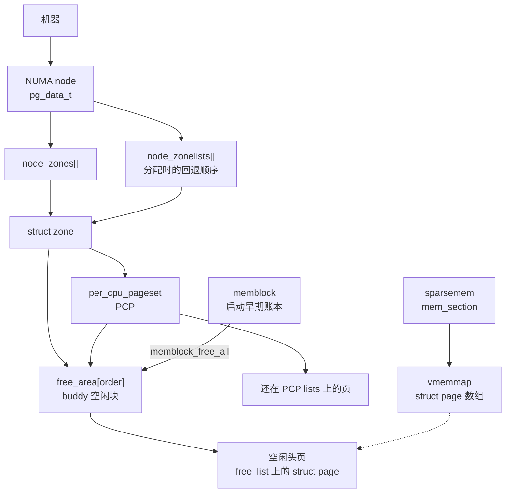

# 2. 物理布局：page / folio / node / zone / buddy / sparsemem

**结论**：每一页物理内存有一个 `struct page`；用户和页缓存看到的分配单位是 `folio`（可以是一页或多页）。页按 NUMA node（`pg_data_t`）再按 `zone` 分组。每个 zone 用 buddy 管空闲页：`free_area[order]` 上挂着 `2^order` 页的空闲块，PCP 是它前面的每 CPU 缓存。x86-64 默认用 sparsemem vmemmap 存放这些 `struct page`。启动早期的账在 memblock，`memblock_free_all` 之后空闲页才出现在 buddy 链表上。这一章给布局名词和 buddy 的拆/合概念；`rmqueue` 与 `__free_one_page` 的完整调用链在 [页分配](./03-00-page-alloc.md)。

> 定义：`include/linux/mm_types.h`、`include/linux/mmzone.h`。v6.6.160。源码对照 [elixir v6.6.160](https://elixir.bootlin.com/linux/v6.6.160/source)。
> 导航：[上一节 总览](./01-overview.md) · [目录](./README.md) · [下一节 页分配](./03-00-page-alloc.md)

## 2.0 全貌

先把后面要碰到的名词排成阅读顺序，再进入结构体。

**node** 是拓扑。一台机器有一个或多个 NUMA node，`pg_data_t` 代表其中一个：这段物理内存离哪组 CPU 近。**zone** 是这个 node 里一段可以拿来分配的范围（DMA、DMA32、NORMAL 这一类），水位和保留按 zone 算。**buddy** 是挂在 zone 下面的空闲页管家，空闲内存按 `2^order` 页一块，放进 `zone->free_area[order]`。**PCP** 是 buddy 前面的每 CPU 小缓存，单页和便宜的高阶先在这里周转，热路径少碰 `zone->lock`。**page / folio** 是页的身份证：`struct page` 每页一张，`folio` 是一次分配的那一整块。**sparsemem** 决定身份证放在哪：`mem_section` 指向 vmemmap 上的 `struct page` 数组。**memblock** 是 buddy 醒来之前的账本；`memblock_free_all` 把还没划走的页交进 buddy 之后，运行时的空闲链表才算数。



虚线表示 `struct page` 放在哪。memblock 那条箭头只在启动交接时走一次。

本章后面的顺序：

```text
2.1–2.2  page / folio：身份证长什么样
2.3–2.4  node / zone，以及 zone 上的 free_area、PCP 成员
2.5      buddy 概念：阶、伙伴、拆、合、migratetype
2.6      zonelist：一次分配允许走哪些 zone
2.7      sparsemem：struct page 放在哪
2.8      x86-64 虚拟布局，点到为止
2.9      pfn_to_page 三种模型
2.10     folio 的 refcount 与 mapcount
2.11     memblock 怎么把页交给 buddy
2.12     关键函数表
```

自检：一页现在没人用，它挂在哪个 node、哪个 zone 的哪条链表上？能指到 `node_zones[]` 里的某个 zone，并说出它在 `free_area[order]` 上还是在该 zone 的 PCP 上，这一节就读完了。阶、以及具体是哪一条 `free_list`，在 [2.5](#25-buddy-概念)。

`page->flags` 是一个 `unsigned long`（`include/linux/mm_types.h:75`）。它不是 C 语法里的 `int x:3` 位域，而是一个字，按位移塞进若干小整数。布局注释在 `include/linux/page-flags-layout.h:46-50`，移位宏在 `include/linux/mmzone.h:1048-1055`。高位往低位大致是：

```text
[SECTION] [NODE] ZONE [LAST_CPUPID] [KASAN tag] [LRU gen] [LRU refs] ... 页标志
```

方括号里的字段宽度可以是 0，编译期没有那一项时整段消失。

- **zone** 总在 flags 里。`page_zonenum()`（`include/linux/mmzone.h:1088`）用 `ZONES_PGSHIFT` / `ZONES_MASK` 把它拆出来。
- **node**：`NODES_WIDTH` 不为 0 时，`page_to_nid()`（`include/linux/mm.h:1643`）从 flags 拆。`NODE_NOT_IN_PAGE_FLAGS`（`include/linux/page-flags-layout.h:72`）时 node 不在这个字里，`page_to_nid` 改成 `include/linux/mm.h:1641` 声明的外部函数。sparsemem vmemmap 若塞不下 node，头文件直接 `#error`（`include/linux/page-flags-layout.h:63`）。
- **section**：只有经典 sparsemem、而且没开 vmemmap 时，`SECTION_IN_PAGE_FLAGS` 才成立（`include/linux/mm.h:1623`），这时才有 `page_to_section()`（`include/linux/mm.h:1886`）。x86-64 默认 `CONFIG_SPARSEMEM_VMEMMAP`，`SECTIONS_WIDTH` 是 0（`include/linux/page-flags-layout.h:52-55`），section 不在 `page->flags` 里，要按 PFN 去找 `mem_section`（[2.7](#27-sparsememstruct-mem_section)）。

空闲页属于哪个 node、哪个 zone，就靠这张身份证上的 node 和 zone。`page_zone()`（`include/linux/mm.h:1859`）把两者合成 `struct zone *`。

---

## 2.1 struct page

**结论**：每页一个 `struct page`（`include/linux/mm_types.h:74`）。`alloc_pages()` 之后，主 union 里大约五个 word 可以借给分配者用，**第一个 word 的 bit 0 必须保持 0**。`PageTail()` 用这一位判断复合页的 tail。

文件头注释在 `:35-67`。对齐宏 `_struct_page_alignment` 在 `:68-72`：`CONFIG_HAVE_ALIGNED_STRUCT_PAGE` 时按两个 `unsigned long` 对齐，给 SLUB 的 `cmpxchg_double` 用。`struct slab` 只是把 `struct page` 的位重新解释，所以每一页都按双字对齐。

读成员之前，三个词：

- **指针**是一个地址，里面记着另一块内存在哪。`struct address_space *mapping` 不把 `address_space` 嵌进 `page`，只记下它的位置。
- **链表**。`struct list_head`（`include/linux/types.h:191`）只有 `next` 和 `prev` 两个指针。它嵌在 `page` 里，很多 page 靠这对指针串成一条链。从链上的节点找回 `struct page`，用 `container_of`：已知成员在结构体里的偏移，用节点地址减这个偏移。
- **标志字**。`flags` 是一个 `unsigned long`，按位移塞小整数和布尔位，见 [2.0](#20-全貌)。`atomic_t` 是可以并发加减的整数，引用计数用它，避免两个 CPU 同时改把数字写花。

`union` 是同一块内存的几种解释，同一时刻只按页的用途选一种。主 union 的第一 word 和 `compound_head` 重叠，所以别的用途不能占用 bit 0，否则 `PageTail()`（`include/linux/page-flags.h:283`）会把普通页看成 tail。`PageTail` 还会调用 `page_is_fake_head()`（`:239`）：没编 HVO 时它恒为假，编了 HVO 时用来认出被折叠的假头页。

```c
/* include/linux/mm_types.h:74 */
struct page {
	unsigned long flags;		/* 原子标志。部分位会被异步改。nid/zone 等也编码在这里 */

	/*
	 * 五个 word（32 位上 20 字节，64 位上 40 字节）。
	 * 第一 word 的 bit 0 留给 PageTail()。
	 */
	union {
		/* --- 页缓存 / 匿名页 --- */
		struct {
			union {
				struct list_head lru;	/* LRU 节点。锁是 lruvec->lru_lock。主人有时把它当通用链表 */
				struct {		/* Unevictable「LRU」槽，和 lru 同占这块内存 */
					void *__filler;		/* 保持偶数地址，避免撞上 PageTail 的 bit 0 */
					unsigned int mlock_count; /* 这一页或 folio 被 mlock 的次数 */
				};
				struct list_head buddy_list;	/* 在 buddy 空闲链表上时用 */
				struct list_head pcp_list;	/* 在 per-CPU pageset 链表上时用 */
			};
			/* PAGE_MAPPING_FLAGS 见 include/linux/page-flags.h:659。最低位被复用 */
			struct address_space *mapping;
			union {
				pgoff_t index;		/* 在 mapping 里的页偏移 */
				unsigned long share;	/* 与 index 同 union。fsdax 的 share 计数 */
			};
			/*
			 * 私有数据。PagePrivate 时常放 buffer_head；
			 * PageSwapCache 时放 swp_entry_t；
			 * PageBuddy 时表示 buddy 的 order。
			 */
			unsigned long private;
		};
		/* --- page_pool（网络栈） --- */
		struct {
			unsigned long pp_magic;		/* 魔数，避免把不是 page_pool 分配的页回收进池 */
			struct page_pool *pp;		/* 所属 page_pool */
			unsigned long _pp_mapping_pad;	/* 占位，垫出和 mapping 对齐的布局 */
			unsigned long dma_addr;		/* DMA 地址 */
			union {
				unsigned long dma_addr_upper;	/* 32 位机器上 DMA 地址的高半 */
				atomic_long_t pp_frag_count;	/* frag 页的计数。32 位 + 64 位 DMA 时不用这条 */
			};
		};
		/* --- 复合页 tail --- */
		struct {
			/* bit 0 置位，PageTail() 为真。其余位是指向头页的指针 */
			unsigned long compound_head;
		};
		/* --- ZONE_DEVICE --- */
		struct {
			struct dev_pagemap *pgmap;	/* 所属设备的 pagemap */
			void *zone_device_data;		/* 设备私有数据 */
			/*
			 * 后面三个 word 不再起新名字，和第一臂的 mapping / index / private 重叠。
			 * 设备私有页在迁移期间用它们保住源匿名页或页缓存页的这三项。
			 * MEMORY_DEVICE_FS_DAX 也用这三项。
			 */
		};
		/* 用 RCU 延迟释放这一页时的回调头 */
		struct rcu_head rcu_head;
	};

	union {		/* 这个 union 共 4 字节 */
		/*
		 * 能映射进用户空间的页：这一页被页表直接映射的次数。
		 * 初值 -1，这样 atomic_inc_and_test / atomic_add_negative(-1)
		 * 能看见进出 0 的边沿。释放前若借用了这块，要 page_mapcount_reset()。
		 */
		atomic_t _mapcount;
		/*
		 * 既不是 slab、也不能映射进用户空间时，用它记录页的类型。
		 * 类型表在 page-flags.h。和 _mapcount 同占 4 字节。
		 */
		unsigned int page_type;
	};

	/* 引用计数。不要直接摸，走 page_ref.h。alloc_pages() 返回时已经是正数 */
	atomic_t _refcount;

#ifdef CONFIG_MEMCG
	unsigned long memcg_data;	/* memcg 归属。和 cgroup 章的 charge 对得上 */
#endif

	/*
	 * 全部内存都能直接映射时，虚拟地址可以算出来。
	 * 有高端内存时，要有个地方记下动态映射出来的内核虚拟地址。
	 * 注释说在 x86 上它甚至可以是 16 位，那是历史口吻。
	 * 乘法慢的架构在 asm/page.h 里定义 WANT_PAGE_VIRTUAL。
	 */
#if defined(WANT_PAGE_VIRTUAL)
	void *virtual;			/* 内核虚拟地址。高端内存还没 kmap 时是 NULL */
#endif

#ifdef CONFIG_KMSAN
	/*
	 * 影子页：对应 bit 表示原页该 bit 是否未初始化。
	 */
	struct page *kmsan_shadow;
	/*
	 * 起源页：每 4 字节一个栈轨迹 id，记录未初始化值从哪来。
	 */
	struct page *kmsan_origin;
#endif

#ifdef LAST_CPUPID_NOT_IN_PAGE_FLAGS
	int _last_cpupid;		/* 最后访问的 CPU/PID。flags 里放不下才落到这里。NUMA balancing 用 */
#endif
} _struct_page_alignment;
```

`address_space` 按 `long` 对齐（`include/linux/fs.h:492`），这样 `mapping` 指针的最低位可以留给 `PAGE_MAPPING_ANON`（`include/linux/page-flags.h:656`）。

`index` 就叫 `index`。folio 侧的同名成员和它对齐（`FOLIO_MATCH(index, index)`，`mm_types.h:369`）。

---

## 2.2 struct folio

**结论**：folio 是「这一次分配的那一整块页」的句柄（`include/linux/mm_types.h:293`）。它和 `struct page` 叠在同一块内存上：order 0 时就是一页；高阶时头页后面还叠着第二、第三个 `struct page` 的位置，用来放大页映射计数、页数和 hugetlb 私有数据。

内核用 `/* private: */` / `/* public: */` 标 kernel-doc 的可见性，不是 `CONFIG`，也不是成员。标了 private 的是布局占位或过渡字段，不是给你当 API 用的。下面按源码顺序列出全部成员。

```c
/* include/linux/mm_types.h:293
 * 第一段 union 的两臂一样大：一边是具名字段，一边是 struct page page。
 */
struct folio {
	/* private: 匿名 union，不当 API */
	union {
		struct {
	/* public: */
			unsigned long flags;		/* 同 page->flags */
			union {
				struct list_head lru;	/* LRU / 空闲链，语义同 page->lru */
	/* private: 避免把占位写进文档 */
				struct {
					void *__filler;		/* 躲开 compound_head 的 bit 0 */
	/* public: */
					unsigned int mlock_count; /* 这个槽里的 mlock 计数 */
	/* private: */
				};
	/* public: */
			};
			struct address_space *mapping;	/* 文件 address_space，或带 ANON 位的 anon_vma */
			pgoff_t index;			/* 在 mapping 中的页偏移。对应 page->index */
			union {
				void *private;		/* 映射私有数据 */
				swp_entry_t swap;	/* 与 private 同 union。swap 项 */
			};
			atomic_t _mapcount;		/* 头页 mapcount。初值语义同 page */
			atomic_t _refcount;		/* 整 folio 的引用 */
#ifdef CONFIG_MEMCG
			unsigned long memcg_data;	/* memcg */
#endif
	/* private: 和 struct page 的 union 是过渡 */
		};
		struct page page;			/* 把 folio 当 page 用时的视图 */
	};

	/* --- 第二页槽（__page_1），mm_types.h:325 --- */
	union {
		struct {
			unsigned long _flags_1;		/* private。与第二个 struct page 的 flags 重叠 */
			unsigned long _head_1;		/* private。与该页第一 word（compound_head）重叠 */
			unsigned long _folio_avail;	/* private。占位，给下面的计数腾开 */
	/* public: */
			atomic_t _entire_mapcount;	/* 整块被一条 PMD/PUD 映射的次数。读之前要 +1 */
			atomic_t _nr_pages_mapped;	/* 被 PTE 单独映射的子页数量。高位另有用途，见 2.10 */
			atomic_t _pincount;		/* 大 folio 的长期 pin 计数 */
#ifdef CONFIG_64BIT
			unsigned int _folio_nr_pages;	/* 这个 folio 有多少页。32 位改放在 _flags_1 的低 8 位 */
#endif
	/* private: 和 struct page 的 union 是过渡 */
		};
		struct page __page_1;			/* 第二个 page 的视图 */
	};

	/* --- 第三页槽（__page_2），mm_types.h:341。hugetlb 和延迟拆分叠在这里 --- */
	union {
		struct {
			unsigned long _flags_2;		/* private 占位，重叠第三个 page 的 flags */
			unsigned long _head_2;		/* private 占位 */
	/* public: */
			void *_hugetlb_subpool;		/* hugetlb 子池 */
			void *_hugetlb_cgroup;		/* hugetlb cgroup（用量） */
			void *_hugetlb_cgroup_rsvd;	/* hugetlb cgroup 预留 */
			void *_hugetlb_hwpoison;	/* 这一大页上的 hwpoison 记录 */
	/* private: 和 struct page 的 union 是过渡 */
		};
		struct {
			unsigned long _flags_2a;	/* 与 _flags_2 同位置的另一臂 */
			unsigned long _head_2a;
	/* public: */
			struct list_head _deferred_list; /* THP 延迟拆分队列上的节点 */
	/* private: */
		};
		struct page __page_2;			/* 第三个 page 的视图 */
	};
};
```

hugetlb 的四个指针和 `_deferred_list` 叠在第三个 `struct page` 上，两臂不能同时当数据用。

小 folio 不会去碰第二页以后的字段。把 order-0 folio 当成多页结构去写 `_deferred_list`，就是踩别的页的 `struct page`。

`_deferred_list` 是队列上的节点。队列本身在 `pgdat->deferred_split_queue`，开了 memcg 且 folio 属于某个 memcg 时改挂到 `memcg->deferred_split_queue`。选队列的函数是 `get_deferred_split_queue()`（`mm/huge_memory.c:588`，没开 memcg 时在 `:600`）。

`_refcount` 和 `_mapcount` 是两本账，get/put 规则见 [2.10](#210-folio-的-refcount-与-mapcount)。

---

## 2.3 node：pg_data_t / struct pglist_data

**结论**：一个 NUMA node 一个 `pg_data_t`（`include/linux/mmzone.h:1266`）。UMA 只有一个，`contig_page_data`（`:1550`）。它拥有本节点的 zone 数组和 zonelist，以及 kswapd/kcompactd。

`NODE_DATA(nid)`：没开 NUMA 时是 `include/linux/mmzone.h:1551` 的 inline，永远返回 `&contig_page_data`（`:1550`）。x86-64 开了 NUMA 时，宏在 `arch/x86/include/asm/mmzone_64.h:15`，展开成 `node_data[nid]`。通用头在 `include/linux/mmzone.h:1558` 把 `asm/mmzone.h` 拉进来。

```c
/* include/linux/mmzone.h:1266 */
typedef struct pglist_data {
	/*
	 * 只含本节点的 zone。没填满的槽可以是空的，但数组是完整的。
	 * 本节点和别的节点的 zonelist 都会引用它们。
	 */
	struct zone node_zones[MAX_NR_ZONES];
	/*
	 * 分配时用的 zone 回退链。
	 * 一般前面几项就是本节点的 zone。
	 */
	struct zonelist node_zonelists[MAX_ZONELISTS];
	int nr_zones;			/* 本节点有多少个已填充 zone */
#ifdef CONFIG_FLATMEM		/* 平坦 memmap。SPARSEMEM 不走这里 */
	struct page *node_mem_map;
#ifdef CONFIG_PAGE_EXTENSION
	struct page_ext *node_page_ext;	/* 页扩展信息 */
#endif
#endif
#if defined(CONFIG_MEMORY_HOTPLUG) || defined(CONFIG_DEFERRED_STRUCT_PAGE_INIT)
	/*
	 * 保护 node_start_pfn、node_present_pages、node_spanned_pages、nr_zones，
	 * 并同步 first_deferred_pfn。嵌套在 zone->lock 和 zone->span_seqlock 之上。
	 */
	spinlock_t node_size_lock;
#endif
	unsigned long node_start_pfn;		/* 本节点起始 PFN */
	unsigned long node_present_pages;	/* 物理上存在的页数（不含洞） */
	unsigned long node_spanned_pages;	/* 从起始到结束的跨度，含洞 */
	int node_id;				/* 节点号 */
	wait_queue_head_t kswapd_wait;		/* 唤醒 kswapd */
	wait_queue_head_t pfmemalloc_wait;	/* PFMEMALLOC 分配在等水位恢复 */
	/* 按不同原因节流回收的等待队列。NR_VMSCAN_THROTTLE 见 :279 */
	wait_queue_head_t reclaim_wait[NR_VMSCAN_THROTTLE];
	atomic_t nr_writeback_throttled;	/* 正被回写节流的任务数 */
	/*
	 * 开始节流时已经写出的页数，用来判断回写有没有进展。
	 */
	unsigned long nr_reclaim_start;
#ifdef CONFIG_MEMORY_HOTPLUG
	struct mutex kswapd_lock;		/* 保护 kswapd 任务指针 */
#endif
	struct task_struct *kswapd;		/* 本节点的 kswapd。热插拔配置下由 kswapd_lock 保护 */
	int kswapd_order;			/* kswapd 这次要满足的阶 */
	enum zone_type kswapd_highest_zoneidx;	/* kswapd 最高扫到哪个 zone */
	int kswapd_failures;			/* 「回收量 == 0」的连续次数 */

#ifdef CONFIG_COMPACTION
	int kcompactd_max_order;			/* kcompactd 目标阶 */
	enum zone_type kcompactd_highest_zoneidx;	/* kcompactd 最高 zone */
	wait_queue_head_t kcompactd_wait;		/* 唤醒 kcompactd */
	struct task_struct *kcompactd;			/* 本节点压缩线程 */
	bool proactive_compact_trigger;			/* 主动压缩被触发 */
#endif
	unsigned long totalreserve_pages;	/* 留给内核、不给用户分配的本节点保留页 */

#ifdef CONFIG_NUMA
	unsigned long min_unmapped_pages;	/* node reclaim：未映射页超过这阈值才考虑就地回收 */
	unsigned long min_slab_pages;		/* node reclaim：slab 页阈值 */
#endif

	/* --- 回收侧。把写频繁的字段推到另一条 cache line --- */
	CACHELINE_PADDING(_pad1_);

#ifdef CONFIG_DEFERRED_STRUCT_PAGE_INIT
	unsigned long first_deferred_pfn;	/* 延迟初始化 struct page 时，下一个还没初始化的 PFN */
#endif
#ifdef CONFIG_TRANSPARENT_HUGEPAGE
	struct deferred_split deferred_split_queue; /* THP 延迟拆分队列。节点见 folio->_deferred_list */
#endif
#ifdef CONFIG_NUMA_BALANCING
	unsigned int nbp_rl_start;		/* 当前 promote 限速窗口的起始时间（ms） */
	unsigned long nbp_rl_nr_cand;		/* 该窗口开始时的 promote 候选页数 */
	unsigned int nbp_threshold;		/* promote 阈值（ms） */
	unsigned int nbp_th_start;		/* 阈值调整窗口起始（ms） */
	unsigned long nbp_th_nr_cand;		/* 阈值调整窗口开始时的候选页数 */
#endif
	/*
	 * 开了 MEMCG 就不用这个字段。注释写明要走 mem_cgroup_lruvec()。
	 * 没开 memcg 时，lruvec_pgdat() 用 container_of 从这里找回 pgdat
	 * （include/linux/mmzone.h:1446）。
	 */
	struct lruvec __lruvec;
	unsigned long flags;			/* 节点标志，见下面的 pgdat_flags */

#ifdef CONFIG_LRU_GEN
	struct lru_gen_mm_walk mm_walk;		/* kswapd 走页表时的 MGLRU 游标。成员见下 */
	struct lru_gen_memcg memcg_lru;		/* 本节点上 memcg 的分代链表 */
#endif

	CACHELINE_PADDING(_pad2_);
	struct per_cpu_nodestat __percpu *per_cpu_nodestats;	/* 每 CPU 的节点计数差分 */
	atomic_long_t vm_stat[NR_VM_NODE_STAT_ITEMS];		/* 节点级 vmstat */
#ifdef CONFIG_NUMA
	struct memory_tier __rcu *memtier;	/* 这个节点属于哪一档内存 */
#endif
#ifdef CONFIG_MEMORY_FAILURE
	struct memory_failure_stats mf_stats;	/* 硬件中毒页统计 */
#endif
} pg_data_t;
```

`CACHELINE_PADDING`（`include/linux/cache.h:180`）在 SMP 上展开成一个按 cache line 对齐的空结构，把后面的字段推到下一条 cache line。没开 SMP 时这个宏是空的（`:182`）。

`deferred_split`（`include/linux/mmzone.h:1226`，`CONFIG_TRANSPARENT_HUGEPAGE`）：

```c
struct deferred_split {
	spinlock_t split_queue_lock;	/* 保护下面的队列 */
	struct list_head split_queue;	/* 链头。链上的节点是 folio->_deferred_list */
	unsigned long split_queue_len;	/* 队列长度 */
};
```

`memory_failure_stats`（`include/linux/mmzone.h:1237`，`CONFIG_MEMORY_FAILURE`）。注释写明 `total = ignored + failed + delayed + recovered`，`total * PAGE_SIZE * 节点数` 对应 `/proc/meminfo` 的 `HardwareCorrupted`：

```c
struct memory_failure_stats {
	unsigned long total;		/* 中毒的原始页数。若干路径不计入，见头文件注释 */
	unsigned long ignored;
	unsigned long failed;
	unsigned long delayed;
	unsigned long recovered;
};
```

节点标志（`include/linux/mmzone.h:990`）：

| 枚举 | 中文 |
|---|---|
| `PGDAT_DIRTY` | 回收最近在 LRU 尾上看到很多脏文件页 |
| `PGDAT_WRITEBACK` | 回收最近看到很多正在回写的页 |
| `PGDAT_RECLAIM_LOCKED` | 防止并发回收 |

### `struct lruvec`（`include/linux/mmzone.h:620`）

没开 memcg 时，节点的 lruvec 就是上面的 `__lruvec`。开了 memcg 时，每个 memcg 在每个 node 上另有一份，`__lruvec` 不用。MGLRU 的两块状态挂在这份 lruvec 上，不挂在 `pgdat` 顶层。

```c
struct lruvec {
	struct list_head lists[NR_LRU_LISTS];	/* 经典 LRU：inactive/active、anon/file、unevictable */
	spinlock_t lru_lock;			/* 本 lruvec 的锁。memcg 时每份一份 */
	unsigned long anon_cost;		/* 回收匿名 LRU 的代价，用来倾斜扫描 */
	unsigned long file_cost;		/* 回收文件 LRU 的代价 */
	atomic_long_t nonresident_age;		/* 非驻留年龄，跟着 LRU 移动走 */
	unsigned long refaults[ANON_AND_FILE];	/* 上一轮回收时的 refault。ANON_AND_FILE 是 2（:298） */
	unsigned long flags;			/* lruvec 标志 */
#ifdef CONFIG_LRU_GEN
	struct lru_gen_folio lrugen;		/* 可回收页按代划分 */
	struct lru_gen_mm_state mm_state;	/* 并发遍历 mm 链表时的状态 */
#endif
#ifdef CONFIG_MEMCG
	struct pglist_data *pgdat;		/* 回指 node。lruvec_pgdat() 开 memcg 时走这里 */
#endif
};
```

### MGLRU（`CONFIG_LRU_GEN`）

`lru_gen_folio`（`include/linux/mmzone.h:418`）。最年轻的一代记在 `max_seq`，匿名和文件共用；最老的一代匿名和文件分开记在 `min_seq[]`，因为干净文件页在换出受限时仍可以先被赶走。各代页数最终一致，`reset_batch_size()` 还没做完时可以短暂为负。

```c
#ifdef CONFIG_LRU_GEN
struct lru_gen_folio {
	unsigned long max_seq;			/* 老化时加一：最年轻的一代 */
	unsigned long min_seq[ANON_AND_FILE];	/* 驱逐时加一：最老的一代，匿名和文件分开 */
	unsigned long timestamps[MAX_NR_GENS];	/* 每一代的出生时间，单位 jiffies。MAX_NR_GENS 是 4（:349） */
	/* 分代链表，驱逐时才懒排序。下标：代 × anon/file × zone */
	struct list_head folios[MAX_NR_GENS][ANON_AND_FILE][MAX_NR_ZONES];
	long nr_pages[MAX_NR_GENS][ANON_AND_FILE][MAX_NR_ZONES]; /* 每一格的页数，最终一致 */
	unsigned long avg_refaulted[ANON_AND_FILE][MAX_NR_TIERS]; /* refault 的指数滑动平均。MAX_NR_TIERS 是 4（:371） */
	unsigned long avg_total[ANON_AND_FILE][MAX_NR_TIERS];	 /* evicted+protected 的指数滑动平均 */
	/* 第一档不需要保护，所以最后一维是 MAX_NR_TIERS - 1 */
	unsigned long protected[NR_HIST_GENS][ANON_AND_FILE][MAX_NR_TIERS - 1];
	/* 下面两项可以不拿 LRU 锁就改 */
	atomic_long_t evicted[NR_HIST_GENS][ANON_AND_FILE][MAX_NR_TIERS];
	atomic_long_t refaulted[NR_HIST_GENS][ANON_AND_FILE][MAX_NR_TIERS];
	bool enabled;				/* 多代 LRU 是否打开 */
#ifdef CONFIG_MEMCG
	u8 gen;					/* 这份 lru_gen_folio 属于 memcg 的哪一代 */
	u8 seg;					/* 属于链表的哪一段：head / tail / default */
	struct hlist_nulls_node list;		/* 挂进本节点的 memcg 分代链表 */
#endif
};
#endif
```

`NR_HIST_GENS`：开了 `CONFIG_LRU_GEN_STATS` 时等于 `MAX_NR_GENS`，否则是 1（`:399-403`）。

`lru_gen_mm_state`（`:463`）。Bloom filter 双缓冲，`NR_BLOOM_FILTERS` 是 2（`:461`）。

```c
#ifdef CONFIG_LRU_GEN
struct lru_gen_mm_state {
	unsigned long seq;			/* 每一轮结束写成 max_seq */
	struct list_head *head;		/* 当前这一轮从哪继续 */
	struct list_head *tail;		/* 上一轮在哪结束 */
	unsigned long *filters[NR_BLOOM_FILTERS]; /* 每轮翻转的 Bloom filter */
	unsigned long stats[NR_HIST_GENS][NR_MM_STATS]; /* 调试用的 mm 统计 */
};
#endif
```

`lru_gen_mm_walk`（`:476`）挂在 `pgdat` 上，给 kswapd 走页表用。`max_seq` 从 `lru_gen_folio` 抄来，走的过程中可能已经旧了。

```c
#ifdef CONFIG_LRU_GEN
struct lru_gen_mm_walk {
	struct lruvec *lruvec;		/* 正在回收的 lruvec */
	unsigned long max_seq;		/* 来自 lru_gen_folio.max_seq，不稳定 */
	unsigned long next_addr;	/* 当前 mm 里下一次要扫的地址 */
	int nr_pages[MAX_NR_GENS][ANON_AND_FILE][MAX_NR_ZONES]; /* 攒一批被 promote 的页 */
	int mm_stats[NR_MM_STATS];	/* 攒一批 mm 统计 */
	int batched;			/* 已经攒下、还没刷进 lruvec 的项数 */
	bool can_swap;			/* 这次 walk 能不能换出 */
	bool force_scan;		/* 为真时不按 young 位、bitmap、Bloom filter 跳过 */
};
#endif
```

`lru_gen_memcg` 的完整定义在 `CONFIG_LRU_GEN && CONFIG_MEMCG` 下（`:543`）。只开了 `CONFIG_LRU_GEN`、没开 memcg 时，`:567` 是一个空结构体。`MEMCG_NR_GENS` 是 3，`MEMCG_NR_BINS` 是 8（`:540-541`）。注释写明只有两代有效（old = seq，young = seq+1），第三格是为了无锁读到过期的 `seq-1` 时不要绕回 young。这套链表只服务全局回收；memcg 自己的回收仍走 `mem_cgroup_iter()`（注释 `:533-535`）。

```c
#if defined(CONFIG_LRU_GEN) && defined(CONFIG_MEMCG)
struct lru_gen_memcg {
	unsigned long seq;				/* 本节点 memcg 的代际计数 */
	unsigned long nr_memcgs[MEMCG_NR_GENS];		/* 每一代有多少 memcg。每个 memcg 在每个 node 有一份 lru_gen_folio */
	struct hlist_nulls_head fifo[MEMCG_NR_GENS][MEMCG_NR_BINS]; /* 全局回收用的分代分桶链表 */
	spinlock_t lock;				/* 保护上面这几项 */
};
#endif
```

---

## 2.4 struct zone

**结论**：zone 是分配和水位的单位（`include/linux/mmzone.h:815`）。x86-64 常见是 DMA、DMA32、NORMAL。`ZONE_MOVABLE` 用来让热拔插和 THP 少碰到不可移动页。在 6.12 上采样的本机快照只有 DMA / DMA32 / NORMAL，没有 MOVABLE（见 [13](./13-observability.md)）。

`enum zone_type`（`:720`）：

| 枚举 | 条件 | 中文 |
|---|---|---|
| `ZONE_DMA` | `CONFIG_ZONE_DMA` | DMA 窗口小的设备。x86 上通常 <16MB |
| `ZONE_DMA32` | `CONFIG_ZONE_DMA32` | 32 位 DMA 掩码盖得住的范围 |
| `ZONE_NORMAL` | 始终 | 正常可直接映射。设备若支持全地址 DMA，也能用这里 |
| `ZONE_HIGHMEM` | `CONFIG_HIGHMEM` | 32 位内核的高端内存。x86-64 没有 |
| `ZONE_MOVABLE` | 始终 | 尽量只放可移动页，方便 offlining，也让不可移动分配别把大页切碎 |
| `ZONE_DEVICE` | `CONFIG_ZONE_DEVICE` | 设备内存，不进普通 buddy 回收 |
| `__MAX_NR_ZONES` | 始终 | 数组上界。`MAX_NR_ZONES` 由生成的 bounds 提供，和这个枚举对齐 |

`ZONE_MOVABLE` 的注释（`:754-801`）列了仍可能出现的例外：长期 pin、memblock 在 kernelcore/movablecore 下留下的不可移动页、内存洞、`PG_hwpoison`、半托管的 `PG_offline`（XEN balloon、Hyper-V balloon、virtio-mem）、`ZERO_PAGE(0)`、`memmap_on_memory` 放在 MOVABLE 里的 vmemmap 页。

水位下标（`:658`）：`WMARK_MIN`、`WMARK_LOW`、`WMARK_HIGH`、`WMARK_PROMO`，上界 `NR_WMARK`。读水位用 `min_wmark_pages()` 这一类宏（`:679`），它们把 `_watermark[i]` 和 `watermark_boost` 加在一起。

zone 标志（`:1001`）：

| 枚举 | 中文 |
|---|---|
| `ZONE_BOOSTED_WATERMARK` | 最近抬高过水位。kswapd 被唤醒时清掉 |
| `ZONE_RECLAIM_ACTIVE` | kswapd 可能正在扫这个 zone |

### zone 成员（按源码顺序）

```c
/* include/linux/mmzone.h:815 */
struct zone {
	/* --- 读多写少的前半 --- */

	unsigned long _watermark[NR_WMARK];	/* 水位。用 *_wmark_pages(zone) 读，不要裸读 */
	unsigned long watermark_boost;		/* 临时抬高的水位。碎片或分配压力会 boost */

	/*
	 * 为高阶原子分配保留的页数。
	 * reserve_highatomic_pageblock()（mm/page_alloc.c:1926）的上限是
	 * zone 托管页的 1% 再加一个 pageblock（managed/100 + pageblock_nr_pages）。
	 */
	unsigned long nr_reserved_highatomic;

	/*
	 * 低 zone 留给高 zone 分配失败时的保留。/proc/zoneinfo 的 protection 就是它。
	 * sysctl_lowmem_reserve_ratio 变了会重算。
	 */
	long lowmem_reserve[MAX_NR_ZONES];

#ifdef CONFIG_NUMA
	int node;				/* 所属节点号 */
#endif
	struct pglist_data *zone_pgdat;		/* 回指 node */
	struct per_cpu_pages __percpu *per_cpu_pageset;	/* 每 CPU 的热页缓存 */
	struct per_cpu_zonestat __percpu *per_cpu_zonestats; /* 每 CPU zone 计数差分 */
	/*
	 * high 和 batch 复制到各个 pageset，热路径少去共享 cache line。
	 */
	int pageset_high;
	int pageset_batch;

#ifndef CONFIG_SPARSEMEM
	/*
	 * pageblock 的 migratetype 位图。SPARSEMEM 改放在 mem_section 里。
	 */
	unsigned long *pageblock_flags;
#endif

	unsigned long zone_start_pfn;		/* 起始 PFN。zone_start_paddr >> PAGE_SHIFT */

	/*
	 * managed_pages：buddy 正在管的页。水位按它算。present - reserved。
	 * spanned_pages：zone_end_pfn - zone_start_pfn，含洞。
	 * present_pages：物理存在的页，不含洞。热插拔写它要 mem_hotplug_begin/done()。
	 * present_early_pages：启动时就在、不含后来热插的 present 页。
	 * cma_pages：划给 CMA（MIGRATE_CMA）的页。
	 */
	atomic_long_t managed_pages;
	unsigned long spanned_pages;
	unsigned long present_pages;
#if defined(CONFIG_MEMORY_HOTPLUG)
	unsigned long present_early_pages;
#endif
#ifdef CONFIG_CMA
	unsigned long cma_pages;
#endif

	const char *name;			/* "DMA" / "DMA32" / "Normal" / "Movable"，/proc/zoneinfo 用 */

#ifdef CONFIG_MEMORY_ISOLATION
	unsigned long nr_isolate_pageblock;	/* 被隔离的 pageblock 数。zone->lock 保护 */
#endif

#ifdef CONFIG_MEMORY_HOTPLUG
	/*
	 * 保护 zone_start_pfn 和 spanned_pages。
	 * 分配快路径用 seqlock 读，因为不能总拿 zone->lock。
	 */
	seqlock_t span_seqlock;
#endif

	int initialized;			/* zone 是否已初始化 */

	/* --- 写频繁的分配侧 --- */
	CACHELINE_PADDING(_pad1_);

	/* buddy 本体。下标是 order，长度 NR_PAGE_ORDERS = MAX_ORDER + 1 */
	struct free_area free_area[NR_PAGE_ORDERS];

#ifdef CONFIG_UNACCEPTED_MEMORY
	/* 还没 accept 的页。链上全是 MAX_ORDER */
	struct list_head unaccepted_pages;
#endif

	unsigned long flags;			/* zone 标志，例如 ZONE_BOOSTED_WATERMARK */
	spinlock_t lock;			/* 主要保护 free_area */

	/* --- 压缩与统计 --- */
	CACHELINE_PADDING(_pad2_);

	/*
	 * 空闲页低于这点时，读空闲数要避免 per-CPU 计数漂移把水位看错。
	 */
	unsigned long percpu_drift_mark;

#if defined CONFIG_COMPACTION || defined CONFIG_CMA
	unsigned long compact_cached_free_pfn;	/* 空闲扫描器下次从哪开始 */
	/* 迁移扫描器，异步/同步各一个。ASYNC_AND_SYNC 是 2（:813） */
	unsigned long compact_cached_migrate_pfn[ASYNC_AND_SYNC];
	unsigned long compact_init_migrate_pfn;	/* 本轮迁移扫描的起点 */
	unsigned long compact_init_free_pfn;	/* 本轮空闲扫描的起点 */
#endif
#ifdef CONFIG_COMPACTION
	unsigned int compact_considered;	/* 上次失败后已经尝试过的次数 */
	unsigned int compact_defer_shift;	/* 失败后跳过 1<<shift 次再试 */
	int compact_order_failed;		/* 失败过的最小阶 */
#endif
#if defined CONFIG_COMPACTION || defined CONFIG_CMA
	bool compact_blockskip_flush;		/* 为真时要清 PG_migrate_skip */
#endif

	bool contiguous;			/* zone 的 PFN 是否连续（没有洞）。压缩可以走更快的路径 */

	CACHELINE_PADDING(_pad3_);
	atomic_long_t vm_stat[NR_VM_ZONE_STAT_ITEMS];		/* zone 级计数，NR_FREE_PAGES 等 */
	atomic_long_t vm_numa_event[NR_VM_NUMA_EVENT_ITEMS];	/* NUMA 命中/未命中。非 NUMA 时长度是 0 */
} ____cacheline_internodealigned_in_smp;
```

### `struct free_area`（`include/linux/mmzone.h:113`）

更长的注释在 [2.5](#25-buddy-概念)。

```c
struct free_area {
	struct list_head free_list[MIGRATE_TYPES];	/* 每个 migratetype 一条空闲链 */
	unsigned long nr_free;				/* 这一阶的空闲块数，各 migratetype 加总 */
};
```

`enum migratetype`（`:47`）：

| 值 | 中文 |
|---|---|
| `MIGRATE_UNMOVABLE` | 不可移动。内核数据结构、页表这一类 |
| `MIGRATE_MOVABLE` | 可移动。用户匿名页、页缓存 |
| `MIGRATE_RECLAIMABLE` | 可回收。inode/dentry slab 一类 |
| `MIGRATE_PCPTYPES` | **不是一种页**。它的值等于 PCP 上有几种类型（上面三种） |
| `MIGRATE_HIGHATOMIC` | 等于 `MIGRATE_PCPTYPES`。高阶原子分配的保留块 |
| `MIGRATE_CMA` | `CONFIG_CMA`。行为上模仿 ZONE_MOVABLE，分配器不会悄悄改这种 pageblock 的类型 |
| `MIGRATE_ISOLATE` | `CONFIG_MEMORY_ISOLATION`。隔离中，不能从这里分 |
| `MIGRATE_TYPES` | 数组上界 |

能跟普通块合并的是 `< MIGRATE_PCPTYPES` 的类型（`migratetype_is_mergeable`，`:94`）。HIGHATOMIC、CMA、ISOLATE 守着自己的 pageblock。为什么要分这些类型，见 [2.5](#25-buddy-概念)。

### `struct per_cpu_pages`（`:684`）

```c
struct per_cpu_pages {
	spinlock_t lock;	/* 保护 lists */
	int count;		/* 列表里的页数 */
	int high;		/* 高水位，超过就要倒回 buddy。从 zone->pageset_high 复制 */
	int batch;		/* 一次向 buddy 批量申请/归还的大小。从 zone->pageset_batch 复制 */
	short free_factor;	/* 连续释放时把一次倒回的批量放大。分配时右移 */
#ifdef CONFIG_NUMA
	short expire;		/* 减到 0 就排空远程节点的 pageset */
#endif
	/*
	 * 按 migratetype × order 分链。
	 * NR_LOWORDER_PCP_LISTS = MIGRATE_PCPTYPES * (PAGE_ALLOC_COSTLY_ORDER + 1)
	 * （:676）。PAGE_ALLOC_COSTLY_ORDER 是 3（:45）。
	 * 开了 CONFIG_TRANSPARENT_HUGEPAGE 时 NR_PCP_THP 是 2（:672），
	 * 再加到 NR_PCP_LISTS（:677）。没开 THP 时这两条是 0。
	 */
	struct list_head lists[NR_PCP_LISTS];
} ____cacheline_aligned_in_smp;
```

---

## 2.5 buddy 概念

**结论**：一页空闲内存在 buddy 里时，它是某个 `2^order` 连续块的头页。所在 zone 是 `page_zone(page)`（`include/linux/mm.h:1859`）：`&NODE_DATA(page_to_nid(page))->node_zones[page_zonenum(page)]`。块挂在这个 zone 的 `free_area[order].free_list[migratetype]` 上，链表节点是 `page->buddy_list`。同阶没有空闲块时，分配从更高阶拆；释放时若伙伴也空闲，就往上合并。PCP 上的页还没进（或已经离开）这张表。`rmqueue` 怎么选 PCP 还是 buddy，在 [03-04-pcp-and-rmqueue.md](./03-04-pcp-and-rmqueue.md)；`__free_one_page` 怎么沿伙伴往上合，在 [03-05-buddy-free.md](./03-05-buddy-free.md)。

### 阶：order *n* 是 2^n 页

`order` 是连续页数的对数。order 0 是 1 页，order 1 是 2 页，order *n* 是 `1 << n` 页，而且这 `1 << n` 页的 PFN 连续、起始 PFN 按 `1 << n` 对齐。

`MAX_ORDER` 默认是 10（`include/linux/mmzone.h:29`）。打开 `CONFIG_ARCH_FORCE_MAX_ORDER` 时改用那个配置值（`:28-32`）。`NR_PAGE_ORDERS` 是 `MAX_ORDER + 1`（`:37`），所以 `zone->free_area[]` 的下标是 0 到 `MAX_ORDER`，默认一共 11 档。合并停在 `MAX_ORDER`：`__free_one_page` 的循环条件是 `order < MAX_ORDER`（`mm/page_alloc.c:813`）。最大的空闲块是 order 10。`__alloc_pages` 对 `order > MAX_ORDER` 直接返回 NULL（`:4477`）。

`PAGE_ALLOC_COSTLY_ORDER` 是 3（`include/linux/mmzone.h:45`）。头文件把它定成「贵」的分界：比这低的阶，在正常回收压力下比较容易自己合回去；再往上就难（`:39-43`）。这是分界，buddy 的最大阶仍是 `MAX_ORDER`。

x86-64 的 `PAGE_SHIFT` 是 12（`arch/x86/include/asm/page_types.h:10`），一页 4KB。下表按 4KB 页估算：

| order | 页数 `1 << order` | 4KB 页时 |
|---|---|---|
| 0 | 1 | 4KB |
| 1 | 2 | 8KB |
| 2 | 4 | 16KB |
| 3 | 8 | 32KB，`PAGE_ALLOC_COSTLY_ORDER` |
| 9 | 512 | 2MB。x86-64 开了 hugetlb 时，page block 通常是这一阶 |
| 10 | 1024 | 4MB，默认最大 buddy 块 |

一块 order *n* 的头页 PFN 要能被 `1 << n` 整除。`__free_one_page` 里有一条 `VM_BUG_ON_PAGE(pfn & ((1 << order) - 1), page)`（`mm/page_alloc.c:810`），调试配置下才触发。伙伴算法本身按这个对齐来配对：PFN 1 只作为 order 0 的头。

### 空闲块挂在 `free_area` 上

每个 zone 有一份 `free_area[NR_PAGE_ORDERS]`（`include/linux/mmzone.h:933`）。同一个阶的空闲块进同一个 `free_area`，再按迁移类型分链。链上只有该阶空闲块的头页，用 `page->buddy_list` 串起来（和 `lru`、`pcp_list` 同占一个 union）。头页后面的 `2^order - 1` 页跟在连续 PFN 上，不再各挂一次。`nr_free` 是本阶空闲块个数，各 migratetype 加总。

头页被 `set_buddy_order`（`mm/page_alloc.c:634`）标成 buddy 页：`PageBuddy` 置上，阶写进 `page->private`。`PageBuddy()` 是页类型，不是 `flags` 里的一位（`include/linux/page-flags.h:970`，类型位 `PG_buddy` 在 `:912`）。读阶用 `buddy_order`（`mm/internal.h:316`），它就是 `page_private(page)`。调用方必须先确认 `PageBuddy()`，而且一般要拿着 `zone->lock`，否则阶可能被并发改掉。

摘下一块用 `get_page_from_free_area`（`mm/page_alloc.c:736`）：从 `free_list[migratetype]` 取第一个 `buddy_list`。挂上去用 `add_to_free_list`（`:691`），同时 `nr_free++`。保护这张表的是 `zone->lock`。

所以 [2.0](#20-全貌) 的那一问，落到 buddy 上的答案是：

```text
page_zone(page)                          # include/linux/mm.h:1859
  = &NODE_DATA(page_to_nid(page))        # page_to_nid：include/linux/mm.h:1643（node 在 flags 里时）
        ->node_zones[page_zonenum(page)] # page_zonenum：include/linux/mmzone.h:1088
  ->free_area[order].free_list[migratetype]
        → 头页 page->buddy_list
```

页还在 PCP 上时，改看下面「PCP 在哪一层」，它不在 `free_area` 里。

### 伙伴：同一阶，PFN 差 `1 << order`

两块能配成伙伴，要阶相同，而且 PFN 相差正好 `1 << order`。差这一位，异或就能从一块跳到另一块：

```c
/* mm/internal.h:386。order 0 时相邻的偶数/奇数 PFN 互为伙伴 */
static inline unsigned long
__find_buddy_pfn(unsigned long page_pfn, unsigned int order)
{
	return page_pfn ^ (1 << order);
}
```

头文件里的例子（`:376-378`）：order 1、起始 PFN 8，伙伴是 `8 ^ (1 << 1) = 10`。8 和 10 各是 2 页，合起来是从 PFN 8 起的 4 页。合完的块取对齐的低地址，注释写成 `P = B & ~(1 << O)`（`:382`），`__free_one_page` 里就是 `buddy_pfn & pfn`（`mm/page_alloc.c:847`）。

伙伴是不是真能合，要过 `page_is_buddy`（`mm/internal.h:348`）这几关：伙伴在 buddy 里（`PageBuddy`，或者是 debug 的 guard 页）、阶和当前块相同、两者 `page_zone_id` 相同。zone 比较放在最后，和源码注释一致（`:357-359`）。`find_buddy_page_pfn`（`:406`）先用上面的异或找到候选页，再跑这几关；有一关不过就返回 NULL。持锁把阶往上抬的循环在 [03-05](./03-05-buddy-free.md)。

**释放时往上合。** `__free_one_page`（`mm/page_alloc.c:792`）里，还回来的块若伙伴也空闲，就把伙伴从它那条 `free_list` 摘掉（`del_page_from_free_list`，`:723`），阶加一，块地址改成两者里对齐的那个低地址，再试下一阶。循环条件是 `order < MAX_ORDER`（`:813`）。阶已经到 `pageblock_order` 时，类型不同、而且至少有一边 `migratetype_is_mergeable` 为假，就停止（`:824-836`）。类型相同可以继续合。停下来之后 `set_buddy_order` 写下最终的阶，`add_to_free_list` 或 `add_to_free_list_tail` 挂回对应的 `free_area[order]`。guard 页、直接 compact 把块截走、挂链表头还是尾，都在这个函数里，见 [03-05](./03-05-buddy-free.md)。

**分配时从高阶拆。** 目标阶的 `free_list` 是空的，就向更高的阶找（`__rmqueue_smallest`，`mm/page_alloc.c:1611`，调用链在 [03-04](./03-04-pcp-and-rmqueue.md)）。找到一块之后，`expand`（`:1435`）把用不到的高半截挂回去，调用者拿走低半截：

```c
/* mm/page_alloc.c:1435。进入时 size == 1 << high，page 指向整块的头 */
while (high > low) {
	high--;
	size >>= 1;
	/*
	 * 没开 CONFIG_DEBUG_PAGEALLOC，或 debug guard 的 static key 没开时，
	 * set_page_guard() 直接返回 false（include/linux/mm.h:3763 和 :3787）。
	 * page[size] 是高半截的头页。
	 */
	if (set_page_guard(zone, &page[size], high, migratetype))
		continue;
	add_to_free_list(&page[size], zone, high, migratetype);
	set_buddy_order(&page[size], high); /* 高半截自己成为这一阶的空闲块 */
}
/* 循环结束，page 仍指向最低那一截，阶已经降到 low，交给调用者 */
```

每拆一次，高半截变成伙伴，留在 buddy 里；低半截继续拆，直到阶等于请求。拆两次就是下面第一个例子。

### 例：只要 1 页，手头只有 order 2

请求 order 0。这条 migratetype 上 order 0 和 1 都没有块，order 2 有一块，PFN 0–3（4 页，起始对齐）。

```text
拆之前
  free_area[2]:  [0 1 2 3]

第一次，high 从 2 降到 1，size 从 4 变成 2
  高半截 page[2] 挂上 free_area[1]
  free_area[1]:  [2 3]
  手里还拿着:    [0 1]

第二次，high 从 1 降到 0，size 从 2 变成 1
  高半截 page[1] 挂上 free_area[0]
  free_area[1]:  [2 3]
  free_area[0]:  [1]
  分给调用者:    [0]
```

分出去的 PFN 0 清掉 `PageBuddy`，不再挂在 `free_list` 上。PFN 1 是它的 order 0 伙伴，PFN 2 是「PFN 0–1 这 2 页」的 order 1 伙伴。两条链上都只有头页。

### 例：还回一页，伙伴也空闲就合并

紧接着把 PFN 0 以 order 0 还回来。伙伴地址用 `pfn ^ (1 << order)`。

```text
order 0：0 ^ 1 = 1
  PFN 1 在 free_area[0] 上，阶相同，同一个 zone
  摘掉 PFN 1
  合成的块从 0 & 1 = 0 起，阶变成 1

order 1：0 ^ 2 = 2
  PFN 2 在 free_area[1] 上，本身就是 order 1 的头（盖住 2 和 3）
  摘掉 PFN 2
  合成的块从 0 & 2 = 0 起，阶变成 2

order 2：0 ^ 4 = 4
  假设 PFN 4 正在使用，page_is_buddy 失败，停止

挂回
  free_area[2]:  [0 1 2 3]
  头页 private = 2，PageBuddy 置上
```

两次合并把刚才拆开的三块（调用者手里的 1 页、order 0 的 PFN 1、order 1 的 PFN 2）收回成原来的 order 2。若 PFN 1 当时不空闲，第一次就停，PFN 0 自己挂到 `free_area[0]`。这两个例子的阶都低于 `pageblock_order`，上面「释放时往上合」里的 migratetype 检查不会插手。

### 为什么要分 migratetype

外碎片是：空闲页的总数够，但凑不齐一块高阶连续页。不可移动的内核页若散落在可移动的用户页中间，两边的空闲页就永远当不了伙伴。

buddy 把「能不能挪走」记在 pageblock 上，同一种 pageblock 里的空闲块进同一条 `free_list`。一个 pageblock 有 `pageblock_nr_pages`（`1 << pageblock_order`）页，整段共用一个迁移类型（`include/linux/pageblock-flags.h:55`）。类型位图在 sparsemem 下放在 `mem_section` 的 `usage` 里，平坦内存模型下放在 `zone->pageblock_flags`（[2.4](#24-struct-zone)、[2.7](#27-sparsememstruct-mem_section)）。

`pageblock_order` 按配置选（`include/linux/pageblock-flags.h:31-53`）：

- 开了 `CONFIG_HUGETLB_PAGE`，而且大页尺寸编译期固定：`MIN(HUGETLB_PAGE_ORDER, MAX_ORDER)`（`include/linux/pageblock-flags.h:44`）。
- `CONFIG_HUGETLB_PAGE_SIZE_VARIABLE`：它是运行时变量，`set_pageblock_order()`（`mm/mm_init.c:1471`）先取 `MAX_ORDER`，若 `HUGETLB_PAGE_ORDER` 更小再降下来。
- 没开 hugetlb：就是 `MAX_ORDER`（`include/linux/pageblock-flags.h:51`）。THP 不改这个宏。

x86 上 `HUGETLB_PAGE_ORDER` 是 `HPAGE_SHIFT - PAGE_SHIFT`（`arch/x86/include/asm/page_types.h:26`），`HPAGE_SHIFT` 等于 `PMD_SHIFT`（`:23`），`PMD_SHIFT` 是 21（`arch/x86/include/asm/pgtable_64_types.h:94`）。所以 order 是 9，比默认 `MAX_ORDER` 10 小，page block 是 512 页，也就是 2MB。`Documentation/filesystems/proc.rst` 把 page block 举例写成默认大页的大小，x86-64 上就是 2MB。

枚举值的表在 [2.4](#24-struct-zone)。分工是：

| 类型 | 放什么 | 和碎片的关系 |
|---|---|---|
| `MIGRATE_UNMOVABLE` | 页表、内核数据结构 | 挪不走。单独成段，避免钉死用户页之间的空隙 |
| `MIGRATE_MOVABLE` | 匿名页、页缓存 | 可以迁移，回收或 compact 之后容易合成高阶块 |
| `MIGRATE_RECLAIMABLE` | inode、dentry 一类 slab | 压力下可以丢掉，再把 pageblock 腾出来 |
| `MIGRATE_PCPTYPES` | PCP 上的类型种数 | 值等于上面三种的个数。分配时不当成一种页 |
| `MIGRATE_HIGHATOMIC` | 高阶原子分配的保留 | 等于 `MIGRATE_PCPTYPES`。没有回退链 |
| `MIGRATE_CMA` | CMA 区，`CONFIG_CMA` | 只给可移动分配用。分配器不会悄悄改这种 pageblock 的类型 |
| `MIGRATE_ISOLATE` | 热插拔、压缩隔离，`CONFIG_MEMORY_ISOLATION` | 隔离期间不从这里分 |

`fallbacks[]`（`mm/page_alloc.c:1643`）只给前三种排了借用顺序：自己的链空了，可以按这个顺序去认领别的类型的空 pageblock，或从里面偷页。做这件事的是 `__rmqueue_fallback`（`:2049`）和 `steal_suitable_fallback`（`:1813`），步骤在 [03-04](./03-04-pcp-and-rmqueue.md)。偷一次，两种页就进了同一个 pageblock，下一次高阶分配更难合上。HIGHATOMIC、CMA、ISOLATE 没有这条 fallback（数组注释 `:1641`）。

### PCP 在 buddy 前面

PCP 是每个 CPU、每个 zone 一份的小缓存，指针在 `zone->per_cpu_pageset`。字段在 [2.4](#24-struct-zone) 的 `struct per_cpu_pages`，这里只讲它和 buddy 的位置。

调用者要的阶被 `pcp_allowed_order`（`mm/page_alloc.c:579`）允许时，先从本 CPU 的 `lists[]` 拿，用 `pcp->lock`，不拿 `zone->lock`。允许的范围是 order 0 到 `PAGE_ALLOC_COSTLY_ORDER`（含 3）；编了 `CONFIG_TRANSPARENT_HUGEPAGE` 再加 `order == pageblock_order` 那一阶。单页分配走 order 0 那几条链，order 1 到 3 也会在 PCP 上停留。这个范围以外的阶直接找 buddy。下标用 `order_to_pindex`（`:546`）：低阶是 `migratetype + order * MIGRATE_PCPTYPES`；THP 那两条例外，可移动和不可移动各一条。

链空了，`rmqueue_bulk`（`:2168`）按 `batch` 一次从 buddy 补一批，只拿一次 `zone->lock`。补进来的页挂上 `pcp_list`，同时 `__mod_zone_page_state(zone, NR_FREE_PAGES, -(i << order))`（`:2198`）把空闲页计数减掉。`count` 达到 `high` 时，`free_unref_page_commit`（`:2421`）调用 `free_pcppages_bulk`（`:1229`）按 `batch` 倒回 buddy。倒回去才进 `__free_one_page`，由 `__mod_zone_freepage_state`（`include/linux/vmstat.h:490`）把 `NR_FREE_PAGES` 加回来。

用户把页还到 PCP 时，`free_unref_page`（`:2451`）只把页挂上 `lists[]`，不加 `NR_FREE_PAGES`。因此 PCP 上的页不在 `free_area` 里，也不在 `nr_free_pages` 里。连续释放会把 `pcp->free_factor` 加大（`nr_pcp_free`，`mm/page_alloc.c:2374`，自增在 `:2397`），一次多倒一些；分配时 `rmqueue_pcplist`（`:2770`）把 `free_factor` 右移（`:2792`）。

补货、排空的完整函数名在 [03-04](./03-04-pcp-and-rmqueue.md) 和 [03-05](./03-05-buddy-free.md)。

### `/proc/buddyinfo` 就是 `free_area` 的脸

`/proc/buddyinfo` 由 `frag_show_print` 打印（`mm/vmstat.c:1469`）。每一列是一个 order，从 0 到 `NR_PAGE_ORDERS - 1`，数字是 `zone->free_area[order].nr_free`：这一阶的空闲**块**个数，各种 migratetype 加在一起。页数等于这个数乘 `1 << order`。创建时权限是 `0444`（`:2140`）。读的时候不拿 `zone->lock`，源码用 `data_race` 标了这次无锁读（`:1480`），拆合进行中可能和真实链表差一块。

本机快照的读法和 DMA / DMA32 / Normal 三行在 [13.3](./13-observability.md)，那是在 6.12 上采样的数字，这里不改。高阶列是 0、低阶列有几千，是外碎片：空闲页还在，只是合成不了大块。

要按迁移类型拆开，看 `/proc/pagetypeinfo`（`pagetypeinfo_show`，`mm/vmstat.c:1627`）。它把每条 `free_list[mtype]` 走一遍，类型名字来自 `migratetype_names[]`（`mm/page_alloc.c:301`）：`Unmovable`、`Movable`、`Reclaimable`、`HighAtomic`，配置打开时还有 `CMA`、`Isolate`。这个文件的权限是 `0400`（`mm/vmstat.c:2141`）。在 6.12 上采样时读它是 `Permission denied`，数字不编，说明见 [13.4](./13-observability.md)。

---

## 2.6 struct zonelist / struct zoneref

**结论**：一次分配先选定一条 zonelist，从首选 zone 往回退 zone 扫。`__GFP_THISNODE` 用没有回退的那条。

`enum`（`include/linux/mmzone.h:1179`）：`ZONELIST_FALLBACK`；NUMA 上还有 `ZONELIST_NOFALLBACK`。`MAX_ZONELISTS` 是上界。

`struct zoneref`（`:1195`）和 `struct zonelist`（`:1214`）：

```c
struct zoneref {
	struct zone *zone;	/* 这条记录指向的 zone */
	int zone_idx;		/* zone_idx(zone) 的缓存，避免热路径再去大结构里算 */
};

struct zonelist {
	/*
	 * 多出来的一项是结束标记（zone == NULL）。
	 * first_zones_zonelist() 在 include/linux/mmzone.h:1654。
	 * MAX_ZONES_PER_ZONELIST = MAX_NUMNODES * MAX_NR_ZONES（:1177）。
	 */
	struct zoneref _zonerefs[MAX_ZONES_PER_ZONELIST + 1];
};
```

---

## 2.7 sparsemem：struct mem_section

**结论**：x86-64 不用一张巨大的 `mem_map[]`。物理地址切成 section，每个 section 一个 `mem_section`，里面藏着该段 `struct page` 数组的地址。PFN → page 先找 section，再加偏移。

`struct mem_section_usage`（`include/linux/mmzone.h:1777`）和 `struct mem_section`（`:1790`）：

```c
struct mem_section_usage {
	struct rcu_head rcu;	/* 释放 usage 时的 RCU 头 */
#ifdef CONFIG_SPARSEMEM_VMEMMAP
	/*
	 * 哪些 subsection 有 memmap。
	 * SUBSECTION_SHIFT 是 21（:1761）。4KB 页时一个 subsection 是 2MB。
	 */
	DECLARE_BITMAP(subsection_map, SUBSECTIONS_PER_SECTION);
#endif
	/*
	 * 柔性数组。pageblock migratetype 位图。
	 * SPARSEMEM 把这份图放在 mem_section 里，zone 这边就不编译这个指针。
	 */
	unsigned long pageblock_flags[0];
};

struct mem_section {
	/*
	 * 逻辑上是 struct page 数组指针，低位另有用途，早期启动还会编码 node id。
	 * 用之前要按 SECTION_MAP_MASK 清掉低位（__section_mem_map_addr，:1894）。
	 */
	unsigned long section_mem_map;
	struct mem_section_usage *usage;	/* 上面的 usage */
#ifdef CONFIG_PAGE_EXTENSION
	/* SPARSEMEM 下 page_ext 挂在 section 上，不挂在 pgdat */
	struct page_ext *page_ext;
	unsigned long pad;	/* 把结构补成 2 的幂 */
#endif
	/*
	 * SECTION_ROOT_MASK 依赖这个结构的大小是 2 的幂。
	 */
};
```

低位标志（`:1873`）：`SECTION_MARKED_PRESENT`、`SECTION_HAS_MEM_MAP`、`SECTION_IS_ONLINE`、`SECTION_IS_EARLY`，以及 `CONFIG_ZONE_DEVICE` 下的 `SECTION_TAINT_ZONE_DEVICE`。`SECTION_MAP_LAST_BIT` 是这些标志占到的下一位。nid 存在这一位之上（`SECTION_NID_SHIFT`，`:1892`）。

`CONFIG_SPARSEMEM_EXTREME` 时 `mem_section` 是二级指针（`:1831`），根的大小按页算：`SECTIONS_PER_ROOT = PAGE_SIZE / sizeof(struct mem_section)`（`:1821`）。否则 `SECTIONS_PER_ROOT` 是 1（`:1823`），`mem_section` 是二维数组（`:1833`）。

FLATMEM 的 `mem_map` 仍声明着（`:1223`），因为有的配置两边都编译到。x86-64 服务器看 sparsemem 就够。三种模型下 PFN 怎么变成 `struct page`，见 [2.9](#29-pfn_to_page三种模型)。

---

## 2.8 x86-64 虚拟布局（点到为止）

权威表在 `Documentation/arch/x86/x86_64/mm.rst`。4 级页表时和本章有关的几行：

| 虚拟范围（文档原文） | 大小 | 是什么 |
|---|---|---|
| `0000000000000000` – `00007fffffffffff` | 128TB | 用户空间，每个 `mm` 一份 |
| `ffff888000000000` – `ffffc87fffffffff` | 64TB | **直接映射** `page_offset_base`。内核用 `page_address()` / `virt_to_page()` 的那片 |
| `ffffc90000000000` – `ffffe8ffffffffff` | 32TB | **vmalloc/ioremap**（`vmalloc_base`） |
| `ffffea0000000000` – `ffffeaffffffffff` | 1TB | **vmemmap**（`vmemmap_base`）：`struct page` 数组自己住的虚拟地址 |
| `ffffffff80000000` 起 | 512MB | 内核文本，映射到物理 0 |
| `ffffffffa0000000` 起 | 1520MB | 模块 |

5 级页表把用户空间扩到 64PB（文档结束地址 `00ffffffffffffff`），内核映射整体下移。`CONFIG_DYNAMIC_MEMORY_LAYOUT` 时，KASLR（`arch/x86/mm/kaslr.c`）会挪 `page_offset_base` / `vmalloc_base` / `vmemmap_base`（`kaslr.c:54` 起）。所以上表是文档给出的经典布局，不是某一台机器 `dmesg` 的保证值。

直接映射是物理连续的线性映射。vmalloc 区是虚拟连续、物理页来自 buddy、可以不连续。`virt_to_page()` 只在 `virt_addr_valid()` 为真时有效（`arch/x86/include/asm/page.h:65-70`）。vmalloc 地址要走 `vmalloc_to_page()`（声明 `include/linux/mm.h:1149`，定义 `mm/vmalloc.c:698`）。

在 6.12 上采样，本机 `DirectMap1G` 约 15GB、`DirectMap2M` 约 3GB、`DirectMap4k` 18MB（[13](./13-observability.md)）。那是直接映射被拆成多大的页，不是 vmalloc。

---

## 2.9 `pfn_to_page`：三种模型

**结论**：`pfn_to_page` 不是一个函数。`include/asm-generic/memory_model.h:65` 把它定义成 `__pfn_to_page`，而 `__pfn_to_page` 按编译期的内存模型三选一。x86-64 服务器默认走 `CONFIG_SPARSEMEM_VMEMMAP`：PFN 就是 vmemmap 数组的下标。

`struct mem_section` 的字段在 [2.7](#27-sparsememstruct-mem_section)，这里不重复。

三种展开（同一文件，互斥）：

```c
/* FLATMEM，include/asm-generic/memory_model.h:18。一张 mem_map[]，PFN 减 ARCH_PFN_OFFSET 做下标 */
#define __pfn_to_page(pfn)	(mem_map + ((pfn) - ARCH_PFN_OFFSET))

/* SPARSEMEM_VMEMMAP，:37。vmemmap 在虚拟地址上连续，PFN 直接当下标 */
#define __pfn_to_page(pfn)	(vmemmap + (pfn))

/* 经典 SPARSEMEM（没有 VMEMMAP），:51。先找 section，再加 PFN */
#define __pfn_to_page(pfn)				\
({	unsigned long __pfn = (pfn);			\
	struct mem_section *__sec = __pfn_to_section(__pfn);	\
	__section_mem_map_addr(__sec) + __pfn;		\
})
```

经典 SPARSEMEM 那条能成立，是因为 `section_mem_map` 存的不是数组起点，而是「数组地址减去该 section 的起始 PFN」（文件注释 `:42-43`）。加上 PFN 之后，section 内的偏移自动对齐。低位标志要用 `__section_mem_map_addr`（`include/linux/mmzone.h:1894`）清掉，[2.7](#27-sparsememstruct-mem_section) 写过。

`page_to_pfn` 是反向的三条（`:19`、`:38`、`:45`），别名在 `:64`。`pfn_to_page` 的别名在 `:65`。

vmemmap 本身要先被填上页表。`vmemmap_populate_basepages`（`mm/sparse-vmemmap.c:292`）转去 `vmemmap_populate_range`（`:275`），`reuse` 参数传 NULL，按一个一个 base page 把 `[start, end)` 这段 `struct page` 虚拟地址铺出来。大页映射走 `vmemmap_populate_hugepages`（同文件 `:309`）。HVO 是铺完之后再把 hugetlb 的尾部 `struct page` 指到同一份，见 `mm/hugetlb_vmemmap.c` 和 [09](./09-thp-and-hugetlb.md)。

x86-64 开了 `CONFIG_DYNAMIC_MEMORY_LAYOUT` 时，`vmemmap` 就是 `vmemmap_base` 上的那片（`arch/x86/include/asm/pgtable_64.h:257`，基址在 `arch/x86/include/asm/pgtable_64_types.h:139`）。KASLR 会挪基址，公式不变：`page = vmemmap + pfn`。

---

## 2.10 folio 的 refcount 与 mapcount

**结论**：`folio` 是为了让「一次分配的那一整块」有一个句柄。order-0 时它和 `struct page` 重叠；高阶时头页代表整块，tail 不再各自算一笔分配。`_refcount` 回答「谁还抓着这块内存」，`_mapcount` 回答「有多少用户页表项指着它」。两本账不能互相代替。

字段布局在 [2.2](#22-struct-folio)，这里只讲语义。引入 folio 之前，复合页用 `PageHead` / `PageTail` 和 `compound_head()` 到处找头页，tail 上的计数容易和头页搞混。folio 把分配单位收成一个类型：`folio_nr_pages()`（`include/linux/mm.h:2054`）是这块有几页，引用和映射都记在头上。小 folio 返回 1。64 位上大 folio 读 `_folio_nr_pages`；32 位上读 `_flags_1` 的低 8 位，当作阶，再 `1 << order`。

`include/linux/page_ref.h:70-84` 列出 refcount 上常见的持有者，读代码时对得上：

| 成分 | 是什么 |
|---|---|
| 页表 | 每条指向这块的用户页表引用 |
| 页缓存 | 文件页还在 `address_space` 里 |
| 文件系统私有数据 | 文件系统自己抓着的引用 |
| LRU | 还挂在 LRU 上 |
| pipe | 管道缓冲区 |
| 直接 IO | 进程地址空间里还指着这一页的 IO |

规则：

- 已经持有引用，才能 `folio_get`（`include/linux/mm.h:1456`）。它先用 `folio_ref_zero_or_close_to_overflow`（`:1445`）看引用是不是 0 或靠近有符号溢出，再 `folio_ref_inc`。没持有引用时注释让你改用 `folio_try_get`。
- 手里没有引用（LRU 隔离、RCU 遍历），用 `folio_try_get`（`include/linux/page_ref.h:261`）。它是 `folio_ref_add_unless(folio, 1, 0)`：refcount 已经是 0（frozen，正在拆分、迁移或释放）就失败，不能把死页救活。
- `folio_put`（`include/linux/mm.h:1489`）减到 0 就进 `__folio_put`（声明 `:1294`），通常还回分配器。注释写明可以在持有自旋锁时调用，但不能在 NMI 里调用。
- `page_ref_count`（`include/linux/page_ref.h:65`）是 `atomic_read(&page->_refcount)`。`folio_ref_count`（`:87`）读的是头页。`page_count()`（`:92`）先 `page_folio()` 再读 folio 的引用，不要拿 tail 的 `_refcount` 当整块的引用。

mapcount 的读法（`include/linux/mm.h:1231`）：

```c
static inline int folio_mapcount(struct folio *folio)
{
	if (likely(!folio_test_large(folio)))
		return atomic_read(&folio->_mapcount) + 1;
	return folio_total_mapcount(folio);
}
```

小 folio 上，`_mapcount` 初值是 -1（`page_mapcount_reset`，`include/linux/mm.h:1189`），所以 +1 才是真正的映射次数。大 folio 走 `folio_total_mapcount`（`mm/rmap.c:1077`）：先算整块映射 `folio_entire_mapcount()`（`include/linux/mm.h:1178`，即 `_entire_mapcount + 1`），若没有任何子页被 PTE 单独映射（`folio_nr_pages_mapped`，`mm/internal.h:75`）就返回这个数；否则把每一页的 `_mapcount` 加进来，再补上每一页初值 -1 扣掉的那 1。

`page_mapcount()`（`include/linux/mm.h:1205`）多做一步：`_mapcount + 1` 小于 0 时当成 0。页类型和 `_mapcount` 同占 4 字节，类型页的这个数是负的。slab、页表页这些不能映射进用户空间的，这条路径报 0（注释 `:1202-1203`）。`folio_mapcount()` 对小 folio 不做这个负数检查。

`_entire_mapcount` 是整块被一条 PMD/PUD 映射的次数。`folio_entire_mapcount()` 的注释说，调试以外多半不是你要的数，它不含被 PTE 拆开映射的子页。`_nr_pages_mapped` 的低位是「有多少子页的 `_mapcount` 被抬高过」，掩码 `FOLIO_PAGES_MAPPED` 在 `mm/internal.h:63`。头文件注释说 hugetlb 目前把 `nr_pages_mapped` 留在 0（`:57-60`）。

`mlock_count` 是 unevictable 槽上的锁页计数，和 mapcount 也不是一回事，见 [10-09-mlock-unevictable.md](./10-09-mlock-unevictable.md)。大 folio 的长期 pin 记在第二页槽的 `_pincount`。order-0 用不到那一槽，`folio_maybe_dma_pinned()`（`include/linux/mm.h:1936`）改用引用计数上的一个偏置来判断。

拿到 folio 之后如果要改页表，还要页表锁。引用只保证这块 `struct page` 不会被释放，不保证 PTE 还指着它。

---

## 2.11 memblock：buddy 醒来之前

**结论**：启动早期没有 buddy、没有 slab。可用内存和已保留内存都记在 `struct memblock` 里。内核自己的早期分配走 `memblock_phys_alloc_range` 这一类，从 `memory` 里挖、记进 `reserved`。buddy 接盘之后，这套表可以丢掉（`memblock_discard`），除非 `CONFIG_ARCH_KEEP_MEMBLOCK`。

`include/linux/memblock.h`。

`struct memblock_region`（`:59`）：

```c
struct memblock_region {
	phys_addr_t base;		/* 区域物理基址 */
	phys_addr_t size;		/* 长度 */
	enum memblock_flags flags;	/* 见下 */
#ifdef CONFIG_NUMA
	int nid;			/* 这块属于哪个 node */
#endif
};
```

`memblock_flags`（`:44`）：

| 标志 | 值 | 中文 |
|---|---|---|
| `MEMBLOCK_NONE` | `0x0` | 没有特殊要求 |
| `MEMBLOCK_HOTPLUG` | `0x1` | 固件内存图里标成可热插拔 |
| `MEMBLOCK_MIRROR` | `0x2` | 镜像内存 |
| `MEMBLOCK_NOMAP` | `0x4` | 不要做内核直接映射，在内存图里当保留 |
| `MEMBLOCK_DRIVER_MANAGED` | `0x8` | 驱动报上来的，固件内存图里没有 |

`struct memblock_type`（`:76`）：

```c
struct memblock_type {
	unsigned long cnt;			/* 当前有多少个 region */
	unsigned long max;			/* regions 数组的容量 */
	phys_addr_t total_size;			/* 全部 region 的尺寸和 */
	struct memblock_region *regions;	/* region 数组 */
	char *name;				/* "memory" 或 "reserved" 这类名字 */
};
```

`struct memblock`（`:91`）：

```c
struct memblock {
	bool bottom_up;			/* 自低地址往高地址分 */
	phys_addr_t current_limit;		/* 当前允许分配到的物理地址上限 */
	struct memblock_type memory;		/* 可用内存 */
	struct memblock_type reserved;		/* 已经划走的 */
};
```

全局对象 `memblock`（`mm/memblock.c:115`，`__initdata_memblock`）。`memory` 和 `reserved` 的名字分别是 `"memory"` 和 `"reserved"`。

```text
memblock_phys_alloc_range(size, align, start, end)   # mm/memblock.c:1500
  → memblock_alloc_range_nid(..., NUMA_NO_NODE, false) # :1425
       在 [start, end) 里找一块对齐的空闲物理内存
       成功返回物理地址，失败返回 0
```

它标了 `__init`。buddy 起来之后再调，就是用一张已经废弃或只读的表。运行时要连续物理页，走 CMA / `alloc_contig_pages`，见 [03-09-cma.md](./03-09-cma.md)。

把 memblock 里还没划走的页交进 buddy 的是 `memblock_free_all`（`mm/memblock.c:2219`）。它下面的 `__free_pages_memory`（`:2087`）按对齐把一段 PFN 切成不超过 `MAX_ORDER` 的块：起始 PFN 不是 0 时，阶取 `min(MAX_ORDER, __ffs(start))`，再保证块不伸出这段的结尾。每块经 `memblock_free_pages`（`mm/mm_init.c:2601`）进 `__free_pages_core`（`mm/page_alloc.c:1333`）。

`CONFIG_DEFERRED_STRUCT_PAGE_INIT` 下，`struct page` 还没初始化的 PFN 在 `memblock_free_pages` 里直接返回（`mm/mm_init.c:2605`），要等延迟初始化之后才进 buddy。`__free_pages_core` 把参与页的引用计数清成 0，把页数加进 `zone->managed_pages`。开了 `CONFIG_UNACCEPTED_MEMORY` 时，order 为 `MAX_ORDER` 的块可能被 `__free_unaccepted()`（`mm/page_alloc.c:6749`）挂到 `zone->unaccepted_pages`，先不进 buddy。其余走 `__free_pages_ok`（`mm/page_alloc.c:1304`）：拿 `zone->lock`，调用 `__free_one_page`。交进去之后这些页怎么挂在 `free_area` 上，见 [2.5](#25-buddy-概念)。

`memblock_discard`：没开 `CONFIG_ARCH_KEEP_MEMBLOCK` 时，声明在 `include/linux/memblock.h:103`，定义在 `mm/memblock.c:371`，把早期的 `memory` / `reserved` 数组丢掉。开了 `CONFIG_ARCH_KEEP_MEMBLOCK` 时，`include/linux/memblock.h:107` 是空的 inline，表留着。

---

## 2.12 关键函数表

| 符号 | 位置 | 作用 |
|---|---|---|
| `page_zonenum` | `include/linux/mmzone.h:1088` | 从 `page->flags` 取 zone |
| `folio_zonenum` | `include/linux/mmzone.h:1094` | 同上，吃 folio |
| `page_to_nid` | `include/linux/mm.h:1643`；`NODE_NOT_IN_PAGE_FLAGS` 时声明在 `:1641` | 从 flags 取 nid，或走外部查找 |
| `folio_nid` | `include/linux/mm.h:1651` | `page_to_nid(&folio->page)` |
| `page_to_section` | `include/linux/mm.h:1886` | 只在 `SECTION_IN_PAGE_FLAGS` 里，也就是经典 sparsemem |
| `page_zone` | `include/linux/mm.h:1859` | nid + zone → `struct zone *` |
| `page_pgdat` | `include/linux/mm.h:1864` | nid → `pg_data_t` |
| `NODE_DATA` | 非 NUMA：`include/linux/mmzone.h:1551`。x86-64 NUMA：`arch/x86/include/asm/mmzone_64.h:15` | nid → `pg_data_t` |
| `lruvec_pgdat` | `include/linux/mmzone.h:1446` | lruvec → node |
| `first_zones_zonelist` | `include/linux/mmzone.h:1654` | zonelist 上第一个合格 zone |
| `migratetype_is_mergeable` | `include/linux/mmzone.h:94` | `< MIGRATE_PCPTYPES` 才能和普通块合并 |
| `__nr_to_section` | `include/linux/mmzone.h:1841` | section 号 → `mem_section` |
| `__pfn_to_section` | `include/linux/mmzone.h:1955` | PFN → `mem_section` |
| `__section_mem_map_addr` | `include/linux/mmzone.h:1894` | 清掉 `section_mem_map` 低位，取出 page 数组 |
| `__pfn_to_page` / `pfn_to_page` | `include/asm-generic/memory_model.h:18` / `:37` / `:51`，别名 `:65` | 三种模型下 PFN → page |
| `__page_to_pfn` / `page_to_pfn` | 同文件 `:19` / `:38` / `:45`，别名 `:64` | 反向 |
| `vmemmap_populate_basepages` | `mm/sparse-vmemmap.c:292` | 按 base page 铺 vmemmap |
| `vmemmap_populate_hugepages` | `mm/sparse-vmemmap.c:309` | 用大页铺 vmemmap |
| `page_ref_count` | `include/linux/page_ref.h:65` | 读 `_refcount` |
| `folio_ref_count` | `include/linux/page_ref.h:87` | 头页引用 |
| `page_count` | `include/linux/page_ref.h:92` | 先 `page_folio()` 再读 folio 引用 |
| `folio_get` / `folio_put` | `include/linux/mm.h:1456` / `:1489` | 已持有时加减引用 |
| `folio_try_get` | `include/linux/page_ref.h:261` | 引用为 0 则失败 |
| `folio_mapcount` | `include/linux/mm.h:1231` | 用户页表映射次数 |
| `page_mapcount` | `include/linux/mm.h:1205` | 单页映射次数。类型页当 0 |
| `folio_entire_mapcount` | `include/linux/mm.h:1178` | 整块 PMD/PUD 映射次数 |
| `folio_total_mapcount` | `mm/rmap.c:1077` | 大 folio 的总映射次数 |
| `folio_nr_pages` | `include/linux/mm.h:2054` | 这块 folio 有几页 |
| `folio_nr_pages_mapped` | `mm/internal.h:75` | `_nr_pages_mapped` 的低位 |
| `folio_maybe_dma_pinned` | `include/linux/mm.h:1936` | 大 folio 看 `_pincount`，小 folio 看引用偏置 |
| `get_deferred_split_queue` | `mm/huge_memory.c:588`（无 memcg 时 `:600`） | THP 延迟拆分队列在 pgdat 还是 memcg |
| `PageTail` | `include/linux/page-flags.h:283` | `compound_head` 的 bit 0，外加 fake head |
| `__find_buddy_pfn` | `mm/internal.h:386` | 伙伴 PFN：`pfn ^ (1 << order)` |
| `page_is_buddy` | `mm/internal.h:348` | 阶、zone、`PageBuddy` 都对才合并 |
| `find_buddy_page_pfn` | `mm/internal.h:406` | 找到伙伴并做上面的检查 |
| `buddy_order` | `mm/internal.h:316` | `page->private`。调用方先确认 `PageBuddy` |
| `set_buddy_order` | `mm/page_alloc.c:634` | 阶写入 `page->private`，置 `PageBuddy` |
| `add_to_free_list` | `mm/page_alloc.c:691` | 头页挂上 `free_list`，`nr_free++` |
| `get_page_from_free_area` | `mm/page_alloc.c:736` | 从某条 `free_list` 取第一块 |
| `del_page_from_free_list` | `mm/page_alloc.c:723` | 从 buddy 摘下，清 `PageBuddy` |
| `expand` | `mm/page_alloc.c:1435` | 高阶块拆开，高半截挂回 `free_area` |
| `__free_one_page` | `mm/page_alloc.c:792` | 释放时沿伙伴往上合并 |
| `__rmqueue_smallest` | `mm/page_alloc.c:1611` | 从本类型的最低可用阶拆一块 |
| `__rmqueue` | `mm/page_alloc.c:2130` | 先 smallest，不够再 fallback |
| `__rmqueue_fallback` | `mm/page_alloc.c:2049` | 按 `fallbacks[]` 向别的类型借 |
| `steal_suitable_fallback` | `mm/page_alloc.c:1813` | 把借来的 pageblock 改成请求的类型 |
| `pcp_allowed_order` | `mm/page_alloc.c:579` | 这一阶能不能走 PCP |
| `order_to_pindex` | `mm/page_alloc.c:546` | order × migratetype → PCP 链下标 |
| `rmqueue_pcplist` | `mm/page_alloc.c:2770` | 从 PCP 拿页 |
| `rmqueue_bulk` | `mm/page_alloc.c:2168` | 一批从 buddy 补进 PCP，并减 `NR_FREE_PAGES` |
| `free_unref_page` | `mm/page_alloc.c:2451` | 把允许的阶还到 PCP |
| `free_unref_page_commit` | `mm/page_alloc.c:2421` | 挂上 `pcp->lists`，超高水位就倒回 |
| `nr_pcp_free` | `mm/page_alloc.c:2374` | 连续释放时放大 `free_factor`，决定一次倒回多少 |
| `free_pcppages_bulk` | `mm/page_alloc.c:1229` | PCP 倒回 buddy，进 `__free_one_page` |
| `__mod_zone_freepage_state` | `include/linux/vmstat.h:490` | 改 `NR_FREE_PAGES`（CMA 再改 `NR_FREE_CMA_PAGES`） |
| `frag_show_print` | `mm/vmstat.c:1469` | 打印 `/proc/buddyinfo` |
| `pagetypeinfo_show` | `mm/vmstat.c:1627` | 打印 `/proc/pagetypeinfo` |
| `set_pageblock_order` | `mm/mm_init.c:1471` | 仅 `CONFIG_HUGETLB_PAGE_SIZE_VARIABLE`。否则是空函数 `:1498` |
| `virt_addr_valid` | `arch/x86/include/asm/page.h:70` | 直接映射地址才为真 |
| `vmalloc_to_page` | 声明 `include/linux/mm.h:1149`；定义 `mm/vmalloc.c:698` | vmalloc 地址 → `struct page` |
| `memblock_phys_alloc_range` | `mm/memblock.c:1500` | 早期物理分配 |
| `memblock_alloc_range_nid` | `mm/memblock.c:1425` | 上面那个的实现 |
| `memblock_free_all` | `mm/memblock.c:2219` | 把早期空闲页交给 buddy |
| `__free_pages_memory` | `mm/memblock.c:2087` | 按 `MAX_ORDER` 把一段 PFN 切开 |
| `memblock_free_pages` | `mm/mm_init.c:2601` | 一块 PFN 进 `__free_pages_core` |
| `__free_pages_core` | `mm/page_alloc.c:1333` | 引用清零，计入 `managed_pages`，再 `__free_pages_ok` 或 unaccepted 链表 |
| `__free_unaccepted` | `mm/page_alloc.c:6749` | `CONFIG_UNACCEPTED_MEMORY`。MAX_ORDER 块先挂 `unaccepted_pages` |
| `__free_pages_ok` | `mm/page_alloc.c:1304` | 拿 `zone->lock`，调用 `__free_one_page` |
| `memblock_discard` | 声明 `include/linux/memblock.h:103`；定义 `mm/memblock.c:371`。`CONFIG_ARCH_KEEP_MEMBLOCK` 时 `include/linux/memblock.h:107` 是空 inline | buddy 接盘后丢掉 memblock |

---

[上一节 总览](./01-overview.md) · [目录](./README.md) · [下一节 页分配](./03-00-page-alloc.md)
