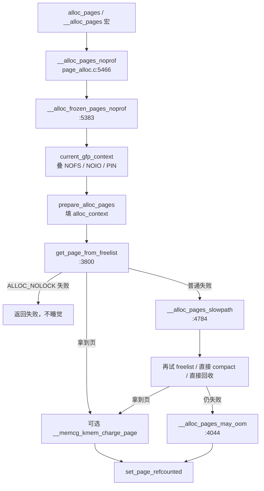

# 3.1 页分配总入口

**结论**：一次普通页分配先被 scope API 改写 gfp，填好 `struct alloc_context`，然后 `get_page_from_freelist` 走快路径。快路径失败且不是 `ALLOC_NOLOCK`，才进 `__alloc_pages_slowpath`。`__alloc_pages_noprof` 自己几乎不分配：它调 frozen 版本，成功再 `set_page_refcounted`。frozen 的意思是返回时引用计数还没交给调用者，slowpath 和 charge 失败都可以直接还回 buddy。

> 主文件：`mm/page_alloc.c`、`mm/page_alloc.h`。
> 导航：[上一篇 页分配](./03-00-page-alloc.md) · [本目录](./03-00-page-alloc.md) · [下一篇 GFP](./03-02-gfp-and-scope.md)

---

## 调用链

```text
alloc_pages(gfp, order)                         # 宏 gfp.h:302
  → alloc_pages_noprof                          # mempolicy.c:2575
       → alloc_frozen_pages_noprof              # 带 mempolicy；无策略时 page_alloc.h:242
            → __alloc_frozen_pages_noprof       # page_alloc.c:5383

__alloc_pages(gfp, order, nid, nodemask, flags) # 宏 page_alloc.h:259
  → __alloc_pages_noprof                        # page_alloc.c:5466
       → __alloc_frozen_pages_noprof
       → set_page_refcounted                    # 返回给调用者之前把引用设上

__alloc_frozen_pages_noprof                     # :5383
  → current_gfp_context                         # 继承 NOFS/NOIO、PF_MEMALLOC_PIN
  → prepare_alloc_pages                         # 填 alloc_context：zonelist、migratetype、最高 zone
  → get_page_from_freelist                      # 快路径，水位用 WMARK_LOW（nolock 用 WMARK_MIN）
  → 失败且不是 ALLOC_NOLOCK：
       __alloc_pages_slowpath                   # :4784
  → __GFP_ACCOUNT 时 __memcg_kmem_charge_page   # 内核页 charge，失败则把页还回去
  → trace_mm_page_alloc
```

```c
/* page_alloc.c:5435 附近，注释按源码意图写 */
page = get_page_from_freelist(alloc_gfp, order, fastpath_alloc_flags, &ac);
if (likely(page) || (alloc_flags & ALLOC_NOLOCK))
    goto out;                          /* 拿到了，或者明确不许睡觉 */
page = __alloc_pages_slowpath(alloc_gfp, order, &ac);
```

`ALLOC_NOLOCK` 是不能睡眠、不能拿 zone 锁的分配（`alloc_pages_nolock` 一类）。它只有一次尝试。

GFP 位和 scope 怎么改写这份 gfp，见 [02](./03-02-gfp-and-scope.md)。快路径里 zonelist 怎么走，见 [03](./03-03-fastpath-freelist.md)。慢路径见 [06](./03-06-slowpath.md)。



---

## `struct alloc_context`（`mm/page_alloc.h:76`）

头文件注释写明：这份结构装的是分配函数之间传递的、基本不变的参数。`nodemask`、`migratetype`、`highest_zoneidx` 在 `__alloc_pages()` 里只填一次。`zonelist`、`preferred_zoneref`、`highest_zoneidx` 快路径先设好，slowpath 里可能再改。其它函数拿到的是 const 指针。

| 成员 | 中文 |
|---|---|
| `struct zonelist *zonelist` | 这次允许走的 zone 列表。`__GFP_THISNODE` 用 `ZONELIST_NOFALLBACK`，否则是带回退的那条 |
| `const nodemask_t *nodemask` | 调用者给的节点掩码。NULL 表示不额外限制。mempolicy 会在进来之前把它算好 |
| `struct zoneref *preferred_zoneref` | zonelist 上的起始项。快路径从这里往后扫，不从数组头重来 |
| `int migratetype` | 由 gfp 推出的迁移类型：UNMOVABLE / MOVABLE / RECLAIMABLE。决定进哪条 buddy 链、哪条 PCP 链 |
| `enum zone_type highest_zoneidx` | 这次请求能用的最高 zone。比它低的 zone 用 `lowmem_reserve[highest_zoneidx]` 保护，防止高 zone 的分配把 DMA/DMA32 榨干。回收和 compaction 也用它封顶：比它高的 zone 对这次请求没用 |
| `bool spread_dirty_pages` | 脏页分配要摊开。快路径里为真时看 `node_dirty_ok`，避免一个 node 吃掉全局脏页配额 |
| `unsigned int alloc_flags` | 只放对整次分配都生效的标志（水位档、`ALLOC_CPUSET`、`ALLOC_CMA`、`ALLOC_NOFRAGMENT`、`ALLOC_NOLOCK` 一类），不是 gfp 本身 |

`prepare_alloc_pages` 是填这张表的地方，声明在调用链上，本篇不把每个赋值再抄一遍。改 gfp 的 scope 发生在填表之前（`page_alloc.c:5412-5419`）。

---

## 关键函数表

| 符号 | 位置 | 作用 |
|---|---|---|
| `alloc_pages` | 宏 `include/linux/gfp.h:302` | 最常见入口 |
| `alloc_pages_noprof` | `mm/mempolicy.c:2575` | 加 mempolicy 后的入口 |
| `__alloc_pages` | 宏 `mm/page_alloc.h:259` | 指定 nid / nodemask。不是 C 函数 |
| `__alloc_pages_noprof` | `mm/page_alloc.c:5466` | 上面这个宏的实现。成功后 `set_page_refcounted` |
| `__alloc_frozen_pages_noprof` | `page_alloc.c:5383` | 快路径 + slowpath。返回时引用还没交给调用者 |
| `alloc_frozen_pages_noprof` | 声明 `page_alloc.h:240`；无 NUMA 时内联 `:242` | 带策略或本节点的 frozen 入口 |
| `current_gfp_context` | `include/linux/sched/mm.h:248` | 按任务标志改写 gfp。细节在 [02](./03-02-gfp-and-scope.md) |
| `get_page_from_freelist` | `page_alloc.c:3800` | 扫 zonelist。细节在 [03](./03-03-fastpath-freelist.md) |
| `__alloc_pages_slowpath` | `page_alloc.c:4784` | 回收 / 压缩 / OOM。细节在 [06](./03-06-slowpath.md) |
| `get_free_pages_noprof` | `page_alloc.c:5503` | 返回虚拟地址。不能带 HIGHMEM |
| `alloc_pages_exact_noprof` | `page_alloc.c:5633` | 非 2 的幂。内部分高阶再砍 |

---

[上一篇 页分配](./03-00-page-alloc.md) · [本目录](./03-00-page-alloc.md) · [下一篇 GFP 与 scope](./03-02-gfp-and-scope.md)
