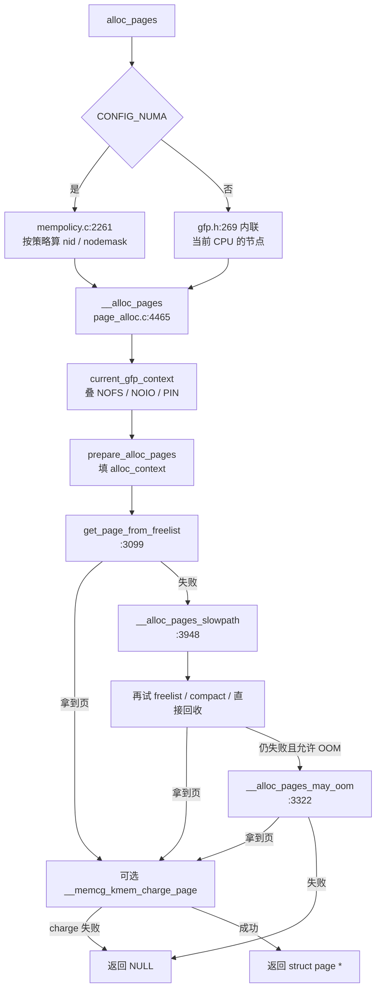

# 3.1 页分配总入口

**结论**：一次普通页分配先被 scope API 改写 gfp，填好 `struct alloc_context`，然后 `get_page_from_freelist` 走快路径。快路径失败就进 `__alloc_pages_slowpath`。不能睡觉的分配也会进 slowpath，但 slowpath 发现没有 `__GFP_DIRECT_RECLAIM` 就马上返回失败，不会在调用者上下文里回收。`__alloc_pages` 自己在返回前做 memcg charge 和 trace，页的引用计数在 `prep_new_page` 里已经立好。

阶和拆/合的概念在 [02 §2.5](./02-physical-layout.md#25-buddy-概念)。

> 主文件：`mm/page_alloc.c`。声明在 `include/linux/gfp.h`。`struct alloc_context` 在 `mm/internal.h`。
> 内核版本：**v6.6.160**。
> 导航：[上一篇 页分配](./03-00-page-alloc.md) · [本目录](./03-00-page-alloc.md) · [下一篇 GFP](./03-02-gfp-and-scope.md)

---

## 调用链

编了 `CONFIG_NUMA` 时，`alloc_pages` 是 `mm/mempolicy.c:2261` 的 C 函数。它先看当前进程的 mempolicy，再调用 `__alloc_pages`。没编 NUMA 时，`include/linux/gfp.h:269` 把它内联成「从当前 CPU 的节点分」。

```text
#ifdef CONFIG_NUMA
alloc_pages(gfp, order)                         # mm/mempolicy.c:2261
  中断里，或者 gfp 带 __GFP_THISNODE：
    用 default_policy（模式是 MPOL_LOCAL，mempolicy.c:127）
  否则 get_task_policy(current)                 # :166
  MPOL_INTERLEAVE
    → alloc_page_interleave                     # :2113
         → __alloc_pages(gfp, order, nid, NULL)
  MPOL_PREFERRED_MANY
    → alloc_pages_preferred_many                # :2130，两趟，见 08
  其它
    → __alloc_pages(gfp, order,
                    policy_node(...),           # :1868
                    policy_nodemask(...))       # :1845
#else
alloc_pages(gfp, order)                         # 内联 gfp.h:269
  → alloc_pages_node(numa_node_id(), ...)       # gfp.h:254
       → __alloc_pages_node                     # gfp.h:231
            → __alloc_pages(..., nid, NULL)
#endif

__alloc_pages(gfp, order, preferred_nid, nodemask)
                                                # 声明 gfp.h:177
                                                # 定义 page_alloc.c:4465
  order > MAX_ORDER：WARN_ON_ONCE_GFP，返回 NULL
  gfp &= gfp_allowed_mask
  gfp = current_gfp_context(gfp)                # 继承 NOFS / NOIO / PIN
  prepare_alloc_pages                           # 填 alloc_context
  alloc_flags |= alloc_flags_nofragment         # 可能加上 ALLOC_NOFRAGMENT
  get_page_from_freelist                        # 快路径，水位 ALLOC_WMARK_LOW
  失败：
    __alloc_pages_slowpath                      # :3948
  __GFP_ACCOUNT 且 memcg kmem 在线：
    __memcg_kmem_charge_page                    # 失败则 __free_pages 把页还回去
  trace_mm_page_alloc
  kmsan_alloc_page
```

`__alloc_pages` 开头和快慢分叉是下面这段（`page_alloc.c:4469-4514`）：

```c
unsigned int alloc_flags = ALLOC_WMARK_LOW;
gfp_t alloc_gfp;
struct alloc_context ac = { };

if (WARN_ON_ONCE_GFP(order > MAX_ORDER, gfp))
	return NULL;

gfp &= gfp_allowed_mask;
gfp = current_gfp_context(gfp);
alloc_gfp = gfp;
if (!prepare_alloc_pages(gfp, order, preferred_nid, nodemask, &ac,
		&alloc_gfp, &alloc_flags))
	return NULL;

alloc_flags |= alloc_flags_nofragment(ac.preferred_zoneref->zone, gfp);

page = get_page_from_freelist(alloc_gfp, order, alloc_flags, &ac);
if (likely(page))
	goto out;

alloc_gfp = gfp;
ac.spread_dirty_pages = false;
ac.nodemask = nodemask;

page = __alloc_pages_slowpath(alloc_gfp, order, &ac);
```

快路径用的水位是 `ALLOC_WMARK_LOW`。`prepare_alloc_pages` 还可能给 `alloc_flags` 加上 `ALLOC_CPUSET` 和 `ALLOC_CMA`。`alloc_flags` 不是 `alloc_context` 的成员，它单独传给 `get_page_from_freelist`。

`out` 之后（`:4516-4526`）才做 memcg charge。charge 失败会 `__free_pages` 把刚拿到的页还回去，调用者看到的是 NULL。

GFP 位和 scope 怎么改写这份 gfp，见 [02](./03-02-gfp-and-scope.md)。快路径里 zonelist 怎么走，见 [03](./03-03-fastpath-freelist.md)。慢路径见 [06](./03-06-slowpath.md)。mempolicy 的几种模式见 [08](./03-08-numa-policy.md)。



---

## 分配标志 `alloc_flags`

这些位在 `mm/internal.h:881` 起。调用者写的是 gfp。`alloc_flags` 是分配器内部用来选水位、cpuset、CMA、保留内存的开关。低两位同时当 `zone->_watermark[]` 的下标。

| 宏 | 值 | 作用 |
|---|---|---|
| `ALLOC_WMARK_MIN` | `WMARK_MIN`（0） | 查最低水位。slowpath 用这个 |
| `ALLOC_WMARK_LOW` | `WMARK_LOW`（1） | 快路径的水位 |
| `ALLOC_WMARK_HIGH` | `WMARK_HIGH`（2） | OOM 前再扫一遍时用 |
| `ALLOC_NO_WATERMARKS` | `0x04` | 不查水位 |
| `ALLOC_WMARK_MASK` | `0x03` | 取出上面三档下标 |
| `ALLOC_OOM` | `0x08`（没编 `CONFIG_MMU` 时等于 `ALLOC_NO_WATERMARKS`） | OOM 受害者可以再挖一截 min 保留 |
| `ALLOC_NON_BLOCK` | `0x10` | 调用者不能睡眠。可以动 min 保留的一部分 |
| `ALLOC_MIN_RESERVE` | `0x20` | 和 `__GFP_HIGH` 数值相同。可以动 50% 的 min |
| `ALLOC_CPUSET` | `0x40` | 走 cpuset 检查 |
| `ALLOC_CMA` | `0x80` | 允许从 CMA pageblock 拿 |
| `ALLOC_NOFRAGMENT` | `0x100`，没编 `CONFIG_ZONE_DMA32` 时是 0 | 先别从别的 migratetype 偷碎页 |
| `ALLOC_HIGHATOMIC` | `0x200` | 允许用 `MIGRATE_HIGHATOMIC` 保留 |
| `ALLOC_KSWAPD` | `0x800` | 和 `__GFP_KSWAPD_RECLAIM` 数值相同。可以叫醒 kswapd |

`ALLOC_RESERVES`（`:918`）是 `ALLOC_NON_BLOCK | ALLOC_MIN_RESERVE | ALLOC_HIGHATOMIC | ALLOC_OOM`。水位计算里，没有这份权利的分配会把 highatomic 保留算成不可用。

`gfp_to_alloc_flags`（`page_alloc.c:3742`）在 slowpath 里把 gfp 翻成这套标志，水位改成 MIN。快路径用 `ALLOC_WMARK_LOW`，热路径上不把每位都算细。

---

## `struct alloc_context`（`mm/internal.h:288`）

头文件注释写明：这份结构装的是分配函数之间传递的、基本不变的参数。`nodemask`、`migratetype`、`highest_zoneidx` 在 `__alloc_pages()` 里填好。`zonelist`、`preferred_zoneref`、`highest_zoneidx` 快路径先设好。其它函数拿到的经常是 const 指针。slowpath 在要用保留内存、或者不再受 cpuset 限制时，会把 `ac->nodemask` 改成 NULL，并重算 `preferred_zoneref`（`page_alloc.c:4107-4110`）。进 slowpath 之前，`__alloc_pages` 还会把 `spread_dirty_pages` 清掉（`:4506`）。

```c
struct alloc_context {
	struct zonelist *zonelist;		/* 这次允许走的 zone 列表 */
	nodemask_t *nodemask;			/* 节点掩码。NULL 表示不额外限制 */
	struct zoneref *preferred_zoneref;	/* zonelist 上的起始项 */
	int migratetype;			/* UNMOVABLE / MOVABLE / RECLAIMABLE */

	/*
	 * 这次请求能用的最高 zone。比它低的 zone 用
	 * lowmem_reserve[highest_zoneidx] 保护。回收和 compaction
	 * 也用它封顶：比它高的 zone 对这次请求没用。
	 */
	enum zone_type highest_zoneidx;
	bool spread_dirty_pages;		/* 脏页分配要摊开，只在快路径看 */
};
```

`prepare_alloc_pages`（`page_alloc.c:4249`）填这些成员：

1. `highest_zoneidx = gfp_zone(gfp_mask)`。zone 怎么从 gfp 低 4 位查出来，见 [02](./03-02-gfp-and-scope.md)。
2. `zonelist = node_zonelist(preferred_nid, gfp_mask)`。带 `__GFP_THISNODE` 时是 `ZONELIST_NOFALLBACK`，否则是 `ZONELIST_FALLBACK`（`gfp.h:147-153`）。
3. `nodemask` 先用调用者传入的。cpuset 开着、当前在进程上下文、而且调用者没给 nodemask 时，改成 `&cpuset_current_mems_allowed`。否则给 `alloc_flags` 加上 `ALLOC_CPUSET`。
4. `migratetype = gfp_migratetype(gfp_mask)`。`__GFP_MOVABLE` 和 `__GFP_RECLAIMABLE` 右移 3 位，对上 `MIGRATE_MOVABLE` / `MIGRATE_RECLAIMABLE`（`gfp.h:16-29`）。两个都设会 `VM_WARN_ON`。`page_group_by_mobility_disabled` 时一律 `MIGRATE_UNMOVABLE`。
5. `spread_dirty_pages` 等于 gfp 里有没有 `__GFP_WRITE`。
6. `preferred_zoneref` 是 zonelist 上第一个符合 `highest_zoneidx` 和 nodemask 的项。
7. 可移动分配在编了 `CONFIG_CMA` 时加上 `ALLOC_CMA`（`gfp_to_alloc_flags_cma`，`:3084`）。

`might_alloc` 和 `should_fail_alloc_page` 也在这里。故障注入命中就直接让这次分配失败。

---

## 关键函数表

| 符号 | 位置 | 作用 |
|---|---|---|
| `alloc_pages` | `CONFIG_NUMA` 时 `mm/mempolicy.c:2261`；否则内联 `include/linux/gfp.h:269` | 最常见入口。NUMA 下先套 mempolicy |
| `alloc_pages_node` | `gfp.h:254` | `nid == NUMA_NO_NODE` 时改用 `numa_mem_id()` |
| `__alloc_pages_node` | `gfp.h:231` | nid 必须合法，然后 `__alloc_pages(..., NULL)` |
| `__alloc_pages` | 声明 `gfp.h:177`，定义 `mm/page_alloc.c:4465` | 指定 nid / nodemask 的实现。快路径失败进 slowpath |
| `__folio_alloc` | `page_alloc.c:4530` | 带上 `__GFP_COMP` 再 `__alloc_pages`，返回 folio |
| `folio_alloc` | `mempolicy.c:2287` | `alloc_pages(gfp \| __GFP_COMP)` |
| `current_gfp_context` | `include/linux/sched/mm.h:235` | 按任务标志改写 gfp。细节在 [02](./03-02-gfp-and-scope.md) |
| `prepare_alloc_pages` | `page_alloc.c:4249` | 填 `alloc_context` |
| `alloc_flags_nofragment` | `page_alloc.c:3052` | 本节点 NORMAL、旁边有 DMA32 时加上 `ALLOC_NOFRAGMENT` |
| `gfp_to_alloc_flags` | `page_alloc.c:3742` | slowpath 把 gfp 翻成 `alloc_flags`，水位改成 MIN |
| `get_page_from_freelist` | `page_alloc.c:3099` | 扫 zonelist。细节在 [03](./03-03-fastpath-freelist.md) |
| `__alloc_pages_slowpath` | `page_alloc.c:3948` | 回收 / 压缩 / OOM。细节在 [06](./03-06-slowpath.md) |
| `__get_free_pages` | `page_alloc.c:4544` | 返回虚拟地址。先丢掉 `__GFP_HIGHMEM`，因为高页没有直接内核地址 |
| `get_zeroed_page` | `page_alloc.c:4555` | order 0，再加 `__GFP_ZERO` |
| `alloc_pages_exact` | `page_alloc.c:4775` | 要的字节数不是 2 的幂。先按 `get_order` 分高阶，再把多出来的页切开还回去 |
| `policy_nodemask` | `mm/mempolicy.c:1845` | BIND / PREFERRED_MANY 的节点掩码。细节在 [08](./03-08-numa-policy.md) |
| `policy_node` | `mempolicy.c:1868` | PREFERRED 和 home node 选起始节点 |

---

[上一篇 页分配](./03-00-page-alloc.md) · [本目录](./03-00-page-alloc.md) · [下一篇 GFP 与 scope](./03-02-gfp-and-scope.md)
