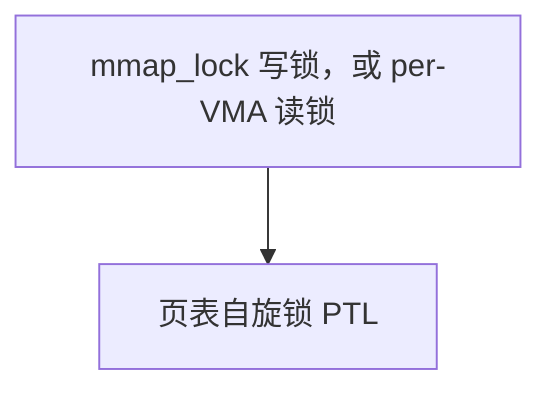

# 6. `mm_struct` 与 `vm_area_struct`

**结论**：一个进程（或共享同一地址空间的线程组）有一个 `mm_struct`。它的 VMA 按虚拟地址放在 maple tree `mm_mt` 里。`mmap` / `brk` 改的是这棵树和 VMA 的标志；匿名页要等缺页，才向伙伴分配器要物理页。`MAP_POPULATE`（且没有 `MAP_NONBLOCK`）或 `VM_LOCKED` 会在系统调用返回前把页填上。

> 源码：Linux v6.6.160。定义在 `include/linux/mm_types.h`。`mm_struct` 从 `:738`，`vm_area_struct` 从 `:630`。
> 路径：`mm/mmap.c`（建立、合并、拆除 VMA）、`mm/util.c`（`vm_mmap_pgoff`）、`kernel/fork.c`（分配 VMA、`dup_mmap`）。
> 导航：[上一节 vmalloc](./05-vmalloc-and-kernel-va.md) · [目录](./README.md) · [下一节 缺页](./07-page-fault.md)

内核线程的 `task_struct.mm` 是 NULL，`active_mm` 借用上一个用户 mm（lazy TLB）。机制在 [6.8](#68-mm-与-active_mm)。进程章 [02-task-struct](../process-management/02-task-struct.md) 只登记这两个指针。

---

## 6.1 `struct mm_struct` 全部成员（`:738`）

几乎所有字段包在一个匿名 `struct { ... } __randomize_layout` 里。最后一项 `cpu_bitmap[]` 必须留在结构体末尾：`mm_cpumask()`（`mm_types.h:1008`）把它当成按 `nr_cpu_ids` 加长的 cpumask（注释 `:987`）。

`mm_mt` 是这套地址空间的 VMA 索引。旁边的 `mmlist` 是另一条链：可能换出过的 `mm_struct` 串在 `init_mm.mmlist` 上，由 `mmlist_lock` 保护。

### 引用与地址空间骨架

```c
/* --- 引用与地址空间骨架 --- */
struct mm_struct {
	struct {
		/*
		 * 常写的字段单独放一条 cache line。
		 * mm_count：抓着这个 mm 的引用数，mm_users 整体算 1。
		 * 用 mmgrab / mmdrop。减到 0 就释放 mm。
		 */
		struct {
			atomic_t mm_count;
		} ____cacheline_aligned_in_smp;

		struct maple_tree mm_mt;	/* VMA 的存储，key 是虚拟地址 */

#ifdef CONFIG_MMU
		/*
		 * 给这个 mm 找空闲虚拟地址的函数。
		 * 架构或特殊文件可以换掉它。
		 */
		unsigned long (*get_unmapped_area)(struct file *filp,
				unsigned long addr, unsigned long len,
				unsigned long pgoff, unsigned long flags);
#endif
		unsigned long mmap_base;		/* mmap 区基址，自顶向下时的起点 */
		unsigned long mmap_legacy_base;		/* 自底向上布局的 mmap 基址 */
#ifdef CONFIG_HAVE_ARCH_COMPAT_MMAP_BASES
		unsigned long mmap_compat_base;		/* 32 位兼容进程的 mmap 基址 */
		unsigned long mmap_compat_legacy_base;	/* 兼容进程的 legacy 基址 */
#endif
		unsigned long task_size;	/* 用户空间大小 */
		pgd_t * pgd;			/* 这套地址空间的顶级页表 */

#ifdef CONFIG_MEMBARRIER
		/*
		 * membarrier 标志。故意靠近 pgd，因为 switch_mm 会同时碰它们。
		 */
		atomic_t membarrier_state;
#endif

		/*
		 * 用户侧引用：活着的线程，以及临时 mmget。
		 * 减到 0 时再放下一次 mm_count。
		 */
		atomic_t mm_users;

#ifdef CONFIG_SCHED_MM_CID
		/*
		 * 调度器的 mm 并发 ID。每个 CPU 当前分到的 cid 放在 pcpu_cid。
		 * struct mm_cid 在 mm_types.h:731，里面是 u64 time 和 int cid。
		 * 读写由各自的 runqueue 锁序列化。
		 */
		struct mm_cid __percpu *pcpu_cid;
		unsigned long mm_cid_next_scan;	/* 下次扫描 cid 的 jiffies */
#endif
#ifdef CONFIG_MMU
		/*
		 * 本 mm 页表占的字节。/proc/pid/status 的 VmPTE 读它
		 * （mm_pgtables_bytes，mm.h:2816）。
		 * /proc/meminfo 的 PageTables 是全局 NR_PAGETABLE。
		 */
		atomic_long_t pgtables_bytes;
#endif
		int map_count;			/* VMA 个数，受 vm.max_map_count 限制 */

		spinlock_t page_table_lock;	/* 页表没拆锁时共用这一把，也保护一部分计数 */
		/*
		 * 地址空间的读写信号量。读锁给缺页和查找，写锁给 mmap / munmap。
		 * 源码把 count 和 owner 放在不同 cache line 上，避免争用时来回弹。
		 */
		struct rw_semaphore mmap_lock;

		/*
		 * 可能换出过的 mm，串在 init_mm.mmlist 上，mmlist_lock 保护。
		 */
		struct list_head mmlist;
```

### per-VMA 锁序号与统计

`CONFIG_PER_VMA_LOCK` 打开时（x86 选了 `ARCH_SUPPORTS_PER_VMA_LOCK`，`mm/Kconfig:1276`，还要 MMU 和 SMP），这里只有一个 `int mm_lock_seq`。它和 VMA 上的 `vm_lock_seq` 配对，见 [6.11](#611-锁层次mmap_lock--per-vma-lock--ptl)。

```c
/* --- per-VMA 锁序号与统计 --- */
#ifdef CONFIG_PER_VMA_LOCK
		/*
		 * 写 mmap_lock 放下或降成读锁时加 1（vma_end_write_all）。
		 * 和 vma->vm_lock_seq 相等，表示这个 VMA 正处于写侧排除读者的窗口。
		 * 读它有时要 ACQUIRE，写它用 RELEASE。允许溢出。
		 */
		int mm_lock_seq;
#endif

		unsigned long hiwater_rss;	/* RSS 高水位，单位是页 */
		unsigned long hiwater_vm;	/* 虚拟地址高水位 */

		unsigned long total_vm;		/* 映射的总页数 */
		unsigned long locked_vm;	/* VM_LOCKED 的页 */
		atomic64_t pinned_vm;		/* 长期 pin（get_user_pages 一类）的页 */
		unsigned long data_vm;		/* VM_WRITE & ~VM_SHARED & ~VM_STACK */
		unsigned long exec_vm;		/* VM_EXEC & ~VM_WRITE & ~VM_STACK */
		unsigned long stack_vm;	/* VM_STACK */
		unsigned long def_flags;	/* 新 VMA 的默认标志 */

		/*
		 * fork 复制页表等路径把映射写成只读、强迫稍后 COW 时持有。
		 */
		seqcount_t write_protect_seq;

		spinlock_t arg_lock;		/* 保护下面这组起止地址 */
```

### 段、auxv、RSS

```c
/* --- 段、auxv、RSS --- */
		unsigned long start_code, end_code, start_data, end_data;
		unsigned long start_brk, brk, start_stack;
		unsigned long arg_start, arg_end, env_start, env_end;

		unsigned long saved_auxv[AT_VECTOR_SIZE]; /* ELF 辅助向量，给 /proc/pid/auxv */

		/*
		 * 四类计数，enum 在 mm_types_task.h:31。
		 * MM_FILEPAGES、MM_ANONPAGES、MM_SWAPENTS、MM_SHMEMPAGES。
		 * /proc/pid/status 的 RssFile、RssAnon、VmSwap、RssShmem 从这里来。
		 */
		struct percpu_counter rss_stat[NR_MM_COUNTERS];

		struct linux_binfmt *binfmt;	/* 装载这个进程的 binfmt，ELF 等 */

		/*
		 * 架构私有。x86 的 mm_context_t（asm/mmu.h:23）里有
		 * ctx_id、tlb_gen、ldt、lam_cr3_mask、pkey_allocation_map。
		 */
		mm_context_t context;

		unsigned long flags;		/* 必须用原子位操作访问 */
```

### 外围子系统挂在 mm 上的钩子

```c
/* --- 外围子系统挂在 mm 上的钩子 --- */
#ifdef CONFIG_AIO
		spinlock_t ioctx_lock;			/* 保护 AIO 上下文表 */
		struct kioctx_table __rcu *ioctx_table;
#endif
#ifdef CONFIG_MEMCG
		/*
		 * 这个 mm 的户主，memcg 归属看它。要改它，当前必须是 owner，
		 * 当前的 mm 已经不是这个 mm，新 owner 的 mm 是它，
		 * 并且拿着新 owner 的 alloc_lock。
		 */
		struct task_struct __rcu *owner;
#endif
		struct user_namespace *user_ns;	/* 这个地址空间所属的用户命名空间 */
		struct file __rcu *exe_file;		/* /proc/pid/exe */
#ifdef CONFIG_MMU_NOTIFIER
		/* KVM、RDMA 等二级页表的失效通知 */
		struct mmu_notifier_subscriptions *notifier_subscriptions;
#endif
#if defined(CONFIG_TRANSPARENT_HUGEPAGE) && !USE_SPLIT_PMD_PTLOCKS
		pgtable_t pmd_huge_pte;		/* 拆 PMD 时暂存的 PTE 页，page_table_lock 保护 */
#endif
#ifdef CONFIG_NUMA_BALANCING
		/*
		 * 下次把 PTE 改成 PROT_NONE、触发 NUMA hint fault 的时间。
		 */
		unsigned long numa_next_scan;
		unsigned long numa_scan_offset;	/* 扫描续点 */
		int numa_scan_seq;		/* 防止两个线程同时改 PROT_NONE */
#endif
		/*
		 * 有一批 TLB 刷新正在进行。迁移 PROT_NONE 页时必须先刷。
		 */
		atomic_t tlb_flush_pending;
#ifdef CONFIG_ARCH_WANT_BATCHED_UNMAP_TLB_FLUSH
		atomic_t tlb_flush_batched;	/* 见 flush_tlb_batched_pending() */
#endif
		struct uprobes_state uprobes_state;
#ifdef CONFIG_PREEMPT_RT
		struct rcu_head delayed_drop;	/* RT 上延迟 mmdrop */
#endif
#ifdef CONFIG_HUGETLB_PAGE
		atomic_long_t hugetlb_usage;	/* 本 mm 的 hugetlb 用量 */
#endif
		struct work_struct async_put_work; /* 异步 mmput */
#ifdef CONFIG_IOMMU_SVA
		u32 pasid;			/* IOMMU 共享虚拟地址用的 PASID */
#endif
#ifdef CONFIG_KSM
		unsigned long ksm_merging_pages; /* 正在被 KSM 合并的页，不含 zero page */
		unsigned long ksm_rmap_items;	 /* 检查过的 rmap 项，含没合并成的 */
		atomic_long_t ksm_zero_pages;	 /* 和内核零页合并的空页（use_zero_pages） */
#endif
#ifdef CONFIG_LRU_GEN
		struct {
			struct list_head list;	/* 挂在 lru_gen_mm_list 上，MGLRU 走页表时遍历 */
			/*
			 * 切到这个 mm 时写成 -1。页表扫描者据此知道：
			 * 自从上次清位以后它被用过。
			 */
			unsigned long bitmap;
#ifdef CONFIG_MEMCG
			struct mem_cgroup *memcg; /* 指向 owner 的 memcg */
#endif
		} lru_gen;
#endif
	} __randomize_layout;

	/*
	 * 末尾柔性数组。mm_cpumask(mm) 返回 (struct cpumask *)&mm->cpu_bitmap。
	 * 长度按 nr_cpu_ids 在分配 mm 时加上，所以必须留在最后。
	 */
	unsigned long cpu_bitmap[];
};
```

maple tree 的建树标志（`mm_types.h:994`）：

```c
#define MM_MT_FLAGS	(MT_FLAGS_ALLOC_RANGE | MT_FLAGS_LOCK_EXTERN | \
			 MT_FLAGS_USE_RCU)
```

`MT_FLAGS_USE_RCU` 让缺页可以在 RCU 读侧走树。`fork.c:1273` 用 `mt_init_flags(&mm->mm_mt, MM_MT_FLAGS)` 初始化。外部锁就是上面的 `mmap_lock`。

`USE_SPLIT_PMD_PTLOCKS` 是宏（`mm_types_task.h:23`）：PTE 锁已拆分，并且架构打开了 `CONFIG_ARCH_ENABLE_SPLIT_PMD_PTLOCK`。它为假、同时又打开了 THP 时，`pmd_huge_pte` 才放在 `mm_struct` 里；为真时锁和暂存指针在 PMD 页自己的 `ptdesc` 上。

---

## 6.2 `struct vm_area_struct` 全部成员（`:630`）

第一组字段给查树用：起止地址和 `vm_mm`。打开 `CONFIG_PER_VMA_LOCK` 时，`vm_start` / `vm_end` 和 `vm_rcu` 占同一块内存，延迟释放走 RCU。

```c
struct vma_lock {
	struct rw_semaphore lock;	/* 缺页读者拿读锁；写侧只短暂拿写锁来发布序号 */
};

struct vm_area_struct {
	/* 第一条 cache line：走 VMA 树时用的区间。 */
	union {
		struct {
			unsigned long vm_start;	/* 覆盖 [vm_start, vm_end) */
			unsigned long vm_end;
		};
#ifdef CONFIG_PER_VMA_LOCK
		struct rcu_head vm_rcu;		/* 延迟释放 VMA 时用 */
#endif
	};

	struct mm_struct *vm_mm;	/* 属于哪个地址空间 */
	pgprot_t vm_page_prot;		/* 由 vm_flags 算出的页保护，建 PTE 时用 */

	/*
	 * VM_* 见 mm.h。已经挂在树上的 VMA 用 vm_flags_set / clear / mod，
	 * 它们会先 vma_start_write（mm.h:844、:851、:872）。
	 * vm_flags_init 只给还没进树的 VMA（:819）。
	 * vm_flags_reset 要求调用者已经排除读者（:830）。
	 * __vm_flags 是同一块内存的可写视图。
	 */
	union {
		const vm_flags_t vm_flags;
		vm_flags_t __private __vm_flags;
	};

#ifdef CONFIG_PER_VMA_LOCK
	/*
	 * 和 mm->mm_lock_seq 比较。写它要同时持有 mmap_lock 写锁，
	 * 并且先 down_write(&vm_lock->lock)。允许溢出；溢出只会偶尔
	 * 让读者误判「写锁还在」，从而走慢路径。
	 * 新 VMA 在 vma_lock_alloc 里把 vm_lock_seq 设成 -1（fork.c:466）。
	 */
	int vm_lock_seq;
	struct vma_lock *vm_lock;	/* 单独从 vma_lock_cachep 分配 */

	bool detached;			/* 已经从 mm->mm_mt 摘掉 */
#endif

	/*
	 * 文件映射进 address_space->i_mmap 区间树的挂钩。
	 * 匿名 VMA 的 vm_file 为 NULL，一般不进这棵树。
	 */
	struct {
		struct rb_node rb;
		unsigned long rb_subtree_last;	/* 子树里最大的结尾 */
	} shared;

	/*
	 * 一个文件的 MAP_PRIVATE 在 COW 之后可以同时在 i_mmap 和 anon_vma 上。
	 * MAP_SHARED 的文件映射只在 i_mmap。
	 * 匿名 MAP_PRIVATE、栈、brk（vm_file 为 NULL）只在 anon_vma 链上。
	 */
	struct list_head anon_vma_chain; /* mmap_lock 和 page_table_lock 一起序列化 */
	struct anon_vma *anon_vma;	 /* page_table_lock 序列化 */

	const struct vm_operations_struct *vm_ops; /* fault / map_pages 等；匿名为 NULL */

	unsigned long vm_pgoff;		/* 相对 vm_file 的页偏移 */
	struct file * vm_file;		/* 映射的文件，匿名为 NULL */
	void * vm_private_data;		/* 驱动私有，以前叫 vm_pte */

#ifdef CONFIG_ANON_VMA_NAME
	/*
	 * 匿名映射的名字，给 /proc/pid/maps 印 [anon:name]。
	 * mmap_lock 序列化，用 anon_vma_name() 读。
	 */
	struct anon_vma_name *anon_name;
#endif
#ifdef CONFIG_SWAP
	atomic_long_t swap_readahead_info; /* swap 预读游标 */
#endif
#ifndef CONFIG_MMU
	struct vm_region *vm_region;	/* NOMMU 的区域，见 6.12 */
#endif
#ifdef CONFIG_NUMA
	struct mempolicy *vm_policy;	/* 这个 VMA 的 NUMA 策略 */
#endif
#ifdef CONFIG_NUMA_BALANCING
	struct vma_numab_state *numab_state; /* NUMA balancing 的扫描状态 */
#endif
	struct vm_userfaultfd_ctx vm_userfaultfd_ctx; /* 没注册时是空上下文 */
} __randomize_layout;
```

`vma_is_anonymous()`（`mm.h:884`）的判断就是 `vm_ops == NULL`。`vma_set_anonymous()`（`:879`）把 `vm_ops` 写成 NULL。

`CONFIG_USERFAULTFD` 打开时，`vm_userfaultfd_ctx`（`mm_types.h:570`）里只有一个 `struct userfaultfd_ctx *ctx`。关掉时它是空结构。

下面这些 `VM_*` 在 `include/linux/mm.h:268` 起。`/proc/pid/maps` 的权限位直接读前几个。

| 宏 | 值 | 含义 |
|---|---|---|
| `VM_READ` | `0x00000001` | 可读 |
| `VM_WRITE` | `0x00000002` | 可写 |
| `VM_EXEC` | `0x00000004` | 可执行 |
| `VM_SHARED` | `0x00000008` | 共享映射 |
| `VM_MAYREAD` | `0x00000010` | `mprotect` 最多可以给到读 |
| `VM_MAYWRITE` | `0x00000020` | 同上，写 |
| `VM_MAYEXEC` | `0x00000040` | 同上，执行 |
| `VM_MAYSHARE` | `0x00000080` | maps 第四个字符为 `s` 就看这个位 |
| `VM_GROWSDOWN` | `0x00000100` | 向下长的栈 |
| `VM_UFFD_MISSING` | `0x00000200` | userfaultfd missing（有 MMU 时） |
| `VM_PFNMAP` | `0x00000400` | 纯 PFN，没有 `struct page` |
| `VM_UFFD_WP` | `0x00001000` | userfaultfd 写保护 |
| `VM_LOCKED` | `0x00002000` | mlock |
| `VM_IO` | `0x00004000` | I/O 映射 |
| `VM_SEQ_READ` | `0x00008000` | 顺序读，给 `madvise` |
| `VM_RAND_READ` | `0x00010000` | 随机读 |
| `VM_DONTCOPY` | `0x00020000` | fork 时不复制 |
| `VM_DONTEXPAND` | `0x00040000` | `mremap` 不能扩大 |
| `VM_LOCKONFAULT` | `0x00080000` | 缺页时再锁 |
| `VM_ACCOUNT` | `0x00100000` | 计入 overcommit |
| `VM_NORESERVE` | `0x00200000` | 不做预留记账 |
| `VM_HUGETLB` | `0x00400000` | hugetlb |
| `VM_SYNC` | `0x00800000` | 同步缺页（DAX） |
| `VM_WIPEONFORK` | `0x02000000` | 子进程看到全零 |
| `VM_DONTDUMP` | `0x04000000` | 不进 core dump |
| `VM_SOFTDIRTY` | `0x08000000` | 软脏，`CONFIG_MEM_SOFT_DIRTY` |
| `VM_MIXEDMAP` | `0x10000000` | `struct page` 和纯 PFN 可以混在一段 |
| `VM_HUGEPAGE` | `0x20000000` | `MADV_HUGEPAGE` |
| `VM_NOHUGEPAGE` | `0x40000000` | `MADV_NOHUGEPAGE` |
| `VM_MERGEABLE` | bit 31 | KSM 可以合并 |

64 位上还有 `VM_HIGH_ARCH_*`（pkey、影子栈等），由架构配置决定，不在这张低 32 位表里。

---

## 6.3 maple tree 里的 VMA

`mm->mm_mt` 的 key 是虚拟地址，value 是 `vm_area_struct *`。

| 查找 | 位置 | 做什么 |
|---|---|---|
| `vma_lookup` | `mm.h:3449` | `mtree_load(&mm->mm_mt, addr)`，地址落在哪个 VMA |
| `find_vma_intersection` | `mm/mmap.c:1872` | `mt_find`，和 `[start, end)` 相交的第一个 VMA。调用时要拿着 `mmap_lock` |
| `find_vma` | 定义 `mm/mmap.c:1891`，声明 `mm.h:3430` | `addr < vm_end` 的第一个，可能是下一个 VMA |
| `lock_mm_and_find_vma` | 声明 `mm.h:2439`，定义 `mm/memory.c:5437` | 缺页慢路径：小心地拿 `mmap_lock` 读锁再 `find_vma` |

写树用 `struct vma_iterator`（`mm_types.h:1073`）。它里面就是一个 `struct ma_state mas`，`VMA_ITERATOR` 宏把 `mas.tree` 指到 `&mm->mm_mt`。插入用 `vma_iter_store`（`mm/internal.h:1178`），改区间用 `vma_iter_config`（`:1139`）。`mm.h:956` 起是 `vma_find` / `vma_next` 这类游标。

缺页快路径在 `CONFIG_PER_VMA_LOCK` 下可以只锁单个 VMA：`lock_vma_under_rcu`（定义 `mm/memory.c:5499`，声明 `mm.h:770`）。树用 RCU 读。三把锁谁包着谁，见 [6.11](#611-锁层次mmap_lock--per-vma-lock--ptl)。

`map_count` 是 VMA 个数。`sysctl_max_map_count` 的初值是 `DEFAULT_MAX_MAP_COUNT`（`mm.h:198`），等于 `USHRT_MAX - 5`，也就是 65530。`do_mmap` 里 `mm->map_count > sysctl_max_map_count` 就返回 `-ENOMEM`（`mmap.c:1260`）。这是 VMA 太多，物理页还没分配。

---

## 6.4 `mmap` / `munmap` / `brk`

x86-64 的系统调用入口是 `SYSCALL_DEFINE6(mmap)`（`arch/x86/kernel/sys_x86_64.c:86`），把字节偏移换成页偏移后调用 `ksys_mmap_pgoff`。通用的 `SYSCALL_DEFINE6(mmap_pgoff)` 在 `mm/mmap.c:1446`。

```text
ksys_mmap_pgoff                         # mm/mmap.c:1401
  → vm_mmap_pgoff                       # mm/util.c:560，先 mmap_write_lock
       → do_mmap                        # mm/mmap.c:1219
            长度、溢出、map_count、RLIMIT
            get_unmapped_area            # 找洞
            mmap_region                  # mm/mmap.c:2925
              → __mmap_region            # :2687
                   文件：mmap_file → call_mmap → f_op->mmap
                   共享匿名：shmem_zero_setup
                   私有匿名：vma_set_anonymous
                   能合并就 vma_merge     # :863，插入前或 mmap_file 改了标志之后
                   vma_iter_store         # 写入 mm_mt，map_count++
       放掉 mmap_lock 写锁
       MAP_POPULATE 或 VM_LOCKED：mm_populate
```

`do_mmap` 末尾（`:1394`）：地址合法，并且 `VM_LOCKED`，或者 flags 里有 `MAP_POPULATE` 且没有 `MAP_NONBLOCK`，就把 `*populate` 设成 `len`。真正填页发生在写锁放下之后。普通 `malloc` / `mmap(MAP_ANONYMOUS)` 只是记下一笔「这段地址将来可以缺页」。

```text
munmap                                  # SYSCALL_DEFINE2，mmap.c:2983
  → __vm_munmap                         # :2959，mmap_write_lock
       → do_vmi_munmap                  # :2643，对齐检查
            → do_vmi_align_munmap       # :2477
                 必要时 __split_vma
                 把 VMA 暂存到栈上的 maple tree，vma_mark_detached
                 从 mm_mt 删除，unmap 页表，释放页

do_munmap                               # :2679，给已经拿着锁、不要求它放锁的调用者
```

```text
brk                                     # SYSCALL_DEFINE1，mmap.c:178
  缩小：do_vma_munmap                   # :3127，内部还是 do_vmi_align_munmap
  扩大：do_brk_flags                    # :3149
       相邻且标志合得上：直接把原 VMA 拉长
       否则新建匿名 VMA
  def_flags 带 VM_LOCKED 时，放锁后 mm_populate
```

`start_brk` 是堆的起点，`brk` 是当前终点。`brk` 和匿名 `mmap` 在 `mm` 里都是 VMA，缺页路径一样。

合并看 `vma_merge`（`mmap.c:863`）。相邻、`mpol_equal`、再通过 `can_vma_merge_before` / `can_vma_merge_after`（`:772`、`:795`）：

- `vm_flags` 除了 `VM_SOFTDIRTY` 以外相同（`is_mergeable_vma`，`:720`）
- 同一个 `vm_file`
- 可能被拆掉的那一侧没有 `vm_ops->close`
- userfaultfd 上下文相同，匿名名字相同
- `anon_vma` 兼容（都空，或指向同一个）
- `vm_pgoff` 连得上

合并不了，`map_count` 就涨。`VM_SPECIAL` 直接拒绝合并。

---

## 6.5 `/proc/pid/maps` 和 `smaps` 怎么读

`maps` 一行由 `show_vma_header_prefix`（`fs/proc/task_mmu.c:240`）拼出来：

```text
start-end perm offset dev inode pathname
```

`perm` 四个字符（`:249`）：`VM_READ` → `r`，`VM_WRITE` → `w`，`VM_EXEC` → `x`，有 `VM_MAYSHARE` 是 `s`，否则 `p`。

名字（`show_map_vma`，`:261`）：有文件就印路径；共享匿名如果设了名字，印 `[anon_shmem:名字]`。没有文件时，堆是 `[heap]`（`vma_is_initial_heap`），栈是 `[stack]`，`prctl` 起的名字是 `[anon:名字]`。

`smaps` 在同一行后面追加 `show_smap`（`:853`）和 `__show_smap`（`:813`）：

| 字段 | 从哪来 |
|---|---|
| `Size` | `vm_end - vm_start`，VMA 长度 |
| `Rss` | 已经在页表里的常驻页 `resident` |
| `Pss` | 按映射次数分摊后的 RSS |
| `Shared_Clean` / `Shared_Dirty` | 多个进程映着的页 |
| `Private_Clean` / `Private_Dirty` | 只有这个进程映着 |
| `Anonymous` | `PageAnon` 的页，含 COW 之后不再和文件共享的页 |
| `LazyFree` | 匿名、`!PageSwapBacked`、也不脏（`:453`）。`MADV_FREE` 把页标成推迟到内存压力再丢 |
| `AnonHugePages` | 这段里的匿名 THP |
| `ShmemPmdMapped` / `FilePmdMapped` | shmem / 文件的 PMD 映射 |
| `Locked` | mlock 分摊后的量 |
| `Swap` / `SwapPss` | 换出的页 |
| `THPeligible` | `hugepage_vma_check` |
| `VmFlags` | 内核 `VM_*` 的缩写 |

`smaps_rollup` 走 `show_smaps_rollup`（`:882`），是整个 mm 的合计，比逐段 `smaps` 少扫几遍。

`/proc/pid/status` 里和这些计数对应的名字在 `task_mmu.c:60` 起：`VmRSS`、`RssAnon`、`RssFile`、`RssShmem`、`VmData`、`VmStk`、`VmPTE`、`VmSwap`。

用户态示例：[demos/01_maps_smaps.c](./demos/01_maps_smaps.c)。本机编译运行见 [14](./14-perf-and-dev-practice.md) 的验证记录。

---

## 6.6 页表层级：pgd → p4d → pud → pmd → pte

**结论**：用户虚拟地址要从 `mm->pgd` 出发，按地址的若干位一级级往下走。x86-64 是否带第 5 级，看编译选项 `CONFIG_X86_5LEVEL`；编进去之后，运行时再看 CPU 有没有 `X86_FEATURE_LA57`。

`struct page` 的 `flags` 是 `unsigned long`（`mm_types.h:75`）。页表项本身是 `pte_t` / `pmd_t` / `pud_t` / `p4d_t` / `pgd_t`，在 x86-64 上各自包一个 `unsigned long`（`pgtable_64_types.h:21`）。

每一级的下标（`include/linux/pgtable.h`，折叠的那一级 `*_index` 返回 0，因为 `PTRS_PER_PxD == 1`，注释 `:61`）：

| 级 | 下标 | x86-64 上这一级盖多大 |
|---|---|---|
| pte | `pte_index`，`:65`，`address >> PAGE_SHIFT` | 一条 PTE 是 4KB。512 项一页，盖 2MB |
| pmd | `pmd_index`，`:71`，`>> PMD_SHIFT`（21，`pgtable_64_types.h:94`） | 一条 PMD 可以是 2MB 大页，或指向一页 PTE |
| pud | `pud_index`，`:79`，`>> PUD_SHIFT`（30，`:87`） | 一条 PUD 可以是 1GB 大页，或指向一页 PMD |
| p4d | `p4d_index`，`arch/x86/include/asm/pgtable.h:1124` | `P4D_SHIFT` 在 5 级配置里是 39（`pgtable_64_types.h:65`），一条盖 512GB |
| pgd | `pgd_index`，`pgtable.h:88`，`>> PGDIR_SHIFT` | 见下 |

`PTRS_PER_PTE` / `PTRS_PER_PMD` / `PTRS_PER_PUD` 在 x86-64 都是 512（`pgtable_64_types.h:88-100`）。`PTRS_PER_PGD` 也是 512。

两种编译：

- 编了 `CONFIG_X86_5LEVEL`：`PGDIR_SHIFT` 是运行时变量 `pgdir_shift`，`PTRS_PER_P4D` 是 `ptrs_per_p4d`（`:59`、`:67`）。初值在 `arch/x86/kernel/head64.c:55-57`：`pgdir_shift = 39`，`ptrs_per_p4d = 1`，`__pgtable_l5_enabled` 默认 0。解压阶段如果 CPUID leaf 7 的 LA57 位在、命令行又没有 `no5lvl`，`arch/x86/boot/compressed/pgtable_64.c:126-135` 把三者改成 1 / 48 / 512。已经在 5 级模式里启动时，`head64.c` 的 `check_la57_support`（`:104`）再写一遍（`:113-115`）。这时一条 PGD 盖 2^48 字节（256TB），用户虚拟地址宽度 `__VIRTUAL_MASK_SHIFT` 是 56 或 47（`page_64_types.h:57`），约 64PB 或 128TB。
- 没编 `CONFIG_X86_5LEVEL`：`PGDIR_SHIFT` 固定 39，`MAX_PTRS_PER_P4D` 是 1（`:78-80`）。p4d 在编译期折进 pgd。`__VIRTUAL_MASK_SHIFT` 固定 47（`page_64_types.h:60`），用户空间约 128TB。`pgtable_l5_enabled()` 恒为 0（`pgtable_64_types.h:41`）。

`pgtable_l5_enabled()`（`pgtable_64_types.h:32`）：早期引导读 `__pgtable_l5_enabled`，之后是 `cpu_feature_enabled(X86_FEATURE_LA57)`（`:37`）。`X86_FEATURE_LA57` 定义在 `cpufeatures.h:399`，CPUID 字 16 的 bit 16。`/proc/cpuinfo` 的 `la57` 就是这个特性位。

5 级配置下的 `p4d_offset`（`asm/pgtable.h:1149`，包在 `CONFIG_PGTABLE_LEVELS > 4` 里）：

```c
static inline p4d_t *p4d_offset(pgd_t *pgd, unsigned long address)
{
	if (!pgtable_l5_enabled())
		return (p4d_t *)pgd;          /* 4 级 CPU：p4d 就是 pgd 自己 */
	return (p4d_t *)pgd_page_vaddr(*pgd) + p4d_index(address);
}
```

没编 5 级时走 `include/asm-generic/pgtable-nop4d.h:35`，`p4d_offset` 直接返回 `(p4d_t *)pgd`，`__p4d_alloc` 是空操作（`mm.h:2746`）。`pgtable-nopud.h`、`pgtable-nopmd.h` 用同样的办法折叠更低的级。x86-64 的 pud / pmd 不折叠。

查找一条表项：

```c
pgd_t *pgd_offset_pgd(pgd_t *pgd, unsigned long address) /* pgtable.h:136 */
{
	return pgd + pgd_index(address);
}
#define pgd_offset(mm, address)  pgd_offset_pgd((mm)->pgd, (address))  /* :145 */
/* p4d_alloc：pgd 空才分配，然后 p4d_offset。mm.h:2847 */
/* pud_offset：p4d_pgtable(*p4d) + pud_index(address)，pgtable.h:129 */
/* pmd_offset：pud_pgtable(*pud) + pmd_index(address)，:121 */
/* pte_offset_kernel：pmd_page_vaddr(*pmd) + pte_index(address)，:92 */
```

`pmd_off`（`:163`）把四级调用串成一行，给「已知映射在 PMD」的内核路径用。`pgd_offset_k`（`:153`）走 `init_mm`，是内核自己的页表。

缺页时的分配式遍历在 `__handle_mm_fault`（`mm/memory.c:5097`）。进来时已经拿着 VMA 锁或 `mmap_lock`：

```text
pgd = pgd_offset(mm, address)          # :5114，顶级页表 mm->pgd 创建 mm 时就有
p4d = p4d_alloc(mm, pgd, address)      # :5115。4 级上 pgd_none 为 0，不再分配一页
pud = pud_alloc(mm, p4d, address)      # :5119
  PUD 空且 hugepage_vma_check 允许 → create_huge_pud（:4960，匿名直接 FALLBACK）
pmd = pmd_alloc(mm, pud, address)      # :5150
  PMD 空且允许 THP → create_huge_pmd   # :4922
  否则落到 handle_pte_fault            # :5013，见 07
```

`p4d_alloc` / `pud_alloc` / `pmd_alloc` 在折叠的那一级是空操作：表项已经在上一级里，不用再分配一页。

### page table check

`Documentation/mm/page_table_check.rst`。在 PTE / PMD 变成用户可访问的那一刻多做一次计数，抓「同一页又匿名又有名字」这一类双映射。检测到就崩。默认关。编译要 `CONFIG_PAGE_TABLE_CHECK`，启动参数 `page_table_check=on`（`early_param` 在 `mm/page_table_check.c:32`，处理函数 `:27`）。`CONFIG_PAGE_TABLE_CHECK_ENFORCED` 则默认开（`:21`）。运行时开关是静态键 `page_table_check_disabled`（`:24`），打开检查时把它 disable 掉（`:43`）。

计数挂在 page_ext 上，每个 `struct page` 一份（`:16`）：

```c
struct page_table_check {
	atomic_t anon_map_count;	/* 作为匿名页被映射的次数 */
	atomic_t file_map_count;	/* 作为文件页（named）被映射的次数 */
};
```

装 PTE 走 `__page_table_check_ptes_set`（`:223`），拆走 `__page_table_check_pte_clear`（`:163`）。PMD / PUD 有 `__page_table_check_pmd_set`（`:248`）和 `__page_table_check_pud_set`（`:264`）。它不代替 mapcount，只在打开时多一道断言。文档写明它故意不读 VMA，只看 `struct page` 上有限的信息。

---

## 6.7 TLB、PCID 与 `mmu_gather`

**结论**：改完页表，CPU 上已经缓存的翻译不会自己消失。x86 用 PCID 给每个 mm 一个地址空间编号，同一颗 CPU 上切回最近用过的 mm 时可以不必整表刷掉。一次 unmap 要拆很多 PTE 时，先把页收进 `struct mmu_gather`，最后 `tlb_finish_mmu` 再射向别的 CPU。

PCID 的说明在 `arch/x86/mm/tlb.c:62` 起。硬件字段叫 PCID，内核里的编号叫 ASID。ASID 从 0 计；写进 CR3 的 kPCID 是 ASID+1，因为 PCID 0 留给不认识 PCID 的代码（`:78-80`）。开了页表隔离（KPTI）时，用户页表再用 uPCID，等于 kPCID + 2048（`:82-85`）。

`switch_mm_irqs_off`（`:496`）先读 `cpu_tlbstate.loaded_mm`。这颗 CPU 上一次真正写进 CR3 的 mm 以它为准。调度器从 lazy 回到同一个 `active_mm` 时，可能拿着 `prev == next` 进来，这时不要假设 CR3 已经等于 `next`（注释 `:508`）。`loaded_mm == next` 并且这次不是从 lazy 回来，函数在 `:588` 返回，不改 CR3。从 lazy 回来但 `tlb_gen` 还没变，也会在 `:600` 返回。

`struct mmu_gather`（`include/asm-generic/tlb.h:295`）是 unmap 期间的暂存。

```c
struct mmu_gather {
	struct mm_struct	*mm;

#ifdef CONFIG_MMU_GATHER_TABLE_FREE
	struct mmu_table_batch	*batch;		/* 要延后释放的页表页 */
#endif

	unsigned long		start;		/* 这次要刷的虚拟区间 */
	unsigned long		end;
	unsigned int		fullmm : 1;		/* 正在拆整个 mm */
	unsigned int		need_flush_all : 1;	/* 必须全刷 */
	unsigned int		freed_tables : 1;	/* 拆掉了页表页 */
	unsigned int		delayed_rmap : 1;	/* 还有推迟的 rmap 拆除 */
	unsigned int		cleared_ptes : 1;
	unsigned int		cleared_pmds : 1;
	unsigned int		cleared_puds : 1;
	unsigned int		cleared_p4ds : 1;
	unsigned int		vma_exec : 1;	/* 区间里有 VM_EXEC */
	unsigned int		vma_huge : 1;	/* 区间里有 hugetlb */
	unsigned int		vma_pfn  : 1;	/* VM_PFNMAP / VM_MIXEDMAP */

	/*
	 * 取消了 hugetlb PMD 共享。
	 * fully_unshared_tables 表示共享表已经变成某一边独占。
	 */
	unsigned int		unshared_tables : 1;
	unsigned int		fully_unshared_tables : 1;

	unsigned int		batch_count;

#ifndef CONFIG_MMU_GATHER_NO_GATHER
	struct mmu_gather_batch *active;	/* 当前正在填的一批 */
	struct mmu_gather_batch	local;		/* 栈上的第一批 */
	struct page		*__pages[MMU_GATHER_BUNDLE]; /* 8 个，:244 */
#ifdef CONFIG_MMU_GATHER_PAGE_SIZE
	unsigned int		page_size;
#endif
#endif
};
```

`struct mmu_gather_batch`（`:246`）：

```c
struct mmu_gather_batch {
	struct mmu_gather_batch	*next;
	unsigned int		nr;
	unsigned int		max;
	struct encoded_page	*encoded_pages[];
};
```

单批上限 `MAX_GATHER_BATCH`（`:253`）是一页减去 batch 头、再除以指针大小。批次数上限 `MAX_GATHER_BATCH_COUNT`（`:262`）大约盖住 10000 页，避免不可抢占内核在一次 unmap 里软锁死。

```text
tlb_gather_mmu(tlb, mm)                 # mm/mmu_gather.c:338
  或 tlb_gather_mmu_fullmm               # :354，退出整个 mm
  或 tlb_gather_mmu_vma                  # :375，记下 VM_EXEC / hugetlb 页大小
拆 PTE 时把页挂进 batch
  批次满了就 tlb_flush_mmu               # :298
tlb_finish_mmu(tlb)                     # :391
  mm_tlb_flush_nested 为真：改成 fullmm，避免和并行的批量 flush 互相看见旧 PTE
  tlb_flush_mmu
  tlb_batch_list_free                    # 没有 CONFIG_MMU_GATHER_NO_GATHER 时
```

x86 真正射出去的是 `flush_tlb_mm_range`（`arch/x86/mm/tlb.c:1048`）：

```text
inc_mm_tlb_gen(mm)                       # :1066，和 switch_mm 同步的代际
页数超过 tlb_single_page_flush_ceiling（默认 33，:1003）就升级成整段 TLB_FLUSH_ALL
mm_cpumask 里还有别的 CPU：flush_tlb_multi
否则本 CPU 的 loaded_mm 就是它：关中断，flush_tlb_func 本地刷
最后 mmu_notifier_arch_invalidate_secondary_tlbs   # :1088，KVM 的 EPT，见 11
```

`flush_tlb_all`（`:1098`）对每个 CPU 调用 `__flush_tlb_all`。

回收路径上还有另一套批量，和 `mmu_gather` 分开。`try_to_unmap_flush`（`mm/rmap.c:618`）刷的是 `current->tlb_ubc`，类型是 `struct tlbflush_unmap_batch`（`mm_types_task.h:51`）。成员包在 `CONFIG_ARCH_WANT_BATCHED_UNMAP_TLB_FLUSH` 里：

```c
struct tlbflush_unmap_batch {
#ifdef CONFIG_ARCH_WANT_BATCHED_UNMAP_TLB_FLUSH
	struct arch_tlbflush_unmap_batch arch;	/* 架构的待刷集合 */
	bool flush_required;			/* 有待刷的项 */
	/*
	 * 拆的时候 PTE 是脏的。写 IO 之前必须刷掉，
	 * 否则旧 TLB 还能把页写脏。
	 */
	bool writable;
#endif
};
```

`try_to_unmap_flush_dirty`（`:631`）只在 `writable` 时才刷。这个函数本身也包在同一个 config 里（`:611`）。

---

## 6.8 mm 与 active_mm

**结论**：`mm` 是这个任务自己的地址空间。`active_mm` 是调度器记下的、CPU 上此刻借来用的那套页表。内核线程没有自己的 `mm`，切过来时不换 CR3，只把上一个用户 mm 记在 `active_mm` 上。

两个指针都在 `task_struct` 里（`include/linux/sched.h:879-880`）：`struct mm_struct *mm`，`struct mm_struct *active_mm`。用户任务两者指向同一个 mm。内核线程 `mm == NULL`，跑着的时候 `active_mm` 指向它借来的那个。说明在 `Documentation/mm/active_mm.rst`。

切换在 `context_switch`（`kernel/sched/core.c:5337`）。注释 `:5349` 把四种情况写在一起：

```c
if (!next->mm) {                         /* 切到内核线程，:5359 */
	enter_lazy_tlb(prev->active_mm, next);
	next->active_mm = prev->active_mm;
	if (prev->mm)                    /* 用户 → 内核：抓住这个 mm */
		mmgrab_lazy_tlb(prev->active_mm);
	else
		prev->active_mm = NULL;  /* 内核 → 内核：引用已经在 next 上 */
} else {                                 /* 切到用户任务 */
	membarrier_switch_mm(rq, prev->active_mm, next->mm);
	switch_mm_irqs_off(prev->active_mm, next->mm, next);  /* :5377 */
	lru_gen_use_mm(next->mm);
	if (!prev->mm) {                 /* 内核 → 用户 */
		rq->prev_mm = prev->active_mm; /* finish_task_switch 里 mmdrop_lazy_tlb */
		prev->active_mm = NULL;
	}
}
```

x86 的 `enter_lazy_tlb` 在 `arch/x86/mm/tlb.c:682`。声明在 `arch/x86/include/asm/mmu_context.h:134`。

```c
void enter_lazy_tlb(struct mm_struct *mm, struct task_struct *tsk)
{
	if (this_cpu_read(cpu_tlbstate.loaded_mm) == &init_mm)
		return;
	this_cpu_write(cpu_tlbstate_shared.is_lazy, true);  /* 只做标记，不写 CR3 */
}
```

函数上方的注释（`:670`）写明：这个名字应该理解成 `switch_to_kernel_thread`。调度器可以连续调好几次，回到真正的用户 mm 时靠 `switch_mm_irqs_off` 把 lazy 清掉（`tlb.c:548`）。

`mmgrab_lazy_tlb`（`include/linux/sched/mm.h:87`）和 `mmdrop_lazy_tlb`（`:93`）在 `CONFIG_MMU_LAZY_TLB_REFCOUNT` 打开时才动 `mm_count`。关掉时 lazy 用户不占 `mm_count`，`mmdrop_lazy_tlb` 只做一次内存屏障。`active_mm.rst` 开头就写了这个差别。

借来的 mm 还要留到最后一个借用者放下，这样用户进程先退出时，内核线程脚下的页表还在。内核线程的 `/proc/pid/maps` 是空的：`m_start` 看见 `mm` 为空就返回（`fs/proc/task_mmu.c:157`）。内核线程在用户地址上缺页会走 `do_user_addr_fault` 里 `!mm` 的失败路径（`arch/x86/mm/fault.c:1258`），那是 bug。

---

## 6.9 反向映射：anon_vma / anon_vma_chain / i_mmap

**结论**：页表是从虚拟地址找到页。回收、迁移、mlock 要反过来：拿着 folio 找到所有指着它的 VMA 和 PTE。匿名页走 `anon_vma`，文件页走 `address_space->i_mmap` 区间树。

匿名页的 `page->mapping` 不能直接指到某个 VMA。VMA 会拆、会合，fork 之后一页同时属于父子。所以低位带上 `PAGE_MAPPING_ANON`（值 `0x1`，`include/linux/page-flags.h:656`），指针指向 `anon_vma`。`page-flags.h:633` 的注释写了这个约定。

`struct anon_vma`（`include/linux/rmap.h:31`）：

```c
struct anon_vma {
	struct anon_vma *root;		/* 树根。锁加在 root->rwsem 上 */
	struct rw_semaphore rwsem;	/* 写：改树；读：rmap_walk 扫 */
	/*
	 * 没有「页表一定还在」的保证时拿的引用。
	 * 最后一个放下的人负责释放。
	 */
	atomic_t refcount;

	/*
	 * parent 指过来的 anon_vma 个数，含自己。
	 * anon_vma_clone 用它决定复用还是新建。
	 */
	unsigned long num_children;
	unsigned long num_active_vmas;	/* ->anon_vma 指着这个对象的 VMA 个数 */

	struct anon_vma *parent;	/* fork 出来的子 anon_vma 指回父 */

	/*
	 * 相关 VMA 的区间树。rb_node 的最低位会被 mm_take_all_locks 占用，
	 * 读之前必须先拿 rwsem。
	 */
	struct rb_root_cached rb_root;
};
```

`struct anon_vma_chain`（`:82`）是 VMA 和 anon_vma 之间的边：

```c
struct anon_vma_chain {
	struct vm_area_struct *vma;
	struct anon_vma *anon_vma;
	struct list_head same_vma;	/* 同一个 VMA 上的全部 anon_vma。mmap_lock + page_table_lock */
	struct rb_node rb;		/* 挂进 anon_vma->rb_root。锁是 anon_vma->rwsem */
	unsigned long rb_subtree_last;
#ifdef CONFIG_DEBUG_VM_RB
	unsigned long cached_vma_start, cached_vma_last;
#endif
};
```

VMA 上的 `anon_vma_chain` 链表头和 `anon_vma` 指针在 [6.2](#62-struct-vm_area_struct-全部成员630)。`MAP_SHARED` 的文件映射没有 anon_vma，只有 `i_mmap`。私有文件映射在 COW 之后会有。

```text
fork
  dup_mmap(mm, oldmm)                     # kernel/fork.c:648
    → anon_vma_fork(tmp, mpnt)            # 调用点 :734，VM_WIPEONFORK 则把 anon_vma 留空
         anon_vma_clone                   # rmap.c:285，把父的链复制过来
         父没有 anon_vma 就直接返回 0
         已有可复用的 anon_vma 也返回 0
         否则新建，parent / root 指回父（:377）
```

`anon_vma_fork` 的定义在 `mm/rmap.c:339`。新的匿名页挂在子进程自己的 `anon_vma` 上。父进程 COW 之前的页仍挂在父 anon_vma 上，子 VMA 通过链还能被找到。

文件页的反向是 `address_space->i_mmap`（`include/linux/fs.h:482`，`struct rb_root_cached`），由 `i_mmap_rwsem`（`:487`）保护。VMA 用 `shared.rb` / `rb_subtree_last` 挂进去。`rmap_walk_file`（`rmap.c:2462`）在 folio 锁下拿 `i_mmap_rwsem`，按 `folio_pgoff` 找出覆盖这段文件偏移的 VMA。

统一入口：

```c
void rmap_walk(struct folio *folio, struct rmap_walk_control *rwc) /* rmap.c:2515 */
{
	if (unlikely(folio_test_ksm(folio)))
		rmap_walk_ksm(folio, rwc);
	else if (folio_test_anon(folio))
		rmap_walk_anon(folio, rwc, false);
	else
		rmap_walk_file(folio, rwc, false);
}
```

`struct rmap_walk_control`（`rmap.h:457`）：

```c
struct rmap_walk_control {
	void *arg;			/* 交给 rmap_one 的私有指针 */
	bool try_lock;			/* 拿不到锁就放弃 */
	bool contended;			/* 上面那次 trylock 失败过 */
	/*
	 * 对一个 VMA 里的一条映射做事。返回 false 就停。
	 */
	bool (*rmap_one)(struct folio *folio, struct vm_area_struct *vma,
					unsigned long addr, void *arg);
	int (*done)(struct folio *folio); /* 返回真就不再往下扫 */
	struct anon_vma *(*anon_lock)(const struct folio *folio,
				      struct rmap_walk_control *rwc);
	bool (*invalid_vma)(struct vm_area_struct *vma, void *arg);
};
```

`folio_referenced`（`rmap.c:901`）是回收用的：`rmap_one = folio_referenced_one`，`anon_lock = folio_lock_anon_vma_read`，`try_lock = true`。返回值是还被访问着的映射数。`mapcount` 已经是 0，或者没有 mapping，直接返回 0（`:918`）。锁拿不到时返回 -1（注释 `:898`）。

`rmap_walk_locked`（`:2526`）是调用者已经拿着 rmap 锁的版本。KSM folio 会触发 `VM_BUG_ON_FOLIO`。

---

## 6.10 overcommit 记账

**结论**：`mmap` 成功不等于有那么多物理页。`vm.overcommit_memory` 决定 `__vm_enough_memory` 在记账时有多较真。`/proc/meminfo` 的 `Committed_AS` 是已经答应出去的虚拟量。`CommitLimit` 三个模式都会印，判决只用在模式 2。

三个值和默认（`include/uapi/linux/mman.h:13-15`，`mm/util.c:830-835`）：

| 值 | 宏 | 默认？ | `__vm_enough_memory` 里的行为 |
|---|---|---|---|
| 0 | `OVERCOMMIT_GUESS` | 是，`sysctl_overcommit_memory` 的初值 | 先记账。这次申请的页数大于 `totalram_pages() + total_swap_pages` 才拒绝。不把历史上已经答应的总量拿来比 |
| 1 | `OVERCOMMIT_ALWAYS` | | 记账之后直接返回 0 |
| 2 | `OVERCOMMIT_NEVER` | | `vm_committed_as` 不得超过 `vm_commit_limit()`，再扣 root 和单进程的保留 |

`Documentation/mm/overcommit-accounting.rst` 把模式 0 叫做启发式：明显过大的地址空间申请会被拒绝。模式 2 才用 `vm.overcommit_ratio`（默认 50）或 `vm.overcommit_kbytes`。模式 2 里 `MAP_NORESERVE` 被忽略；`do_mmap`（`mmap.c:1383`）也只在策略不是 `OVERCOMMIT_NEVER` 时才给 `VM_NORESERVE`。

`CommitLimit` 由 `vm_commit_limit`（`util.c:903`）算：

```c
if (sysctl_overcommit_kbytes)
	allowed = sysctl_overcommit_kbytes >> (PAGE_SHIFT - 10); /* kB → 页 */
else
	allowed = (totalram_pages() - hugetlb_total_pages())
		  * sysctl_overcommit_ratio / 100;
allowed += total_swap_pages;
```

`/proc/meminfo` 把这个数印成 `CommitLimit`（`fs/proc/meminfo.c:128`），把 `vm_memory_committed()`（`util.c:936`，读 `vm_committed_as`）印成 `Committed_AS`（`:46`、`:129`）。模式 0 和 1 也会印 `CommitLimit`，`__vm_enough_memory` 不用它做判决。v6.12 采样里见过 `CommitLimit == MemTotal/2`（默认 ratio 50、swap 为 0 时公式就是这样），那是另一台机器的数，不能据此判断它跑在模式 2。

```c
int __vm_enough_memory(struct mm_struct *mm, long pages, int cap_sys_admin)
{
	vm_acct_memory(pages);                       /* util.c:962，先记上 */
	if (sysctl_overcommit_memory == OVERCOMMIT_ALWAYS)
		return 0;
	if (sysctl_overcommit_memory == OVERCOMMIT_GUESS) {
		if (pages > totalram_pages() + total_swap_pages)
			goto error;
		return 0;
	}
	allowed = vm_commit_limit();
	if (!cap_sys_admin)
		allowed -= sysctl_admin_reserve_kbytes >> (PAGE_SHIFT - 10);
	if (mm)
		allowed -= min_t(long, mm->total_vm / 32, reserve);
	if (percpu_counter_read_positive(&vm_committed_as) < allowed)
		return 0;
error:
	vm_unacct_memory(pages);                     /* :997，拒绝就把刚才记的减回去 */
	return -ENOMEM;
}
```

`sysctl_admin_reserve_kbytes` 默认 `1UL << 13`（8MB），`sysctl_user_reserve_kbytes` 默认 `1UL << 17`（128MB）（`:834-835`）。`cap_sys_admin` 由 LSM 的 `security_vm_enough_memory_mm`（`security/security.c:1058`）传进来，只影响模式 2 里给 root 留的那一截。hugetlb 有自己的预留，`vm_commit_limit` 把 `hugetlb_total_pages()` 从 RAM 里减掉，见 [09](./09-thp-and-hugetlb.md)。KVM 把客户机内存超卖是另一层，见 [12](./12-balloon-fpr-and-overcommit.md)。

`vm_committed_as`（`util.c:921`）独占一条 cache line。读 `/proc/meminfo` 时 `vm_memory_committed` 做的是 `percpu_counter_sum_positive`，大机器上会去对一下各 CPU 的计数。

---

## 6.11 锁层次：mmap_lock / per-VMA lock / PTL

**结论**：改 VMA 树拿 `mmap_lock` 写锁。缺页的快路径在 `CONFIG_PER_VMA_LOCK` 下只拿目标 VMA 的 per-VMA 读锁。改某一张页表里的 PTE 再拿这张表的页表锁（PTL）。顺序是先地址空间锁，后 PTL。



`mm->mmap_lock` 是 `rw_semaphore`（[6.1](#61-struct-mm_struct-全部成员738)）。`mmap` / `munmap` / `brk` / `mprotect` / `mlock` 走写锁。`/proc/pid/maps` 和缺页慢路径走读锁。`mmap_write_unlock`（`mmap_lock.h:129`）在 `up_write` 之前调用 `vma_end_write_all`，把 `mm_lock_seq` 加 1。

per-VMA 锁的对象是 `vma->vm_lock->lock`，类型是 `struct rw_semaphore`（`mm_types.h:584`）。它和 `mmap_lock` 是两把锁。读者在缺页期间持有读锁。写侧的用法是：

```text
调用者已经拿着 mmap_lock 写锁
vma_start_write(vma)                     # mm.h:715
  vm_lock_seq 已经等于 mm_lock_seq：什么都不做
  否则 down_write(&vma->vm_lock->lock)   # 等正在缺页的读者放锁
       WRITE_ONCE(vma->vm_lock_seq, mm_lock_seq)
       up_write                           # 写锁马上放下，排除读者靠序号
mmap_write_unlock
  vma_end_write_all                      # mmap_lock.h:84
    smp_store_release(&mm->mm_lock_seq, mm->mm_lock_seq + 1)
```

`vma_start_read`（`mm.h:657`）给缺页用：

```text
vm_lock_seq == mm_lock_seq               # 写侧还在，直接失败
down_read_trylock(&vma->vm_lock->lock) 失败也失败
再用 ACQUIRE 读一次 mm_lock_seq
相等就把读锁放下并失败                   # 和 vma_end_write_all 的 RELEASE 配对
```

`lock_vma_under_rcu`（`mm/memory.c:5499`）：

```text
rcu_read_lock
mas_walk(&mm->mm_mt)                     # 在 maple tree 里找 VMA
vma_start_read 失败 → 放 RCU，返回 NULL
匿名 VMA 还没有 anon_vma → vma_end_read，返回 NULL
地址不在 [vm_start, vm_end) → 同样放弃
vma->detached → vma_end_read，再试一次  # munmap 已经把这只 VMA 摘出树
rcu_read_unlock
返回这只 VMA，读者还拿着 per-VMA 读锁
```

返回 NULL 时缺页退回 `lock_mm_and_find_vma`，拿 `mmap_lock` 读锁再查一次。`detached` 由 `vma_mark_detached`（`mm.h:746`）在 `do_vmi_align_munmap` 里置上，置位前要先 `vma_start_write`。

页表锁看 `USE_SPLIT_PTE_PTLOCKS`（`mm_types_task.h:22`）：`NR_CPUS >= CONFIG_SPLIT_PTLOCK_CPUS`。`include/linux/mm.h`：

```c
/* 拆分，:2949。锁在 PTE 页自己的 ptdesc 里 */
static inline spinlock_t *pte_lockptr(struct mm_struct *mm, pmd_t *pmd)
{
	return ptlock_ptr(page_ptdesc(pmd_page(*pmd)));
}
/* 不拆分，:2974。整个 mm 一把 page_table_lock */
static inline spinlock_t *pte_lockptr(struct mm_struct *mm, pmd_t *pmd)
{
	return &mm->page_table_lock;
}
```

PMD 同样有两套：`pmd_lockptr` 在 `:3054`（`USE_SPLIT_PMD_PTLOCKS`，锁在 PMD 页上）和 `:3079`（退回 `page_table_lock`）。自旋锁比一个 `unsigned long` 还大时，`ALLOC_SPLIT_PTLOCKS`（`mm_types_task.h:25`，`SPINLOCK_SIZE > BITS_PER_LONG/8`）为真，锁不嵌在 `ptdesc` 里，`ptlock_alloc` 另分配（`mm.h:2922`）。

`pte_offset_map_lock` 的内联包装在 `mm.h:3011`，真正加锁在 `__pte_offset_map_lock`（`mm/pgtable-generic.c:364`）：

```c
pte = __pte_offset_map(pmd, addr, &pmdval);   /* HIGHPTE 上会 kmap_local */
ptl = pte_lockptr(mm, &pmdval);
spin_lock(ptl);
if (likely(pmd_same(pmdval, pmdp_get_lockless(pmd))))
	return pte;                            /* PMD 没被换成大页或拆掉 */
pte_unmap_unlock(pte, ptl);
goto again;
```

先看 PMD 再锁，是因为 THP 拆分会把 PMD 换成 PTE 页。锁完再对一次，对不上就重来。`pte_unmap_unlock`（`mm.h:3023`）先 `spin_unlock` 再 `pte_unmap`。

缺页快路径的顺序：`lock_vma_under_rcu` 或 `mmap_read_lock`，然后 `pte_offset_map_lock`。`munmap` 是 `mmap_write_lock`，再在 `mmu_gather` 里拆页表。hugetlb 的共享 PMD 另有 `struct hugetlb_vma_lock`（`hugetlb.h:110`，里面是 `kref`、`rw_semaphore` 和指向 VMA 的指针），挂在 VMA 的 `vm_private_data` 上，不在这三层里面。

---

## 6.12 没有 MMU，以及 `remap_file_pages`

没有 MMU 的配置（uClinux 一类）走 `mm/nommu.c`，说明在 `Documentation/admin-guide/mm/nommu-mmap.rst`。x86-64 有 MMU，不编这个文件。`Documentation/admin-guide/mm/index.rst` 把这篇文档列在 admin-guide 下，`Documentation/mm/` 里没有同名文件。

`nommu.c` 有自己的 `do_mmap`（`:1020`）和 `ksys_mmap_pgoff`（`:1257`），系统调用入口仍是 `SYSCALL_DEFINE6(mmap_pgoff)`（`:1279`）。地址提示会被忽略（`:1046`）。匿名 `MAP_PRIVATE` 要的是物理上连续的页。没有 `fork`：`Documentation/admin-guide/mm/nommu-mmap.rst` 写明 `clone` 必须带 `CLONE_VM`。`kernel/fork.c:814` 在 `!CONFIG_MMU` 时的 `dup_mmap` 只复制 exe 文件，不复制 VMA。VMA 在这个配置下多一个 `vm_region`（[6.2](#62-struct-vm_area_struct-全部成员630)）。`brk` 的系统调用在 `nommu.c:388`，只在 `start_brk` 和 `context.end_brk` 之间移动 `mm->brk`。

`remap_file_pages`（`Documentation/mm/remap_file_pages.rst`）用来做非线性文件映射：同一个 VMA 里，文件页的顺序和文件偏移对不上。文档说明这种映射要在 PTE 里占一个标志来记文件偏移，而 PTE 标志很紧。v6.6.160 的系统调用还在，`mm/mmap.c:2993`。注释写的是 “Emulation of deprecated remap_file_pages() syscall.” 第一件事是 `pr_warn_once`（`:3004`），指向 `Documentation/mm/remap_file_pages.rst`。`prot` 非 0 直接 `-EINVAL`（`:3007`）。VMA 必须是 `VM_SHARED`。真正的工作是拼出 `MAP_SHARED | MAP_FIXED | MAP_POPULATE`，再加上原来的 `MAP_NONBLOCK` / `MAP_LOCKED`，然后调用 `do_mmap`（`:3100`）。仿真靠新建 VMA 保住 ABI，`map_count` 会涨，更容易撞上 `vm.max_map_count`。

---

## 6.13 关键函数表

| 符号 | 位置 | 作用 |
|---|---|---|
| `do_mmap` | `mm/mmap.c:1219` | mmap 主体 |
| `mmap_region` / `__mmap_region` | `mm/mmap.c:2925` / `:2687` | 建 VMA、调用文件的 mmap、插入 `mm_mt` |
| `mmap_file` / `call_mmap` | `mm/internal.h:97` / `fs.h:2022` | `f_op->mmap` |
| `ksys_mmap_pgoff` | `mm/mmap.c:1401` | 系统调用包装 |
| `SYSCALL_DEFINE6(mmap)` | `arch/x86/kernel/sys_x86_64.c:86` | x86-64 入口 |
| `vm_mmap_pgoff` | `mm/util.c:560` | 内核里 mmap，负责加解锁和 `mm_populate` |
| `vma_merge` | `mm/mmap.c:863` | 和前后 VMA 合并 |
| `vma_iter_store` | `mm/internal.h:1178` | 把 VMA 写入 `mm_mt` |
| `SYSCALL_DEFINE2(munmap)` | `mm/mmap.c:2983` | munmap |
| `do_vmi_munmap` | `mm/mmap.c:2643` | 对齐并找到第一只 VMA |
| `do_vmi_align_munmap` | `mm/mmap.c:2477` | 拆 VMA、摘出 maple tree、unmap |
| `do_munmap` | `mm/mmap.c:2679` | 已持锁调用者的包装 |
| `SYSCALL_DEFINE1(brk)` | `mm/mmap.c:178` | 有 MMU 的 brk |
| `do_brk_flags` | `mm/mmap.c:3149` | 扩大堆 |
| `vma_lookup` | `mm.h:3449` | 地址 → VMA，`mtree_load` |
| `find_vma_intersection` | `mm/mmap.c:1872` | 和区间相交的 VMA |
| `lock_mm_and_find_vma` | `mm/memory.c:5437` | 缺页时锁 mm 并查找 |
| `lock_vma_under_rcu` | `mm/memory.c:5499` | per-VMA 读锁快路径 |
| `vma_start_read` / `vma_start_write` | `mm.h:657` / `:715` | 读锁；写侧发布 `vm_lock_seq` |
| `vma_end_write_all` | `mmap_lock.h:84` | `mmap_lock` 写侧结束时 `mm_lock_seq++` |
| `vm_area_alloc` / `vm_area_dup` | `kernel/fork.c:483` / `:500` | 分配 / 复制 VMA，并分配 `vm_lock` |
| `pgd_offset` / `pgd_offset_pgd` | `pgtable.h:145` / `:136` | 顶级页表项 |
| `p4d_offset` | `asm/pgtable.h:1149` 或 `pgtable-nop4d.h:35` | 5 级配置看 `pgtable_l5_enabled()`；4 级配置返回 pgd 本身 |
| `pmd_offset` / `pud_offset` | `pgtable.h:121` / `:129` | 中间级 |
| `__handle_mm_fault` | `mm/memory.c:5097` | 分配式走完 pgd→pmd |
| `tlb_gather_mmu` / `tlb_finish_mmu` | `mm/mmu_gather.c:338` / `:391` | 批量拆页表 |
| `flush_tlb_mm_range` | `arch/x86/mm/tlb.c:1048` | x86 射 TLB |
| `try_to_unmap_flush` | `mm/rmap.c:618` | rmap 那条批量 TLB |
| `enter_lazy_tlb` | `arch/x86/mm/tlb.c:682` | 置 lazy，不写 CR3 |
| `switch_mm_irqs_off` | `arch/x86/mm/tlb.c:496` | 真正换 mm |
| `anon_vma_fork` / `anon_vma_clone` | `mm/rmap.c:339` / `:285` | fork 时接上反向映射 |
| `dup_mmap` | `kernel/fork.c:648` | 复制 VMA，里面调 `anon_vma_fork` |
| `rmap_walk` | `mm/rmap.c:2515` | 按 anon / file / ksm 分发 |
| `rmap_walk_file` | `mm/rmap.c:2462` | 文件页走 `i_mmap` |
| `folio_referenced` | `mm/rmap.c:901` | 回收时数访问过的映射 |
| `__vm_enough_memory` | `mm/util.c:958` | overcommit 判决 |
| `vm_commit_limit` | `mm/util.c:903` | `CommitLimit` |
| `pte_lockptr` | `mm.h:2949` 或 `:2974` | 拆分 PTL，或整 mm 一把 |
| `pmd_lockptr` | `mm.h:3054` 或 `:3079` | PMD 那一层 |
| `pte_offset_map_lock` | 包装 `mm.h:3011`，实现 `mm/pgtable-generic.c:364` | 映射 PTE 并加 PTL，对不上就重试 |
| `SYSCALL_DEFINE5(remap_file_pages)` | `mm/mmap.c:2993` | 仿真非线性映射，转成 `do_mmap` |

---

[上一节 vmalloc](./05-vmalloc-and-kernel-va.md) · [目录](./README.md) · [下一节 缺页](./07-page-fault.md)
