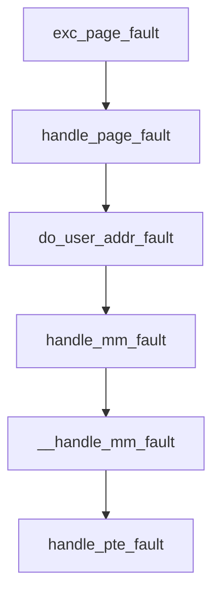

# 7. 缺页

**结论**：用户访问一个还没有 PTE，或者 PTE 权限不够的地址，x86 从 `exc_page_fault` 进到 `handle_mm_fault()`。匿名页向伙伴分配器要 folio，或者先映全局零页；文件页先找页缓存；写只读的私有页会走 COW。hugetlb 在入口就分叉，不走普通的 PMD/PTE。

> 源码：Linux v6.6.160。主文件 `mm/memory.c`。x86 入口 `arch/x86/mm/fault.c`。文件缺页的页缓存半边在 `mm/filemap.c`。
> 导航：[上一节 mm/VMA](./06-mm-and-vma.md) · [目录](./README.md) · [下一节 页缓存](./08-page-cache-and-writeback.md)

`handle_mm_fault` 进来时已经拿着 per-VMA 读锁或 `mmap_lock`。`FAULT_FLAG_VMA_LOCK`（`mm_types.h:1344`，值 `1 << 12`）标明是哪一把。函数里有一句：缺页处理如果放下了 `mmap_lock`，`vma` 可能已经被释放（`memory.c:5326`）。`do_fault` 的注释写得更直：锁放下之后，别的线程可能已经 `munmap`，`vma` 作废（`:4742`）。返回 `VM_FAULT_RETRY` 时调用者要重新查找 VMA。

`struct page` 的 `flags` 是 `unsigned long`（`mm_types.h:75`）。这一章碰到的坏页、COW 都读这块 `flags`，再通过 folio 帮手看匿名、KSM、引用计数。

---

## 7.1 从架构异常到 `handle_pte_fault`



x86 的 `#PF` 入口是 `exc_page_fault`（`arch/x86/mm/fault.c:1472`）。它读 CR2，处理完 KVM 的异步缺页之后调用 `handle_page_fault`（调用点 `:1516`，函数 `:1451`）。用户地址进 `do_user_addr_fault`（`:1197`）。

```text
do_user_addr_fault
  内核态执行用户地址、SMAP、没有 mm、中断里：直接失败
  用户态：FAULT_FLAG_USER；写是 FAULT_FLAG_WRITE；取指是 FAULT_FLAG_INSTRUCTION
  用户态先试 lock_vma_under_rcu          # :1314
       成功 → handle_mm_fault(..., flags | FAULT_FLAG_VMA_LOCK)
       没有 VM_FAULT_RETRY：vma_end_read，结束
       有 RETRY：放掉 per-VMA 锁，落到下面的慢路径
  lock_mmap:
       lock_mm_and_find_vma               # :1343，mmap_lock 读锁
       handle_mm_fault                    # :1371
       VM_FAULT_RETRY：置 FAULT_FLAG_TRIED，再试
       否则 mmap_read_unlock
```

内核态缺页（`get_user` 一类）跳过 per-VMA 锁，直接 `lock_mm_and_find_vma`（`:1311`）。`handle_mm_fault` 的注释仍写着「到这里时已经拿着 mm 信号量」（`:5317`）。带 `FAULT_FLAG_VMA_LOCK` 的那条快路径拿的是 per-VMA 读锁，`__handle_mm_fault` 开头把两把锁都说了（`:5092`）。

```text
handle_mm_fault                         # memory.c:5323
  sanitize_fault_flags                  # :5282。UNSHARE 和 WRITE 同时出现就 SIGSEGV
  arch_vma_access_permitted             # pkey / 权限，失败 SIGSEGV
  用户态：mem_cgroup_enter_user_fault
  lru_gen_enter_fault                   # CONFIG_LRU_GEN 时记下这次访问
  is_vm_hugetlb_page ?
       hugetlb_fault                    # mm/hugetlb.c:6085
     : __handle_mm_fault                # memory.c:5097
  lru_gen_exit_fault
  用户态：mem_cgroup_exit_user_fault
       缺页里进了 memcg OOM、又没有 VM_FAULT_OOM：mem_cgroup_oom_synchronize(false)
  mm_account_fault                      # :5208，PGFAULT / min_flt / maj_flt

__handle_mm_fault
  pgd_offset → p4d_alloc → pud_alloc
  pud 空且 hugepage_vma_check 允许：create_huge_pud   # :4960
       匿名 PUD 大页直接 VM_FAULT_FALLBACK
  pud 已是大页：写保护则 wp_huge_pud，否则 huge_pud_set_accessed
  pmd_alloc
  pmd 空且允许 PMD THP：create_huge_pmd               # :4922
       匿名 → do_huge_pmd_anonymous_page             # mm/huge_memory.c:805
       文件 → vm_ops->huge_fault
       失败带 VM_FAULT_FALLBACK 才降级成 PTE
  pmd 是 migration：pmd_migration_entry_wait，返回 0
  pmd 是透明大页：NUMA 走 do_huge_pmd_numa_page
       写保护走 wp_huge_pmd                          # :4933
            匿名且 userfaultfd PMD wp：handle_userfault(VM_UFFD_WP)
            否则 do_huge_pmd_wp_page
  否则 handle_pte_fault                              # :5013
```

THP 能不能装，看 `hugepage_vma_check`（`mm/huge_memory.c:77`），调用时带 `TVA_IN_PF | TVA_ENFORCE_SYSFS`。`madvise` / `always` / `never` 的策略在那一层过滤。细节见 [09](./09-thp-and-hugetlb.md)。

---

## 7.2 `handle_pte_fault`（`:5013`）

```text
pmd 还是空：
  先不建 PTE 页。vm_ops->fault 可能要装大页，
  页表一旦露出来就很难收回
  vmf->pte = NULL
pmd 已有：
  pte_offset_map_nolock                  # 映射 PTE，先不拿 PTL
  映射失败：返回 0，让调用者重试
  pte_none → 解映射，当成缺失
!vmf->pte   → do_pte_missing             # :3684
!pte_present → do_swap_page              # :3739
pte_protnone 且 VMA 可访问 → do_numa_page # :4806
拿 ptl，pte 没被别人改掉：
  写或 unshare，且 PTE 不可写 → do_wp_page  # :3355
  否则置 dirty / young，更新 TLB
```

`do_pte_missing` 只有一个判断：

```c
static vm_fault_t do_pte_missing(struct vm_fault *vmf) /* :3684 */
{
	if (vma_is_anonymous(vmf->vma))
		return do_anonymous_page(vmf);   /* :4104 */
	else
		return do_fault(vmf);            /* :4745 */
}
```

`vma_is_anonymous` 就是 `vm_ops == NULL`。userfaultfd 的写保护不在 `handle_pte_fault` 里分叉：PTE 还在、只是 uffd-wp 时，要等 `do_wp_page` 看见 `userfaultfd_pte_wp` 才交给用户态。换出之后留下的 uffd-wp 标记走 `do_swap_page` → `handle_pte_marker`。

---

## 7.3 匿名、文件、COW

### 匿名

`do_anonymous_page`（`:4104`）：

- `VM_SHARED` 的匿名段在这里直接 `VM_FAULT_SIGBUS`。共享匿名在 `mmap` 时已经接上 shmem 文件，`vm_ops` 不是 NULL，不会进这个函数。
- 只读、而且这个 mm 允许零页：用 `my_zero_pfn` 做一条 special PTE，不分配 folio，也不增加 `MM_ANONPAGES`。第一次读因此几乎不涨 `RssAnon`。接下来的写会走 `do_wp_page`，变成私有页。
- 写，或者禁止零页：`anon_vma_prepare`，然后 `vma_alloc_zeroed_movable_folio` 要一页全零 folio，`mem_cgroup_charge` 记到缺页时的 memcg，`folio_add_new_anon_rmap` 挂上反向映射，`inc_mm_counter(..., MM_ANONPAGES)`，装 PTE。`VM_WRITE` 时 PTE 是 dirty + write。
- 无论哪条，只要 `userfaultfd_missing(vma)`（`VM_UFFD_MISSING`），就在页表锁里再确认一次，然后 `handle_userfault(vmf, VM_UFFD_MISSING)`，把这件事交给用户态。

大页不在这个函数里。`__handle_mm_fault` 先试 `create_huge_pmd`；它返回 `VM_FAULT_FALLBACK` 之后才落到这里的 order-0。

用户态示例 [demos/02_fault.c](./demos/02_fault.c) 逐页写入，`ru_minflt` 会上升。那是 minor fault：页不在内存里，也不需要磁盘。`mm_account_fault`（`:5240`）把没有 `VM_FAULT_MAJOR`、也没有 `FAULT_FLAG_TRIED` 的成功缺页记成 `min_flt`。

### 文件

`do_fault`（`:4745`）：

| 条件 | 去哪 |
|---|---|
| `vm_ops->fault` 为空 | 拿 PTL 再读一次 PTE。仍是 none 就 `VM_FAULT_SIGBUS`。已经有人装好了就 `VM_FAULT_NOPAGE` |
| 不是写 | `do_read_fault`（`:4617`） |
| 写且 `VM_SHARED` 没置上 | `do_cow_fault`（`:4650`）。私有文件映射：读进来再复制，新页是匿名的 |
| 写且 `VM_SHARED` | `do_shared_fault`（`:4694`）。必要时 `page_mkwrite`，然后把页标脏 |

`do_read_fault` 在 `should_fault_around` 为真时先 `do_fault_around`（`:4571`），调用 `vm_ops->map_pages`，一次装附近几页。普通文件的 `generic_file_vm_ops`（`filemap.c:3706`）把 `map_pages` 指到 `filemap_map_pages`，`fault` 指到 `filemap_fault`。around 没装上这一页，再 `__do_fault`（`:4218`）调 `vm_ops->fault`。

`do_cow_fault` 和 `do_shared_fault` 看见 `FAULT_FLAG_VMA_LOCK` 就 `vma_end_read` 并返回 `VM_FAULT_RETRY`，让慢路径改拿 `mmap_lock`。`do_read_fault` 在 around 失败之后也同样退回。

`filemap_fault`（`mm/filemap.c:3293`）用 `filemap_get_folio` 在 `address_space->i_pages` 这棵 xarray 里按 `vmf->pgoff` 找 folio（`filemap_get_entry`，`:1844`，`xas_load`）。偏移超过文件大小返回 `VM_FAULT_SIGBUS`。缓存里没有就 `count_vm_event(PGMAJFAULT)` 并带上 `VM_FAULT_MAJOR`，再同步预读。`/proc/vmstat` 的 `pgmajfault` 记的是这类。v6.12 采样里见过 `pgfault` 约 2259 万、`pgmajfault` 8519，那是另一台机器的计数，只能说明那次采样里多数缺页没读盘。

### COW

`do_wp_page`（`:3355`）：PTE 在，但是不可写，这次是写或 unshare。进来时 PTE 已经映射并且拿着 PTL。

- 这次是写，而且 `userfaultfd_pte_wp`（VMA 有 `VM_UFFD_WP`，PTE 带 uffd-wp 位）：放掉 PTL，`handle_userfault(vmf, VM_UFFD_WP)`。
- `VM_SHARED` 或 `VM_MAYSHARE`：没有 `struct page` 就 `wp_pfn_shared`（`:3270`），否则 `wp_page_shared`（`:3293`）。共享映射在这里把页改成可写，不复制。
- 匿名 folio 且 `PageAnonExclusive`：跳到 `reuse`，`wp_page_reuse`（`:3026`）把 PTE 改成可写，不复制。fork 之后如果对端已经退出、这一页只属于当前进程，经常走这里。
- 否则先看能不能复用：KSM，或者 `folio_ref_count > 3`，直接 `copy`。引用里还扣掉 swapcache 之后仍然大于 1，也 `copy`。拿到 folio 锁之后引用计数不是 1，还是 `copy`。计数正好是 1：`page_move_anon_rmap`，然后 `reuse`。
- `copy`：放掉 PTL，`wp_page_copy`（`:3070`）分配新页、拷贝、装新 PTE。这是 fork 之后第一次写入的成本。per-VMA 锁下如果这只 VMA 还没有 `anon_vma`，先 `VM_FAULT_RETRY`。

`VM_FAULT_RETRY` 也出现在 folio 锁拿不到、或者要等回写的时候（`__folio_lock_or_retry`，`handle_mm_fault` 的注释指向它）。调用者要重新查找 VMA。

---

## 7.4 userfaultfd（点到为止）

缺页可以不在内核里填页，而把事件交给用户态。系统调用 `userfaultfd` 在 `fs/userfaultfd.c:2257`：权限通过之后 `new_userfaultfd`。`userfaultfd_register`（`:1333`）按模式改 VMA 标志，并把 `vma->vm_userfaultfd_ctx.ctx` 指到这个上下文（写入点 `:1528`）。

注册模式在 `include/uapi/linux/userfaultfd.h:247`：

| 模式 | 值 | 缺页里谁看见它 |
|---|---|---|
| `UFFDIO_REGISTER_MODE_MISSING` | bit 0 | `VM_UFFD_MISSING`。`do_anonymous_page` 里 `userfaultfd_missing` 为真就 `handle_userfault` |
| `UFFDIO_REGISTER_MODE_WP` | bit 1 | `VM_UFFD_WP`。`do_wp_page` 里 `userfaultfd_pte_wp` 为真，或 `wp_huge_pmd` 里 PMD 级 wp |
| `UFFDIO_REGISTER_MODE_MINOR` | bit 2 | `VM_UFFD_MINOR`。页已经在页缓存，缺页要等 `UFFDIO_CONTINUE` 才装 PTE |

`handle_userfault` 在 `fs/userfaultfd.c:429`。

ioctl 全在 `userfaultfd_ioctl`（`fs/userfaultfd.c:2111`）。`UFFDIO_API` 之外的命令要求上下文已经初始化（`:2117`）。

| ioctl | 处理函数 | 做什么 |
|---|---|---|
| `UFFDIO_API` | `userfaultfd_api`（`:2053`） | 协商 API 和特性 |
| `UFFDIO_REGISTER` | `userfaultfd_register`（`:1333`） | 把范围记进 VMA |
| `UFFDIO_UNREGISTER` | `userfaultfd_unregister`（`:1570`） | 摘掉 |
| `UFFDIO_WAKE` | `userfaultfd_wake`（`:1730`） | 叫醒等在这个范围上的缺页 |
| `UFFDIO_COPY` | `userfaultfd_copy`（`:1762`） | 从用户缓冲拷进缺页地址 |
| `UFFDIO_ZEROPAGE` | `userfaultfd_zeropage`（`:1820`） | 用零页填 |
| `UFFDIO_WRITEPROTECT` | `userfaultfd_writeprotect`（`:1872`） | 装上或拿掉写保护 |
| `UFFDIO_CONTINUE` | `userfaultfd_continue`（`:1925`） | minor fault：页已在页缓存，继续装 PTE |
| `UFFDIO_POISON` | `userfaultfd_poison`（`:1984`） | 把这段标成 hwpoison |

参数布局在 `include/uapi/linux/userfaultfd.h`。用法说明在 `Documentation/admin-guide/mm/userfaultfd.rst`。

和 KVM 的关系：postcopy 迁移时，guest 碰尚未从源端拉来的页，宿主缺页进 uffd，用户态再 `UFFDIO_COPY` 把页填上。EPT 那一层见 [11](./11-kvm-memory.md)。

---

## 7.5 返回值

`vm_fault_t` 是位掩码。`mm_types.h:1190` 把它定义成 `typedef __bitwise unsigned int vm_fault_t`，注释写明缺页处理返回的是 `VM_FAULT` 值的组合。这些值列在 `enum vm_fault_reason`（`:1217`）。

| 位 | 值 | 含义 |
|---|---|---|
| `VM_FAULT_OOM` | `0x000001` | 分配失败。用户态缺页里还会交给 memcg 或 `pagefault_out_of_memory` |
| `VM_FAULT_SIGBUS` | `0x000002` | 坏访问：没有 `vm_ops->fault`、文件被截断、超出文件尾 |
| `VM_FAULT_MAJOR` | `0x000004` | 这次读了存储。`mm_account_fault` 把它或 `FAULT_FLAG_TRIED` 记成 major |
| `VM_FAULT_HWPOISON` | `0x000010` | 碰到毒页。x86 在 `do_user_addr_fault` 里转成 SIGBUS |
| `VM_FAULT_HWPOISON_LARGE` | `0x000020` | 毒的是大页，高位里还有 hstate 下标 |
| `VM_FAULT_SIGSEGV` | `0x000040` | 权限 / pkey。`sanitize_fault_flags` 也会返回它 |
| `VM_FAULT_NOPAGE` | `0x000100` | `->fault` 自己装了 PTE，或者什么都不用做 |
| `VM_FAULT_LOCKED` | `0x000200` | `->fault` 锁着返回的页 |
| `VM_FAULT_RETRY` | `0x000400` | 锁已放，调用者重试 |
| `VM_FAULT_FALLBACK` | `0x000800` | 大页没装成，调用者改走小页 |
| `VM_FAULT_DONE_COW` | `0x001000` | `->fault` 已经把 COW 做完 |
| `VM_FAULT_NEEDDSYNC` | `0x002000` | DAX 同步缺页还要 fsync |
| `VM_FAULT_COMPLETED` | `0x004000` | 缺页做完，并且 `mmap_lock` 已经放下 |

`VM_FAULT_ERROR`（`:1238`）是 `OOM | SIGBUS | SIGSEGV | HWPOISON | HWPOISON_LARGE | FALLBACK`。`do_user_addr_fault` 在 `:1426` 把 `SIGBUS` 和两种 hwpoison 交给 `do_sigbus`，`SIGSEGV` 走 `bad_area_nosemaphore`，`OOM` 走 `pagefault_out_of_memory`。

---

## 7.6 hwpoison

**结论**：硬件报告某一页损坏时，`memory_failure` 尽量把这一页从用户映射里摘掉。该杀的进程发 SIGBUS。恢复关着（`sysctl_memory_failure_recovery == 0`）就直接 panic。软下线是另一条入口 `soft_offline_page`，不杀进程。

说明在 `Documentation/mm/hwpoison.rst`。入口 `memory_failure(pfn, flags)`（`mm/memory-failure.c:2215`）。函数上方的返回值（`:2211`）：0 表示处理好了，`-EOPNOTSUPP` 表示 `hwpoison_filter()` 滤掉了，其它负数是失败。代码里还能看到 `-ENXIO`（内核不管理这块，`:2249`）和 `-EHWPOISON`（`TestSetPageHWPoison` 发现已经毒过，`:2260`）。`action_result`（`:1344`）把 `MF_RECOVERED` 和 `MF_DELAYED` 收成 0，其余收成 `-EBUSY`。

```text
sysctl_memory_failure_recovery == 0 → panic          # :2225
mutex_lock(&mf_mutex)
pfn_to_online_page 失败：
  arch_memory_failure，或设备页 memory_failure_dev_pagemap
  否则 -ENXIO
try_memory_failure_hugetlb
已经 HWPoison：-EHWPOISON，MF_ACTION_REQUIRED 时再 kill_accessing_process
get_hwpoison_page                         # :1556
  返回 0 且页在 buddy 上：take_page_off_buddy，记 MF_MSG_BUDDY / MF_RECOVERED
  返回 0 且不在 buddy：MF_MSG_KERNEL_HIGH_ORDER / MF_IGNORED
  返回负数：MF_MSG_UNKNOWN / MF_IGNORED
透明大页：SetPageHasHWPoisoned，try_to_split_thp_page   # :2321、:1701
  拆不开：MF_MSG_UNSPLIT_THP / MF_IGNORED
shake_page，lock_page
hwpoison_filter 命中：ClearPageHWPoison，返回 -EOPNOTSUPP   # :2369
hwpoison_user_mappings                    # :1574
identify_page_state
```

`hwpoison_user_mappings` 先跳过 `PageReserved`、`PageSlab`、`PageTable`、`PageOffline`，以及既不是 LRU 也不是 hugetlb 的页（这些情况返回 true，表示「用户映射这边没有要做的」）。页还映着的话，先 `collect_procs`（`:1629`，函数本体 `:718`）。匿名、文件、ksm 各有一份收集（`:723`）。必须在 `try_to_unmap` 之前做，因为 unmap 会把 rmap 拆掉。拆映射用的标志是 `TTU_IGNORE_MLOCK | TTU_SYNC | TTU_HWPOISON`（`:1578`），把 PTE 换成 hwpoison 项。干净页可以丢掉不杀；脏页、`MF_MUST_KILL`、或者 unmap 失败，要 `kill_procs`（`:522`）。单个进程走 `kill_proc`（`:340`）。

`/proc/meminfo` 的 `HardwareCorrupted` 读全局 `num_poisoned_pages`（`memory-failure.c:71`，打印在 `fs/proc/meminfo.c:139`），单位换成 kB。每个 `pg_data_t` 在 `CONFIG_MEMORY_FAILURE` 下还有 `struct memory_failure_stats mf_stats`（`include/linux/mmzone.h:1237`，挂在 `pg_data_t` 的 `:1404`），里面分 `ignored` / `failed` / `delayed` / `recovered`。

软下线（页还没坏、只是纠正错误变多，想提前迁走）入口是 `soft_offline_page`（`memory-failure.c:2790`）。注释写明它不杀进程、也不该丢数据。`MADV_SOFT_OFFLINE` 走的是这一条，和 `memory_failure` 的计数不要加在一起解读。

---

## 7.7 关键函数表

| 符号 | 位置 | 作用 |
|---|---|---|
| `exc_page_fault` | `arch/x86/mm/fault.c:1472` | x86 `#PF` 入口 |
| `handle_page_fault` | `arch/x86/mm/fault.c:1451` | 区分内核地址和用户地址 |
| `do_user_addr_fault` | `arch/x86/mm/fault.c:1197` | 用户地址缺页，先 per-VMA 锁再 `mmap_lock` |
| `handle_mm_fault` | `mm/memory.c:5323` | 架构无关的缺页入口 |
| `sanitize_fault_flags` | `mm/memory.c:5282` | 丢掉非法的 WRITE / UNSHARE 组合 |
| `__handle_mm_fault` | `mm/memory.c:5097` | 分配 pud/pmd，尝试大页 |
| `create_huge_pmd` | `mm/memory.c:4922` | PMD THP |
| `do_huge_pmd_anonymous_page` | `mm/huge_memory.c:805` | 匿名 PMD 大页 |
| `wp_huge_pmd` | `mm/memory.c:4933` | 大页写保护，含 uffd-wp |
| `hugepage_vma_check` | `mm/huge_memory.c:77` | 这次缺页允不允许 THP |
| `handle_pte_fault` | `mm/memory.c:5013` | PTE 级分发 |
| `do_pte_missing` | `mm/memory.c:3684` | 匿名还是文件 |
| `do_anonymous_page` | `mm/memory.c:4104` | 匿名缺页，读路径可用零页 |
| `do_fault` | `mm/memory.c:4745` | 文件缺页分发 |
| `do_read_fault` | `mm/memory.c:4617` | 读文件，可先 fault-around |
| `do_fault_around` | `mm/memory.c:4571` | `vm_ops->map_pages` |
| `do_cow_fault` | `mm/memory.c:4650` | 私有文件映射的写 |
| `do_shared_fault` | `mm/memory.c:4694` | 共享文件映射的写 |
| `__do_fault` | `mm/memory.c:4218` | 调用 `vm_ops->fault` |
| `do_wp_page` | `mm/memory.c:3355` | COW，或把只读 PTE 变成可写 |
| `wp_page_copy` | `mm/memory.c:3070` | 真正分配并拷贝 |
| `wp_page_reuse` | `mm/memory.c:3026` | 独占页直接改 PTE |
| `do_swap_page` | `mm/memory.c:3739` | swap、migration、hwpoison、PTE marker |
| `handle_pte_marker` | `mm/memory.c:3708` | uffd-wp / poison 标记 |
| `do_numa_page` | `mm/memory.c:4806` | `PROT_NONE` 的 NUMA hint |
| `filemap_fault` | `mm/filemap.c:3293` | 页缓存缺页 |
| `hugetlb_fault` | `mm/hugetlb.c:6085` | hugetlb |
| `handle_userfault` | `fs/userfaultfd.c:429` | 把缺页交给用户态 |
| `SYSCALL_DEFINE1(userfaultfd)` | `fs/userfaultfd.c:2257` | 创建 uffd |
| `userfaultfd_register` | `fs/userfaultfd.c:1333` | 注册范围 |
| `userfaultfd_ioctl` | `fs/userfaultfd.c:2111` | API / COPY / ZEROPAGE / POISON 等 |
| `memory_failure` | `mm/memory-failure.c:2215` | 硬件坏页 |
| `get_hwpoison_page` | `mm/memory-failure.c:1556` | 为处理坏页拿引用 |
| `hwpoison_user_mappings` | `mm/memory-failure.c:1574` | `try_to_unmap` 摘用户映射，必要时 SIGBUS |
| `collect_procs` | `mm/memory-failure.c:718` | 找出映着这页的进程 |
| `kill_procs` / `kill_proc` | `mm/memory-failure.c:522` / `:340` | 发 SIGBUS 或 SIGKILL |
| `soft_offline_page` | `mm/memory-failure.c:2790` | 软下线，不杀进程 |

---

[上一节 mm/VMA](./06-mm-and-vma.md) · [目录](./README.md) · [下一节 页缓存](./08-page-cache-and-writeback.md)
