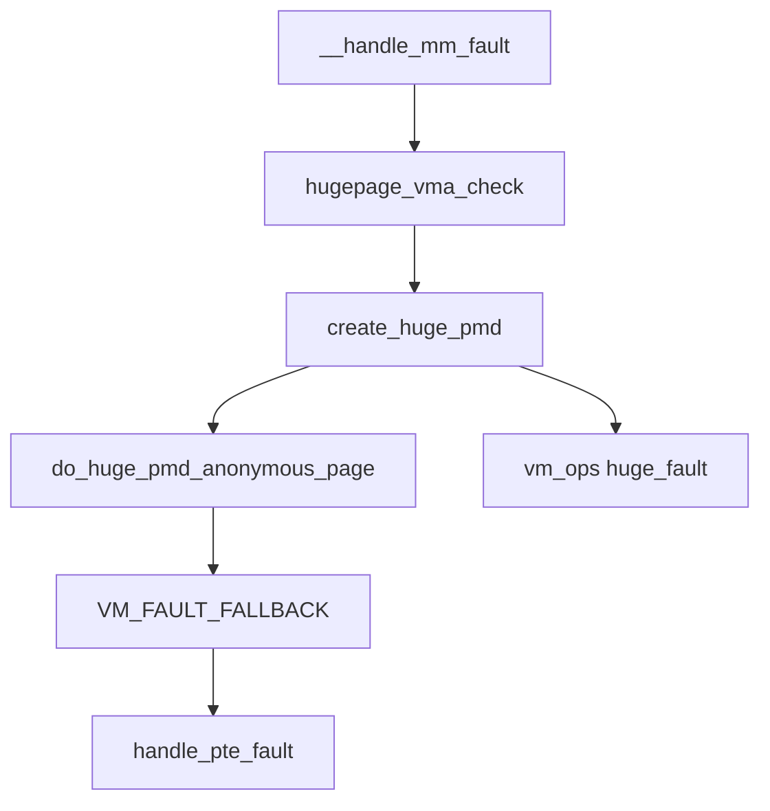

# 9. THP 与 hugetlb

**结论**：透明大页（THP）是缺页或 `khugepaged` 把普通页合成一块更大的 folio。匿名内存这条路径只做 PMD：x86-64 上 `PMD_SHIFT` 是 21（`arch/x86/include/asm/pgtable_64_types.h:94`），一块是 2MB。hugetlb 是事先放进池子里的另一种大页，有自己的 `hstate`、预留和缺页函数，不进普通 buddy，也不进普通 LRU。数据库和 DPDK 要钉死的页，用 hugetlb 或明确的 `madvise`，而不是把全局 `enabled` 设成 `always` 再打开同步压缩。

> 源码：Linux v6.6.160。THP 在 `mm/huge_memory.c`、`mm/khugepaged.c`、`include/linux/huge_mm.h`。hugetlb 在 `mm/hugetlb.c`、`include/linux/hugetlb.h`。HVO 在 `mm/hugetlb_vmemmap.c`，要 `CONFIG_HUGETLB_PAGE_OPTIMIZE_VMEMMAP`。
> 导航：[上一节 页缓存](./08-page-cache-and-writeback.md) · [目录](./README.md) · [下一节 回收](./10-00-reclaim.md)

x86-64 还 `select HAVE_ARCH_TRANSPARENT_HUGEPAGE_PUD`（`arch/x86/Kconfig:193`）。`create_huge_pud()`（`mm/memory.c:4960`）对匿名 VMA 直接 `VM_FAULT_FALLBACK`，注释写明还没有匿名透明 PUD 页。1GB 大页是 hugetlb 的 PUD 尺寸（`PUD_SHIFT` 是 30，`arch/x86/include/asm/pgtable_64_types.h:87`），`Documentation/mm/vmemmap_dedup.rst` 把 x86-64 的 hugetlb 写成 2MB 和 1GB。THP 的 sysfs 不按 16KB、64KB、1GB 分目录。

---

## 9.1 THP 和 hugetlb 不要混

| | THP（匿名是 PMD） | hugetlb |
|---|---|---|
| 谁分配 | 缺页 `create_huge_pmd()`（`mm/memory.c:4922`），或后台 `khugepaged` | `alloc_hugetlb_folio()`（`mm/hugetlb.c:3051`），从 `hstate` 的池里拿 |
| 失败了 | 返回 `VM_FAULT_FALLBACK`，继续走 PTE，用户无感 | 池子空了缺页得到 `VM_FAULT_SIGBUS`（`hugetlb_no_page` 的初值，`mm/hugetlb.c:5858`） |
| 回收 | 可以拆开，也可以整块回收。延迟拆分挂在 `folio->_deferred_list` | 挂在 `hstate` 的 `hugepage_freelists` / `hugepage_activelist`，不进普通 LRU |
| 看计数 | `AnonHugePages`、`/proc/vmstat` 的 `thp_*`（要 `CONFIG_TRANSPARENT_HUGEPAGE`） | `HugePages_*`、`Hugetlb` |

匿名 THP 允许的 order 只有 PMD：`THP_ORDERS_ALL_ANON` 是 `BIT(PMD_ORDER)`（`include/linux/huge_mm.h:67`）。`hugepage_vma_check()` 把调用者传来的 order 和这个掩码相与，结果为 0 就拒绝（`mm/huge_memory.c:86`）。

文件映射另说。只读可执行的普通文件要 `CONFIG_READ_ONLY_THP_FOR_FS`，并且 `file_thp_enabled()`（`include/linux/huge_mm.h:141`）要求 `VM_EXEC`、文件没有打开写、是普通文件。缺页时若 `vm_ops->huge_fault` 存在，`hugepage_vma_check` 信任它（`mm/huge_memory.c:145`）。DAX 还可以在 `THP_ORDERS_ALL_FILE_DAX` 里带上 `PUD_ORDER`（`include/linux/huge_mm.h:74`），那条路进 `create_huge_pud()` 的 `huge_fault(vmf, PUD_ORDER)`，仍然不是匿名 1GB THP，也没有按尺寸分的 sysfs。

`struct hstate`（`include/linux/hugetlb.h:714`）描述一种 hugetlb 尺寸。名字在 `hugetlb_add_hstate()` 里格式化成 `hugepages-%lukB`（`mm/hugetlb.c:4337`）。x86-64 上常见的是 `hugepages-2048kB`；架构支持时还有 1GB 那一档。

```c
struct hstate {
	struct mutex resize_lock;		/* 调整池子大小 */
	struct lock_class_key resize_key;
	int next_nid_to_alloc;			/* 下一个用来分配的节点 */
	int next_nid_to_free;			/* 下一个用来释放的节点 */
	unsigned int order;			/* 相对基页的 order。2MB 在 4KB 基页上是 9 */
	unsigned int demote_order;		/* 降级时拆成的更小 order */
	unsigned long mask;			/* 对齐掩码 */
	unsigned long max_huge_pages;		/* 持久池的目标页数 */
	unsigned long nr_huge_pages;		/* 池里现在有多少 */
	unsigned long free_huge_pages;		/* 空闲 */
	unsigned long resv_huge_pages;		/* 已经预留、还没实例化 */
	unsigned long surplus_huge_pages;	/* 超出持久池、临时从 buddy 借的 */
	unsigned long nr_overcommit_huge_pages;	/* 允许的 surplus 上限 */
	struct list_head hugepage_activelist;	/* 正在用的大页 */
	struct list_head hugepage_freelists[MAX_NUMNODES]; /* 每个节点一条空闲链 */
	unsigned int max_huge_pages_node[MAX_NUMNODES];
	unsigned int nr_huge_pages_node[MAX_NUMNODES];
	unsigned int free_huge_pages_node[MAX_NUMNODES];
	unsigned int surplus_huge_pages_node[MAX_NUMNODES];
#ifdef CONFIG_CGROUP_HUGETLB
	struct cftype cgroup_files_dfl[8];	/* cgroup 控制文件 */
	struct cftype cgroup_files_legacy[10];
#endif
	char name[HSTATE_NAME_LEN];		/* 例如 hugepages-2048kB。HSTATE_NAME_LEN 是 32 */
};
```

编进内核：`mm/Makefile` 把 `hugetlb.o` 挂在 `CONFIG_HUGETLBFS` 上（`:77`），把 `huge_memory.o` 和 `khugepaged.o` 挂在 `CONFIG_TRANSPARENT_HUGEPAGE` 上（`:96`）。

---

## 9.2 缺页路径上的 THP

[07](./07-page-fault.md) 里 `__handle_mm_fault()` 在 PMD 为空时调用 `hugepage_vma_check()`，允许才 `create_huge_pmd()`。调用点带的标志是 `TVA_IN_PF | TVA_ENFORCE_SYSFS`，order 是 `BIT(PMD_ORDER)`（`mm/memory.c:5159`）。装不成功且返回值带 `VM_FAULT_FALLBACK`，才继续 `handle_pte_fault()`。



`TVA_*`（`include/linux/huge_mm.h:85`）：

| 宏 | 值 | 含义 |
|---|---|---|
| `TVA_SMAPS` | `1 << 0` | 给 procfs 的 smaps 用 |
| `TVA_IN_PF` | `1 << 1` | 正在缺页 |
| `TVA_ENFORCE_SYSFS` | `1 << 2` | 服从 `/sys/kernel/mm/transparent_hugepage/enabled` |

`hugepage_vma_check()`（`mm/huge_memory.c:77`）按这个顺序过滤：

```text
hugepage_vma_check(vma, vm_flags, tva_flags, orders)
  orders 和本 VMA 支持的掩码相与，空了就拒绝
       匿名：THP_ORDERS_ALL_ANON，只有 PMD
       DAX：THP_ORDERS_ALL_FILE_DAX，含 PMD 和 PUD
       其他文件：THP_ORDERS_ALL_FILE_DEFAULT
  没有 mm（vdso）、硬件关了 THP、VM_NOHUGEPAGE、MMF_DISABLE_THP：拒绝
  不在缺页里、也不是 smaps：VM_NO_KHUGEPAGED 拒绝
  不在缺页里：transhuge_vma_suitable          # huge_mm.h:122
       地址按 HPAGE_PMD_SIZE 对齐，并且整块落在 VMA 里
  不在缺页里的 shmem：交给 shmem_is_huge       # mm/shmem.c:570
  TVA_ENFORCE_SYSFS：
       enabled 是 never：拒绝
       enabled 是 madvise 且 VMA 没有 VM_HUGEPAGE：拒绝
       enabled 是 always：匿名 VMA 可以继续
  非匿名：缺页里有 huge_fault 才允许；折叠路径还要 file_thp_enabled
  临时栈：拒绝
```

`VM_HUGEPAGE` 来自 `madvise(MADV_HUGEPAGE)`，`VM_NOHUGEPAGE` 来自 `MADV_NOHUGEPAGE`。`hugepage_madvise()`（`mm/khugepaged.c:348`）改这两位。`MADV_HUGEPAGE` 还会 `khugepaged_enter_vma()`（`:444`），让这块 VMA 的 mm 进入后台扫描。

全局策略是 `transparent_hugepage_flags` 上的位（`include/linux/huge_mm.h:43`）。枚举值就是位号，代码里写成 `1 << TRANSPARENT_HUGEPAGE_FLAG` 这种形式。

| 枚举 | 值 | sysfs 上对应什么 |
|---|---|---|
| `TRANSPARENT_HUGEPAGE_UNSUPPORTED` | 0 | 硬件或固件关掉了大页。`thp_disabled_by_hw()` 看这一位 |
| `TRANSPARENT_HUGEPAGE_FLAG` | 1 | `enabled=always` |
| `TRANSPARENT_HUGEPAGE_REQ_MADV_FLAG` | 2 | `enabled=madvise` |
| `TRANSPARENT_HUGEPAGE_DEFRAG_DIRECT_FLAG` | 3 | `defrag=always`，缺页里同步压缩 |
| `TRANSPARENT_HUGEPAGE_DEFRAG_KSWAPD_FLAG` | 4 | `defrag=defer`，叫醒 kswapd，分不到就退回 |
| `TRANSPARENT_HUGEPAGE_DEFRAG_KSWAPD_OR_MADV_FLAG` | 5 | `defrag=defer+madvise` |
| `TRANSPARENT_HUGEPAGE_DEFRAG_REQ_MADV_FLAG` | 6 | `defrag=madvise` |
| `TRANSPARENT_HUGEPAGE_DEFRAG_KHUGEPAGED_FLAG` | 7 | `khugepaged/defrag` 为 1 时，折叠分配可以用直接回收 |
| `TRANSPARENT_HUGEPAGE_USE_ZERO_PAGE_FLAG` | 8 | `use_zero_page` |

初值在 `mm/huge_memory.c:59`。`CONFIG_TRANSPARENT_HUGEPAGE_ALWAYS` 置上 `TRANSPARENT_HUGEPAGE_FLAG`，`CONFIG_TRANSPARENT_HUGEPAGE_MADVISE` 置上 `REQ_MADV`。另外三项不看这两项配置，编译进来就有：`DEFRAG_REQ_MADV`、`DEFRAG_KHUGEPAGED`、`USE_ZERO_PAGE`。所以默认的 `defrag` 显示是 `madvise`，零页是开的。

匿名缺页：

```text
create_huge_pmd                              # memory.c:4922
  匿名：do_huge_pmd_anonymous_page           # huge_memory.c:805
       transhuge_vma_suitable 失败：VM_FAULT_FALLBACK
       khugepaged_enter_vma                   # 让后台以后还能折叠这块
       读故障、允许零页、transparent_hugepage_use_zero_page：
            mm_get_huge_zero_page             # huge_memory.c:212
            set_huge_zero_page                # :791，装一条 PMD
            零页分配失败：THP_FAULT_FALLBACK，再 VM_FAULT_FALLBACK
       否则 vma_thp_gfp_mask                  # :764，按 defrag 位选 GFP
            vma_alloc_folio(gfp, HPAGE_PMD_ORDER, ...)
            失败：THP_FAULT_FALLBACK，VM_FAULT_FALLBACK
            成功：__do_huge_pmd_anonymous_page # :677
                 装上 PMD 后 THP_FAULT_ALLOC（:740）
  有 vm_ops->huge_fault：huge_fault(vmf, PMD_ORDER)
  都没有：VM_FAULT_FALLBACK
```

`vma_thp_gfp_mask()` 的注释（`mm/huge_memory.c:756`）和 `defrag` 的五个字符串一一对应：

| `defrag` | 置上的位 | 分配 |
|---|---|---|
| `always` | `DEFRAG_DIRECT` | `GFP_TRANSHUGE`。缺页上下文里可以同步压缩 |
| `defer` | `DEFRAG_KSWAPD` | `GFP_TRANSHUGE_LIGHT \| __GFP_KSWAPD_RECLAIM`。叫醒回收，自己不等 |
| `defer+madvise` | `DEFRAG_KSWAPD_OR_MADV` | `MADV_HUGEPAGE` 用 `GFP_TRANSHUGE`，其他用 LIGHT 加 kswapd |
| `madvise` | `DEFRAG_REQ_MADV` | 只有 `MADV_HUGEPAGE` 才带 `__GFP_DIRECT_RECLAIM` |
| `never` | 上面四位都清 | `GFP_TRANSHUGE_LIGHT`，分不到就退回 |

`GFP_TRANSHUGE` 是 `GFP_TRANSHUGE_LIGHT | __GFP_DIRECT_RECLAIM`（`include/linux/gfp_types.h:340`）。同步压缩就发生在这次缺页里。

已经是透明大页的 PMD 再写：`wp_huge_pmd()`（`mm/memory.c:4933`）。匿名且不是 unshare、又挂了 userfaultfd 的 PMD 写保护，走 `handle_userfault(VM_UFFD_WP)`；否则 `do_huge_pmd_wp_page()`（`mm/huge_memory.c:1320`）。共享映射先试 `huge_fault`。其余情况 `__split_huge_pmd()`（`mm/huge_memory.c:2313`）把 PMD 拆开，返回 `VM_FAULT_FALLBACK`，后面按 PTE 做 COW。NUMA 的提示缺页走 `do_huge_pmd_numa_page()`（`mm/huge_memory.c:1519`）。

### khugepaged

`start_stop_khugepaged()`（`mm/khugepaged.c:2621`）在 `hugepage_flags_enabled()` 为真时 `kthread_run(khugepaged, NULL, "khugepaged")`。`enabled=never` 时把线程停掉。线程函数 `khugepaged()`（`:2549`）循环调用 `khugepaged_do_scan()`（`:2481`），里面再 `khugepaged_scan_mm_slot()`（`:2318`）。`kthread_run` 是 `include/linux/kthread.h:51` 的宏。

扫描每个 VMA 时再次 `hugepage_vma_check(..., TVA_ENFORCE_SYSFS, BIT(PMD_ORDER))`（`:2368`）。因此：

- `always`：符合条件的匿名 VMA 都会被扫。
- `madvise`：只有带 `VM_HUGEPAGE` 的 VMA。
- `never`：线程本身就不在跑。

```text
khugepaged_scan_mm_slot                    # khugepaged.c:2318
  匿名：collapse_huge_page                 # :1073
       先放下 mmap 读锁再分配             # 注释 :1090，压缩可能很久
       alloc_charge_folio                  # :1045
            is_khugepaged 时 GFP 看 khugepaged_defrag()
            宏在 :855，对应 DEFRAG_KHUGEPAGED 位
            为真：GFP_TRANSHUGE；否则 GFP_TRANSHUGE_LIGHT
            分配失败：THP_COLLAPSE_ALLOC_FAILED（:1056）
            成功：THP_COLLAPSE_ALLOC（:1060）
       mmap_write_lock                     # :1134
            折叠要独占页表。这是延迟毛刺的来源，不是缺页本身
  文件 / shmem：collapse_file              # :1782
```

`khugepaged/defrag` 这个文件写 0 或 1，走 `single_hugepage_flag_store`，改的就是 `TRANSPARENT_HUGEPAGE_DEFRAG_KHUGEPAGED_FLAG`（`defrag_store` 在 `mm/khugepaged.c:235`，标志传在 `:240`）。

拆开：`deferred_split_folio()`（`mm/huge_memory.c:2882`）把 folio 的 `_deferred_list` 挂到 `get_deferred_split_queue()` 选出的队列（开了 memcg 且 folio 属于某个 memcg 时在 `:588`，否则 `:600`）。队列本身是 `struct deferred_split`（`include/linux/mmzone.h:1226`），node 上的那份在 `pgdat->deferred_split_queue`。`split_huge_page()`（`include/linux/huge_mm.h:186`）转去 `split_huge_page_to_list()`（`mm/huge_memory.c:2682`）。`/proc/vmstat` 里相关的是 `thp_split_pmd`、`thp_deferred_split_page`、`thp_split_page`（`mm/vmstat.c` 里 `CONFIG_TRANSPARENT_HUGEPAGE` 那段，从 `:1349` 起）。

相关 tracepoint 在 `include/trace/events/huge_memory.h`：`mm_khugepaged_scan_pmd`（`:56`）、`mm_collapse_huge_page`（`:93`）、`mm_collapse_huge_page_isolate`（`:117`）、`mm_collapse_huge_page_swapin`（`:148`）、`mm_khugepaged_scan_file`（`:175`）、`mm_khugepaged_collapse_file`（`:209`）。

---

## 9.3 sysfs 与 vmstat

THP 的目录在 `hugepage_init_sysfs()` 里创建（`mm/huge_memory.c:437`）。整段包在 `CONFIG_SYSFS` 里。kobject 名字是 `transparent_hugepage`，父对象是 `mm_kobj`，所以路径是 `/sys/kernel/mm/transparent_hugepage/`。属性组只有一组全局文件，加上名为 `khugepaged` 的子组（`mm/khugepaged.c:342`）。没有按尺寸再分子目录。

`CONFIG_SHMEM` 时全局组里还有 `shmem_enabled`（`mm/huge_memory.c:427`）。这个属性的 show/store 还要 `CONFIG_TRANSPARENT_HUGEPAGE && CONFIG_SYSFS`（`mm/shmem.c:4663`）。取值是 `always`、`within_size`、`advise`、`never`、`deny`、`force`，对应 `SHMEM_HUGE_*`（`mm/shmem.c:514` 起）。

```text
/sys/kernel/mm/transparent_hugepage/enabled          # always / madvise / never
/sys/kernel/mm/transparent_hugepage/defrag           # always / defer / defer+madvise / madvise / never
/sys/kernel/mm/transparent_hugepage/use_zero_page    # 0 或 1
/sys/kernel/mm/transparent_hugepage/hpage_pmd_size   # 只读，打印 HPAGE_PMD_SIZE
/sys/kernel/mm/transparent_hugepage/shmem_enabled    # 仅 CONFIG_SHMEM
/sys/kernel/mm/transparent_hugepage/khugepaged/defrag
/sys/kernel/mm/transparent_hugepage/khugepaged/pages_to_scan
/sys/kernel/mm/transparent_hugepage/khugepaged/scan_sleep_millisecs
/sys/kernel/mm/transparent_hugepage/khugepaged/alloc_sleep_millisecs
/sys/kernel/mm/transparent_hugepage/khugepaged/pages_collapsed
/sys/kernel/mm/transparent_hugepage/khugepaged/full_scans
/sys/kernel/mm/transparent_hugepage/khugepaged/max_ptes_none
/sys/kernel/mm/transparent_hugepage/khugepaged/max_ptes_swap
/sys/kernel/mm/transparent_hugepage/khugepaged/max_ptes_shared
```

`khugepaged_init()`（`mm/khugepaged.c:385`）把 `pages_to_scan` 设成 `HPAGE_PMD_NR * 8`，`max_ptes_none` 设成 `HPAGE_PMD_NR - 1`，`max_ptes_swap` 设成 `HPAGE_PMD_NR / 8`，`max_ptes_shared` 设成 `HPAGE_PMD_NR / 2`。扫描间隔初值 10000 毫秒（`:74`），分配失败后的睡眠初值 60000 毫秒（`:76`）。x86-64 上 `HPAGE_PMD_NR` 是 512。

下面是改开关的示例，没有在采样机上执行：

```text
# RECIPE
echo madvise > /sys/kernel/mm/transparent_hugepage/enabled
echo defer > /sys/kernel/mm/transparent_hugepage/defrag
```

hugetlb 的 sysfs 由 `hugetlb_sysfs_init()` 创建（`mm/hugetlb.c:4211`），父对象同样是 `mm_kobj`，目录名 `hugepages`。每个 `hstate` 一个子目录，名字就是上面的 `hugepages-%lukB`。`nr_hugepages` 这个属性写进去会增减池子（`nr_hugepages_store`，`:3806`）。`/proc/sys/vm/nr_hugepages` 在 `CONFIG_SYSCTL` 下由 `hugetlb_sysctl_init()` 注册（`:4689`），管的是默认尺寸那一档。`CONFIG_NUMA` 时还有 `nr_hugepages_mempolicy`。

```text
/proc/sys/vm/nr_hugepages
/sys/kernel/mm/hugepages/hugepages-2048kB/nr_hugepages
# RECIPE：挂载 hugetlbfs 之后应用才能 mmap 这块文件系统
mount -t hugetlbfs none /mnt/huge
```

预留要在内存还连续的时候做。`Documentation/admin-guide/mm/hugetlbpage.rst` 写明：节点上没有足够连续内存时，这次分配会悄悄跳过。写完之后看 `/proc/meminfo` 的 `HugePages_Total`，它来自默认 hstate 的 `nr_huge_pages`（`hugetlb_report_meminfo`，`mm/hugetlb.c:4695`）。请求值和 Total 不一致，就是只做成了一部分。

`/proc/meminfo` 的 THP 行在 `CONFIG_TRANSPARENT_HUGEPAGE` 下才有（`fs/proc/meminfo.c:143`）：`AnonHugePages` 是 `NR_ANON_THPS`，另外还有 `ShmemHugePages`、`ShmemPmdMapped`、`FileHugePages`、`FilePmdMapped`。`/proc/vmstat` 的 `thp_fault_alloc`、`thp_fault_fallback`、`thp_collapse_alloc`、`thp_collapse_alloc_failed` 同样包在 `CONFIG_TRANSPARENT_HUGEPAGE` 里（`mm/vmstat.c:1348`）。

### 在 6.12 上采样

作者在 6.12.94+ 主机上读到的是：`AnonHugePages 0`、`HugePages_Total 0`、`thp_fault_alloc 0`、`thp_collapse_alloc 0`、`thp_fault_fallback 0`。这组 0 表示采样当时没有装成功的匿名 THP，也没有 hugetlb 池；`thp_fault_fallback` 也是 0，说明这段计数窗口里缺页没有走进「尝试 THP 然后退回」。读的时候以这组 0 为准。

---

## 9.4 数据库 / DPDK 怎么选

| 需求 | 用什么 | 原因 |
|---|---|---|
| 延迟稳定，页要钉死 | hugetlb。启动时把 `nr_hugepages` 写成池子，应用 `mmap` hugetlbfs 或 `MAP_HUGETLB` | 页在 `hstate` 的链上，不进普通 LRU。`khugepaged` 也不会把它们再折叠一遍 |
| 大块匿名内存，能接受退回基页 | `madvise(MADV_HUGEPAGE)`，全局 `enabled` 保持 `madvise` | 只有这一段 VMA 带 `VM_HUGEPAGE`。`defrag=madvise` 时也只有这段在缺页里同步压缩 |
| 包处理要物理连续的大页 | hugetlb 的 2MB，或架构支持的 1GB | 1GB 是 hugetlb 的 PUD 页。运行时池子空了不会自动变成 THP |
| 怕缺页被拉长 | `defrag` 用 `defer` 或 `madvise`，不要 `always` | `defrag=always` 让缺页走 `GFP_TRANSHUGE`，压缩发生在 fault 上下文里 |

`mlock` 把已经有的页锁在内存里，它不调用 `hugepage_madvise()`，也不会把基页合成 PMD。

DPDK 用的大页是宿主机上的 hugetlb。客户机里再开 THP，不能代替宿主把 virtio 环放进大页。客户机看见的物理连续还要经过 EPT。见 [11](./11-kvm-memory.md) 和 [12](./12-balloon-fpr-and-overcommit.md)。

---

## 9.5 hugetlb 预留

**结论**：hugetlb 缺页时再去要页，池子可能已经被别人拿光。预留在 `mmap` 时把「这段还会缺多少页」记进 `resv_map`，并从全局池里划出来。缺页消费预留。`MAP_NORESERVE` 让 `VM_NORESERVE` 置位（hugetlb 文件即使 overcommit 是 never 也置位，`mm/mmap.c:1388`），`hugetlb_reserve_pages()` 直接返回真、不划页。之后缺页硬分配，失败就是 `VM_FAULT_SIGBUS`。

文档在 `Documentation/mm/hugetlbfs_reserv.rst`。

### `struct resv_map`（`include/linux/hugetlb.h:56`）

```c
struct resv_map {
	struct kref refs;		/* 最后一个引用放下时走 resv_map_release */
	spinlock_t lock;		/* 保护 regions */
	struct list_head regions;	/* 已预留或已实例化的区间 */
	long adds_in_progress;		/* region_chg 之后还没 region_add / region_abort 的次数 */
	struct list_head region_cache;	/* 预先分配的 file_region，避免在锁里 kmalloc */
	long region_cache_count;	/* 缓存里还有几个 */
	struct rw_semaphore rw_sema;	/* 和缺页、截断、PMD 共享配合 */
#ifdef CONFIG_CGROUP_HUGETLB
	/*
	 * 私有映射上，用来退还预留 charge。
	 * 这些字段是 0：共享映射，或没开 cgroup 记账。
	 */
	struct page_counter *reservation_counter;
	unsigned long pages_per_hpage;	/* 一页大页等于多少基页 */
	struct cgroup_subsys_state *css;
#endif
};
```

区间是 `struct file_region`（`:95`）。`from` 含、`to` 不含，单位是大页下标。源码注释里的例子：`from == 0`、`to == 4` 表示 4 页（`:87`）。

```c
struct file_region {
	struct list_head link;		/* 挂在 resv_map->regions 上 */
	long from;			/* 起始下标，含 */
	long to;			/* 结束下标，不含 */
#ifdef CONFIG_CGROUP_HUGETLB
	struct page_counter *reservation_counter; /* 共享映射上，这一段预留该退给哪个计数器 */
	struct cgroup_subsys_state *css;
#endif
};
```

子池 `struct hugepage_subpool`（`:44`）挂在 hugetlbfs 的 inode 上，管这个文件自己的上限和下限：

```c
struct hugepage_subpool {
	spinlock_t lock;
	long count;		/* 当前计数 */
	long max_hpages;	/* 上限。-1 表示不封顶 */
	long used_hpages;	/* 已用，含已分配和已预留 */
	struct hstate *hstate;	/* 哪种尺寸 */
	long min_hpages;	/* 下限。-1 表示没有下限 */
	long rsv_hpages;	/* 为了满足下限，已经向全局池预留的页 */
};
```

私有映射的 `HPAGE_RESV_*` 塞在 `vma->vm_private_data` 的低位，因为指针对齐后这些位本来是 0（`mm/hugetlb.c:1039`）：

| 宏 | 值 | 含义 |
|---|---|---|
| `HPAGE_RESV_OWNER` | `1UL << 0` | 调用了 `mmap` 的那一方。只有它保证还能用这份预留 |
| `HPAGE_RESV_UNMAPPED` | `1UL << 1` | fork 之后 COW 失败，子进程那边的页已经被摘掉 |

```text
mmap hugetlbfs / MAP_HUGETLB
  hugetlb_reserve_pages(inode, from, to, vma, vm_flags)  # hugetlb.c:6710
    VM_NORESERVE：直接返回真，不划页
    共享（或没有 vma，shm）：
         resv_map 在 inode 上，inode_resv_map          # :1144
         region_chg 算出还要新增多少                   # :775
    私有：
         resv_map_alloc                               # :1092
         chg = to - from
         set_vma_resv_map                             # :1172
         set_vma_resv_flags(..., HPAGE_RESV_OWNER)  # :1180
    hugetlb_cgroup_charge_cgroup_rsvd                 # mm/hugetlb_cgroup.c:304
    hugepage_subpool_get_pages                        # mm/hugetlb.c:175
         子池不够就失败
    hugetlb_acct_memory                              # :4774，从全局池划出 gbl_reserve
    共享映射再 region_add                             # :708，把区间记进 resv_map
    私有映射这里不 region_add
         私有 resv_map 记的是已经消费掉的预留
         整段长度就是原始预留
```

缺页消费走 `__vma_reservation_common()`（`:2721`）。`vma_resv_map()`（`:1157`）为空则返回 1，表示没有预留可谈。否则按下标做一次：

| `vma_resv_mode` | 动作 |
|---|---|
| `VMA_NEEDS_RESV` | `region_chg`，问这一页还要不要新预留 |
| `VMA_COMMIT_RESV` | `region_add`，预留落实 |
| `VMA_END_RESV` | `region_abort`（`:811`），刚才的 chg 不要了 |
| `VMA_ADD_RESV` | 共享：`region_add`。私有：`region_abort` 再 `region_del`（`:834`） |
| `VMA_DEL_RESV` | 和 `VMA_ADD_RESV` 对调。错误路径上把误记的区间删掉或补回去 |

私有映射的 resv_map 和共享相反。注释（`:2786`）写明：私有映射里没有区间，表示预留还在；有区间，表示这一页的预留已经消费掉。所以 `__vma_reservation_common` 对私有映射把 `region_*` 的返回值再反过来。

`alloc_hugetlb_folio()` 先 `vma_needs_reservation()`（`mm/hugetlb.c:2801`），那是 `__vma_reservation_common(..., VMA_NEEDS_RESV)` 的包装。返回 0 表示预留还在，这次分配不再跟别人抢全局池。

fork 时 `hugetlb_dup_vma_private()`（`:1202`）对 `MAP_PRIVATE` 把子 VMA 的 `vm_private_data` 清成 NULL。子进程没有父进程那份 `resv_map`，也没有 `HPAGE_RESV_OWNER`。子进程缺页要自己再向池子要页。要不到，`hugetlb_no_page()` 保持 `VM_FAULT_SIGBUS`。若父进程因为 COW 失败把子进程的页摘掉，`HPAGE_RESV_UNMAPPED` 置位，`hugetlb_no_page` 打出 “killed due to inadequate hugepage pool” 后同样走 SIGBUS（`:5874`）。

`hugetlb_unreserve_pages()`（定义 `mm/hugetlb.c:6870`，声明 `include/linux/hugetlb.h:163`）在截断和打洞时把没消费的预留还回去。调用点：`remove_inode_single_folio()` 在非截断路径上还一页（`fs/hugetlbfs/inode.c:643`），`remove_inode_hugepages()` 在整段截断结束时还剩余区间（`:709`）。

---

## 9.6 HVO：hugetlb 的 vmemmap 去重

**结论**：一张 2MB 大页有 512 个 `struct page`（4KB 基页）。hugetlb 真正用到的只有开头几个。HVO 把尾部 vmemmap 的 PTE 改指向同一页，把腾出来的物理页还给伙伴分配器。省下的是存 `struct page` 的页，不是这张大页本身。`HugePages_Total` 不因此变大。要编 `CONFIG_HUGETLB_PAGE_OPTIMIZE_VMEMMAP`（`mm/Makefile:78` 才编译 `hugetlb_vmemmap.o`）。

思路在 `Documentation/mm/vmemmap_dedup.rst`。实现保留的长度是一页：`HUGETLB_VMEMMAP_RESERVE_SIZE` 等于 `PAGE_SIZE`（`mm/hugetlb_vmemmap.h:21`）。`__NR_USED_SUBPAGE` 是 3（`include/linux/hugetlb.h:42`）。`hugetlb_vmemmap_init()` 用 `BUILD_BUG_ON` 确认这 3 个 `struct page` 放得进保留的那一页（`mm/hugetlb_vmemmap.c:589`）。

开关：

- 启动参数 `hugetlb_free_vmemmap` 由 `core_param` 写到 `vmemmap_optimize_enabled`（`:441`）。初值是 `IS_ENABLED(CONFIG_HUGETLB_PAGE_OPTIMIZE_VMEMMAP_DEFAULT_ON)`（`:440`）。
- 运行时 `/proc/sys/vm/hugetlb_optimize_vmemmap` 只有在至少一种 `hstate` 能优化时才注册（`hugetlb_vmemmap_init`，`:584`）。判断函数是 `hugetlb_vmemmap_optimizable()`（`mm/hugetlb_vmemmap.h:56`）：可优化的字节数不为 0。

新页进池时调用。`__prep_new_hugetlb_folio()`（`mm/hugetlb.c:1967`）第一件事就是 `hugetlb_vmemmap_optimize(h, &folio->page)`（`:1969`）。

```text
hugetlb_vmemmap_optimize                 # mm/hugetlb_vmemmap.c:548
  vmemmap_should_optimize 为假：直接返回   # :483
       开关关着、这种尺寸优化不了、或这块 vmemmap 是 memory hotplug 自托管的
  static_branch_inc(hugetlb_optimize_vmemmap_key)
  vmemmap_reuse = 头页的地址
  vmemmap_start = 头页 + HUGETLB_VMEMMAP_RESERVE_SIZE
  vmemmap_remap_free(start, end, reuse)  # :311
       另分配一页，把保留页的内容拷过去，避免拆碎连续的 struct page
       走页表。vmemmap_remap_pte           # :228
            复用地址那一条 PTE：PAGE_KERNEL，可写
            尾部 PTE：PAGE_KERNEL_RO，只读，用来抓住对尾页的误写
            旧页挂进 vmemmap_pages
       成功后 free_vmemmap_page_list       # :220，还给伙伴分配器
       失败：把已经改过的 PTE 再映回去
  成功：SetHPageVmemmapOptimized
       这一位在 folio->private 里，枚举值 HPG_vmemmap_optimized
       读它用 folio_test_hugetlb_vmemmap_optimized
       宏 HPAGEFLAG 在 include/linux/hugetlb.h:707
  失败：static_branch_dec，不置位
```

函数注释（`:543`）写明：返回之后不保证已经优化成功，调用者用 `HPageVmemmapOptimized()` 看结果。`folio_test_hugetlb_vmemmap_optimized()` 和它看的是同一个位（`include/linux/hugetlb.h:646` 起的 `TESTHPAGEFLAG`）。

大页离开池子、要还给 buddy 之前，必须把 vmemmap 补回来，否则尾部 `struct page` 不能写。入口是 `hugetlb_vmemmap_restore()`（`mm/hugetlb_vmemmap.c:453`）。它在标志还在时调用 `vmemmap_remap_alloc()`（`:414`），成功就 `ClearHPageVmemmapOptimized` 并 `static_branch_dec`。

`enum hugetlb_page_flags`（`include/linux/hugetlb.h:631`）里和 HVO 有关的是：

| 枚举 | 含义 |
|---|---|
| `HPG_restore_reserve = 0` | 这一页分配时消耗了一份预留 |
| `HPG_migratable` | 可以迁移 |
| `HPG_temporary` | 临时从 buddy 借的，释放时立刻还回去 |
| `HPG_freed` | 在空闲链上 |
| `HPG_vmemmap_optimized` | vmemmap 尾页已经释放 |
| `HPG_raw_hwp_unreliable` | hwpoison 子页没有进 raw_hwp 名单 |

这些位在头页的 `page->private` / `folio->private` 里，不是 `folio->flags`。

---

## 9.7 关键函数表

| 符号 | 位置 | 作用 |
|---|---|---|
| `hugepage_flags_enabled` | `include/linux/huge_mm.h:103` | `always` 或 `madvise` 至少开了一个 |
| `hugepage_flags_always` | `include/linux/huge_mm.h:107` | `enabled=always` |
| `transhuge_vma_suitable` | `include/linux/huge_mm.h:122` | 地址按 PMD 对齐，且整块落在 VMA 里 |
| `file_thp_enabled` | `include/linux/huge_mm.h:141` | 只读可执行普通文件，要 `CONFIG_READ_ONLY_THP_FOR_FS` |
| `vma_thp_disabled` | `include/linux/huge_mm.h:162` | `VM_NOHUGEPAGE` 或 `MMF_DISABLE_THP` |
| `thp_disabled_by_hw` | `include/linux/huge_mm.h:174` | `TRANSPARENT_HUGEPAGE_UNSUPPORTED` |
| `split_huge_page` | `include/linux/huge_mm.h:186` | 转去 `split_huge_page_to_list` |
| `hugepage_vma_check` | `mm/huge_memory.c:77` | 缺页和 khugepaged 共用的允许检查 |
| `single_hugepage_flag_store` | `mm/huge_memory.c:319` | 把 0/1 写进 `transparent_hugepage_flags` 的某一位 |
| `hugepage_init_sysfs` | `mm/huge_memory.c:437` | 创建 `/sys/kernel/mm/transparent_hugepage/`。要 `CONFIG_SYSFS` |
| `set_huge_zero_page` | `mm/huge_memory.c:791` | 把巨零页装成一条 PMD |
| `vma_thp_gfp_mask` | `mm/huge_memory.c:764` | 按 `defrag` 位选择 GFP |
| `__do_huge_pmd_anonymous_page` | `mm/huge_memory.c:677` | 把匿名 PMD folio 装进页表，计数 `THP_FAULT_ALLOC` |
| `do_huge_pmd_anonymous_page` | `mm/huge_memory.c:805` | 匿名 PMD 缺页。失败 `VM_FAULT_FALLBACK` |
| `mm_get_huge_zero_page` | `mm/huge_memory.c:212` | 读故障用的巨零页 |
| `do_huge_pmd_wp_page` | `mm/huge_memory.c:1320` | 匿名透明大页的写保护 |
| `do_huge_pmd_numa_page` | `mm/huge_memory.c:1519` | 透明大页上的 NUMA 缺页 |
| `__split_huge_pmd` | `mm/huge_memory.c:2313` | 把一条 PMD 拆成 PTE |
| `split_huge_page_to_list` | `mm/huge_memory.c:2682` | 把大 folio 拆成基页 |
| `get_deferred_split_queue` | `mm/huge_memory.c:588`（memcg）或 `:600` | 选延迟拆分队列 |
| `deferred_split_folio` | `mm/huge_memory.c:2882` | 把 `_deferred_list` 挂进队列 |
| `handle_pte_fault` | `mm/memory.c:5013` | THP 退回之后的基页缺页 |
| `__handle_mm_fault` | `mm/memory.c:5097` | 在这里决定要不要装 PMD / PUD |
| `create_huge_pmd` | `mm/memory.c:4922` | 匿名走 `do_huge_pmd_anonymous_page`，文件走 `huge_fault` |
| `wp_huge_pmd` | `mm/memory.c:4933` | 已有透明大页上的写故障 |
| `create_huge_pud` | `mm/memory.c:4960` | 匿名直接 `VM_FAULT_FALLBACK` |
| `hugepage_madvise` | `mm/khugepaged.c:348` | `MADV_HUGEPAGE` / `MADV_NOHUGEPAGE` |
| `khugepaged_enter_vma` | `mm/khugepaged.c:444` | 把 mm 放进 khugepaged 的扫描名单 |
| `defrag_store` | `mm/khugepaged.c:235` | `khugepaged/defrag` 的写入口，改 `DEFRAG_KHUGEPAGED` 位 |
| `handle_userfault` | `fs/userfaultfd.c:429` | PMD 写保护上的 userfaultfd |
| `alloc_charge_folio` | `mm/khugepaged.c:1045` | 折叠用的 PMD folio。失败记 `THP_COLLAPSE_ALLOC_FAILED` |
| `collapse_huge_page` | `mm/khugepaged.c:1073` | 把匿名 PTE 折叠成 PMD。中途拿 `mmap_write_lock` |
| `collapse_file` | `mm/khugepaged.c:1782` | 把 file/shmem 页缓存折叠成 PMD |
| `khugepaged_scan_mm_slot` | `mm/khugepaged.c:2318` | 扫一个 mm 里的 VMA |
| `khugepaged_do_scan` | `mm/khugepaged.c:2481` | 一轮扫描，调用上面的函数 |
| `khugepaged` | `mm/khugepaged.c:2549` | 后台线程 |
| `kthread_run` | `include/linux/kthread.h:51` | 拉起名为 `khugepaged` 的内核线程 |
| `start_stop_khugepaged` | `mm/khugepaged.c:2621` | `enabled` 不是 never 时拉起线程 |
| `shmem_is_huge` | `mm/shmem.c:570` | khugepaged 问这块 shmem 能不能折成大页 |
| `hugetlb_add_hstate` | `mm/hugetlb.c:4318` | 注册一种尺寸，名字 `hugepages-%lukB` |
| `alloc_hugetlb_folio` | `mm/hugetlb.c:3051` | 从池里拿 folio，先问预留 |
| `hugetlb_fault` | `mm/hugetlb.c:6085` | hugetlb 缺页入口 |
| `hugetlb_no_page` | `mm/hugetlb.c:5851` | 没有页时分配。失败保持 `VM_FAULT_SIGBUS` |
| `region_add` | `mm/hugetlb.c:708` | 把区间记进 `resv_map` |
| `region_chg` | `mm/hugetlb.c:775` | 问这段还要新增多少预留 |
| `region_abort` | `mm/hugetlb.c:811` | 放弃刚才的 `region_chg` |
| `region_del` | `mm/hugetlb.c:834` | 删掉一段区间 |
| `resv_map_alloc` | `mm/hugetlb.c:1092` | 私有映射新建 `resv_map` |
| `inode_resv_map` | `mm/hugetlb.c:1144` | 共享映射的 `resv_map` 在 inode 上 |
| `vma_resv_map` | `mm/hugetlb.c:1157` | 从 VMA 取出 `resv_map`。低位是 `HPAGE_RESV_*` |
| `set_vma_resv_map` | `mm/hugetlb.c:1172` | 私有 VMA 挂上 `resv_map` |
| `set_vma_resv_flags` | `mm/hugetlb.c:1180` | 把 `HPAGE_RESV_OWNER` 等压进 `vm_private_data` 低位 |
| `vma_needs_reservation` | `mm/hugetlb.c:2801` | `__vma_reservation_common(..., VMA_NEEDS_RESV)` |
| `nr_hugepages_store` | `mm/hugetlb.c:3806` | sysfs 的 `nr_hugepages` 写入口 |
| `hugetlb_dup_vma_private` | `mm/hugetlb.c:1202` | fork 时清掉子进程的私有预留 |
| `__vma_reservation_common` | `mm/hugetlb.c:2721` | 缺页时按 `vma_resv_mode` 消费或回滚 |
| `hugepage_subpool_get_pages` | `mm/hugetlb.c:175` | 从文件子池划页 |
| `hugetlb_acct_memory` | `mm/hugetlb.c:4774` | 从全局池划出或归还 |
| `hugetlb_reserve_pages` | `mm/hugetlb.c:6710` | `mmap` 时预留 |
| `hugetlb_unreserve_pages` | `mm/hugetlb.c:6870` | 截断、打洞时归还没消费的预留 |
| `remove_inode_single_folio` | `fs/hugetlbfs/inode.c:613` | 打洞时摘一页并 `hugetlb_unreserve_pages` |
| `remove_inode_hugepages` | `fs/hugetlbfs/inode.c:672` | 截断结束时归还剩余区间 |
| `hugetlb_cgroup_charge_cgroup_rsvd` | `mm/hugetlb_cgroup.c:304` | 预留的 cgroup 记账 |
| `hugetlb_sysfs_init` | `mm/hugetlb.c:4211` | 创建 `/sys/kernel/mm/hugepages/` |
| `hugetlb_sysctl_init` | `mm/hugetlb.c:4689` | 注册 `/proc/sys/vm/nr_hugepages` |
| `hugetlb_report_meminfo` | `mm/hugetlb.c:4695` | 打印 `HugePages_Total` 和 `Hugetlb` |
| `__prep_new_hugetlb_folio` | `mm/hugetlb.c:1967` | 新页进池前做 HVO |
| `hugetlb_vmemmap_optimizable` | `mm/hugetlb_vmemmap.h:56` | 这种尺寸的 vmemmap 能不能省 |
| `vmemmap_remap_pte` | `mm/hugetlb_vmemmap.c:228` | 尾部 vmemmap PTE 改成只读并指向复用页 |
| `free_vmemmap_page_list` | `mm/hugetlb_vmemmap.c:220` | 把腾出的 vmemmap 页还给伙伴分配器 |
| `vmemmap_remap_free` | `mm/hugetlb_vmemmap.c:311` | 重映射并释放尾部 vmemmap |
| `vmemmap_remap_alloc` | `mm/hugetlb_vmemmap.c:414` | 归还大页前把 vmemmap 补回来 |
| `hugetlb_vmemmap_restore` | `mm/hugetlb_vmemmap.c:453` | 清 `HPG_vmemmap_optimized` |
| `hugetlb_vmemmap_optimize` | `mm/hugetlb_vmemmap.c:548` | HVO 入口。成功才置位 |
| `hugetlb_vmemmap_init` | `mm/hugetlb_vmemmap.c:584` | 注册 `hugetlb_optimize_vmemmap` sysctl |
| `folio_test_hugetlb_vmemmap_optimized` | `include/linux/hugetlb.h:707` 的 `HPAGEFLAG` | 这张大页的 vmemmap 是否已经优化 |

---

[上一节 页缓存](./08-page-cache-and-writeback.md) · [目录](./README.md) · [下一节 回收](./10-00-reclaim.md)
