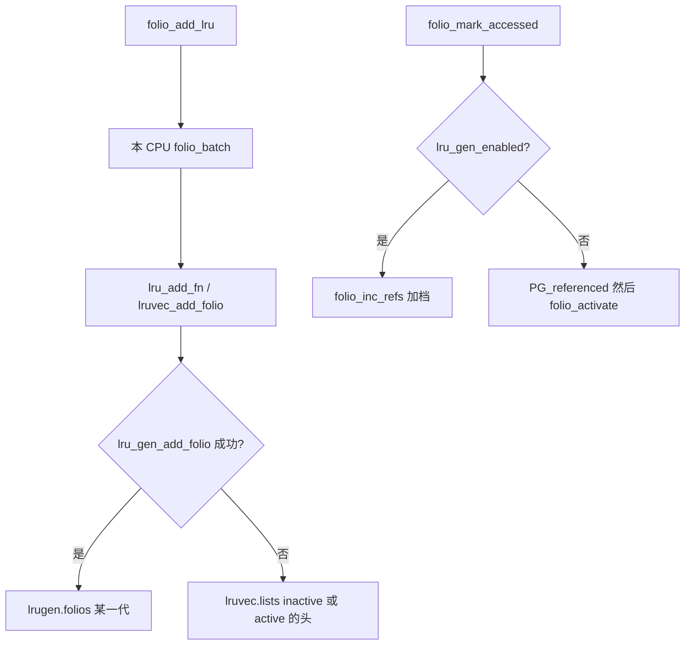
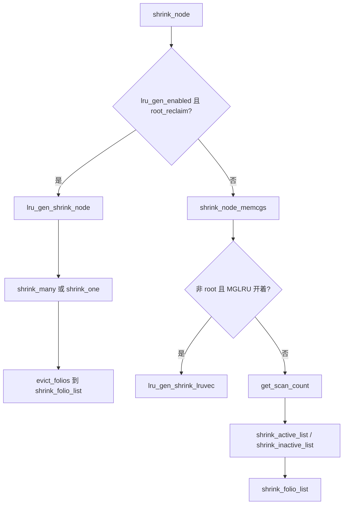

# 10.6 经典 LRU 与 MGLRU 对照

**结论**：两套实现共用 `shrink_node`、`shrink_folio_list`、`workingset_refault` 的外壳。分叉在入链、记访问、选谁扫、以及 refault 时怎么记账。开关在 `/sys/kernel/mm/lru_gen/enabled`，工作集阀在 `min_ttl_ms`。debugfs 的 `lru_gen` 能读直方图，也能手动老化和主动回收。

> 接口以 `Documentation/admin-guide/mm/multigen_lru.rst` 为准。代码分叉见 [02](./10-02-lru-classic.md) 和 [05](./10-05-mglru-code-path.md)。
> 导航：[上一篇 代码路径](./10-05-mglru-code-path.md) · [本目录](./10-00-reclaim.md) · [下一篇 swap](./10-07-swap-zswap.md)

---

## 四个时刻

| 时刻 | 经典 LRU | MGLRU |
|---|---|---|
| 分配 / 入链 | `folio_add_lru` → 本 CPU `cpu_fbatches.lru_add` → `lru_add_fn` → `list_add` 到 inactive 头。`PG_active` 已经立着才进 active | 同一个 batch。`lruvec_add_folio` 里 `lru_gen_add_folio` 成功就进 `lrugen->folios[gen][type][zone]`。选代的四种情况写在 `lru_gen_add_folio` 的注释里。`lrugen->enabled` 为假则退回经典链 |
| 访问 | `folio_mark_accessed`：第一次 `PG_referenced`，第二次 `folio_activate` 升 active。映射页要等回收时 `folio_referenced` 走 rmap 清 young | `folio_mark_accessed` 改调 `folio_inc_refs`，只加档，不搬链表。缺页期间 `lru_gen_enter_fault` 标记新近度，影响随后的 `folio_add_lru`。页表遍历用 `folio_update_gen`，rmap 上的年轻 PTE 用 `lru_gen_look_around` |
| 回收 | `shrink_node_memcgs` → `get_scan_count`（swappiness 和 `anon_cost` / `file_cost`）→ `shrink_active_list` / `shrink_inactive_list` → `shrink_folio_list` | 全局：`lru_gen_shrink_node` → `shrink_many` / `shrink_one` → `evict_folios` → `sort_folio` → 同一个 `shrink_folio_list`。memcg 限额：`lru_gen_shrink_lruvec`。类和档由 `get_type_to_scan` 的 PID 选 |
| refault | `workingset_refault` 用 shadow 里的 `nonresident_age` 算距离，够近就 `folio_set_active`，并记 `WORKINGSET_ACTIVATE` / `WORKINGSET_RESTORE` | `workingset_refault` 转去 `lru_gen_refault`。够近的标准是 shadow 里的 `min_seq` 还等于现在这一类的 `min_seq`。可以再立 `PG_workingset`。`workingset_*` 计数两套都有 |

`shrink_folio_list` 在 MGLRU 下多一个提前返回：folio 仍映射且 `PG_referenced` 已经立着，就 `keep_locked`（`vmscan.c:1757`）。注释写这是 `folio_update_gen()` 想提升这一页。没有这个提前返回时，两边都进 `folio_check_references`（`:1868`）。写出、unmap、放页是同一段。

`shrink_node` 在走了 `lru_gen_shrink_node` 之后直接返回（`vmscan.c:6538-6540`），不会再进 `shrink_node_memcgs`。写 `enabled` 时，`lru_gen_change_state`（`:5699`）在锁里把 folio 从一套链表搬到另一套（`fill_evictable` / `drain_evictable`），搬完才改 `lrugen->enabled`。

---

## 开关

`/sys/kernel/mm/lru_gen/` 是管理文档 Runtime options 里的稳定 ABI。`mm_kobj` 由 `mm_sysfs_init` 创建在 `kernel_kobj` 下面（`mm/mm_init.c:210`），名字是 `"mm"`，所以目录是 `/sys/kernel/mm`。`init_lru_gen`（`vmscan.c:6255`）在 `:6260` 把属性组 `"lru_gen"` 挂上去，里面有 `enabled` 和 `min_ttl_ms`。没编 `CONFIG_LRU_GEN` 时 `init_lru_gen` 不存在，这个目录也不会被这段代码创建。

`enabled`（`enabled_show` `:5775`，`enabled_store` `:5792`）按位开关。默认值取决于 `CONFIG_LRU_GEN_ENABLED`：编了则 `lru_gen_caps` 用 `DEFINE_STATIC_KEY_ARRAY_TRUE`（`:3230`），否则用 `FALSE`（`:3233`）。主开关那一位走 `lru_gen_change_state`；其余位直接拨 static key。

管理文档（`Documentation/admin-guide/mm/multigen_lru.rst:26-52`）和枚举 `LRU_GEN_*`（`mmzone.h:388`）对得上：

| 值 | 组件 | 文档里的后果 |
|---|---|---|
| `0x0001` | 主开关 `LRU_GEN_CORE` | 关掉就回到经典 LRU |
| `0x0002` | `LRU_GEN_MM_WALK`。硬件会置 accessed 位时（例如 x86），成批清叶子 PTE 的访问位 | 文档写理论上可能加重 `mmap_lock` 竞争。关掉的话，连续映射热页的负载会有轻微性能损失 |
| `0x0004` | `LRU_GEN_NONLEAF_YOUNG`。连非叶子 PTE 的访问位一起清 | 文档写只在 Intel 和 AMD 上验证过。关掉的损失可以忽略 |
| `y` / `Y` / `n` / `N` | 上面全部 | `y` 读回来是 `0x0007` |

文档里的例子：`echo y > enabled` 读到 `0x0007`；`echo 5` 读到 `0x0005`（主开关加非叶子，不批量清叶子）。`enabled_show` 只打印硬件和 static key 都允许的位（`:5779-5786`），所以写进去的位如果硬件不支持，读回来可以少几位。

`min_ttl_ms`（`:5754` / `:5760`）保护最近 N 毫秒的工作集，保不住就 OOM。默认 0，关掉。文档（`:77-82`）：按人能察觉的卡顿大约 100ms 来估，`N=1000` 通常能去掉由颠簸引起的、受不了的 UI 卡顿；`N=3000` 更不明显，风险是过早 OOM。内核里变量是 `lru_gen_min_ttl`，单位 jiffies（`vmscan.c:4612`）。

---

## debugfs

`/sys/kernel/debug/lru_gen` 可读写，`init_lru_gen` 在 `:6263` 创建。多行命令可以，分隔符是 `,` 和 `;`（管理文档 `:87-88`）。

`/sys/kernel/debug/lru_gen_full` 只读（`:6264`，模式 `0444`）。`CONFIG_LRU_GEN_STATS=y` 时 `NR_HIST_GENS` 等于 `MAX_NR_GENS`，被赶走的代的历史留在这个文件里。否则 `NR_HIST_GENS` 是 1，历史只有当前格。

读 `lru_gen` 得到每个 memcg、每个 node 的直方图，不累计。每一行是 `min_gen_nr age_in_ms nr_anon_pages nr_file_pages`，直到 `max_gen_nr`。`min_gen` 最冷（`age_in_ms` 最大），`max_gen` 最热。bin 的个数由 `MAX_NR_GENS` 决定。

写 `+ memcg_id node_id max_gen_nr [can_swap [force_scan]]`：新建一代 `max_gen_nr+1`。`can_swap` 默认跟 swap 设置走，写成 1 会在 swap 关掉时仍扫匿名，反过来也一样。`force_scan` 默认 1；写成 0 用启发式减开销，覆盖也会变小。

写 `- memcg_id node_id min_gen_nr [swappiness [nr_to_reclaim]]`：赶走编号小于等于 `min_gen_nr` 的代。`min_gen_nr` 要小于 `max_gen_nr-1`，因为最年轻的两代还没老化完，等价于 active，不能被这条命令驱逐。代码里 `run_eviction`（`:6026`）在 `seq + MIN_NR_GENS > max_seq` 时返回 `-EINVAL`。`swappiness` 覆盖这次命令用的值；`run_cmd`（`:6079`）拒绝大于 200 的数。不写就用 `get_swappiness`。`nr_to_reclaim` 限制页数。

---

## 观测

两套都能看到的：

| 看什么 | 在哪 |
|---|---|
| 后台扫了多少、收回多少 | `/proc/vmstat` 的 `pgscan_kswapd`、`pgsteal_kswapd` |
| 直接回收 | `pgscan_direct`、`pgsteal_direct`，次数看 `allocstall_*` |
| 匿名还是文件 | `pgscan_anon` / `pgscan_file`，`pgsteal_anon` / `pgsteal_file` |
| refault | `workingset_refault_*`、`workingset_activate_*`、`workingset_restore_*`。有这些数不等于 MGLRU 开着 |
| kswapd 被 LOW 立刻叫醒 | `kswapd_low_wmark_hit_quickly` |
| 在 6.12 上采样的这组数 | [01](./10-01-overview.md) 末尾 |

tracepoint（`include/trace/events/vmscan.h`，[13](./13-observability.md) 有表）：

| 事件 | 行 | 更贴哪套 |
|---|---|---|
| `mm_vmscan_kswapd_sleep` | `:49` | 两套。kswapd 睡 |
| `mm_vmscan_kswapd_wake` | `:66` | 两套。kswapd 醒 |
| `mm_vmscan_wakeup_kswapd` | `:89` | 两套。谁叫醒的 |
| `mm_vmscan_direct_reclaim_begin` | 模板 `:115`，事件 `:136` | 两套。直接回收开始。`try_to_free_pages` 在 `vmscan.c:7090` 打 |
| `mm_vmscan_direct_reclaim_end` | 模板 `:159`，事件 `:176` | 两套。结束在 `:7094` |
| `mm_vmscan_lru_isolate` | `:281` | 经典 `isolate_lru_folios`（函数 `:2295`）在 `:2381` 打 |
| `mm_vmscan_lru_shrink_inactive` | `:353` | 经典 `shrink_inactive_list`（`:2656`） |
| `mm_vmscan_lru_shrink_active` | `:404` | 经典 `shrink_active_list`（`:2773`）。MGLRU 没有这一步 |
| `mm_lru_insertion` | `include/trace/events/pagemap.h:28` | 两套。`lru_add_fn` 末尾 |
| `mm_lru_activate` | `include/trace/events/pagemap.h:61` | 经典 `folio_activate_fn`（`mm/swap.c:319`）在 `:327` 打 |

MGLRU 额外看 debugfs 直方图：每一代的 `age_in_ms` 和匿名/文件页数。`lru_gen_full` 在打开 `CONFIG_LRU_GEN_STATS` 时能看被赶走的代。经典路径没有这个直方图，冷热只有 active/inactive 的计数。

---

## 何时开、何时关（RECIPE）

本环境没有改 `/sys/kernel/mm/lru_gen/enabled`，也没有读它。下面只复述管理文档，标 RECIPE，跑不跑由你自己的机器决定。

- **RECIPE：想用 MGLRU。** 内核要编 `CONFIG_LRU_GEN`。文档的 Quick start 是再编 `CONFIG_LRU_GEN_ENABLED=y`，启动即开。运行时 `echo y > /sys/kernel/mm/lru_gen/enabled`。文档写：除非某个组件有没预料到的副作用，否则位都该开着。
- **RECIPE：连续映射的热页多，又在意 `mmap_lock`。** 文档说 `0x0002` 理论上可能加重这把锁的竞争。要验证就清掉这一位（例如写 `0x0005`），并接受文档说的轻微损失。本篇不把「理论上」写成已经发生。
- **RECIPE：桌面或笔记本，没有 oomd，UI 会因为回收卡。** 文档把 `min_ttl_ms` 做成压力阀。`echo 1000 > /sys/kernel/mm/lru_gen/min_ttl_ms` 是文档给的通常值；`3000` 更稳，可能过早 OOM。默认 0 是关掉。这会在保不住工作集时杀进程，不是只把回收变温和。
- **RECIPE：要关主开关。** 把 bit 0 清掉，或写 `n`。`lru_gen_change_state` 会在返回前把 folio 从分代链表搬回 `lruvec->lists[]`。
- **RECIPE：数据中心要估计工作集或提前腾冷页。** 用 debugfs 的 `+` / `-`，文档里的作业调度例子是：按间隔 `+` 出新一代，按冷页大小给机器排序；落地新作业前 `-` 掉冷代，腾不出来就换下一台。`min_gen_nr` 不要指到最年轻的两代。

没有文档句子支持的「数据库一定要关」「容器一定要开」，这里不写。

---

## 关键函数表

| 符号 | 位置 | 作用 |
|---|---|---|
| `init_lru_gen` | `mm/vmscan.c:6255` | 创建 sysfs 组和两个 debugfs 文件 |
| `enabled_show` | `:5775` | 读能力位，格式 `0x%04x` |
| `enabled_store` | `:5792` | 写 `y`/`n` 或位掩码 |
| `lru_gen_change_state` | `:5699` | 拨主开关，并把 folio 从一套链表搬到另一套 |
| `fill_evictable` | `:5639` | 经典链 → 分代链表 |
| `drain_evictable` | `:5670` | 分代链表 → 经典链 |
| `min_ttl_ms_show` | `:5754` | 读毫秒 |
| `min_ttl_ms_store` | `:5760` | 写毫秒，内部换成 jiffies |
| `run_cmd` | `:6049` | debugfs 的 `+` / `-` |
| `run_aging` | `:6001` | `+` 命令 |
| `run_eviction` | `:6021` | `-` 命令 |
| `mm_sysfs_init` | `mm/mm_init.c:208` | 创建 `/sys/kernel/mm` |

---

[上一篇 代码路径](./10-05-mglru-code-path.md) · [本目录](./10-00-reclaim.md) · [下一篇 swap 与 zswap](./10-07-swap-zswap.md)
