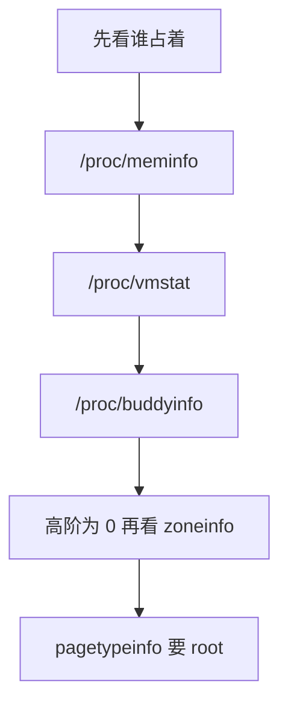

# 13. 观测

**结论**：先读 `/proc/meminfo` 把「谁占着」分成可用、缓存、匿名、slab、页表，再用 `/proc/vmstat` 看分配和回收是不是正在发生，最后用 `/proc/buddyinfo` 看高阶页还在不在。PSI 只回答「有没有人在等内存」。聚合算法见 [cgroup/08-psi-rstat.md](../cgroup/08-psi-rstat.md)。

> 本节数字来自本机快照 `uploads/host-mm-snapshot.txt`，**在 6.12 上采样**。`uname`：`Linux ... 6.12.94+ #1 SMP PREEMPT_DYNAMIC ... x86_64`。
> 结构体、函数、文件权限、tracepoint 名字核对自内核 **v6.6.160** 源码树。快照里的计数器名字在 v6.6.160 的 `mm/vmstat.c` `vmstat_text[]` 里都能对上（有的包在 `CONFIG_*` 里，见 13.2）。`/proc/zoneinfo` 快照文本里的 `promo` 是 6.12 采样里的词，v6.6.160 的 `zoneinfo_show_print` 不打印这个词。
> 导航：[上一节 balloon](./12-balloon-fpr-and-overcommit.md) · [目录](./README.md) · [下一节 排障](./14-perf-and-dev-practice.md)

`/proc/pagetypeinfo` 和 `/proc/slabinfo` 快照里是 `Permission denied`。下面不编这两份的数字。



---

## 13.1 `/proc/meminfo`

`fs/proc/meminfo.c` 的 `meminfo_proc_show`（`:34`）把数字打成 kB。`proc_create_single("meminfo", 0, ...)` 在 `:178`。传进去的 mode 是 0，`proc_create_reg`（`fs/proc/generic.c:570`）看到权限位全空就补上 `S_IRUGO`，所以普通用户也能读。

`si_meminfo`（`mm/show_mem.c:78`）填这几项：

| `sysinfo` 字段 | 从哪来 | meminfo 名字 |
|---|---|---|
| `totalram` | `totalram_pages()` | `MemTotal` |
| `freeram` | `NR_FREE_PAGES` | `MemFree` |
| `bufferram` | `nr_blockdev_pages()` | `Buffers` |
| `sharedram` | `NR_SHMEM` | `Shmem` |

`MemAvailable` 走 `si_mem_available`（`mm/show_mem.c:32`）。它从空闲页里扣掉保留页（`:52`），再把一部分文件页（`:59`）和可回收 slab（`:68`）加回去。判断还能不能再分，读 `MemAvailable`。`MemFree` 只含 buddy 里的空闲页，可回收缓存在它外面。

`Cached`（`meminfo.c:48`）是 `NR_FILE_PAGES` 减去 swap cache 再减去 `Buffers`，小于 0 就打 0。

`show_val_kb`（`:28`）把页数左移 `PAGE_SHIFT - 10`，4 KiB 页就是乘 4，得到 kB。`KernelStack` 直接打印 `NR_KERNEL_STACK_KB`，单位已经是 kB（`:112`）。

`VmallocChunk` 在 `:133` 固定写成 `0ul`。窗口大小看 `VmallocTotal`，已用量看 `VmallocUsed`。`VmallocTotal` 是 `VMALLOC_TOTAL >> 10`（`include/linux/vmalloc.h:270`，`VMALLOC_END - VMALLOC_START`）。x86_64 上这是虚拟地址窗口。

`CommitLimit` 走 `vm_commit_limit`（`mm/util.c:903`）。`overcommit_kbytes` 非 0 时用它；否则是 `(totalram_pages() - hugetlb_total_pages()) * overcommit_ratio / 100`，再加 `total_swap_pages`。`sysctl_overcommit_ratio` 的初值是 50（`util.c:831`），proc 名 `overcommit_ratio` 在 `kernel/sysctl.c:2069`。快照里没有 `overcommit_memory` / `overcommit_ratio` / `overcommit_kbytes` 的读数。`CommitLimit` 正好是 `MemTotal/2`，和「ratio 50、swap 0、hugetlb 0、overcommit_kbytes 为 0」这组输入长得一样。

下面是 **在 6.12 上采样** 的字段。名字在 v6.6.160 的 `meminfo_proc_show` 里都有（`Zswap` 要 `CONFIG_ZSWAP`，THP 三项要 `CONFIG_TRANSPARENT_HUGEPAGE`，`DirectMap*` 来自 x86 `arch_report_meminfo`，`HugePages_*` / `Hugepagesize` / `Hugetlb` 来自 `hugetlb_report_meminfo`）。这台机器约 16GB。

| 字段 | 快照 | 怎么读 |
|---|---|---|
| `MemTotal` | 16386368 | `totalram_pages()`。内核记账的页，和 DIMM 标签上的容量是两个数 |
| `MemFree` | 369288 | `NR_FREE_PAGES`。约 360MB。偏低只说明 buddy 里空闲少 |
| `MemAvailable` | 3421272 | `si_mem_available`。约 3.3GB。看这个判断还能不能再分 |
| `Buffers` | 82432 | 块设备元数据页 |
| `Cached` | 3120060 | 文件页减去 swap cache 和 Buffers。和 `Active(file)+Inactive(file)` 同量级 |
| `SwapCached` | 0 | `total_swapcache_pages()`。无 swap |
| `Active` / `Inactive` | 2183736 / 2876092 | 四个 LRU 的和 |
| `Active(anon)` / `Inactive(anon)` | 876 / 1925976 | 匿名页几乎都在 inactive |
| `Active(file)` / `Inactive(file)` | 2182860 / 950116 | 文件页是大头，多数在 active |
| `Unevictable` / `Mlocked` | 0 / 0 | `LRU_UNEVICTABLE` 和 `NR_MLOCK` |
| `SwapTotal` / `SwapFree` | 0 / 0 | `si_swapinfo`。匿名页换不走 |
| `Zswap` / `Zswapped` | 0 / 0 | `CONFIG_ZSWAP` 下才打印。池大小和已存页 |
| `Dirty` / `Writeback` | 764 / 0 | `NR_FILE_DIRTY` / `NR_WRITEBACK`。见 [08](./08-page-cache-and-writeback.md) |
| `AnonPages` | 1857444 | `NR_ANON_MAPPED`。约 1.8GB |
| `Mapped` | 351576 | `NR_FILE_MAPPED` |
| `Shmem` | 69604 | `NR_SHMEM`。tmpfs、共享内存 |
| `KReclaimable` | 256936 | `NR_SLAB_RECLAIMABLE_B` 换成页，再加 `NR_KERNEL_MISC_RECLAIMABLE` |
| `Slab` | 338408 | 可回收 slab 加不可回收 slab。约 330MB |
| `SReclaimable` / `SUnreclaim` | 256936 / 81472 | 两者之和等于 `Slab` |
| `KernelStack` | 12724 | 已经是 kB 的栈记账 |
| `PageTables` | 53524 | `NR_PAGETABLE`。约 52MB |
| `SecPageTables` | 0 | `NR_SECONDARY_PAGETABLE`。KVM EPT 一类的二级页表 |
| `Committed_AS` | 5864400 | `vm_memory_committed()`。约 5.6GB |
| `CommitLimit` | 8193184 | 见上面的公式。正好是 `MemTotal/2` |
| `VmallocTotal` | 34359738367 | 约 32TB 虚拟窗口 |
| `VmallocUsed` | 15984 | `vmalloc_nr_pages()`。约 16MB |
| `VmallocChunk` | 0 | v6.6.160 固定打 0 |
| `Percpu` | 3040 | `pcpu_nr_pages()` |
| `AnonHugePages` 及 `ShmemHugePages` / `FileHugePages` | 全 0 | `NR_ANON_THPS` 等。计数按页记，meminfo 用 `show_val_kb` 打成 kB。`/proc/vmstat` 里的 `nr_anon_transparent_hugepages` 才会再除以 `HPAGE_PMD_NR` |
| `HugePages_*` / `Hugetlb` | 0 | 默认 hstate 的池是空的 |
| `Hugepagesize` | 2048 | `huge_page_size(default_hstate) / SZ_1K`。池空也会打 |
| `DirectMap4k` / `2M` / `1G` | 18432 / 3127296 / 15728640 | x86 `arch/x86/mm/pat/set_memory.c:110`。约 15GB 用 1GB 页 |

`MemAvailable` 远大于 `MemFree`，差的主要是可回收文件页。

---

## 13.2 `/proc/vmstat`

`proc_create_seq("vmstat", 0444, ...)` 在 `mm/vmstat.c:2142`。`vmstat_show`（`:1841`）按 `vmstat_text[]`（`:1168`）的下标打「名字 数值」。数组顺序是：zone stat、numa event、node stat、writeback 阈值、vm event。

node stat 经过 `global_node_page_state_pages`（`:1815`），字节计数会换回页。`vmstat_item_print_in_thp`（`mmzone.h:220`）为真的项再除以 `HPAGE_PMD_NR`，所以 `nr_anon_transparent_hugepages`、`nr_shmem_hugepages`、`nr_file_hugepages` 以及对应的 pmdmapped 打出来的是大页个数。`pgpgin` / `pgpgout` 在 `:1827` 再除以 2，扇区换成 kB。其余 vm event 是次数或页数，名字里能看出来。

文件最后 `vmstat_show`（`:1850`）固定再打一行 `nr_unstable 0`。这个名字不在 `vmstat_text[]` 里。

zone 后缀由 `TEXTS_FOR_ZONES`（`:1164`）生成：`_normal` 和 `_movable` 总在；`_dma` 要 `CONFIG_ZONE_DMA`；`_dma32` 要 `CONFIG_ZONE_DMA32`。`balloon_migrate` 要 `CONFIG_MEMORY_BALLOON` 加 `CONFIG_BALLOON_COMPACTION`。事件段要 `CONFIG_VM_EVENT_COUNTERS` 或 `CONFIG_MEMCG`。

下面的名字都在 v6.6.160 的 `vmstat_text[]` 里。数值 **在 6.12 上采样**。

### 当前存量（`nr_*`）

| 项 | 值 | 读法 |
|---|---|---|
| `nr_free_pages` | 92322 | 约 360MB，和 `MemFree` 一致 |
| `nr_anon_pages` | 464361 | 约 1.8GB |
| `nr_file_pages` | 800623 | 文件页约 3.1GB |
| `nr_slab_reclaimable` / `nr_slab_unreclaimable` | 64234 / 20368 | 和 meminfo 的 SReclaimable / SUnreclaim 同量级。vmstat 里是页 |
| `nr_dirty` | 191 | 约 764kB |
| `nr_writeback` | 0 | |
| `nr_isolated_anon` / `nr_isolated_file` | 0 / 0 | 此刻没有页正被回收隔离 |
| `nr_zone_inactive_anon` / `nr_zone_active_anon` | 481559 / 219 | 匿名几乎全 inactive |
| `nr_zone_inactive_file` / `nr_zone_active_file` | 237529 / 545715 | 文件页多数 active |
| `nr_anon_transparent_hugepages` | 0 | 大页个数，已经除过 `HPAGE_PMD_NR` |

`workingset_refault_file` 1132283、`workingset_refault_anon` 0。这两项写在 node stat 段，`workingset.c` 在缺页撞上 shadow 时按页 `mod_lruvec_state` 累加。读数是曾经 refault 的页数。当前占用量看 `nr_file_pages` 这一类。文件页被挤走后又缺页回来，说明缓存是热的。匿名为 0，和没有 swap 对得上。

### 累计事件

| 项 | 值 | 读法 |
|---|---|---|
| `pgalloc_dma` / `dma32` / `normal` / `movable` | 0 / 12429729 / 21146499 / 0 | 按页真正离开的 zone 记。见下面的路径 |
| `allocstall_dma32` / `normal` / `movable` | 0 / 11 / 373 | 直接回收入口加一。下标是 `gfp_zone(gfp_mask)` |
| `pgfault` / `pgmajfault` | 22590804 / 8519 | 缺页很多，真正读盘的少 |
| `pgscan_kswapd` / `pgsteal_kswapd` | 2082453 / 1611280 | 后台回收。1611280/2082453 ≈ 77% |
| `pgscan_direct` / `pgsteal_direct` | 19314 / 18131 | 直接回收扫到的页大部分被偷走 |
| `pgscan_file` / `pgsteal_file` | 2101767 / 1629411 | |
| `pgscan_anon` / `pgsteal_anon` | 0 / 0 | 没扫匿名。无 swap 时回收匿名没有去处 |
| `pgskip_normal` | 492221 | 隔离时跳过的页，按页所在 zone 记。见下 |
| `compact_stall` / `fail` / `success` | 0 / 0 / 0 | 这三个只在直接压缩路径上加 |
| `compact_daemon_wake` | 72 | `kcompactd_do_work` 开头加一 |
| `compact_daemon_migrate_scanned` / `free_scanned` | 640430 / 2197208 | kcompactd 自己的扫描页数 |
| `thp_*` | 全 0 | `CONFIG_TRANSPARENT_HUGEPAGE` 下的那一组，含 `thp_fault_alloc`、`thp_fault_fallback`、`thp_collapse_alloc`、`thp_split_page`、`thp_split_pmd` |
| `oom_kill` | 0 | |
| `balloon_inflate` / `deflate` / `migrate` | 4718592 / 2097152 / 45672 | 历史累计页数。见 [12](./12-balloon-fpr-and-overcommit.md) |
| `pswpin` / `pswpout` | 0 / 0 | |
| `numa_hit` / `numa_miss` | 31818671 / 0 | `CONFIG_NUMA`。单节点，全部命中 |

`kswapd_low_wmark_hit_quickly` 399、`kswapd_high_wmark_hit_quickly` 46：kswapd 经常刚睡又被 LOW 叫醒，偶尔才是因为到了 HIGH 立刻再睡。

`pgalloc_*` 和 `allocstall_*` 对不上，是两条计数：

```text
rmqueue_pcplist / rmqueue_buddy          # page_alloc.c:2798 / :2722
  __count_zid_vm_events(PGALLOC, 页真正所在的 zone, 1 << order)

do_try_to_free_pages                     # vmscan.c:6839
  非 cgroup 回收时
  __count_zid_vm_events(ALLOCSTALL, sc->reclaim_idx, 1)   # :6850
    reclaim_idx 来自 try_to_free_pages 的 gfp_zone(gfp_mask)  # :7064
```

`gfp_zone`（`include/linux/gfp.h:129`）用 GFP 里的 zone 位查出允许的最高 zone。`GFP_HIGHUSER_MOVABLE` 得到 `ZONE_MOVABLE`，stall 就记在 `allocstall_movable`。页可以最后从更低的 zone 拿出来，回收完仍然失败时 stall 也已经加过。stall 记的是进入直接回收的次数。从哪个 zone 拿到页看 `pgalloc_*`。只叫醒 kswapd、或只做压缩的 slowpath 不经过 `do_try_to_free_pages`，`allocstall_*` 保持不动。

`compact_stall` / `compact_success` / `compact_fail` 在 `__alloc_pages_direct_compact`（`page_alloc.c:3417`）。压缩没被跳过就 `COMPACTSTALL`（`:3445`）；随后从 freelist 拿到页才 `COMPACTSUCCESS`（`:3460`）；拿不到才 `COMPACTFAIL`（`:3468`）。kcompactd 在 `kcompactd_do_work`（`compaction.c:2932`）里 `KCOMPACTD_WAKE`（`:2950`），扫完记 `KCOMPACTD_MIGRATE_SCANNED` / `KCOMPACTD_FREE_SCANNED`（`:2994`）。这条路径在 `status == COMPACT_SUCCESS` 时只 `compaction_defer_reset`（`:2976`），不加 `compact_success`。所以 daemon 在扫、`compact_success` 仍是 0，两件事可以同时成立。

`pgskip_*` 有两条：

- 经典 LRU `isolate_lru_folios`：folio 的 zone 高于 `sc->reclaim_idx` 就先记进 `nr_skipped`（`vmscan.c:2320`），扫完再按 zone 加 `PGSCAN_SKIP`（`:2376`）。
- MGLRU `scan_folios`：`isolate_folio` 失败（不能 IO、和释放或另一次隔离赛跑）时按该 zone 加 `PGSCAN_SKIP`（`:5052`、`:5062`）。zone 高于 `reclaim_idx` 的 folio 在 `sort_folio` 里计入 sorted，计数进 `PGREFILL`。

快照是 6.12 上的累计值。上面两段是 v6.6.160 里这个名字的加一位置。

---

## 13.3 `/proc/buddyinfo`

`proc_create_seq("buddyinfo", 0444, ...)` 在 `vmstat.c:2140`。`frag_show_print`（`:1469`）对每个有页的 zone 打一行：`Node %d, zone %8s`，然后 `order` 从 0 到 `NR_PAGE_ORDERS - 1`。

`include/linux/mmzone.h`：

```c
#ifndef CONFIG_ARCH_FORCE_MAX_ORDER
#define MAX_ORDER 10          /* :29。默认 10 */
#else
#define MAX_ORDER CONFIG_ARCH_FORCE_MAX_ORDER
#endif
#define NR_PAGE_ORDERS (MAX_ORDER + 1)   /* :37。默认 11，列是 order 0..10 */
```

每列是该阶空闲块的个数 `zone->free_area[order].nr_free`。页数 = 个数 × 2^order。4 KiB 页时 order 9 是 512 页 = 2 MiB，order 10 是 1024 页 = 4 MiB。x86_64 上 `HPAGE_PMD_ORDER` 是 `PMD_SHIFT - PAGE_SHIFT`（`include/linux/huge_mm.h:89`），等于 9。

**在 6.12 上采样**：

```text
Node 0, zone    DMA     0    0    0    0    0    0    0    0    1    1    3
Node 0, zone  DMA32  9372 5976 2779 1021  603  167   93   15    2    1    2
Node 0, zone Normal   996 1103  625  192  173   36   17    5   13   11    0
```

| zone | 读法 |
|---|---|
| DMA | order 8、9、10 各有几块。DMA 的 managed 只有 3840 页（zoneinfo 快照），zone 本来就小 |
| DMA32 | 低阶很多。order 9 有 1 块 = 2 MiB。order 10 有 2 块 = 8 MiB |
| Normal | order 10 是 **0**。要 4 MiB 连续物理页会失败或去压缩。order 9 还有 11 块，2 MiB 还有 |

高阶为 0、低阶几千，是外碎片。`MemFree` 仍有 360MB。快照没有 Movable 行：`frag_show` 用 `assert_populated == true`（`:1490`），没有页的 zone 不打。

---

## 13.4 `/proc/zoneinfo`

`proc_create_seq("zoneinfo", 0444, ...)` 在 `vmstat.c:2143`。`zoneinfo_show`（`:1768`）把每个 zone 都打出来，包括没有页的，因为 `lowmem_reserve[]` 按全部 zone 算。

v6.6.160 的 `zoneinfo_show_print`（`:1673`）水位行是：

```text
pages free / boost / min / low / high / spanned / present / managed / cma
protection: (lowmem_reserve[0], lowmem_reserve[1], ...)
```

`protection` 就是 `zone->lowmem_reserve[]`（`mmzone.h:833`）。DMA 给更高 zone 留的保护从 0 开始（自己是最低），后面的数是更高 zone 来分配时不能把 DMA 吃进保留区。

per-CPU pageset（`:1733`）每个 online cpu 打 `count`、`high`、`batch`。

**在 6.12 上采样**，DMA 段被收成：

```text
pages free 3840  min 15  low 18  high 21  promo 24
      spanned 4095  present 3998  managed 3840
      protection: (0, 2953, 15983, 15983)
```

`promo` 这个词出现在 6.12 的采样文本里。v6.6.160 的 `zoneinfo_show_print` 打印的是 `free`、`boost`、`min`、`low`、`high`、`spanned`、`present`、`managed`、`cma`。快照没有给出 `boost` 和 `cma` 的数，这里不补。能对上的数是 free 3840、min 15、low 18、high 21、spanned 4095、present 3998、managed 3840、protection `(0, 2953, 15983, 15983)`。DMA 的水位只有十几页，因为 managed 才 3840 页。

pageset 快照：`count 0, high 0, batch 1`。DMA 太小，PCP 不囤页。v6.6.160 按每个 online cpu 打这三项。

快照在 `Node 0, zone DMA32` 处截断，DMA32 和 Normal 的 min/low/high 不在这份文本里。DMA 的水位只描述 DMA。

`pagetypeinfo`：`proc_create_seq("pagetypeinfo", 0400, ...)` 在 `vmstat.c:2141`，属主只读。快照是 `Permission denied`。缺了它就不知道 Normal 的 order 10 为 0 是 Unmovable pageblock 钉住的，还是当时高阶链表是空的。要看的话用 root 再读。本节不补数。`migratetype_names`（`page_alloc.c:301`）是 `Unmovable`、`Movable`、`Reclaimable`、`HighAtomic`，再加可选的 `CMA`、`Isolate`。

---

## 13.5 PSI memory

`kernel/sched/psi.c` 在 `psi_enable` 为真时 `proc_mkdir("pressure")`，再 `proc_create("pressure/memory", 0666, ...)`（`:1675`、`:1677`）。`psi_memory_show`（`:1517`）把系统级 `PSI_MEM` 交给 `psi_show`。

**在 6.12 上采样**：

```text
some avg10=0.00 avg60=0.00 avg300=0.00 total=2919337
full avg10=0.00 avg60=0.00 avg300=0.00 total=2872235
```

`some`：至少一个任务在等内存。`full`：所有非 idle 任务都在等。平均值是最近 10/60/300 秒的百分比，此刻全 0。`total` 是累计微秒。约 2.9 秒的历史等待。快照没写 uptime，这里不把 total 换成占空比。

任务状态怎么收成 `some` / `full`，见 [cgroup/08-psi-rstat.md](../cgroup/08-psi-rstat.md)。全局 `/proc/pressure/memory` 和某个 cgroup 的 `memory.pressure` 各算各的。

---

## 13.6 slabinfo 与 memcg `memory.stat`

`/proc/slabinfo` 在 `mm/slab_common.c:1368` 创建。权限宏 `SLABINFO_RIGHTS`（`:1227`）：`CONFIG_SLAB` 时 `0600`，否则 `0400`。快照是非 root 的 `Permission denied`，和 `0400` 一致。对象级的列要 root 读，或用 `slabtop`，见 [14](./14-perf-and-dev-practice.md)。非 root 只能看 meminfo 的 `Slab` 三项。

本快照**没有**采集 `/sys/fs/cgroup/.../memory.stat`。cgroup 章别的时点的 `memory.current` 和这份 meminfo 是两个瞬间。

v6.6.160 的字段表在 `mm/memcontrol.c` 的 `memory_stats[]`（`:1524`）。和观测有关的名字：

| 名字 | 含义 |
|---|---|
| `anon` / `file` | `NR_ANON_MAPPED` / `NR_FILE_PAGES`。输出乘 `PAGE_SIZE`，是字节 |
| `kernel` | `MEMCG_KMEM` |
| `sock` | `MEMCG_SOCK` |
| `slab_reclaimable` / `slab_unreclaimable` | 计数本身是字节，`memcg_page_state_unit` 返回 1（`:1574`） |
| `workingset_refault_anon` / `workingset_refault_file` | 这个 memcg 的 refault。单位函数返回 1，是页次数。全局同名项在 `/proc/vmstat` |

内核对象看 `slab_reclaimable` 和 `slab_unreclaimable`。用户匿名页看 `anon`。

`memory.events` 的 `oom_kill` 在 `__memory_events_show`（`memcontrol.c:6696`）。和全局 `/proc/vmstat` 的 `oom_kill` 各记各的。

---

## 13.7 关键 tracepoint

打开方式是 ftrace 或 bpftrace。本环境没有把这些 tracepoint 跑一遍，命令在 [14](./14-perf-and-dev-practice.md) 标 RECIPE。下面只列 v6.6.160 `include/trace/events/` 里真实存在的事件，行号是 `TRACE_EVENT` 或 `DEFINE_EVENT` 那一行。

| 事件 | 文件:行 | 什么时候打 |
|---|---|---|
| `mm_page_alloc` | `kmem.h:177` | 页分配完成 |
| `mm_page_free` | `kmem.h:136` | 页释放 |
| `mm_page_free_batched` | `kmem.h:158` | 批量释放 |
| `mm_page_alloc_zone_locked` | `kmem.h:235` | 持 zone 锁分配 |
| `mm_page_alloc_extfrag` | `kmem.h:266` | 分配造成外碎片 |
| `mm_page_pcpu_drain` | `kmem.h:243` | PCP 倒回 buddy |
| `kmem_cache_alloc` | `kmem.h:12` | slab 分配 |
| `kmalloc` | `kmem.h:54` | kmalloc |
| `kfree` | `kmem.h:94` | kfree |
| `kmem_cache_free` | `kmem.h:114` | slab 释放 |
| `rss_stat` | `kmem.h:346` | RSS 记账 |
| `mm_vmscan_kswapd_wake` | `vmscan.h:66` | kswapd 醒 |
| `mm_vmscan_kswapd_sleep` | `vmscan.h:49` | kswapd 睡 |
| `mm_vmscan_wakeup_kswapd` | `vmscan.h:89` | 谁把它叫醒 |
| `mm_vmscan_direct_reclaim_begin` | `vmscan.h:136` | 直接回收开始。模板在 `:115` |
| `mm_vmscan_memcg_reclaim_begin` | `vmscan.h:144` | 同一个模板 |
| `mm_vmscan_memcg_softlimit_reclaim_begin` | `vmscan.h:151` | 同一个模板 |
| `mm_vmscan_direct_reclaim_end` | `vmscan.h:176` | 直接回收结束。模板在 `:159` |
| `mm_vmscan_lru_isolate` | `vmscan.h:281` | 从 LRU 隔离 |
| `mm_vmscan_write_folio` | `vmscan.h:330` | 回收路径写脏页 |
| `mm_vmscan_lru_shrink_inactive` | `vmscan.h:353` | 收缩 inactive |
| `mm_vmscan_lru_shrink_active` | `vmscan.h:404` | 收缩 active |
| `mm_vmscan_node_reclaim_begin` | `vmscan.h:440` | node reclaim |
| `mm_vmscan_node_reclaim_end` | `vmscan.h:464` | 结束模板同 direct reclaim end |
| `mm_shrink_slab_start` | `vmscan.h:199` | shrinker 开始 |
| `mm_shrink_slab_end` | `vmscan.h:244` | shrinker 结束 |
| `mm_vmscan_throttled` | `vmscan.h:471` | 回收节流 |
| `mm_compaction_begin` | `compaction.h:101` | 压缩开始 |
| `mm_compaction_end` | `compaction.h:131` | 压缩结束 |
| `mm_compaction_try_to_compact_pages` | `compaction.h:165` | 直接压缩入口 |
| `mm_compaction_kcompactd_sleep` | `compaction.h:293` | kcompactd 睡 |
| `mm_compaction_wakeup_kcompactd` | `compaction.h:338` | 叫醒 kcompactd |
| `mm_compaction_kcompactd_wake` | `compaction.h:345` | kcompactd 醒来 |
| `mm_khugepaged_scan_pmd` | `huge_memory.h:56` | khugepaged 扫匿名 PMD |
| `mm_khugepaged_scan_file` | `huge_memory.h:175` | 扫文件 |
| `mm_collapse_huge_page` | `huge_memory.h:93` | 折叠匿名大页 |
| `mm_khugepaged_collapse_file` | `huge_memory.h:209` | 折叠文件大页 |
| `balance_dirty_pages` | `writeback.h:621` | 脏页限速 |
| `mark_victim` | `oom.h:76` | OOM 选中进程 |
| `reclaim_retry_zone` | `oom.h:34` | OOM 前再看水位 |
| `compact_retry` | `oom.h:183` | OOM 前再试压缩 |
| `mm_migrate_pages` | `migrate.h:48` | 迁移结束 |
| `mm_migrate_pages_start` | `migrate.h:87` | 迁移开始 |
| `mm_filemap_add_to_page_cache` | `filemap.h:54` | 页进入 page cache |
| `mm_filemap_delete_from_page_cache` | `filemap.h:49` | 页离开 page cache |
| `mmap_lock_start_locking` | `mmap_lock.h:49` | 开始拿 mmap_lock |
| `mmap_lock_acquire_returned` | `mmap_lock.h:52` | 拿到或失败 |
| `mmap_lock_released` | `mmap_lock.h:50` | 放开 |
| `ksm_start_scan` / `ksm_stop_scan` | `ksm.h:46` / `:61` | KSM 扫描 |
| `kvm_unmap_hva_range` | `kvm.h:441` | 拆掉一段 HVA |
| `kvm_age_hva` | `kvm.h:474` | 给 HVA 变老 |
| `kvm_test_age_hva` | `kvm.h:492` | 查询 HVA 是否年轻 |
| `kvm_page_fault` | `arch/x86/kvm/trace.h:402` | x86 EPT/NPF。`vmx.c` 和 `svm.c` 调用。通用头里靠近内存的是上面三行 `kvm_*_hva` |

`include/trace/events/filemap.h` 里和页缓存有关的是上面两行进出缓存的事件。缺页本身看 `handle_mm_fault`（`mm/memory.c:5323`）。

---

## 13.8 guest 和宿主对照

同一时刻，两边的数字回答的是不同的问题。

| 问题 | 在 guest 里看 | 在宿主里看 |
|---|---|---|
| guest 还剩多少空闲 | guest `MemFree` / `MemAvailable` | qemu RSS 是宿主记账 |
| 宿主是不是把页给了别的虚拟机 | guest 看不出来，除非 balloon 把 `MemTotal` 或可用页压下去 | qemu 进程的 RSS、`memory.stat`、宿主机 `MemAvailable` |
| 气球 | guest `balloon_*` vmstat、`MemTotal` 是否下降 | 宿主侧 qemu 的 balloon 统计（`info balloon`） |
| FPR | guest 空闲页仍在 `MemFree` 里 | 宿主可能已经把这些 HPA 分走。guest `MemFree` 偏乐观 |
| 缺页延迟 | guest `pgmajfault`、PSI | 宿主上 qemu 的 major fault、x86 `kvm_page_fault` |
| 大页 | guest `AnonHugePages` | 宿主 THP/hugetlb。两边都要看，见 [09](./09-thp-and-hugetlb.md) |
| 页表 | guest `PageTables` | 宿主 `SecPageTables`（EPT）加 qemu 自己的 `PageTables` |
| OOM | guest `dmesg` 和 `oom_kill` | 宿主 OOM killer 可能杀的是 qemu 整个进程 |

本机快照是宿主视角（这台 box 自己的 `/proc`），**在 6.12 上采样**。`SecPageTables` 为 0，`balloon_*` 非 0：气球计数在，二级页表记账是 0。一个是事件累计，一个是当前存量。

---

## 13.9 pagemap、soft-dirty、idle page

**结论**：工作集估算用三件套。`/proc/<pid>/pagemap` 看这个进程每一页现在是什么；soft-dirty 看两次清零之间谁被写过；`/sys/kernel/mm/page_idle/bitmap` 按 PFN 看谁被碰过。`pagemap` 是 `S_IRUSR`（`fs/proc/base.c:3326`），`clear_refs` 是 `S_IWUSR`（`:3323`）。`kpagecount` / `kpageflags` 是 `S_IRUSR`（`fs/proc/page.c:332`、`:333`）。page_idle 的 bitmap 是 `0600`（`mm/page_idle.c:197`）。本机快照没采这三份。

`PM_*` 宏不在 uapi 头文件里。它们是 `fs/proc/task_mmu.c:1349` 起的局部宏。

### `/proc/<pid>/pagemap`

`pagemap_read`（`task_mmu.c:1659`）。一项是 `u64`（`PM_ENTRY_BYTES`，`:1349`）。文件偏移和读长度必须是它的整数倍，否则 `-EINVAL`（`:1675`）。注释（`:1655`）说高效读法是先看 `/proc/<pid>/maps`，对空洞 `llseek` 跳过。

| 位 | 宏 | 含义 |
|---|---|---|
| 0–54 | `PM_PFRAME_BITS` 55，`PM_PFRAME_MASK` | `show_pfn` 为真且页在内存里时是 PFN。在 swap 里时是 `swp_type` 拼上左移 `MAX_SWAPFILES_SHIFT` 的 offset（`:1446`）。没映射是 0 |
| 55 | `PM_SOFT_DIRTY` | soft-dirty。PTE 上的位，或 VMA 的 `VM_SOFTDIRTY`（`:1460`） |
| 56 | `PM_MMAP_EXCLUSIVE` | 在内存里且 `page_mapcount == 1` |
| 57 | `PM_UFFD_WP` | userfaultfd write-protect |
| 58–60 | 无宏 | `pte_to_pagemap_entry` 不置这些位 |
| 61 | `PM_FILE` | 页存在且不是匿名页 |
| 62 | `PM_SWAP` | 在 swap |
| 63 | `PM_PRESENT` | 在内存里 |

`:1682` 的注释是 “do not disclose physical addresses”。下一行 `pm.show_pfn = file_ns_capable(file, &init_user_ns, CAP_SYS_ADMIN)`。没有 `CAP_SYS_ADMIN`，PFN 字段保持 0。

`/proc/kpagecount` 的 `kpagecount_read` 在 `fs/proc/page.c:45`，`/proc/kpageflags` 的 `kpageflags_read` 在 `:226`。kpagecount 是 mapcount，kpageflags 是页标志。和 pagemap 的 PFN 对上之后，才能从「这个进程的虚拟页」走到「这张物理页的标志」。

### soft-dirty

x86 在 `CONFIG_HAVE_ARCH_SOFT_DIRTY` 下用 `pte_flags(pte) & _PAGE_SOFT_DIRTY`（`arch/x86/include/asm/pgtable.h:669`）。没有这个配置时，`include/linux/pgtable.h:1202` 的 `pte_soft_dirty` 固定返回 0。

清零只在 `CONFIG_MEM_SOFT_DIRTY` 下有函数体。`clear_soft_dirty`（`task_mmu.c:1105`）：

```c
if (pte_present(ptent)) {
    if (pte_is_pinned(vma, addr, ptent))   /* :1089：可写、COW、mm 有 pin、页可能被 DMA pin */
        return;                            /* pin 住的页跳过 */
    old_pte = ptep_modify_prot_start(vma, addr, pte);
    ptent = pte_wrprotect(old_pte);        /* 写成只读，下次写再缺页 */
    ptent = pte_clear_soft_dirty(ptent);
    ptep_modify_prot_commit(vma, addr, pte, old_pte, ptent);
} else if (is_swap_pte(ptent)) {
    ptent = pte_swp_clear_soft_dirty(ptent);
    set_pte_at(...);
}
```

PMD 大页走 `clear_soft_dirty_pmd`（`:1138`），要同时打开 `CONFIG_MEM_SOFT_DIRTY` 和 `CONFIG_TRANSPARENT_HUGEPAGE`。

用户接口是写 `/proc/<pid>/clear_refs`。`clear_refs_write`（`:1268` 一带）把写入的整数当成 `enum clear_refs_types`（`:1074`）：

```c
enum clear_refs_types {
    CLEAR_REFS_ALL = 1,
    CLEAR_REFS_ANON,             /* 2 */
    CLEAR_REFS_MAPPED,           /* 3 */
    CLEAR_REFS_SOFT_DIRTY,       /* 4 */
    CLEAR_REFS_MM_HIWATER_RSS,   /* 5。注释写明写 5 是把 hiwater rss 收成当前 rss */
    CLEAR_REFS_LAST,
};
```

写 4 时先把带 `VM_SOFTDIRTY` 的 VMA 清掉这个标志（`:1302`），再 `walk_page_range` 清 PTE/PMD。然后读 pagemap 的 bit 55，置位的就是这段时间里被写过的页。`pte_is_pinned` 为真的页清不掉，bit 55 会一直留着，工作集里要把它们单独算。

### idle page tracking

`/sys/kernel/mm/page_idle/bitmap`。`page_idle_attr_group`（`mm/page_idle.c:205`）名字是 `"page_idle"`，`subsys_initcall`（`:221`）里 `sysfs_create_group(mm_kobj, ...)`（`:214`）。`mm_kobj` 是 `/sys/kernel/mm`。

只跟踪在 LRU 上的用户页。`page_idle_get_folio`（`:34`）拿不到在线页、碰到 tail page、folio 不在 LRU 或 `folio_try_get` 失败，就当这个 PFN 没有 idle 位。

写（`page_idle_bitmap_write`，`:159`）：偏移和长度按 `BITMAP_CHUNK_SIZE`（`sizeof(u64)`）对齐，否则 `-EINVAL`。某个 bit 为 1 时，`page_idle_clear_pte_refs`（`:89`）用 `rmap_walk` 清 PTE/PMD young，再 `folio_set_idle`（`:185`）。文件页或 KSM folio 要先 `folio_trylock`，锁不到就直接返回（`:105`），这一轮 young 可能还在。

读（`page_idle_bitmap_read`，`:114`）：同一对齐。folio 带 idle 标志时，先 `page_idle_clear_pte_refs` 再查一次。`page_idle_clear_pte_refs_one`（`:52`）若清掉了 young，就 `folio_clear_idle`（`:78`），这一位保持 0。young 本来就是 0、idle 标志还在，输出位才置 1（`:148`）。读一个确实 idle 的页会留下 idle 标志。

要开一个新的观测窗口，再写一遍 bitmap，把关心的 PFN 标回 idle。估算是近似的。

---

## 13.10 DAMON

**结论**：DAMON 用一个内核线程 `kdamond.%d` 按间隔采样访问，把地址空间收成若干 `damon_region`，每个 region 有访问计数和年龄。用户态有两套接口，都在 v6.6.160 里：`CONFIG_DAMON_SYSFS` 的 `/sys/kernel/mm/damon/admin/`，和 `CONFIG_DAMON_DBGFS` 的 debugfs `damon/`。scheme 的类型是 `struct damos`。动作以 `enum damos_action` 为准。

文档：`Documentation/mm/damon/`（设计），`Documentation/admin-guide/mm/damon/usage.rst`（sysfs 和 debugfs 的文件树）。

### 怎么启动

`damon_new_ctx`（`mm/damon/core.c:452`）`kzalloc` 一个 `struct damon_ctx`，默认 `sample_interval` 5 ms、`aggr_interval` 100 ms、`ops_update_interval` 60 s、`min_nr_regions` 10、`max_nr_regions` 1000（单位微秒，见头文件注释）。

```text
damon_start(ctxs, nr_ctxs, exclusive)     /* core.c:710，先拿 damon_lock */
  exclusive 且已经有运行中的 ctx：-EBUSY
  非 exclusive 但已经有 exclusive 组：-EBUSY
  __damon_start(ctx)                      /* :673。注释要求调用时已持 damon_lock */
    拿 ctx->kdamond_lock
    kdamond 已在：返回 -EBUSY
    kthread_run(kdamond_fn, ctx, "kdamond.%d", nr_running_ctxs)
    成功：wait_for_completion(&ctx->kdamond_started)
```

`kdamond_fn` 在 `:1483`。头文件写明：线程一直跑到有人 `damon_stop()`，或 `ops.target_valid` 认为目标都无效。pid 用 `damon_kdamond_pid()`（`:800`）取。线程只拿 `kdamond_lock` 保护 `kdamond` 指针。别的字段要调用者自己同步。

debugfs 的 `monitor_on` 写 `on` 时调用 `damon_start(dbgfs_ctxs, dbgfs_nr_ctxs, true)`（`dbgfs.c:1039`），整组互斥。sysfs 启动一个 kdamond 时调用 `damon_start(&ctx, 1, false)`（`sysfs.c:1466`），可以和别的非互斥 ctx 同时跑。

### 两套用户接口

sysfs（`CONFIG_DAMON_SYSFS`，依赖 `DAMON && SYSFS`）在 `damon_sysfs_init`（`mm/damon/sysfs.c:1819`）里 `kobject_create_and_add("damon", mm_kobj)`，下面再挂 `admin`。文件树以 `Documentation/admin-guide/mm/damon/usage.rst` 为准，根是 `/sys/kernel/mm/damon/admin/`：

```text
kdamonds/nr_kdamonds
  0/state,pid
    contexts/nr_contexts
      0/avail_operations,operations
        monitoring_attrs/intervals/sample_us,aggr_us,update_us
        monitoring_attrs/nr_regions/min,max
        targets/nr_targets
          0/pid_target
            regions/nr_regions
              0/start,end
        schemes/nr_schemes
          0/action
            access_pattern/sz,nr_accesses,age
            quotas/ms,bytes,reset_interval_ms
            watermarks/metric,interval_us,high,mid,low
            filters/nr_filters
            stats/nr_tried,sz_tried,nr_applied,sz_applied,qt_exceeds
```

debugfs（`CONFIG_DAMON_DBGFS`，依赖 `DAMON_VADDR && DAMON_PADDR && DEBUG_FS`）在 `__damon_dbgfs_init`（`dbgfs.c:1075`）里 `debugfs_create_dir("damon", NULL)`，也就是 debugfs 根下的 `damon/`。Kconfig 提示语是 `DAMON debugfs interface (DEPRECATED!)`（`mm/damon/Kconfig:63`）。打开文件时 `damon_dbgfs_warn_deprecation`（`dbgfs.c:23`）打一次警告，文本让用户改用 `DAMON_SYSFS`。

根目录上的文件（权限 0600）：

| 文件 | 作用 |
|---|---|
| `mk_contexts` / `rm_contexts` | 按名字建、删一个 context 子目录 |
| `monitor_on` | 写 `on` / `off` 启动或停止全部 context |
| `attrs` | 这一份默认 context 的间隔和 region 数 |
| `schemes` | scheme 文本 |
| `target_ids` | 要监视的 pid |
| `init_regions` | 初始区间 |
| `kdamond_pid` | 只读，正在跑的 kdamond pid |

`dbgfs_fill_ctx_dir`（`:759`）把后五个文件挂到每个 context 目录，也挂到根目录那份默认 context。

### `enum damos_action`（`include/linux/damon.h:101`）

```c
enum damos_action {
	DAMOS_WILLNEED,		/* madvise(MADV_WILLNEED) */
	DAMOS_COLD,		/* madvise(MADV_COLD) */
	DAMOS_PAGEOUT,		/* madvise(MADV_PAGEOUT) */
	DAMOS_HUGEPAGE,		/* madvise(MADV_HUGEPAGE) */
	DAMOS_NOHUGEPAGE,	/* madvise(MADV_NOHUGEPAGE) */
	DAMOS_LRU_PRIO,		/* 把 region 在 LRU 上提前 */
	DAMOS_LRU_DEPRIO,	/* 把 region 在 LRU 上推后 */
	DAMOS_STAT,		/* 只记账，不处理页 */
	NR_DAMOS_ACTIONS,
};
```

头文件写明：`DAMON_OPS_VADDR` 和 `DAMON_OPS_FVADDR` 支持除 `LRU_PRIO` / `LRU_DEPRIO` 以外的动作；`DAMON_OPS_PADDR` 支持 `PAGEOUT`、`LRU_PRIO`、`LRU_DEPRIO`、`STAT`。真正做不做还要看当前 `damon_operations`。

sysfs 字符串和枚举下标对齐（`mm/damon/sysfs-schemes.c:1145`）：`willneed`、`cold`、`pageout`、`hugepage`、`nohugepage`、`lru_prio`、`lru_deprio`、`stat`。

debugfs 用整数，映射在 `dbgfs_scheme_action_to_damos_action`（`dbgfs.c:206`）：0 `WILLNEED`、1 `COLD`、2 `PAGEOUT`、3 `HUGEPAGE`、4 `NOHUGEPAGE`、5 `STAT`。其它整数返回 `-EINVAL`，所以 debugfs 这条路径写不进 `LRU_PRIO` / `LRU_DEPRIO`。

`enum damon_ops_id`（`:357`）：`DAMON_OPS_VADDR`、`DAMON_OPS_FVADDR`、`DAMON_OPS_PADDR`。

`enum damos_wmark_metric`（`:175`）：`DAMOS_WMARK_NONE`、`DAMOS_WMARK_FREE_MEM_RATE`（系统空闲内存，范围 0 到 1000）。

`enum damos_filter_type`（`:244`）：`ANON`、`MEMCG`、`ADDR`、`TARGET`。

### `struct damon_addr_range` 和 `struct damon_region`（`:33`、`:51`）

```c
struct damon_addr_range {
	unsigned long start;		/* 含 */
	unsigned long end;		/* 不含 */
};

struct damon_region {
	struct damon_addr_range ar;	/* 这段地址 */
	unsigned long sampling_addr;	/* 下一次采样看的地址 */
	unsigned int nr_accesses;	/* 当前聚合窗口里的访问次数 */
	struct list_head list;		/* 挂在 target->regions_list 上 */
	unsigned int age;		/* 访问频率没大变时，每个聚合间隔加一 */
/* private: */
	unsigned int last_nr_accesses;	/* 算 age 用的上一窗口次数 */
};
```

`age` 一开始是 0。访问频率明显变化就清零。两个 region 合并时，新 region 的 `nr_accesses` 和 `age` 按大小加权平均。region 按 `DAMON_MIN_REGION`（`PAGE_SIZE`，`:18`）对齐。

### `struct damon_target`（`:74`）

```c
struct damon_target {
	struct pid *pid;		/* 虚拟地址监控时是目标进程。物理地址监控可以不用 */
	unsigned int nr_regions;	/* regions_list 上的 region 数 */
	struct list_head regions_list;	/* damon_region 链表 */
	struct list_head list;		/* 挂在 ctx->adaptive_targets 上 */
};
```

### `struct damon_attrs`（`:494`）

时间单位是微秒。

```c
struct damon_attrs {
	unsigned long sample_interval;		/* 两次采样的间隔 */
	unsigned long aggr_interval;		/* 把访问累加多久，到点交给 scheme */
	unsigned long ops_update_interval;	/* 多久让 ops->update 跟上 mmap 之类的变化 */
	unsigned long min_nr_regions;		/* 自适应 region 数下限 */
	unsigned long max_nr_regions;		/* 上限 */
};
```

### `struct damon_operations` 和 `struct damon_callback`

`damon_operations`（`:414`）是一组函数指针。kdamond 按间隔调用它们，ctx 自己不碰页表。

```c
struct damon_operations {
	enum damon_ops_id id;
	void (*init)(struct damon_ctx *context);
	void (*update)(struct damon_ctx *context);
	void (*prepare_access_checks)(struct damon_ctx *context);
	unsigned int (*check_accesses)(struct damon_ctx *context);
	void (*reset_aggregated)(struct damon_ctx *context);
	int (*get_scheme_score)(struct damon_ctx *context,
			struct damon_target *t, struct damon_region *r,
			struct damos *scheme);		/* 返回 0 .. DAMOS_MAX_SCORE（99） */
	unsigned long (*apply_scheme)(struct damon_ctx *context,
			struct damon_target *t, struct damon_region *r,
			struct damos *scheme);		/* 返回实际作用到的字节 */
	bool (*target_valid)(struct damon_target *t);
	void (*cleanup)(struct damon_ctx *context);
};
```

`damon_callback`（`:460`）让 kdamond 在采样点上通知外面。任何一个返回非 0，监控停止。

```c
struct damon_callback {
	void *private;
	int (*before_start)(struct damon_ctx *context);
	int (*after_wmarks_check)(struct damon_ctx *context);
	int (*after_sampling)(struct damon_ctx *context);
	int (*after_aggregation)(struct damon_ctx *context);
	int (*before_damos_apply)(struct damon_ctx *context,
			struct damon_target *target,
			struct damon_region *region,
			struct damos *scheme);
	void (*before_terminate)(struct damon_ctx *context);
};
```

### `struct damon_ctx`（`:532`）

```c
struct damon_ctx {
	struct damon_attrs attrs;		/* 间隔和 region 数 */

/* private: internal use only */
	unsigned long passed_sample_intervals;	/* 启动后过了多少个采样间隔 */
	unsigned long next_aggregation_sis;	/* 下次聚合前还要过多少个 */
	unsigned long next_ops_update_sis;	/* 下次 ops->update 前还要过多少个 */
	struct completion kdamond_started;	/* __damon_start 等线程真正跑起来 */

/* public: */
	struct task_struct *kdamond;		/* NULL 表示没在跑。外面读写要拿锁 */
	struct mutex kdamond_lock;
	struct damon_operations ops;
	struct damon_callback callback;
	struct list_head adaptive_targets;	/* damon_target */
	struct list_head schemes;		/* damos */
};
```

### `struct damos`（`:330`）

这就是 scheme。嵌在里面的配额、水位、统计也列在下面，字段顺序跟头文件一致。

```c
struct damos_access_pattern {
	unsigned long min_sz_region;
	unsigned long max_sz_region;
	unsigned int min_nr_accesses;
	unsigned int max_nr_accesses;
	unsigned int min_age_region;
	unsigned int max_age_region;
};

struct damos_quota {
	unsigned long ms;			/* 每个重置周期最多花多少毫秒 */
	unsigned long sz;			/* 每个重置周期最多处理多少字节 */
	unsigned long reset_interval;		/* 配额清零间隔，毫秒 */
	unsigned int weight_sz;			/* 排序时 region 大小的权重 */
	unsigned int weight_nr_accesses;
	unsigned int weight_age;
/* private: */
	unsigned long total_charged_sz;		/* 用来估计吞吐量 */
	unsigned long total_charged_ns;
	unsigned long esz;			/* 时间和大小配额里较小的那个，字节 */
	unsigned long charged_sz;
	unsigned long charged_from;
	struct damon_target *charge_target_from;
	unsigned long charge_addr_from;
	unsigned long histogram[DAMOS_MAX_SCORE + 1];
	unsigned int min_score;
};

struct damos_watermarks {
	enum damos_wmark_metric metric;		/* NONE 表示一直有效 */
	unsigned long interval;			/* 检查间隔，微秒 */
	unsigned long high;			/* 高于 high：停用 */
	unsigned long mid;			/* mid 和 low 之间：启用 */
	unsigned long low;			/* 低于 low：停用 */
/* private: */
	bool activated;
};

struct damos_stat {
	unsigned long nr_tried;
	unsigned long sz_tried;
	unsigned long nr_applied;
	unsigned long sz_applied;
	unsigned long qt_exceeds;		/* 配额用超的次数 */
};

struct damos {
	struct damos_access_pattern pattern;
	enum damos_action action;
	unsigned long apply_interval_us;	/* 0 表示用 attrs->aggr_interval */
/* private: */
	unsigned long next_apply_sis;		/* 下次应用前还要过多少个采样间隔 */
/* public: */
	struct damos_quota quota;
	struct damos_watermarks wmarks;
	struct list_head filters;		/* damos_filter */
	struct damos_stat stat;
	struct list_head list;			/* 挂在 ctx->schemes 上 */
};
```

`apply_interval_us` 到点后，kdamond 找出落在 `pattern` 里的 region，调用 `ops->apply_scheme`。全部 scheme 都不活跃时，监控停下来，只反复看水位。

---

## 13.11 shrinker debugfs

**结论**：每个 shrinker 在 `/sys/kernel/debug/shrinker/<名字>-<id>/` 下有 `count` 和 `scan`。`count` 只读，问这个 shrinker 还有多少对象。`scan` 只写，让它立刻扫一批。用来确认「slab 回收不动」是 count 就是 0，还是 scan 了但扫不动。文档是 `Documentation/admin-guide/mm/shrinker_debugfs.rst`。

根目录由 `shrinker_debugfs_init`（`mm/shrinker_debug.c:255`）创建：`debugfs_create_dir("shrinker", NULL)` 在 `:261`，dentry 存 `shrinker_debugfs_root`（`:14`）。每个 shrinker 注册时 `shrinker_debugfs_add`（`:156`）用 ida 拿 `debugfs_id`，目录名 `"%s-%d"`（`:173`）。init 末尾拿 `shrinker_rwsem` 写锁，把启动时已经挂上、还没有 dentry 的 shrinker 补登记（`:267`）。

| 文件 | 权限 | 实现 |
|---|---|---|
| `count` | `0440` | `shrinker_debugfs_count_show`（`:45`）。有 `count_objects` 才创建（`:183`） |
| `scan` | `0220` | `shrinker_debugfs_scan_write`（`:98`）。有 `scan_objects` 才创建（`:186`） |

`count` 的一行：先是 `mem_cgroup_ino(memcg)`（`include/linux/memcontrol.h:843`，memcg 为空时是 0，否则是 cgroup inode），再每个 node 的对象数。`total == 0` 的 memcg 不打行（`:68`）。`count_objects` 返回 `SHRINK_EMPTY` 时记 0（`:32`）。非 NUMA-aware 的 shrinker 只问 node 0，其它 node 打 0（`:24`）。不感知 memcg 时只走迭代器的第一轮（`:75`）：memcg 关掉时这一轮是 NULL，所以打 0；memcg 开着时第一轮是 root，打的是 root 的 cgroup inode。admin-guide 写「不感知 memcg 时打 0」，和 memcg 关闭时的代码一致。

`scan` 的写格式是三个数：`<cgroup inode> <nid> <nr_to_scan>`（`sscanf` `"%lu %d %lu"`，`:116`）。`nr_to_scan == 0` 直接返回。`nid` 超出 `nr_node_ids` 返回 `-EINVAL`。感知 memcg 时用 `mem_cgroup_get_from_ino`（`:126`），memcg 不在线返回 `-ENOENT`。不感知时 inode 必须是 0，否则 `-EINVAL`（`:134`）。然后填 `shrink_control` 调 `shrinker->scan_objects`（`:143`）。

debugfs 还没挂上时 `shrinker_debugfs_add` 直接返回 0（`:165`），shrinker 先记在 `shrinker_list` 里，等根目录出现再补。本机非 root 读不到 debugfs。这一节是配方，快照里没有这些文件的内容。

---

## 13.12 关键函数表

| 符号 | 位置 | 作用 |
|---|---|---|
| `meminfo_proc_show` | `fs/proc/meminfo.c:34` | `/proc/meminfo` |
| `si_meminfo` | `mm/show_mem.c:78` | MemTotal / MemFree / Buffers / Shmem |
| `vmstat_show` | `mm/vmstat.c:1841` | `/proc/vmstat` |
| `frag_show_print` | `mm/vmstat.c:1469` | `/proc/buddyinfo` 的一行 |
| `zoneinfo_show_print` | `mm/vmstat.c:1673` | `/proc/zoneinfo` |
| `pagemap_read` | `fs/proc/task_mmu.c:1659` | `/proc/<pid>/pagemap` |
| `clear_soft_dirty` | `fs/proc/task_mmu.c:1105` | 清 PTE soft-dirty 并写保护 |
| `clear_soft_dirty_pmd` | `fs/proc/task_mmu.c:1138` | PMD 大页 |
| `kpageflags_read` | `fs/proc/page.c:226` | `/proc/kpageflags` |
| `kpagecount_read` | `fs/proc/page.c:45` | `/proc/kpagecount` |
| `page_idle_bitmap_read` | `mm/page_idle.c:114` | 读 idle bitmap |
| `page_idle_bitmap_write` | `mm/page_idle.c:159` | 把 PFN 标成 idle |
| `page_idle_clear_pte_refs` | `mm/page_idle.c:89` | 标 idle 前清 PTE young |
| `damon_new_ctx` | `mm/damon/core.c:452` | 分配 `damon_ctx` |
| `damon_start` | `mm/damon/core.c:710` | 启动一组 kdamond |
| `__damon_start` | `mm/damon/core.c:673` | `kthread_run(kdamond_fn)` |
| `shrinker_debugfs_count_show` | `mm/shrinker_debug.c:45` | debugfs `count` |
| `shrinker_debugfs_scan_write` | `mm/shrinker_debug.c:98` | debugfs `scan` |
| `shrinker_debugfs_add` | `mm/shrinker_debug.c:156` | 给一个 shrinker 建目录 |

---

[上一节 balloon](./12-balloon-fpr-and-overcommit.md) · [目录](./README.md) · [下一节 排障](./14-perf-and-dev-practice.md)
