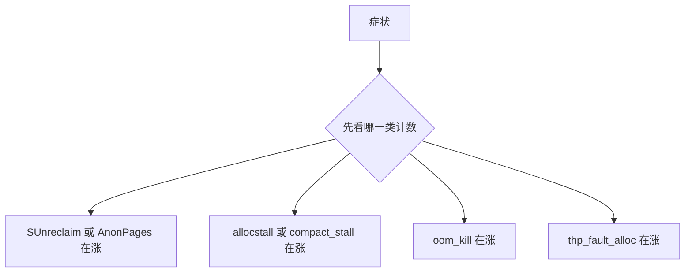

# 14. 按症状排障

**结论**：先用 `/proc` 判断是泄漏、外碎片、直接回收，还是 OOM / THP / balloon。trace、perf、bpftrace 是第二步，本机没跑，标 RECIPE。调用栈画像用 page_owner（§14.7）。

> 快照数字 **在 6.12 上采样**（内核 6.12.94+）。函数、sysfs、sysctl 名字核对自 **v6.6.160**。
> 导航：[上一节 观测](./13-observability.md) · [目录](./README.md)



---

## 14.1 泄漏：slab 涨，或用户页涨

### 内核对象（slab）

症状：`SUnreclaim` 单调涨，重启才掉；`MemAvailable` 掉，`AnonPages` 不明显。

```text
# 实测：本机非 root 读 /proc/slabinfo 失败（Permission denied）。
# 总量仍可读：
grep -E 'Slab|SReclaimable|SUnreclaim' /proc/meminfo
```

快照（**在 6.12 上采样**）：`Slab 338408 kB`，其中不可回收 `81472 kB`。这是一个时点。要判断泄漏，隔几分钟再读，看差值。

`/proc/slabinfo` 的权限在 v6.6.160 里是 `SLABINFO_RIGHTS`（`mm/slab_common.c:1227`）：编的是 `CONFIG_SLAB` 时 `0600`，否则 `0400`。`slabtop` 读的就是这个文件。本机没有跑 `slabtop`。

```text
# RECIPE：需要 root。slabinfo 的列见 04-slab.md。
sudo slabtop -s c
sudo awk 'NR>2 {print}' /proc/slabinfo | sort -k3 -n | tail
```

对象名对得上调用点之后，再考虑 kmemleak。本机没有确认 debugfs 里有 `kmemleak`，下面整段是 RECIPE，也不该在这台 box 上打开调试分配器。

v6.6.160 的实现在 `mm/kmemleak.c`，文档 `Documentation/dev-tools/kmemleak.rst`。`debugfs_create_file("kmemleak", 0644, NULL, ...)` 在 `:2161`，路径是 `/sys/kernel/debug/kmemleak`。要编 `CONFIG_DEBUG_KMEMLEAK`。写这个文件的命令在 `:1937` 的注释里：`scan` 触发一次扫描，`scan=on` / `scan=off` 开关后台线程，`clear` 把当前报告过的对象涂灰，`off` 关掉并且关不回来。读文件打出未引用对象。

```text
# RECIPE：内核要 CONFIG_DEBUG_KMEMLEAK。很多发行版内核没编。
# echo scan > /sys/kernel/debug/kmemleak
# cat /sys/kernel/debug/kmemleak
```

按页看调用栈用 page_owner，见 §14.7。

用户自己的 cache：看名字是不是还在 slabtop 里，对象数是否等于进程还持有的。模块示例在 [demos/kmod_slab_cache.c](./demos/kmod_slab_cache.c)，不在本机 insmod。

### 用户页

症状：`AnonPages` 涨，`Cached` 不涨。

```text
# 按 RSS 排序。本机可以跑，输出随负载变，不贴进笔记当基准。
ps -eo pid,rss,comm --sort=-rss | head
# 某个进程。RssAnon / RssFile / RssShmem 由 task_mem() 打进 /proc/<pid>/status
# （fs/proc/task_mmu.c:66，fs/proc/array.c 调它）。
# grep -E 'RssAnon|RssFile|RssShmem' /proc/<pid>/status
```

`smaps_rollup` 的 `Anonymous` 和 `Rss` 对不上时，差在共享和 THP 记账。`Anonymous`、`AnonHugePages`、`FilePmdMapped` 都在 `task_mmu.c` 的 smaps 输出里（`:836` 一带）。先看 rollup，再对单个映射看 `smaps`。

**本机实测**（**在 6.12 上采样**）：

`demos/02_fault.c`：`pagesize=4096`，触摸 256 页。两次运行 `ru_minflt` 分别是 72→328 和 73→329，增量都是 256；`ru_majflt` 保持 0。基线会随加载器差一两页，增量稳定。

`demos/01_maps_smaps.c`：`mmap` 2MB 匿名并写第一页后，`/proc/self/maps` 里有一行 `rw-p` 且路径为空的映射；同一次运行的 `smaps_rollup` 里 `Anonymous` 104 kB、`AnonHugePages` 0、`Swap` 0。rollup 含堆和加载器，不只有那 2MB。编译命令在 [demos/README.md](./demos/README.md)。

---

## 14.2 直接回收 / compact 延迟

症状：延迟尖刺，`ps` 里业务线程偶尔 `D`，同时 `allocstall_*` 或 `compact_stall` 在涨。

计数含义见 [13](./13-observability.md) §13.2。`allocstall_*` 在 `do_try_to_free_pages` 加一，`compact_stall` / `compact_fail` / `compact_success` 在 `__alloc_pages_direct_compact` 加一。

| 计数 | 尖刺期间应该怎样 | 本机快照（**在 6.12 上采样**，开机以来的累计） |
|---|---|---|
| `allocstall_normal` + `allocstall_movable` | 窗口内增加 | 11 + 373 |
| `pgscan_direct` / `pgsteal_direct` | 增加 | 19314 / 18131 |
| `compact_stall` / `compact_fail` | 直接压缩才涨 | 0 / 0 |
| PSI `memory` `some` | avg10 离开 0 | 当前 avg10=0，total 约 2.9s |

`compact_stall` 为 0 而 `compact_daemon_wake` 为 72：kcompactd 在扫（`KCOMPACTD_WAKE`），分配路径没有同步压缩。这种对延迟的影响小，除非 kcompactd 和业务抢同一把 `zone->lock`。

```text
# RECIPE：ftrace。需要 tracefs 可写，本笔记没有在 box 上打开。
# cd /sys/kernel/tracing
# echo 1 > events/compaction/enable
# echo 1 > events/vmscan/mm_vmscan_wakeup_kswapd/enable
# echo 1 > tracing_on
# 复现之后：
# cat trace | head
# echo 0 > tracing_on

# RECIPE：bpftrace 若没装或没权限，不要装到生产机。本机没跑。
# bpftrace -e 'tracepoint:vmscan:mm_vmscan_wakeup_kswapd { @[comm] = count(); }'

# RECIPE：perf mem。本机没跑，下面不贴报告。
# perf mem record -a -- sleep 5
# perf mem report

# RECIPE：kprobe。符号都在 v6.6.160 源码里。
#   __alloc_pages              mm/page_alloc.c:4465
#   get_page_from_freelist     mm/page_alloc.c:3099   static
#   __alloc_pages_slowpath     mm/page_alloc.c:3948   static
#   kmem_cache_alloc           mm/slub.c:3540 或 mm/slab.c:3430
#   handle_mm_fault            mm/memory.c:5323
#   shrink_node                mm/vmscan.c:6532       static
# static 函数要内核把符号留在 kallsyms 里，kprobe 才挂得上。本机没挂。
# bpftrace -e 'kprobe:__alloc_pages { @[comm] = count(); }'
```

读输出：`mm_vmscan_wakeup_kswapd` 的 order 大于 0，是高阶分配在叫 kswapd，先看 buddyinfo 高阶列。order 0 且 PSI `full` 升高，是缺页这一级的内存压力。

`compact_fail` 持续涨、buddyinfo 的 order 9/10 仍是 0：不可移动页钉在 pageblock 上。`pagetypeinfo` 能确认，权限 `0400`（`mm/vmstat.c:2141`），本机非 root 读它是 Permission denied。缓解是少做不可移动分配、让用户页走 `GFP_MOVABLE`，或者把可拔内存放进 `ZONE_MOVABLE`。

`drop_caches` 丢掉的是缓存，它不整理不可移动页。proc 名在 `kernel/sysctl.c:2120`，mode `0200`，handler 是 `fs/drop_caches.c:51`：bit 0 置位丢 page cache（`DROP_PAGECACHE`），bit 1 置位 `drop_slab()`（`DROP_SLAB`），bit 2 置位之后不再打那行 `drop_caches` 的 printk。

和这节有关的 `/proc/sys/vm/` 名字，v6.6.160 里都在：

| proc 名 | 位置 | mode | 写进去发生什么 |
|---|---|---|---|
| `compact_memory` | `mm/compaction.c:3192`，`register_sysctl_init("vm", ...)` 在 `:3243` | `0200` | 写成 1 时 `compact_nodes()`（`:2862`） |
| `drop_caches` | `kernel/sysctl.c:2120` | `0200` | 见上。1 页缓存，2 slab，3 两个都丢 |
| `min_free_kbytes` | `mm/page_alloc.c:6029` | `0644` | 改每个 zone 的 min 水位。初值计算在 `calculate_min_free_kbytes` |
| `watermark_scale_factor` | `mm/page_alloc.c:6045` | `0644` | 拉高 low/high 相对 min 的距离。变量初值 10（`:317`） |
| `swappiness` | `kernel/sysctl.c:2100` | `0644` | 0 到 200（`extra2` 是 `SYSCTL_TWO_HUNDRED`） |
| `zone_reclaim_mode` | `kernel/sysctl.c:2176`，包在 `CONFIG_NUMA` 里 | `0644` | 数据是 `node_reclaim_mode` |

这些写入本机没做，当 RECIPE。

---

## 14.3 OOM

症状：`dmesg` 有 `Out of memory: Killed process`，或 cgroup `memory.events` 的 `oom_kill` 增加。`oom_kill` 这一行由 `__memory_events_show` 打印（`mm/memcontrol.c:6696`）。

本机全局 `oom_kill` 是 0（**在 6.12 上采样**）。没有 OOM 可复盘。

```text
# 全局
dmesg -T | grep -E 'Out of memory|Killed process'   # RECIPE：本机 dmesg 往往要 root
grep oom_kill /proc/vmstat

# cgroup。路径以实际挂载为准。
# grep oom /sys/fs/cgroup/<path>/memory.events
```

`oom-kill:constraint=` 后面的字符串来自 `oom_constraint_text[]`（`mm/oom_kill.c:243`）：

| 字符串 | 枚举 | 怎么读 |
|---|---|---|
| `CONSTRAINT_MEMCG` | `include/linux/oom.h` | `is_memcg_oom` 时返回。看那个 cgroup 的 `memory.max` 和 `memory.stat`。charge 语义在 cgroup 章 |
| `CONSTRAINT_NONE` | 同上 | 全局。看 `MemAvailable`、swap、匿名页有没有地方去。本机快照 `SwapTotal` 是 0 |
| `CONSTRAINT_CPUSET` | 同上 | cpuset 把节点收窄了 |
| `CONSTRAINT_MEMORY_POLICY` | 同上 | mempolicy 把节点收窄了 |

被杀的是 qemu：guest 里可能只有一次突然重启，guest 的 `oom_kill` 仍是 0。

`oom_score_adj` 决定谁先死。`OOM_SCORE_ADJ_MIN` 是 -1000（`include/uapi/linux/oom.h:9`），写到这个值会让 OOM killer 跳过该进程。排障时把随机进程设成 -1000，会把 OOM 推给别人。

---

## 14.4 THP 毛刺

症状：延迟周期性尖刺，`thp_fault_alloc` 在涨，或者 `thp_fault_fallback` 在涨同时 `compact_stall` 在涨。这三个名字都在 v6.6.160 的 `vmstat_text[]` 里（`mm/vmstat.c:1349` 起，要 `CONFIG_TRANSPARENT_HUGEPAGE`）。

本机这些计数全是 0（**在 6.12 上采样**），**没有 THP 毛刺可观测**。下面是配方。

v6.6.160 的 sysfs 由 `hugepage_init_sysfs`（`mm/huge_memory.c:437`）创建：`kobject_create_and_add("transparent_hugepage", mm_kobj)`，再挂两组属性。路径是 `/sys/kernel/mm/transparent_hugepage/`。这一层的文件是 `enabled`、`defrag`、`use_zero_page`、`hpage_pmd_size`，`CONFIG_SHMEM` 下还有 `shmem_enabled`（`:422`）。`khugepaged` 是子目录（`khugepaged_attr_group.name`，`mm/khugepaged.c:344`），里面是 `defrag`、`max_ptes_none`、`max_ptes_swap`、`max_ptes_shared`、`pages_to_scan`、`pages_collapsed`、`full_scans`、`scan_sleep_millisecs`、`alloc_sleep_millisecs`。

`enabled` 的可写字符串是 `always`、`madvise`、`never`（`huge_memory.c:289`）。`defrag` 的可写字符串是 `always`、`defer+madvise`、`defer`、`madvise`、`never`（`:368`）。`always` 置 `TRANSPARENT_HUGEPAGE_DEFRAG_DIRECT_FLAG`，缺页分配会走直接压缩。

```text
# 当前策略。本笔记没有改这台机器的开关。
cat /sys/kernel/mm/transparent_hugepage/enabled
cat /sys/kernel/mm/transparent_hugepage/defrag
cat /sys/kernel/mm/transparent_hugepage/use_zero_page
ls /sys/kernel/mm/transparent_hugepage/khugepaged/
grep -E 'thp_fault|thp_collapse|thp_split' /proc/vmstat

# 进程里有没有大页
grep -E 'AnonHugePages|FilePmdMapped' /proc/<pid>/smaps_rollup
```

读法：

| 现象 | 含义 |
|---|---|
| `enabled` 括号在 `always`，`defrag` 括号在 `always`，`compact_stall` 随缺页涨 | 缺页在同步压缩。把 defrag 写成 `defer` 或 `madvise`，让业务 VMA 自己 `MADV_HUGEPAGE` |
| `thp_fault_fallback` 涨、`compact_stall` 不涨 | 大页分配直接失败，退回基页。看 buddyinfo 的 order 9（4 KiB 页、2 MiB PMD 时一阶是 512 页） |
| `thp_collapse_alloc` 涨，尖刺和缺页对不上 | `khugepaged` 在后台折叠。它会 `mmap_read_lock` / `mmap_write_lock`（`khugepaged.c` 里多处）。加大 `khugepaged/scan_sleep_millisecs`，或对延迟敏感的 VMA `MADV_NOHUGEPAGE` |
| `thp_fault_alloc` 和 `thp_fault_fallback` 都是 0 | 没走 THP 缺页分配。先看 `enabled` |

`scan_sleep_millisecs` 的变量初值是 10000（`khugepaged.c:74`）。本笔记没有改这台机器的 THP 开关。

---

## 14.5 balloon 过猛

症状：guest `MemAvailable` 骤降，应用变慢，但宿主看起来还有内存；或者 guest `MemFree` 还很高，宿主已经 OOM（FPR 的方向反了）。

本机 `balloon_inflate` 累计 4718592 页，`balloon_deflate` 2097152 页（**在 6.12 上采样**）。这是开机以来的累计。当前气球大小看设备。这两个差是历史进出量。

```text
# guest
grep -E 'MemTotal|MemAvailable|MemFree' /proc/meminfo
grep balloon /proc/vmstat

# RECIPE：需要 qemu 监视器和 virtio-balloon 设备。本 box 不操作。
# (qemu) info balloon
# 若 guest 已经在回收/OOM，先把气球放大（把内存还给 guest），再查是谁把 inflate 设这么低。
```

判断过猛：guest PSI memory 的 `full` avg10 离开 0，同时宿主 `MemAvailable` 还宽裕，并且 inflate 计数在窗口内增加。这时先停止继续 inflate。`VIRTIO_BALLOON_F_DEFLATE_ON_OOM` 在 `include/uapi/linux/virtio_balloon.h:36`，驱动在 `drivers/virtio/virtio_balloon.c` 里把它接成 OOM notifier。这是 guest 快死时的最后手段。日常水位用 inflate/deflate 的目标值来调。

FPR 过猛的症状不同：guest `MemFree` 不降，宿主把报告走的页分给了别人，guest 一旦分配这些页就在 EPT/宿主缺页上卡住。看宿主侧该 qemu 的 major fault 是否和 guest 的分配同时涨。命令在 [11](./11-kvm-memory.md)，本机没有 `/dev/kvm` 实验，标 RECIPE。

---

## 14.6 本机跑过的

| 项 | 结果 |
|---|---|
| `gcc` 编译 `demos/01_maps_smaps.c`、`demos/02_fault.c` | 作为完成标准的一部分执行，见仓库提交前的编译 |
| 读 `/proc/meminfo`、`vmstat`、`buddyinfo`、PSI | 数字在 [13](./13-observability.md)，**在 6.12 上采样**，笔记生成时没有再采一次 |
| `/proc/pagetypeinfo`、`/proc/slabinfo` | 快照即 Permission denied |
| perf / bpftrace / kmemleak / `slabtop` | 没跑。RECIPE |
| 打开 tracefs、改 THP、改 balloon、改 vm sysctl、嵌套 KVM | 没跑。RECIPE |

用户态缺页示例的预期：`02_fault` 触摸 256 页，`ru_minflt` 的增量应不少于触摸页数（进程自身的其他缺页会使增量更大）。`ru_majflt` 应不变，因为匿名页不读盘。

---

## 14.7 page_owner

**结论**：slabtop 告诉你哪个 cache 在涨。page_owner 告诉你这一页是哪条调用栈分配的。要 `CONFIG_PAGE_OWNER`，并且启动参数把记录打开。本机没开，下面是 v6.6.160 `mm/page_owner.c` 和 `Documentation/mm/page_owner.rst` 的路径。

启动参数 `page_owner=` 的 `early_param` 在 `mm/page_owner.c:55`。`kstrtobool` 为真时调用 `stack_depot_request_early_init()`。文档写的是启动参数 `page_owner=on`。`init_page_owner`（`:86`）在参数为真时登记 dummy / failure / early 三条栈，再 `static_branch_enable(&page_owner_inited)`。

`pageowner_init`（`:724`）在 static key 还关着时打一行 `page_owner is disabled` 就返回，debugfs 文件不创建。打开之后：

```c
debugfs_create_file("page_owner", 0400, NULL, NULL,
                    &proc_page_owner_operations);   /* :731 */
```

文件是 `/sys/kernel/debug/page_owner`，属主只读。读它走 `read_page_owner`（`:517`），对每个已分配页调用 `print_page_owner`（`:406`）。v6.6.160 这一版 debugfs 下就是这一个文件。

`print_page_owner` 打出来的字段：

```text
Page allocated via order %u, mask %#x(%pGg), pid %d, tgid %d (%s), ts %llu ns, free_ts %llu ns
PFN 0x%lx type %s Block %lu type %s Flags %pGp
<stack_depot 打印的分配栈>
Page has been migrated, last migrate reason: %s    # 仅 last_migrate_reason != -1
Charged ... memcg %s                                 # CONFIG_MEMCG 时
```

`type` 是 `gfp_migratetype(gfp_mask)` 对应的 `migratetype_names[]`。`Block` 的 type 是 `get_pageblock_migratetype`。栈用 `stack_depot_snprint`。

分配时 `__set_page_owner`（`:186`）：

```c
handle = save_stack(gfp_mask);          /* stackdepot，深度 PAGE_OWNER_STACK_DEPTH（16） */
page_ext = page_ext_get(page);
__set_page_owner_handle(page_ext, handle, order, gfp_mask);
page_ext_put(page_ext);
```

`__set_page_owner_handle`（`:160`）对这一阶里的每一页写下 handle、order、gfp、`last_migrate_reason = -1`、当前 pid / tgid / comm、`local_clock()` 的 `ts_nsec`，并置 `PAGE_EXT_OWNER` 和 `PAGE_EXT_OWNER_ALLOCATED`。迁移原因另走 `__set_page_owner_migrate_reason`（`:201`）。

`struct page_owner`（`:24`）放在 `page_ext` 里。`struct page` 本身没有这块字段。`page_owner_ops.size` 就是这个结构的大小（`:99`）。

```c
struct page_owner {
	unsigned short order;			/* 分配阶 */
	short last_migrate_reason;		/* 最近一次迁移原因。初始 -1 */
	gfp_t gfp_mask;				/* 这次分配的 gfp */
	depot_stack_handle_t handle;		/* 分配栈 */
	depot_stack_handle_t free_handle;	/* 释放栈 */
	u64 ts_nsec;				/* 分配时刻，local_clock() */
	u64 free_ts_nsec;			/* 释放时刻 */
	char comm[TASK_COMM_LEN];		/* 分配者的 comm */
	pid_t pid;				/* 分配者 pid */
	pid_t tgid;				/* 分配者 tgid */
};
```

启动早期已经分出去的页，`init_pages_in_zone` 用 `early_handle` 调 `__set_page_owner_handle(page_ext, early_handle, 0, 0)`（`:685`）。order 和 gfp 都写成 0。

内核日志里的另一条出口是 `__dump_page_owner`（`:463`）。它根据 `PAGE_EXT_OWNER_ALLOCATED` 打 “allocated” 或 “freed”，并打印 free stack。

page_owner 没编进内核、或启动参数没打开时，`/sys/kernel/debug/page_owner` 不存在。退回 14.1 的 meminfo `Slab` 三项；有 root 时再用 slabtop。

---

[上一节 观测](./13-observability.md) · [目录](./README.md)
