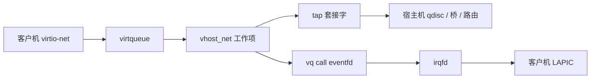

# 14. 宿主机 tap 与 vhost_net

**结论**：QEMU 打开一张 tap，把文件描述符交给内核 `vhost_net`。`handle_tx` 从客户机的发送 virtqueue 取出描述符，对 tap 套接字 `sendmsg`；`handle_rx` 从 tap `recvmsg`，把数据写进客户机的接收 virtqueue，再 `vhost_signal` 敲 eventfd。vhost-user 把同一角色换成用户态进程，本章只点名。

> `vhost_net` 在 `drivers/vhost/net.c`。tap 是 `drivers/net/tun.c` 里 `IFF_TAP` 的设备。`vhost_signal` 在 `drivers/vhost/vhost.c:2912`。eventfd 怎样变成客户机中断，见 [interrupts/11](../interrupts/11-kvm-irq-virt.md)。

---

## 14.1 拓扑



常见的 QEMU 参数是 `-netdev tap,vhost=on` 再配 `-device virtio-net-pci`。内核看见的是：tap 设备的文件描述符，加上 `VHOST_SET_VRING_KICK`、`VHOST_SET_VRING_CALL`、`VHOST_NET_SET_BACKEND` 这几个 ioctl。QEMU 怎样解析命令行不在这里。

vhost-user 用套接字把 virtqueue 的地址交给另一个用户态进程（常见是 OVS 或 DPDK 的 vhost 端口）。内核里的 `vhost_net` 不参与那条路径。本章不读那份用户态代码。

---

## 14.2 `vhost_net` 对象

每个 `vhost_net` 只有两条 virtqueue：下标 0 是 RX，1 是 TX（`net.c:84`）。名字是宿主机视角：TX 队列上的描述符是客户机要发出去的包。

```c
/* drivers/vhost/net.c:109 */
struct vhost_net_virtqueue {
	struct vhost_virtqueue vq;   /* 必须嵌在前面，container_of 靠它 */
	size_t vhost_hlen;           /* 客户机头在 virtqueue 里占多少 */
	size_t sock_hlen;            /* tap 的 TUN_VNET_HDR 占多少 */
	int upend_idx;
	int done_idx;
	int batched_xdp;
	struct ubuf_info_msgzc *ubuf_info;
	struct vhost_net_ubuf_ref *ubufs;
	struct ptr_ring *rx_ring;
	struct vhost_net_buf rxq;
	struct xdp_buff *xdp;
};

/* :133 */
struct vhost_net {
	struct vhost_dev dev;
	struct vhost_net_virtqueue vqs[2];
	struct vhost_poll poll[2];
	unsigned tx_packets;
	unsigned tx_zcopy_err;
	bool tx_flush;
	struct page_frag page_frag;
	int refcnt_bias;
};
```

`vhost_virtqueue` 的字段按 `drivers/vhost/vhost.h:81`：

```c
struct vhost_virtqueue {
	struct vhost_dev *dev;
	struct vhost_worker __rcu *worker;
	struct mutex mutex;
	unsigned int num;
	vring_desc_t __user *desc;     /* 客户机地址空间里的环 */
	vring_avail_t __user *avail;
	vring_used_t __user *used;
	const struct vhost_iotlb_map *meta_iotlb[VHOST_NUM_ADDRS];
	struct file *kick;             /* 客户机 kick 的 eventfd */
	struct vhost_vring_call call_ctx; /* 用来通知客户机 */
	struct eventfd_ctx *error_ctx;
	struct eventfd_ctx *log_ctx;
	struct vhost_poll poll;
	vhost_work_fn_t handle_kick;
	u16 last_avail_idx;
	u16 avail_idx;
	u16 last_used_idx;
	u16 used_flags;
	u16 signalled_used;
	bool signalled_used_valid;
	bool log_used;
	u64 log_addr;
	struct iovec iov[UIO_MAXIOV];
	struct iovec iotlb_iov[64];
	struct iovec *indirect;
	struct vring_used_elem *heads;
	struct vhost_iotlb *umem;
	struct vhost_iotlb *iotlb;
	void *private_data;
	u64 acked_features;
	u64 acked_backend_features;
	void __user *log_base;
	struct vhost_log *log;
	struct iovec log_iov[64];
	bool is_le;
#ifdef CONFIG_VHOST_CROSS_ENDIAN_LEGACY
	bool user_be;
#endif
	u32 busyloop_timeout;
};
```

`vhost_dev`（`:162`）有 `mm`（客户机进程的地址空间，用来翻译 virtqueue）、`worker_xa` 和 `use_worker`。工作项跑在 vhost 自己的内核线程上，不跑在客户机 vCPU 上。

打开设备是 `vhost_net_open`（`net.c:1305`）。后端套接字由 `vhost_net_set_backend`（`:1513`）安装，ioctl 号 `VHOST_NET_SET_BACKEND` 在 `include/uapi/linux/vhost.h:132`。kick 和 call 分别是 `VHOST_SET_VRING_KICK`（`:109`）和 `VHOST_SET_VRING_CALL`（`:111`）。

---

## 14.3 客户机发包，宿主机 `handle_tx`

客户机 `start_xmit` 写完描述符并 kick。kick 的 eventfd 唤醒 `handle_tx_kick`（`net.c:1273`），它调用 `handle_tx`（`:980`）。

```text
handle_tx
  sock = 这条 TX virtqueue 的后端套接字
  vhost_sock_zcopy(sock) 为真：handle_tx_zerocopy
  否则 handle_tx_copy               :781
    get_tx_bufs                     从客户机环取出一个链
    sock->ops->sendmsg              :851
      tap 的发送进 tun_get_user，再进宿主机协议栈
    攒满 VHOST_NET_BATCH（64）再 vhost_add_used_and_signal_n
```

`sendmsg` 把客户机的 iovec 写进 tap。tap 是一块 `net_device`，对宿主机协议栈来说这是一次从用户（这里是 vhost 线程）注入的接收。`tun_get_user` 在 `drivers/net/tun.c:1755`。协商了 `IFF_VNET_HDR`（`tun.c:1782`）时，前面带的就是 virtio 头，宿主机用它恢复 `CHECKSUM_PARTIAL` 和 GSO。

用完的描述符经 `vhost_add_used_and_signal`（`vhost.h:218`，调用点例如 `net.c:971`）写回 used ring。需要通知客户机时进 `vhost_signal`。

---

## 14.4 客户机收包，宿主机 `handle_rx`

宿主机协议栈把帧从 tap 设备发出去时走 `tun_net_xmit`（`tun.c:1071`），skb 排进这块 tap 的套接字接收队列，并唤醒等待者。`vhost_net` 的 RX 工作项是 `handle_rx`（`net.c:1127`）。

```text
handle_rx
  vhost_net_rx_peek_head_len        :1027  看 tap 的 sk_receive_queue
  协商了 VIRTIO_NET_F_MRG_RXBUF：一次可以填多个客户机缓冲
  get_rx_bufs                       向客户机要空的接收描述符
  sock->ops->recvmsg                :1206 / :1220
  把 virtio 头和数据写入客户机 iov
  vhost_net_signal_used             :1269
```

没有空描述符时打开 notify，等客户机 `try_fill_recv` 补了缓冲再 kick。tap 侧暂时没包时重新挂上套接字的 poll。

`vhost_signal`（`vhost.c:2912`）在客户机需要中断时 `eventfd_signal(vq->call_ctx.ctx)`（`:2916`）。QEMU 事先把这个 eventfd 注册成 KVM irqfd。`irqfd_wakeup` 再 `kvm_set_irq`，客户机才进入 virtio-net 的中断处理，然后 [13](./13-virtio-net-guest.md) 的 `virtqueue_napi_schedule`。posted interrupt 可以让这条注入不 VM-Exit，那是中断章的内容。

---

## 14.5 线程和权重

`handle_tx` / `handle_rx` 的注释写明它们跑在工作队列上下文里。一个队列的工作跑完之前会看 `vhost_exceeds_weight`（声明在 `vhost.h:183`）。超过包数或字节就停，把剩余留到下一次 kick，避免一个客户机占住宿主机的 kthread。

多队列 virtio-net 在宿主机上是多对 kick/call，常常仍由同一组 vhost worker 处理。worker 和 vCPU 抢同一颗核时，客户机的 NAPI 和宿主机的 `handle_rx` 会互相推迟。怎么看线程，在 [16](./16-observability.md) 的 RECIPE-V2；怎么拆开，在 [15](./15-mq-rps-xps-affinity.md) 和 [17](./17-perf-analysis.md)。

*笔记生成对照源码：Linux v6.6.160。内核树不放进本仓库。*
