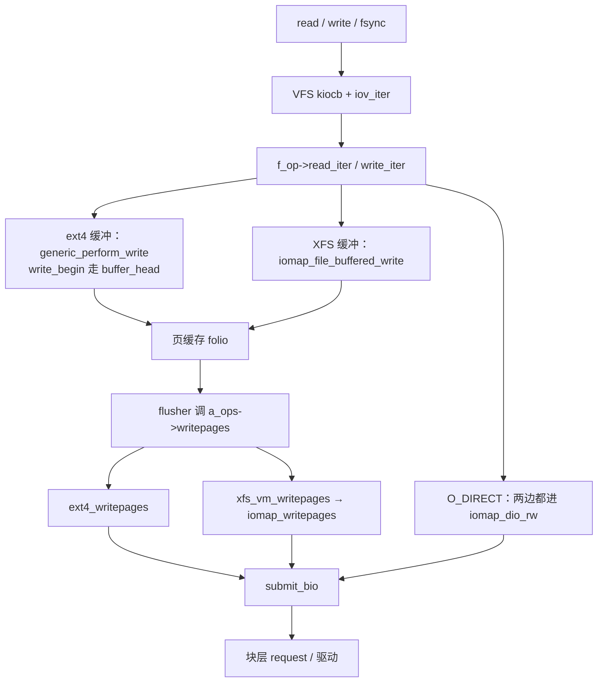

# 1. 总览

**结论**：一次缓冲读写先停在 VFS 的 `read_iter` / `write_iter` 和页缓存；盘上文件系统要回答「这段文件偏移占磁盘哪些块」，再由通用代码或文件系统自己把答案收成 bio。6.6 里这条答案有两套接口：`get_block_t` 按块填 `buffer_head`，`iomap_ops` 一次填一段 `struct iomap`。

> VFS 交接点在 [vfs/05](../vfs/05-read-write.md)。页缓存和 flusher 在 [MM §08](../memory-management/08-page-cache-and-writeback.md)。bio 提交之后在 [block-io/](../block-io/README.md)。

C 新手把三层看成三张工单。VFS 的工单是「这个 fd、这个偏移、这么多字节」。文件系统的工单是「这些字节在哪个 `block_device` 的哪个字节区间，这段是洞、延迟分配、已映射还是未写完」。块层的工单是 `struct bio`，只看扇区和内存页。

---

## 1.1 一张总图



读图时抓住三件事：

1. **VFS 不读 superblock。** `inode->i_mapping` 上的 `address_space_operations` 才是缓冲读、预读、回写的入口。ext4 在 `ext4_set_aops`（`fs/ext4/inode.c:3668`）里挑选 `ext4_aops` / `ext4_da_aops` / `ext4_journalled_aops` / `ext4_dax_aops`。XFS 普通文件用 `xfs_address_space_operations`（`fs/xfs/xfs_aops.c:544`）。
2. **缓冲写的分叉在 `write_iter`，不在块层。** ext4 非 DAX、非 `O_DIRECT` 时进 `ext4_buffered_write_iter`（`fs/ext4/file.c:285`），里面调 `generic_perform_write`（`:306`）。XFS 同一条件下进 `xfs_file_buffered_write`（`fs/xfs/xfs_file.c:758`），里面调 `iomap_file_buffered_write`（`:779`）。
3. **Direct IO 在两边都进 iomap。** ext4 读是 `ext4_dio_read_iter` → `iomap_dio_rw`（`file.c:94`），写是 `ext4_dio_write_iter` → `iomap_dio_rw`（`:584`）。XFS 读在 `xfs_file.c:265`，对齐写在 `:601`。`a_ops->direct_IO` 在这些表里是 `noop_direct_IO`（ext4 `inode.c:3619` 等），只为了让 open 通过，真正的 IO 走 `write_iter` 里的 iomap。这一点和 [vfs/05](../vfs/05-read-write.md) §5.5 的 `noop_direct_IO` 说明接上。

---

## 1.2 两套映射接口

| 接口 | 文件系统要填的函数 | 一次回答的粒度 | 6.6 里谁用它做缓冲数据 IO |
|---|---|---|---|
| `get_block_t` | 给一个逻辑块号，填一个 `buffer_head` | 通常一块 | ext4 缓冲写：`ext4_da_get_block_prep` / `ext4_get_block`，经 `__block_write_begin` |
| `iomap_ops` | `->iomap_begin` / `->iomap_end`，填 `struct iomap` | 一段连续映射，`iomap->length` 是字节 | XFS 缓冲读写和回写；ext4 的 DIO、fiemap、SEEK、swap、bmap |

`get_block_t` 的类型在 `include/linux/fs.h:90`：

```c
typedef int (get_block_t)(struct inode *inode, sector_t iblock,
			struct buffer_head *bh_result, int create);
```

`iomap_ops` 在 `include/linux/iomap.h:182`。调用循环在 `fs/iomap/iter.c` 的 `iomap_iter`（`:74`）：先对上一次映射调 `iomap_end`，再 `iomap_begin` 要下一段。通用代码根据 `iomap->type` 决定读、写、跳过洞，还是记成 delalloc / unwritten。

---

## 1.3 和已经写过的章怎么接

| 问题 | 去哪 |
|------|------|
| `read` 系统调用怎样变成 `kiocb` | [vfs/05](../vfs/05-read-write.md) §5.1–§5.2 |
| folio 怎样进 xarray、脏页怎样叫醒 flusher | [MM §08](../memory-management/08-page-cache-and-writeback.md) §8.1–§8.3 |
| `submit_bio` 之后 request 怎样到驱动 | [block-io/02](../block-io/02-bio-and-bvec.md)、[block-io/03](../block-io/03-request-and-blk-mq.md) |
| 回写线程调用 `writepages` 的那一层 | [block-io/10](../block-io/10-writeback-and-fsync.md) §10.1。本章从文件系统的 `writepages` 实现往下写到 `submit_bio` |
| `O_DIRECT` 在块设备文件上的三档 | [block-io/11](../block-io/11-direct-io.md) §11.2。本章写文件系统的 `iomap_dio_rw` |
| fsync 在 VFS 停在哪 | [vfs/05](../vfs/05-read-write.md) §5.6。ext4 / XFS 的 `->fsync` 在 [11](./11-fsync-crash.md) |

---

## 1.4 本章写到哪

写：ext4 与 XFS 的盘上结构（只到能读懂映射）、`buffer_head` 路径、iomap 的迭代和缓冲 / 回写 / DIO、delalloc 与 unwritten、jbd2 与 XFS CIL 的对象和提交顺序、fsync 与 rename 的持久化边界、观测配方。

不写：btrfs / f2fs、网络文件系统、FUSE、mkfs 细节、页缓存回收、IO 调度器。

*笔记生成对照源码：Linux v6.6.160。内核树不放进本仓库。*

**导航**：[目录](./README.md) · [盘上布局 →](./02-ondisk-layout.md)
