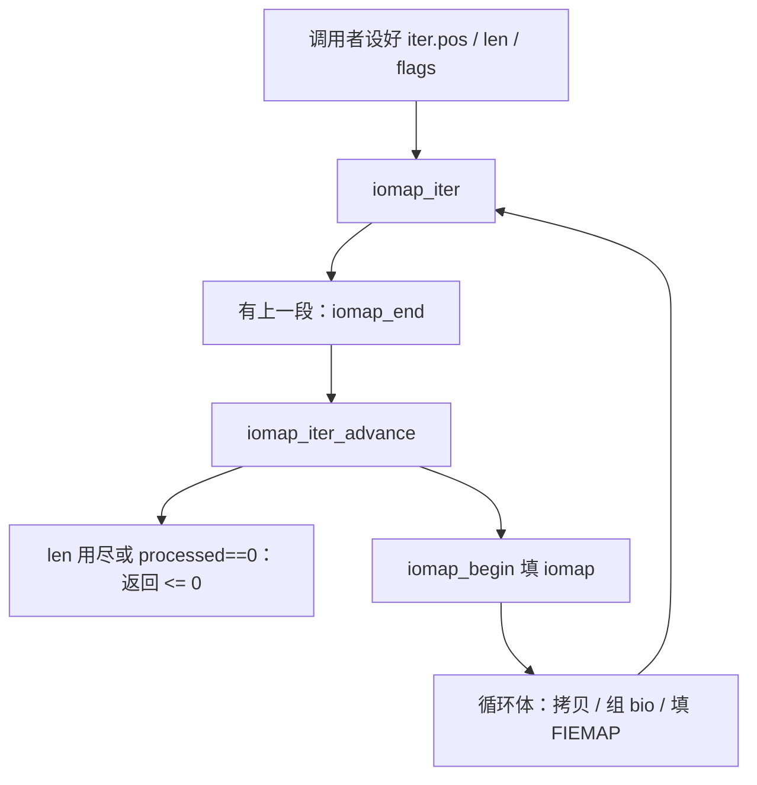

# 4. iomap 核心模型

**结论**：文件系统只实现 `iomap_ops`：`iomap_begin` 填好一段 `struct iomap`，`iomap_end` 在这段用完后提交或退回预留。通用代码用 `iomap_iter` 沿着文件区间循环，自己做拷贝、组 bio、FIEMAP。6.6 里没有 `iomap_apply`；循环的入口就是 `fs/iomap/iter.c` 的 `iomap_iter`。

> 缓冲写、回写、DIO 都是这个循环的不同循环体，分别在 [05](./05-buffered-io.md)、[06](./06-writeback.md)、[07](./07-direct-io.md)。

---

## 4.1 `struct iomap`：一段映射

```c
/* include/linux/iomap.h:94 */
struct iomap {
	u64			addr; /* disk offset of mapping, bytes */
	loff_t			offset;	/* file offset of mapping, bytes */
	u64			length;	/* length of mapping, bytes */
	u16			type;	/* type of mapping */
	u16			flags;	/* flags for mapping */
	struct block_device	*bdev;	/* block device for I/O */
	struct dax_device	*dax_dev; /* dax_dev for dax operations */
	void			*inline_data;
	void			*private; /* filesystem private */
	const struct iomap_folio_ops *folio_ops;
	u64			validity_cookie; /* used with .iomap_valid() */
};
```

`addr` 是磁盘上的字节偏移，无效时用 `IOMAP_NULL_ADDR`（`-1ULL`，`:90`）。`iomap_sector`（`:108`）把它换成扇区：`(addr + pos - offset) >> SECTOR_SHIFT`。

类型（`:28`）：

| 宏 | 值 | 源码注释 |
|---|---|---|
| `IOMAP_HOLE` | 0 | no blocks allocated, need allocation |
| `IOMAP_DELALLOC` | 1 | delayed allocation blocks |
| `IOMAP_MAPPED` | 2 | blocks allocated at @addr |
| `IOMAP_UNWRITTEN` | 3 | blocks allocated at @addr in unwritten state |
| `IOMAP_INLINE` | 4 | data inline in the inode |

文件系统从 `iomap_begin` 报上来的标志（`:57` 起）包括 `IOMAP_F_NEW`（新分配，没拷到数据的地方要补零）、`IOMAP_F_DIRTY`（访问已写数据还依赖没提交的元数据，fdatasync 要提交它们）、`IOMAP_F_SHARED`（reflink，写之前要拆开）、`IOMAP_F_MERGED`（多段块映射被并成这一条）、`IOMAP_F_BUFFER_HEAD`（这段仍要 bh）、`IOMAP_F_XATTR`。

通用代码自己会置的标志（`:78`）：`IOMAP_F_SIZE_CHANGED` 告诉 `iomap_end` 这次写改了文件大小；`IOMAP_F_STALE` 表示缓存的映射已经不能用，高层必须重映射。`0x1000` 起的位留给文件系统，`IOMAP_F_PRIVATE` 在 `:84`。

---

## 4.2 `iomap_ops`：只回答映射

```c
/* include/linux/iomap.h:182 */
struct iomap_ops {
	int (*iomap_begin)(struct inode *inode, loff_t pos, loff_t length,
			unsigned flags, struct iomap *iomap,
			struct iomap *srcmap);

	int (*iomap_end)(struct inode *inode, loff_t pos, loff_t length,
			ssize_t written, unsigned flags, struct iomap *iomap);
};
```

头文件注释（`:183`）：`iomap_begin` 返回 `pos` 处已有的映射，或者从 `pos` 起预留最多 `length` 字节，并且必须是**一条**映射。实际长度写回 `iomap->length`。

`iomap_end`（`:192`）：提交或退回 `iomap_begin` 预留的空间。`written` 是成功写过的长度，其余要退回。没写到数据时 `written` 可以是 0。

`srcmap` 给需要两份映射的写（reflink / COW）。`iomap_iter_srcmap`（`:252`）在 `srcmap.type != IOMAP_HOLE` 时返回源映射，否则返回目的映射。普通覆盖写两边是同一条。

调用 `iomap_begin` 时的 `flags`（`:168`，注释写明没有标志就是读）：

| 宏 | 含义（头文件注释） |
|---|---|
| `IOMAP_WRITE` | writing, must allocate blocks |
| `IOMAP_ZERO` | zeroing operation, may skip holes |
| `IOMAP_REPORT` | report extent status, e.g. FIEMAP |
| `IOMAP_FAULT` | mapping for page fault |
| `IOMAP_DIRECT` | direct I/O |
| `IOMAP_NOWAIT` | do not block |
| `IOMAP_OVERWRITE_ONLY` | only pure overwrites allowed |
| `IOMAP_UNSHARE` | unshare_file_range |
| `IOMAP_DAX` | DAX mapping；没编 `CONFIG_FS_DAX` 时是 0 |

同一文件系统可以挂多张 `iomap_ops`。XFS 把读、缓冲写、直接写、seek、xattr 拆开（`fs/xfs/xfs_iomap.c`）：`xfs_read_iomap_ops`（`:1279`）、`xfs_buffered_write_iomap_ops`（`:1224`）、`xfs_direct_write_iomap_ops`（`:908`）、`xfs_seek_iomap_ops`（`:1367`）。ext4 是 `ext4_iomap_ops`（`inode.c:3477`）、只覆盖已映射块的 `ext4_iomap_overwrite_ops`（`:3482`）、给 FIEMAP / seek 的 `ext4_iomap_report_ops`（`:3567`）。

---

## 4.3 `iomap_iter`：循环在通用代码里

```c
/* include/linux/iomap.h:215 */
struct iomap_iter {
	struct inode *inode;
	loff_t pos;
	u64 len;
	s64 processed;
	unsigned flags;
	struct iomap iomap;
	struct iomap srcmap;
	void *private;
};
```

`pos` / `len` 由 `iomap_iter()` 更新，循环体把它们当只读。`processed` 是上一次循环体处理的字节数，或者负的 errno。注释（`:209`）：0 会让迭代停下来。

```text
iomap_iter                         fs/iomap/iter.c:74
  若上一次 iomap.length 非 0 且 ops->iomap_end：
    iomap_end(inode, pos, iomap_length, written, flags, &iomap)
  trace_iomap_iter                 :86
  iomap_iter_advance               :22
    processed < 0：把这个 errno 返回
    processed == 0 且没有 IOMAP_F_STALE：结束
    否则 pos += processed，len -= processed，清掉 iomap/srcmap
  ops->iomap_begin                 :91
  iomap_iter_done                  :47    检查 offset/length，打 dstmap trace
  返回 1，调用者进入循环体
```

`iomap_iter` 的 kerneldoc（`:59`）规定调用方式：返回正数就继续循环；返回 0 或负数就不得再进循环体。循环体想停，可以不改 `processed`，或把它设成负 errno。

`IOMAP_F_STALE` 的处理在 `iomap_iter_advance` 的注释（`:13`）：映射在操作中途失效时，即使 `processed == 0` 也要重映射剩下的区间。缓冲写在锁住 folio 之后用 `folio_ops->iomap_valid` 发现映射过期，就会置这个标志（`buffered-io.c:796`）。

一次循环实际覆盖的长度是 `iomap_length`（`iomap.h:234`）：当前映射的末端、源映射的末端、以及 `iter->len` 三者里更小的那段。



---

## 4.4 分工

| 谁 | 做什么 | 不做什么 |
|---|---|---|
| 文件系统 `iomap_begin` | 查 extent / bmap / 延迟分配，填 type、addr、length、bdev | 不拷用户字节，不分配 bio |
| 文件系统 `iomap_end` | 退回没写到的 delalloc，或记下文件变长 | 不调用 `submit_bio` |
| `fs/iomap/buffered-io.c` | 锁 folio、拷贝、标脏、回写时组 bio | 不认识 ext4 extent 的 `ee_len` |
| `fs/iomap/direct-io.c` | 按逻辑块对齐检查，钉用户页，提交 direct bio | 不把字节先放进页缓存 |
| `fs/iomap/fiemap.c` | 把 type 译成 `FIEMAP_EXTENT_*` | 不分配磁盘块 |

ext4 的 `ext4_iomap_begin`（`inode.c:3393`）把这段分工写进了分配路径：`IOMAP_WRITE` 时先试着无事务地查找，已映射就直接 `ext4_set_iomap`；否则 `ext4_iomap_alloc`。那个函数里有一条 `WARN_ON`（`:3361`）：`IOMAP_WRITE` 目前只接受带 `IOMAP_DAX` 或 `IOMAP_DIRECT` 的调用。缓冲写不会走到这里。

`ext4_set_iomap`（`:3276`）的类型规则：先看 `EXT4_MAP_UNWRITTEN`，再看 `EXT4_MAP_MAPPED`，否则是 `IOMAP_HOLE` 且 `addr = IOMAP_NULL_ADDR`。注释（`:3306`）解释为什么 unwritten 要优先：直接写的 `ext4_map_blocks` 可能同时置 mapped 和 unwritten，完成时要靠 `iomap->type == IOMAP_UNWRITTEN` 去做转换。

---

## 4.5 folio 钩子

文件系统可以在返回的 iomap 上挂 `iomap_folio_ops`（`iomap.h:141`）：

```c
struct iomap_folio_ops {
	struct folio *(*get_folio)(struct iomap_iter *iter, loff_t pos,
			unsigned len);
	void (*put_folio)(struct inode *inode, loff_t pos, unsigned copied,
			struct folio *folio);
	bool (*iomap_valid)(struct inode *inode, const struct iomap *iomap);
};
```

注释（`:132`）：只有缓冲写会为每个写到的 folio 调 `get_folio` / `put_folio`。`put_folio` 负责解锁和放下 folio。`iomap_valid` 在 folio 已锁时调用，用来发现缓存的映射和文件系统内部 extent 已经不一致。文件系统可以在 `validity_cookie` 里放一个序号。

XFS 提供了 `xfs_iomap_folio_ops`（`fs/xfs/xfs_iomap.c:86`）。ext4 的 `ext4_set_iomap` 摘录里没有填 `folio_ops`。

---

## 4.6 关键函数

| 文件 | 符号 | 行号 | 作用 |
|---|---|---|---|
| `include/linux/iomap.h` | `struct iomap` | 94 | 一段文件到磁盘的映射 |
| `include/linux/iomap.h` | `struct iomap_ops` | 182 | `iomap_begin` / `iomap_end` |
| `include/linux/iomap.h` | `struct iomap_iter` | 215 | 迭代游标 |
| `include/linux/iomap.h` | `iomap_length` | 234 | 这一轮实际覆盖的字节 |
| `fs/iomap/iter.c` | `iomap_iter` | 74 | end → advance → begin |
| `fs/iomap/iter.c` | `iomap_iter_advance` | 22 | 推进 pos，处理 `IOMAP_F_STALE` |
| `fs/ext4/inode.c` | `ext4_iomap_begin` | 3393 | ext4 的 begin |
| `fs/ext4/inode.c` | `ext4_set_iomap` | 3276 | `ext4_map_blocks` 的结果译成 type |
| `fs/xfs/xfs_iomap.c` | `xfs_bmbt_to_iomap` | 91 | bmap 记录译成 iomap |
| `fs/xfs/xfs_iomap.c` | `xfs_buffered_write_iomap_ops` | 1224 | XFS 缓冲写用的 ops |

*笔记生成对照源码：Linux v6.6.160。内核树不放进本仓库。*

**导航**：[← buffer_head](./03-buffer-head.md) · [目录](./README.md) · [缓冲读写 →](./05-buffered-io.md)
