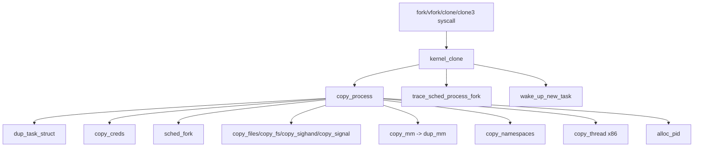
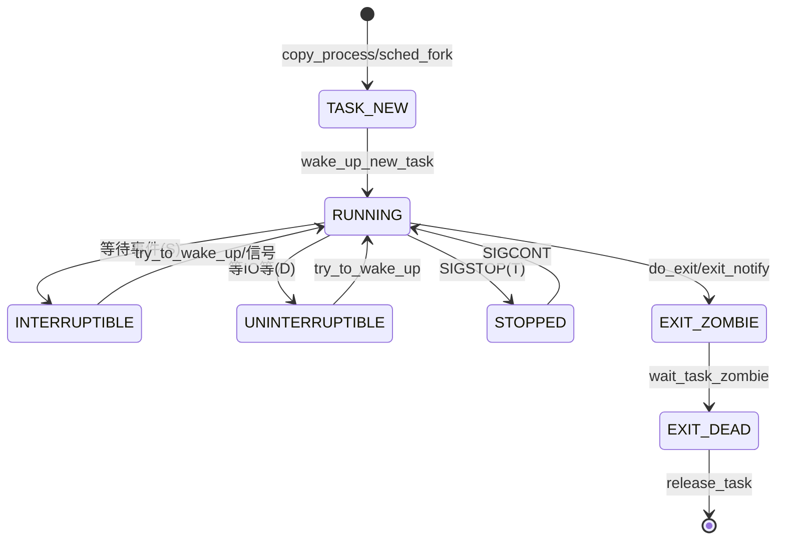

# Linux 进程管理子系统（基于 v7.3 源码）

> 内核版本：**v7.3**（commit `c03c1a14507d`，kernel.org stable）。下文行号都对应这个版本。源码请对照 [elixir v7.3](https://elixir.bootlin.com/linux/v7.3/source)。

## 1. 核心数据结构：struct task_struct（include/linux/sched.h:835）

Linux 不单独区分"进程"和"线程"，它们都是 task_struct，差别只在共享了哪些资源。

| 字段 | 行号 | 含义 |
|---|---|---|
| `struct thread_info thread_info` | 841 | 开了 CONFIG_THREAD_INFO_IN_TASK 时（x86 就是这样）放在第一个字段，存 flags 等底层信息 |
| `unsigned int __state` | 843 | 任务状态（TASK_RUNNING 等），用 READ_ONCE/WRITE_ONCE 访问 |
| `void *stack` | 854 | 内核栈 |
| `se / rt / dl` | 889-891 | CFS/EEVDF、实时、deadline 三种调度实体 |
| `struct sched_ext_entity scx` | 894 | sched_ext（BPF 调度器），受 CONFIG_SCHED_CLASS_EXT 控制 |
| `mm / active_mm` | 980-981 | 用户地址空间；内核线程的 mm 是 NULL，借用 active_mm（lazy TLB） |
| `pid / tgid` | 1080-1081 | pid 是线程 ID；tgid 是线程组 ID，也就是用户态看到的"进程 PID" |
| `real_parent / parent` | 1094/1097 | 亲生父进程 / 当前接收 SIGCHLD 和 wait 的父进程（被 ptrace 时是 tracer） |
| `children / sibling` | 1102-1103 | 子进程链表 / 挂到父进程 children 上用的节点 |
| `cred` | 1176 | 凭证（uid、capabilities 等），RCU 保护 |
| `fs` | 1204 | 根目录、当前目录、umask |
| `files` | 1207 | 打开的文件描述符表 |
| `nsproxy` | 1215 | 各类命名空间 |
| `signal / sighand` | 1218-1219 | 线程组共享的信号状态 / 信号处理函数表 |

任务状态（sched.h:107-141）：`TASK_RUNNING 0x0`、`TASK_INTERRUPTIBLE 0x1`（ps 显示 S）、`TASK_UNINTERRUPTIBLE 0x2`（D）、`EXIT_DEAD 0x10`、`EXIT_ZOMBIE 0x20`（Z，存在 exit_state 里）、`TASK_DEAD 0x80`、`TASK_WAKEKILL`、`TASK_NEW 0x800`；组合状态有 `TASK_KILLABLE = WAKEKILL|UNINTERRUPTIBLE`、`TASK_STOPPED`（T）、`TASK_TRACED`（t）、`TASK_IDLE = UNINTERRUPTIBLE|NOLOAD`（显示为 I，不计入 loadavg）。

## 2. PID 管理（include/linux/pid.h:58，kernel/pid.c）

```c
struct pid {
	refcount_t count;
	unsigned int level;          // 所在 pid namespace 的层级
	...                          // pidfs 的 ino/dentry（pidfd 用）
	struct hlist_head tasks[PIDTYPE_MAX]; // 使用这个 pid 的 task（PID/TGID/PGID/SID）
	wait_queue_head_t wait_pidfd;
	struct upid numbers[];       // 每一层 namespace 各有一个号
};
```
- `alloc_pid()`（kernel/pid.c:159）：从当前 ns 往上，每一层都分配一个号（支持 clone3 的 set_tid），所以同一个进程在容器里和宿主机上看到的 PID 不一样。
- `attach_pid()`（:392）把 task 挂到 pid->tasks[type]；`free_pid()`（:110）负责释放。
- 调用点：copy_process 里的 `alloc_pid(p->nsproxy->pid_ns_for_children, args->set_tid, ...)`（kernel/fork.c:2337）。

## 3. fork 路径（kernel/fork.c）

系统调用入口：`SYSCALL_DEFINE0(fork)`:2862、`vfork`:2878、`clone`:2891 起（不同架构参数顺序不同，有好几个变体）、`clone3`:3063，最后都调用 `kernel_clone(&args)`。

`kernel_clone()`（:2727）→ `copy_process()`（:2021，见 :2781）→ `trace_sched_process_fork`（:2791）→ `wake_up_new_task(p)`（:2812）。

copy_process 内部按以下顺序执行（行号是调用点）：
1. `dup_task_struct(current, node)` :2142（定义在 :915，内部调用 arch_dup_task_struct，并分配内核栈）
2. `copy_creds` :2183（kernel/cred.c:263）
3. `sched_fork` :2289（kernel/sched/core.c:4826，状态设为 TASK_NEW，选调度类）
4. `copy_files` :2307 → `copy_fs` :2310 → `copy_sighand` :2315 → `copy_signal` :2318 → `copy_mm` :2321（:1568；没有 CLONE_VM 时调用 `dup_mm` :1527 复制 VMA，页面走 COW）→ `copy_namespaces` :2324（kernel/nsproxy.c:169）→ `copy_io` :2327 → `copy_thread` :2330（arch/x86/kernel/process.c:170，设置子进程的寄存器和栈，子进程从 ret_from_fork 开始执行，返回值为 0）
5. `alloc_pid` :2337 → `sched_cgroup_fork` :2439 → 挂进进程树和 pid hash

传了 CLONE_VM/CLONE_FILES/CLONE_SIGHAND 等标志时，对应的 copy_* 只增加引用计数、不复制，这就是"线程"。



## 4. 内核线程
- `kernel_thread()`（kernel/fork.c:2830）同样走 kernel_clone。
- `kthreadd()`（kernel/kthread.c:787）就是 PID 2，处理创建请求；`kthread_create_on_node()`（:550）把请求排进队列，再由 kthreadd 实际 fork 出来。
- `create_io_thread()`（kernel/fork.c:2706）设置 `.user_worker = 1`，copy_process 看到后给新任务置 `PF_USER_WORKER`（:2156-2161）。io_uring 的 iou-wrk 就是这种线程：它属于用户进程，但只在内核里跑。

## 5. exec 路径（fs/exec.c）
`execve`（:2032）/`execveat`（:2042）→ `do_execveat_common()`（:1897）→ `bprm_execve()`（:1843）→ `exec_binprm()`（:1794）→ `search_binary_handler()`（:1760，遍历各格式调用 `fmt->load_binary`）→ `load_elf_binary()`（fs/binfmt_elf.c:829）。
- load_elf_binary 中调用 `begin_new_exec(bprm)`（binfmt_elf.c:1010；定义在 exec.c:1136）。这是不可回退点：替换 mm、解除和其他线程共享的资源、杀掉同组的其他线程。之后映射各个段，最后 `START_THREAD`（:1376）把用户态 IP/SP 设到新程序入口。
- `trace_sched_process_exec` 在 exec_binprm 里触发（:1837）。exec 不换 PID，换的是 mm。

## 6. exit 路径（kernel/exit.c）
`exit`（:1094）/`exit_group`（:1138）→ `do_exit()`（:906）：
`exit_signals`（置 PF_EXITING）→ `exit_mm()`（:558/调用于 :974）→ `exit_sem` → `exit_files` → `exit_fs` → ... → `exit_notify()`（:998；定义在 :748，设 `exit_state = EXIT_ZOMBIE`（:760），给子进程找新父进程、向父进程发信号）→ `do_task_dead()`（:1029），最后一次调度，之后不再返回。
- 回收：`wait4`（:1916）→ `kernel_wait4`（:1857）→ `do_wait`（:1721）→ `wait_task_zombie`（:1184）→ `release_task`（:248）。父进程不 wait，子进程就一直是 Z。父进程如果设置了忽略 SIGCHLD 等，exit_notify 中会直接调用 release_task（:787）自动回收。



## 7. 上下文切换（简述）
`schedule()`（kernel/sched/core.c:7366）→ `__schedule()`（:7111）选出 next 任务 → `context_switch()`（:5474，调用于 :7284）：
- next 是内核线程（mm 为 NULL）：沿用 prev 的 active_mm，走 lazy TLB；
- 否则调用 `switch_mm_irqs_off(prev->active_mm, next->mm, next)`（:5512，x86 实现在 arch/x86/mm/tlb.c:783）切换 CR3/PCID；
- `switch_to(prev, next, prev)`（:5533，arch/x86/include/asm/switch_to.h:49）切换内核栈和寄存器；之后 `finish_task_switch()`（:5341）收尾。
唤醒入口是 `try_to_wake_up()`（:4274）。

## 8. 实操观测命令
```bash
ps -eLo pid,tid,ppid,stat,nlwp,psr,cls,pri,wchan:20,comm | head
```
PID 列对应 tgid，TID 列对应 task 的 pid，NLWP 是线程数。STAT 的 R/S/D/Z/T/I 对应第 1 节的状态，`+` 表示前台进程组，`l` 表示多线程；WCHAN 显示在哪个内核函数里睡眠。

```bash
grep -E 'State|Tgid|^Pid|PPid|Threads|NSpid|voluntary' /proc/<pid>/status
ls /proc/<pid>/task/        # 每个线程一个目录，名字就是 tid
```
NSpid 列出每层 namespace 中的号，对应 struct pid 的 numbers[]。voluntary_ctxt_switches 高说明在等资源；nonvoluntary 高说明 CPU 被抢占得多。

```bash
bpftrace -e 'tracepoint:sched:sched_process_fork { printf("%s %d -> %d\n", args->parent_comm, args->parent_pid, args->child_pid); }
 tracepoint:sched:sched_process_exec { printf("exec %d %s\n", args->pid, str(args->filename)); }
 tracepoint:sched:sched_process_exit { printf("exit %d %s\n", args->pid, args->comm); }'
```
这三个 tracepoint 分别在 kernel_clone（fork.c:2791）、exec_binprm（exec.c:1837）和 do_exit 路径上触发。如果某个父进程 fork 极多但 exec 很少，多半是 fork 风暴或者短命的 worker。可以用 `bpftrace -lv tracepoint:sched:sched_process_fork` 核对字段名。

```bash
perf trace -e clone,clone3,execve,exit_group,wait4 -- bash -c 'ls >/dev/null'
perf trace -s -p <pid>      # 按系统调用统计次数和耗时
```
在输出里能看到 shell 先 clone3/clone 出子进程，子进程 execve，父进程 wait4 拿到退出码。
