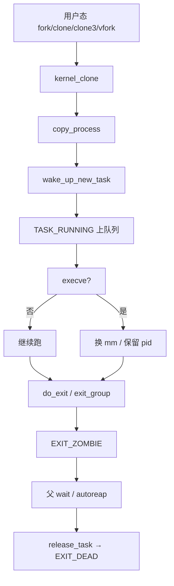
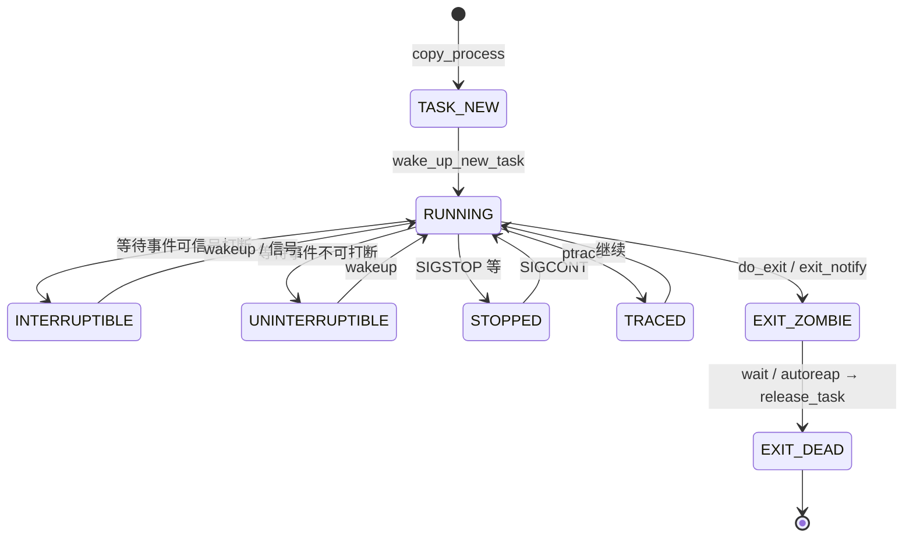
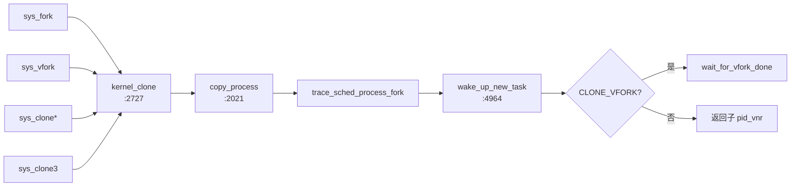
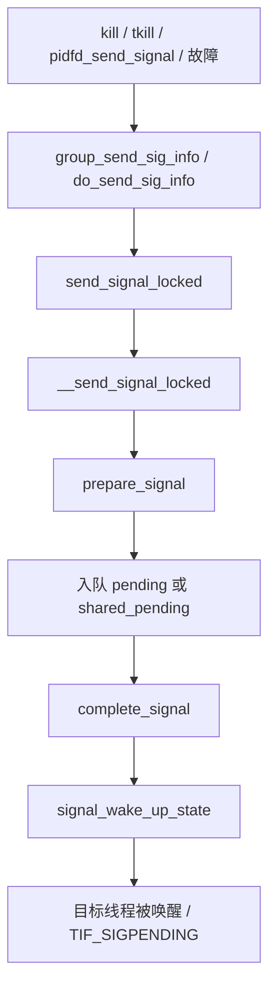

# Linux 进程管理（大章）

> 内核版本：**v7.3**（commit `c03c1a14507d`）。下文路径/函数/行号均在本机 `/workspace/linux` 对照该版本核对。
> 在线对照：[elixir.bootlin.com — linux/v7.3](https://elixir.bootlin.com/linux/v7.3/source)

**一句话**：内核里没有独立的「进程对象」和「线程对象」——全是 `task_struct`；差别只在 clone 时哪些资源共享引用、哪些复制。本章从抽象讲到创建/exec/退出/切换/信号，调度「选谁跑」留给下一章。

---

## 目录

1. [总览与边界](#1-总览与边界)
2. [任务抽象：task_struct](#2-任务抽象task_struct)
3. [PID 与命名空间](#3-pid-与命名空间)
4. [创建路径：fork / clone / clone3 / vfork](#4-创建路径fork--clone--clone3--vfork)
5. [内核线程与特殊任务](#5-内核线程与特殊任务)
6. [地址空间交接：exec](#6-地址空间交接exec)
7. [退出、僵尸与回收](#7-退出僵尸与回收)
8. [上下文切换（进程管理视角）](#8-上下文切换进程管理视角)
9. [信号与进程](#9-信号与进程)
10. [观测与调试清单](#10-观测与调试清单)

---

## 1. 总览与边界

**结论**：用户态「进程 / 线程」是资源共享策略的表象；内核统一用 `task_struct`，用 `CLONE_*` 决定共享还是复制。

### 1.1 进程 vs 线程（内核模型）

| 用户态说法 | 内核事实 |
|---|---|
| 进程 PID | `task_struct.tgid`（线程组 ID）；`getpid()` 返回的是 tgid |
| 线程 TID | `task_struct.pid`（内核内部的线程 ID）；`gettid()` 返回这个 |
| pthread 线程 | `clone(CLONE_VM\|CLONE_FS\|CLONE_FILES\|CLONE_SIGHAND\|CLONE_THREAD\|CLONE_SYSVSEM\|CLONE_SETTLS\|CLONE_PARENT_SETTID\|CLONE_CHILD_CLEARTID, …)` |
| fork 出来的子进程 | 几乎所有资源复制（mm 写时复制），新的 tgid == 新的 pid |

线程组：同一 `signal_struct` 上的一组 task，`group_leader` 指向组长（通常是第一个线程），组长的 `pid == tgid`。

### 1.2 本章覆盖 / 不覆盖

| 覆盖 | 不覆盖（另章） |
|---|---|
| `task_struct` / PID / ns | MM 细节（页表、VMA、fault） |
| fork/clone/exec/exit | VFS 打开文件路径 |
| 调度入口与 `context_switch` | EEVDF / RT / DL / sched_ext 选人算法 |
| 信号投递与 exit 交叉 | 完整 ptrace 协议 |
| 观测命令模板 | cgroup 控制器细节 |

### 1.3 用户态 API ↔ 内核入口

| 用户态 | 系统调用 | 内核入口 |
|---|---|---|
| `fork()` | `sys_fork` | `kernel/fork.c:2862` → `kernel_clone` |
| `vfork()` | `sys_vfork` | `:2878` → `kernel_clone`（`CLONE_VFORK\|CLONE_VM`） |
| `clone()` / `clone2` | 多架构变体 | `:2891` 起 → `kernel_clone` |
| `clone3()` | `sys_clone3` | `:3063` → `kernel_clone` |
| `pthread_create` | 通常走 `clone`/`clone3` | 同上 |
| `execve` / `execveat` | `sys_execve*` | `fs/exec.c` → `do_execveat_common` |
| `exit` / `exit_group` | `sys_exit` / `sys_exit_group` | `do_exit` / `do_group_exit` |
| `wait4` / `waitid` | | `do_wait` |
| `unshare` | `sys_unshare` | `ksys_unshare`（`kernel/fork.c:3251`） |
| `kill` / `tgkill` / `pidfd_send_signal` | | `kernel/signal.c` |

### 1.4 `CLONE_*` 速查（`include/uapi/linux/sched.h`）

| 标志 | 值 | 含义（共享 / 新建） |
|---|---|---|
| `CLONE_VM` | `0x00000100` | 共享 `mm_struct`（线程必备） |
| `CLONE_FS` | `0x00000200` | 共享 `fs_struct`（cwd/root/umask） |
| `CLONE_FILES` | `0x00000400` | 共享 `files_struct` |
| `CLONE_SIGHAND` | `0x00000800` | 共享 `sighand_struct`（要求同时 `CLONE_VM`） |
| `CLONE_PIDFD` | `0x00001000` | 给父进程返回 pidfd |
| `CLONE_PTRACE` | `0x00002000` | 子进程继续被 trace |
| `CLONE_VFORK` | `0x00004000` | 父进程阻塞到子进程 `exec`/`exit` |
| `CLONE_PARENT` | `0x00008000` | 与调用者同父 |
| `CLONE_THREAD` | `0x00010000` | 同一线程组（要求 `CLONE_SIGHAND`） |
| `CLONE_NEWNS` | `0x00020000` | 新 mount ns |
| `CLONE_SYSVSEM` | `0x00040000` | 共享 System V SEM_UNDO |
| `CLONE_SETTLS` | `0x00080000` | 设置 TLS |
| `CLONE_PARENT_SETTID` | `0x00100000` | 把子 TID 写到父地址 |
| `CLONE_CHILD_CLEARTID` | `0x00200000` | 子退出时清 TID 并 futex wake（pthread join） |
| `CLONE_DETACHED` | `0x00400000` | 历史遗留，现与 `CLONE_PIDFD` 互斥 |
| `CLONE_UNTRACED` | `0x00800000` | 不被强制 ptrace（内核线程） |
| `CLONE_CHILD_SETTID` | `0x01000000` | 子地址写 TID |
| `CLONE_NEWCGROUP` | `0x02000000` | 新 cgroup ns |
| `CLONE_NEWUTS` | `0x04000000` | 新 uts ns |
| `CLONE_NEWIPC` | `0x08000000` | 新 ipc ns |
| `CLONE_NEWUSER` | `0x10000000` | 新 user ns |
| `CLONE_NEWPID` | `0x20000000` | 新 pid ns |
| `CLONE_NEWNET` | `0x40000000` | 新 net ns |
| `CLONE_IO` | `0x80000000` | 共享 I/O context |
| `CLONE_NEWTIME` | `0x00000080` | 新 time ns |
| `CLONE_CLEAR_SIGHAND` | `1ULL<<32` | 重置信号 handler 为 `SIG_DFL`（不清 `SIG_IGN`） |
| `CLONE_PIDFD_AUTOKILL` | `1ULL<<36` | pidfd 关闭时杀子进程（较新） |

约束（`copy_process` 开头硬性检查，`kernel/fork.c:2038` 起）：

- `CLONE_THREAD` ⇒ 必须 `CLONE_SIGHAND`
- `CLONE_SIGHAND` ⇒ 必须 `CLONE_VM`
- `CLONE_NEWNS|CLONE_FS`、`CLONE_NEWUSER|CLONE_FS` 互斥
- `CLONE_THREAD` 不能同时 `CLONE_NEWUSER|CLONE_NEWPID`



---

## 2. 任务抽象：`task_struct`

**结论**：`task_struct`（`include/linux/sched.h:835`）是调度、资源、身份、信号的总枢纽；开了 `CONFIG_THREAD_INFO_IN_TASK`（x86 默认）时，`thread_info` 必须是第一个字段。

### 2.1 状态机（`__state` / `exit_state`）

定义在 `include/linux/sched.h:107-141`。运行态与退出态分字段：活着的任务看 `__state`，退出路径写入 `exit_state`。

| 宏 | 值 | 用途 / ps 字母 |
|---|---|---|
| `TASK_RUNNING` | `0x0` | 可运行（未必正在 CPU 上）→ **R** |
| `TASK_INTERRUPTIBLE` | `0x1` | 可被信号打断的睡眠 → **S** |
| `TASK_UNINTERRUPTIBLE` | `0x2` | 不可打断睡眠 → **D** |
| `__TASK_STOPPED` | `0x4` | 作业控制停止（配合 `TASK_WAKEKILL`）→ **T** |
| `__TASK_TRACED` | `0x8` | 被 trace 停下 → **t** |
| `EXIT_DEAD` | `0x10` | 正在销毁 → **X**（在 `exit_state`） |
| `EXIT_ZOMBIE` | `0x20` | 僵尸，等父 wait → **Z** |
| `TASK_PARKED` | `0x40` | kthread park → **P** |
| `TASK_DEAD` | `0x80` | 调度侧确认死亡 |
| `TASK_WAKEKILL` | `0x100` | 致命信号可唤醒 |
| `TASK_WAKING` | `0x200` | 正在被唤醒 |
| `TASK_NOLOAD` | `0x400` | 不计入 loadavg |
| `TASK_NEW` | `0x800` | `copy_process` 尚未唤醒 |
| `TASK_KILLABLE` | `WAKEKILL\|UNINTERRUPTIBLE` | 可被致命信号杀的 D 睡 |
| `TASK_STOPPED` | `WAKEKILL\|__TASK_STOPPED` | |
| `TASK_IDLE` | `UNINTERRUPTIBLE\|NOLOAD` | idle/部分内核睡 → **I**，不计 load |

`/proc` 显示映射：`fs/proc/array.c:127` 的 `task_state_array[]`，索引由 `task_state_index()`（`sched.h:1731`）从 `__state`+`exit_state` 算出。`TASK_IDLE` 被特殊映射到 `TASK_REPORT_IDLE`。



### 2.2 `thread_info` 与内核栈

- x86：`CONFIG_THREAD_INFO_IN_TASK=y` 时 `thread_info` 嵌在 `task_struct` 头部（`sched.h:836-841`）。
- 内核栈：`task_struct.stack` 指向 `THREAD_SIZE` 大小的栈；用户寄存器帧在栈顶附近，用 `task_pt_regs(p)` 取。
- `usage`：`task_struct` 引用计数；`get_task_struct` / `put_task_struct`。

### 2.3 字段分组（按源码顺序，CONFIG 已标注）

下面按 `sched.h:835` 起的真实字段分组。超大结构不整段粘贴，**按组列表 + 中文含义**；未列的多为调试/arch 边角，需要时对照 elixir。

#### A. 状态 / 栈 / 标志

| 成员 | 含义 |
|---|---|
| `thread_info` | 底层 flags（`CONFIG_THREAD_INFO_IN_TASK`） |
| `__state` | 任务状态，用 `READ_ONCE`/`WRITE_ONCE` |
| `saved_state` | spinlock sleeper 保存的状态 |
| `stack` | 内核栈基 |
| `usage` | `task_struct` 引用计数 |
| `flags` | `PF_*` 每任务标志 |
| `ptrace` | ptrace 标志位 |
| `alloc_tag` | 分配剖析标签（`CONFIG_MEM_ALLOC_PROFILING`） |

#### B. 调度位置与唤醒亲和

| 成员 | 含义 |
|---|---|
| `on_cpu` | 是否正在某 CPU 上执行 |
| `on_rq` | 是否在 runqueue 上 |
| `is_blocked` | 阻塞标记 |
| `wake_entry` | 跨 CPU 唤醒用的 CSD 节点 |
| `wakee_flips` / `wakee_flip_decay_ts` / `last_wakee` | 唤醒亲和统计 |
| `recent_used_cpu` / `wake_cpu` | 最近/目标 CPU |

#### C. 优先级与调度实体

| 成员 | 含义 |
|---|---|
| `prio` / `static_prio` / `normal_prio` | 动态/静态/正常优先级 |
| `rt_priority` | RT 优先级 |
| `se` | CFS/EEVDF 实体 `sched_entity` |
| `rt` | RT 实体 `sched_rt_entity` |
| `dl` / `dl_server` | Deadline 实体 |
| `scx` | sched_ext 实体（`CONFIG_SCHED_CLASS_EXT`） |
| `sched_class` | 当前调度类指针 |
| `core_node` / `core_cookie` / `core_occupation` | 核心调度（`CONFIG_SCHED_CORE`） |
| `sched_task_group` | cgroup 调度组（`CONFIG_CGROUP_SCHED`） |
| `uclamp_req` / `uclamp` | util clamp（`CONFIG_UCLAMP_TASK`） |
| `stats` | `sched_statistics` |
| `policy` | `SCHED_*` 策略 |
| `max_allowed_capacity` | 容量限制相关 |
| `nr_cpus_allowed` / `cpus_ptr` / `user_cpus_ptr` / `cpus_mask` | CPU 亲和 |
| `migration_pending` / `migration_disabled` / `migration_flags` | 迁移控制 |
| `sched_info` | 调度延迟统计 |
| `tasks` | 全局进程链表节点 |
| `pushable_tasks` / `pushable_dl_tasks` | 可推送任务 |

#### D. 地址空间

| 成员 | 含义 |
|---|---|
| `mm` | 用户地址空间；内核线程为 `NULL` |
| `active_mm` | 当前借用的 mm（lazy TLB：kthread 借上一个用户 mm） |
| `exec_state` | exec 相关状态（RCU） |

#### E. 退出 / 作业控制 / personality

| 成员 | 含义 |
|---|---|
| `exit_state` | `EXIT_ZOMBIE` / `EXIT_DEAD` |
| `exit_code` | 退出码 |
| `exit_signal` | 通知父进程用的信号（通常 `SIGCHLD`） |
| `pdeath_signal` | 父死时发给自己的信号 |
| `jobctl` | `JOBCTL_*`（stop/trace） |
| `personality` | 人格/ABI 模拟 |

#### F. 调度相关 bitfield（节选）

| 成员 | 含义 |
|---|---|
| `sched_reset_on_fork` | fork 后重置调度属性 |
| `sched_contributes_to_load` | 是否计入 load |
| `sched_migrated` / `sched_task_hot` | 迁移/热度 |
| `sched_remote_wakeup` | 远程唤醒路径标记 |
| `in_execve` / `in_iowait` | 正在 exec / 在 iowait |
| `frozen` | cgroup freezer（`CONFIG_CGROUPS`） |
| `in_memstall` | PSI 内存停滞（`CONFIG_PSI`） |
| `atomic_flags` | 需原子访问的标志 |
| `restart_block` | 重启系统调用块 |

#### G. 身份与亲缘

| 成员 | 含义 |
|---|---|
| `pid` | 线程 ID（内核） |
| `tgid` | 线程组 ID = 用户态「进程 PID」 |
| `stack_canary` | 栈金丝雀（`CONFIG_STACKPROTECTOR`） |
| `real_parent` | 亲生父任务 |
| `parent` | 当前接收 `SIGCHLD`/wait 的父（被 trace 时是 tracer） |
| `children` / `sibling` | 子链表 / 挂在父 `children` 上的节点 |
| `group_leader` | 线程组组长 |
| `ptraced` / `ptrace_entry` | ptrace 关系 |
| `thread_pid` | 指向本线程的 `struct pid` |
| `pid_links[PIDTYPE_MAX]` | 挂到各类 pid hash |
| `thread_node` | 挂在 `signal->thread_head` |
| `vfork_done` | vfork completion |
| `set_child_tid` / `clear_child_tid` | CLONE_*SETTID/CLEARTID 用户地址 |
| `worker_private` | kthread / IO worker 私有数据 |

#### H. 时间与统计

| 成员 | 含义 |
|---|---|
| `utime` / `stime` / `gtime` | 用户/系统/guest 时间 |
| `prev_cputime` / `vtime` | 前回值 / 虚拟时间记账 |
| `nvcsw` / `nivcsw` | 自愿/非自愿上下文切换次数 |
| `start_time` / `start_boottime` | 单调/启动基准开始时间 |
| `min_flt` / `maj_flt` | 小/大缺页 |
| `posix_cputimers` | POSIX CPU 定时器 |

#### I. 凭证与名字

| 成员 | 含义 |
|---|---|
| `ptracer_cred` | tracer 附着时的凭证 |
| `real_cred` | 客观/真实主观凭证（COW） |
| `cred` | 有效主观凭证（COW，RCU） |
| `cached_requested_key` | 密钥缓存（`CONFIG_KEYS`） |
| `comm[TASK_COMM_LEN]` | 短名（`set_task_comm` / `begin_new_exec`） |

#### J. 文件 / 命名空间 / 信号（进程管理核心资源）

| 成员 | 含义 |
|---|---|
| `real_fs` / `fs` | 文件系统根/cwd；多数时候二者相同 |
| `files` | 打开文件表 |
| `io_uring` / `io_uring_restrict` | io_uring（`CONFIG_IO_URING`） |
| `nsproxy` | 各命名空间集合 |
| `signal` | 线程组共享的 `signal_struct` |
| `sighand` | 信号处理函数表（可共享） |
| `blocked` / `real_blocked` / `saved_sigmask` | 信号屏蔽 |
| `pending` | 本线程私有挂起信号 |
| `sas_ss_sp` / `sas_ss_size` / `sas_ss_flags` | 信号交替栈 |

#### K. cgroup / 安全 / 杂项（重要组）

| 成员 | 含义 |
|---|---|
| `seccomp` / `syscall_dispatch` | seccomp / 系统调用用户分发 |
| `parent_exec_id` / `self_exec_id` | exec 世代，用于信号安全域判断 |
| `alloc_lock` / `pi_lock` | 资源分配锁 / PI 锁 |
| `pi_waiters` / `pi_top_task` / `pi_blocked_on` | RT mutex PI（`CONFIG_RT_MUTEXES`） |
| `blocked_on` / `blocked_lock` / `blocked_donor` | 普通阻塞追踪 |
| `last_siginfo` / `ptrace_message` | 最近信号信息 / ptrace 消息 |
| `ioac` | IO 记账 |
| `cgroups` / `cg_list` | css_set（`CONFIG_CGROUPS`） |
| `mems_allowed` | cpuset 内存节点（`CONFIG_CPUSETS`） |
| `mempolicy` | NUMA 策略（`CONFIG_NUMA`） |
| `numa_*` | NUMA balancing 一整组（`CONFIG_NUMA_BALANCING`） |
| `timer_slack_ns` | poll/select 超时松弛 |
| `thread` | 架构线程状态（x86 在 `sched.h` 末尾 `thread_struct`） |

`task_struct` 在 `randomized_struct_fields_end`（约 `:1690`）结束随机化区；其后还有 `thread_struct thread` 等。完整字段以源码为准。

### 2.4 常用 `PF_*`（`sched.h:1796` 起）

| 标志 | 含义 |
|---|---|
| `PF_IDLE` | idle 线程 |
| `PF_EXITING` | 正在退出（`exit_signals` 设置） |
| `PF_IO_WORKER` | IO worker |
| `PF_WQ_WORKER` | workqueue worker |
| `PF_FORKNOEXEC` | fork 后尚未 exec |
| `PF_SIGNALED` | 被信号杀死 |
| `PF_USER_WORKER` | 从用户线程 clone 出的内核侧 worker（io_uring） |
| `PF_KTHREAD` | 内核线程 |
| `PF_NOFREEZE` | 不被 freeze |
| `PF_KSWAPD` / `PF_KCOMPACTD` | 特定内核守护 |

### 2.5 关联对象一览

| 对象 | 头文件 | 与 task 关系 |
|---|---|---|
| `mm_struct` | `mm_types.h` | 地址空间；线程共享 |
| `fs_struct` | `fs_struct.h` | cwd/root/umask |
| `files_struct` | `fdtable.h` | fd 表 |
| `nsproxy` | `nsproxy.h` | uts/ipc/mnt/pid_for_children/net/time/cgroup |
| `signal_struct` | `sched/signal.h` | 线程组级信号/统计/rlimit |
| `sighand_struct` | 同上 | `action[_NSIG]` |
| `cred` | `cred.h` | uid/cap |
| `pid` | `pid.h` | 命名空间感知的 ID |
| `css_set` | cgroup | 控制组 |

`nsproxy` 关键成员（`include/linux/nsproxy.h:32`）：

```c
struct nsproxy {
	refcount_t count;
	struct uts_namespace *uts_ns;
	struct ipc_namespace *ipc_ns;
	struct mnt_namespace *mnt_ns;
	struct pid_namespace *pid_ns_for_children; /* 子进程用的 pidns，不是自己的 */
	struct net *net_ns;
	struct time_namespace *time_ns;
	struct time_namespace *time_ns_for_children;
	struct cgroup_namespace *cgroup_ns;
};
```

注意：任务**自己**所在的 pid ns 来自 `task_active_pid_ns()`（看 `thread_pid`），`nsproxy->pid_ns_for_children` 只影响**新创建**的子进程。

#### `fs_struct`（`include/linux/fs_struct.h:11`）

```c
struct fs_struct {
	int users;           /* 中文：共享此 fs 的任务数（CLONE_FS） */
	seqlock_t seq;
	int umask;
	int in_exec;         /* 中文：exec 进行中；copy_fs 见此会 -EAGAIN */
	struct path root, pwd;
};
```

#### `files_struct`（`include/linux/fdtable.h:38`）

```c
struct files_struct {
	atomic_t count;                /* 中文：CLONE_FILES 时 ++ */
	bool resize_in_progress;
	wait_queue_head_t resize_wait;
	struct fdtable __rcu *fdt;     /* 中文：可扩展 fd 表 */
	struct fdtable fdtab;          /* 中文：内嵌初始表 */
	spinlock_t file_lock;
	unsigned int next_fd;
	unsigned long close_on_exec_init[1];
	unsigned long open_fds_init[1];
	unsigned long full_fds_bits_init[1];
	struct file __rcu *fd_array[NR_OPEN_DEFAULT];
};
```

`copy_files`（`fork.c:1669`）：`CLONE_FILES` 则 `atomic_inc(&oldf->count)`；否则 `dup_fd`。`args->no_files` 时可让子任务 `files=NULL`。


### 2.6 关键函数表

| 文件 | 函数 | 作用 |
|---|---|---|
| `include/linux/sched.h` | `task_is_running` / `task_state_index` / `task_state_to_char` | 状态查询 |
| `fs/proc/array.c` | `get_task_state` | `/proc/pid/status` 状态字符串 |
| `kernel/fork.c` | `dup_task_struct` | 分配并复制 `task_struct`+栈 |
| `include/linux/sched/task.h` | `get_task_struct` / `put_task_struct` | 引用计数 |

---


## 3. PID 与命名空间

**结论**：内核持有的身份是 `struct pid`（可跨 namespace 多层编号），不是裸 `pid_t`；容器内外看到不同数字，是因为 `upid.numbers[]` 每层一个号。

### 3.1 `struct upid` / `struct pid`

`include/linux/pid.h:53-75`：

```c
struct upid {
	int nr;                      /* 在该 ns 内的数字 */
	struct pid_namespace *ns;
};

struct pid {
	refcount_t count;
	unsigned int level;          /* 最深 ns 层级 */
	spinlock_t lock;
	struct {
		u64 ino;
		struct rhash_head pidfs_hash;
		struct dentry *stashed;
		struct pidfs_attr *attr; /* pidfs / pidfd */
	};
	struct hlist_head tasks[PIDTYPE_MAX]; /* PID/TGID/PGID/SID */
	struct hlist_head inodes;
	wait_queue_head_t wait_pidfd;        /* pidfd 通知 */
	struct rcu_head rcu;
	struct upid numbers[];               /* 柔性数组：每层一个 upid */
};
```

`enum pid_type`（`include/linux/pid_types.h`）：`PIDTYPE_PID`、`PIDTYPE_TGID`、`PIDTYPE_PGID`、`PIDTYPE_SID`、`PIDTYPE_MAX`。

一个 `task_struct` 通过 `pid_links[type]` 挂到对应 `pid->tasks[type]`。线程组共享同一个 TGID 的 `struct pid`，但每个线程有自己的 `PIDTYPE_PID`。

### 3.2 `struct pid_namespace`

`include/linux/pid_namespace.h:26-50`：

| 成员 | 含义 |
|---|---|
| `idr` | 号分配器 |
| `pid_allocated` | 已分配计数（含 `PIDNS_ADDING`） |
| `child_reaper` | 该 ns 的 init（收尸者） |
| `pid_cachep` | `struct pid` 的 kmem_cache |
| `level` | 嵌套深度，init_pid_ns 为 0 |
| `pid_max` | 本 ns 上限 |
| `parent` | 父 pid ns |
| `user_ns` | 关联的 user ns |
| `ucounts` | 资源计数 |
| `reboot` | 该 ns reboot 时的 group exit code |
| `ns` | `ns_common` |
| `work` | 销毁工作 |

`MAX_PID_NS_LEVEL` = 32。`RESERVED_PIDS` = 300（低号保留）。

### 3.3 分配与查找

| 文件 | 函数 | 行号 | 作用 |
|---|---|---|---|
| `kernel/pid.c` | `alloc_pid` | 159 | 从当前 ns 向上逐层分配 `nr`，填 `numbers[]`；支持 clone3 `set_tid` |
| | `free_pid` | 110 | 释放 |
| | `free_pids` | 147 | 批量 |
| | `attach_pid` | 392 | task 挂到 `pid->tasks[type]`（需 tasklist_lock） |
| | `detach_pid` / `change_pid` / `transfer_pid` | | 摘链 / 换 pid / 转移 |
| | `find_pid_ns` | 370 | 在指定 ns 查 nr |
| | `find_vpid` | 376 | 在**当前** ns 查 |
| | `find_get_pid` | 530 | 查找并 `get_pid` |
| | `pid_task` | 466 | 从 pid 取某个 type 的 task |
| | `get_task_pid` | 508 | 从 task 取 pid |
| | `pidfd_get_pid` | 594 | 从 pidfd 还原 `struct pid` |

`copy_process` 调用点（`kernel/fork.c:2337`）：

```c
/* 中文：在「将来子进程所属」的 pid_ns_for_children 里分配多层号 */
pid = alloc_pid(p->nsproxy->pid_ns_for_children, args->set_tid,
		args->set_tid_size);
```

### 3.3.1 `alloc_pid` 逐层分配（摘录加注）

`kernel/pid.c:159` 起，逻辑骨架：

```c
struct pid *alloc_pid(struct pid_namespace *ns, pid_t *arg_set_tid,
		      size_t arg_set_tid_size)
{
	/* 中文：set_tid 最多覆盖 ns->level+1 层，供 clone3 指定每层 tid */
	if (arg_set_tid_size > ns->level + 1)
		return ERR_PTR(-EINVAL);

	pid = kmem_cache_alloc(ns->pid_cachep, GFP_KERNEL);
	pid->level = ns->level;
	/* 初始化 tasks[]、wait_pidfd、pidfs … */

	/* 中文：从当前 ns 走到 init_pid_ns，校验 set_tid / 能力 */
	for (tmp = ns, i = ns->level; i >= 0; i--) {
		pid_max[...] = READ_ONCE(tmp->pid_max);
		if (arg_set_tid_size) { /* 校验 tid 范围与 CAP */ ... }
		tmp = tmp->parent;
	}

	/* 中文：再从当前 ns 向上，每层 idr_alloc 一个 nr，写入 numbers[i] */
	for (tmp = ns, i = ns->level; i >= 0;) {
		if (tid)
			nr = idr_alloc(&tmp->idr, NULL, tid, tid + 1, GFP_ATOMIC);
		else
			nr = idr_alloc_cyclic(...); /* 绕过 RESERVED_PIDS */
		pid->numbers[i].nr = nr;
		pid->numbers[i].ns = tmp;
		tmp = tmp->parent;
		i--;
	}
	/* 挂到各层 pid hash，返回 */
}
```

找任务：用户传入的数字 → `find_vpid(nr)`（当前 ns）或 `find_pid_ns(nr, ns)` → `pid_task(pid, PIDTYPE_PID|TGID|…)`。

### 3.4 为何容器内外 PID 不同

假设宿主机 pid ns level=0，容器 pid ns level=1：

- 容器内 init 的 `numbers[1].nr == 1`，`numbers[0].nr` 可能是宿主机上的 12345。
- 容器内 `getpid()` 走当前 ns → 看到 1。
- 宿主机 `ps` 看同一任务 → 看到 12345。
- `kill` 从哪个 ns 发起，就用哪层的 `nr` 去 `find_pid_ns`。

### 3.5 pidfd（点到为止）

- `CLONE_PIDFD`：`copy_process` 里 `pidfd_prepare`（`fork.c:2362`），把 fd 写回 `args->pidfd`。
- `pidfd_send_signal` / `poll(pidfd)`：基于 `struct pid` 生命周期，避免 PID 复用竞态。
- pidfs：`struct pid` 内嵌 `ino` / `stashed` dentry（`pid.h`）。
- `do_notify_pidfd`：任务退出时唤醒 pidfd waiters（`do_notify_parent` 也会调）。

### 3.6 关键函数表（本节）

见上表；另：`ns_of_pid()`（`pid.h:149`）返回分配该 pid 的最深 ns；`is_child_reaper()` 判断是否为该 ns 的 init。

---

## 4. 创建路径：fork / clone / clone3 / vfork

**结论**：所有创建最终进 `kernel_clone` → `copy_process` → `wake_up_new_task`；`CLONE_*` 在每一步 `copy_*` 里决定「引用 +1」还是「深拷贝」。

### 4.1 调用链



`kernel_clone`（`kernel/fork.c:2727`）要点：

1. 处理 `CLONE_EMPTY_MNTNS` → 隐含 `CLONE_NEWNS`
2. `CLONE_PIDFD` 与 `CLONE_PARENT_SETTID` 指向同一用户地址则 `-EINVAL`
3. 决定 ptrace 事件类型（VFORK/CLONE/FORK）
4. `p = copy_process(...)`
5. `wake_up_new_task(p)`
6. 若 `CLONE_VFORK`，父进程 `wait_for_vfork_done`

### 4.2 `copy_process` 主序（`kernel/fork.c:2021`）

前置：大量 `CLONE_*` 合法性检查（见 §1.4）。

关键步骤（调用点行号）：

| 顺序 | 调用 | 行号 | 说明 |
|---|---|---|---|
| 1 | `dup_task_struct` | 2142 | 新 `task_struct` + 内核栈；置 `TASK_NEW` |
| 2 | `copy_creds` | 2183 | 凭证 |
| 3 | `sched_fork` | 2289 | 调度实体初始化、选 CPU，**不入队** |
| 4 | `copy_semundo` | 2304 | SysV SEM |
| 5 | `copy_files` | 2307 | fd 表 |
| 6 | `copy_fs` | 2310 | cwd/root |
| 7 | `copy_sighand` | 2315 | 信号处理表 |
| 8 | `copy_signal` | 2318 | 线程组信号结构（`CLONE_THREAD` 则共享） |
| 9 | `copy_mm` | 2321 | 地址空间 |
| 10 | `copy_namespaces` | 2324 | nsproxy |
| 11 | `copy_io` | 2327 | io_context |
| 12 | `copy_thread` | 2330 | 架构栈帧（x86 见下） |
| 13 | `alloc_pid` | 2337 | 分配 `struct pid` |
| 14 | 可选 `pidfd_prepare` | 2362 | `CLONE_PIDFD` |
| 15 | `copy_seccomp` 等 | 2517+ | seccomp / cgroup / … |
| 16 | 挂 tasklist、`attach_pid` | 后部 | 对世界可见 |

`user_worker` 时会打 `PF_USER_WORKER`（约 `:2161`）。

### 4.3 共享 vs 复制对照

| 资源 | 共享条件 | 共享时 | 复制时 |
|---|---|---|---|
| mm | `CLONE_VM` | `mmget(oldmm)` | `dup_mm`（COW 页表） |
| fs | `CLONE_FS` | `fs->users++` | `copy_fs_struct` |
| files | `CLONE_FILES` | 引用 +1 | `dup_fd` |
| sighand | `CLONE_SIGHAND` | 引用 +1 | 新 `sighand_struct`，拷贝 `action[]` |
| signal | `CLONE_THREAD` | 共用父的 `signal_struct` | 新分配并初始化 |
| nsproxy | 无 NEW* 标志 | 引用 +1 | `copy_namespaces` 按标志拆 |
| IO | `CLONE_IO` | 共享 `io_context` | 新 |

`copy_mm` 核心（`:1591-1601`）：

```c
if (clone_flags & CLONE_VM) {
	mmget(oldmm);          /* 中文：线程 —— 只加引用 */
	mm = oldmm;
} else {
	mm = dup_mm(tsk, current->mm); /* 中文：进程 —— COW 复制 mm */
	if (!mm)
		return -ENOMEM;
}
tsk->mm = mm;
tsk->active_mm = mm;
```

内核线程：`current->mm == NULL` 时 `copy_mm` 直接返回 0，子任务 `mm` 保持 NULL。

### 4.3.1 `copy_sighand` / `copy_signal` 摘录

```c
/* fork.c:1699 */
static int copy_sighand(u64 clone_flags, struct task_struct *tsk)
{
	if (clone_flags & CLONE_SIGHAND) {
		refcount_inc(&current->sighand->count); /* 中文：线程共享 handler 表 */
		return 0;
	}
	sig = kmem_cache_alloc(sighand_cachep, GFP_KERNEL);
	RCU_INIT_POINTER(tsk->sighand, sig);
	memcpy(sig->action, current->sighand->action, sizeof(sig->action));
	if (clone_flags & CLONE_CLEAR_SIGHAND)
		flush_signal_handlers(tsk, 0); /* 中文：clone3 可清成默认 */
	return 0;
}

/* fork.c:1748 */
static int copy_signal(u64 clone_flags, struct task_struct *tsk)
{
	if (clone_flags & CLONE_THREAD)
		return 0; /* 中文：同组 —— 不新建 signal_struct，沿用 leader */
	sig = kmem_cache_zalloc(signal_cachep, GFP_KERNEL);
	tsk->signal = sig;
	/* 初始化 live、nr_threads、rlim、posix timers、wait_chldexit … */
}
```

线程：`CLONE_THREAD` ⇒ 共享 `signal`；通常同时 `CLONE_SIGHAND` ⇒ 共享 `sighand`。进程：两者都新建。

### 4.4 `copy_thread`（x86，`arch/x86/kernel/process.c:170`）

```c
int copy_thread(struct task_struct *p, const struct kernel_clone_args *args)
{
	/* ... 准备 fork_frame / inactive_task_frame ... */
	frame->ret_addr = (unsigned long) ret_from_fork_asm; /* 中文：第一次调度从这里「返回」 */
	p->thread.sp = (unsigned long) fork_frame;

	if (unlikely(p->flags & PF_KTHREAD)) {
		memset(childregs, 0, sizeof(*childregs));
		kthread_frame_init(frame, args->fn, args->fn_arg); /* 中文：内核线程跑 fn */
		return 0;
	}

	*childregs = *current_pt_regs();
	childregs->ax = 0;   /* 中文：子进程 fork 返回值 = 0 */
	if (sp)
		childregs->sp = sp; /* 中文：用户指定的新栈（线程） */

	if (unlikely(args->fn)) {
		/* 中文：user_worker / 带 fn 的特殊任务 */
		kthread_frame_init(frame, args->fn, args->fn_arg);
		return 0;
	}
	if (clone_flags & CLONE_SETTLS)
		ret = set_new_tls(p, tls);
	/* ... */
}
```

### 4.5 `sched_fork` / `wake_up_new_task`

- `sched_fork`（`kernel/sched/core.c:4826`）：初始化 `se`/`rt`/`dl`，设初始优先级，绑定 CPU，**此时仍是 `TASK_NEW`，不挂 runqueue**。
- `wake_up_new_task`（`:4964`）：把新任务设为可运行并入队，之后可能被挑中执行。

### 4.6 `unshare`

`ksys_unshare`（`kernel/fork.c:3251`）/ `sys_unshare`（`:3373`）：对**当前**任务按标志拆开先前共享的资源（等价于「先 clone 再让父进程用新副本」的逆向操作）。容器运行时常用 `unshare(CLONE_NEWNS|…)` 再 `fork`。

### 4.7 关键函数表

| 文件 | 函数 | 作用 |
|---|---|---|
| `kernel/fork.c` | `kernel_clone` | 创建总入口 |
| | `copy_process` | 真正造 task |
| | `dup_task_struct` | 分配 task+栈 |
| | `copy_mm` / `copy_fs` / `copy_files` / `copy_sighand` / `copy_signal` / `copy_namespaces` / `copy_io` | 资源 |
| | `ksys_unshare` | 拆共享 |
| `kernel/sched/core.c` | `sched_fork` / `wake_up_new_task` | 调度侧出生 |
| `arch/x86/kernel/process.c` | `copy_thread` | 子任务首次返回帧 |

---


## 5. 内核线程与特殊任务

**结论**：普通内核线程由 PID 2 的 `kthreadd` 统一创建；idle 用 `fork_idle`；io_uring worker 走 `create_io_thread`，带 `PF_USER_WORKER`。

### 5.1 `kthreadd`

`kernel/kthread.c:787`：

```c
int kthreadd(void *unused)
{
	set_task_comm(tsk, "kthreadd");
	ignore_signals(tsk);
	current->flags |= PF_NOFREEZE;
	cgroup_init_kthreadd();
	for (;;) {
		set_current_state(TASK_INTERRUPTIBLE);
		if (list_empty(&kthread_create_list))
			schedule();                 /* 中文：没活就睡 */
		__set_current_state(TASK_RUNNING);
		spin_lock(&kthread_create_lock);
		while (!list_empty(&kthread_create_list)) {
			create = list_entry(...);
			list_del_init(&create->list);
			spin_unlock(&kthread_create_lock);
			create_kthread(create);     /* 中文：kernel_thread → 新 kthread */
			spin_lock(&kthread_create_lock);
		}
		spin_unlock(&kthread_create_lock);
	}
}
```

用户 API：`kthread_create` / `kthread_create_on_node` / `kthread_create_on_cpu`（`include/linux/kthread.h`）把请求挂进 `kthread_create_list`，再 `wake_up_process(kthreadd_task)`。

`create_kthread`（约 `:451`）内部：`kernel_thread(kthread, create, …)`（`fork.c:2830`），flags 含 `CLONE_VM|CLONE_UNTRACED`。

### 5.2 `kernel_thread` / `fork_idle` / `create_io_thread`

| 函数 | 位置 | 用途 |
|---|---|---|
| `kernel_thread` | `fork.c:2830` | 底层造内核线程（`CLONE_VM\|CLONE_UNTRACED`） |
| `fork_idle` | `fork.c:2680` | 每 CPU idle task（`__init`） |
| `create_io_thread` | `fork.c:2706` | io_uring worker |

`create_io_thread` 标志：

```c
unsigned long flags = CLONE_FS|CLONE_FILES|CLONE_SIGHAND|CLONE_THREAD|
		      CLONE_IO|CLONE_VM|CLONE_UNTRACED;
/* args.io_thread = 1; args.user_worker = 1; → 打上 PF_USER_WORKER */
return copy_process(NULL, 0, node, &args);
```

`PF_USER_WORKER`（`sched.h:1810`）：「从用户线程 clone 出来的内核侧 worker」。`is_user_mode_task` 一类判断会把 `PF_KTHREAD|PF_USER_WORKER` 排除出普通用户任务（见 `sched.h:1867` 附近）。

### 5.3 与用户线程的差别（要点）

| | 用户任务 | 内核线程 |
|---|---|---|
| `mm` | 非 NULL | NULL，跑时借 `active_mm` |
| `PF_KTHREAD` | 无 | 有 |
| 创建者 | 某用户父进程 | 通常 `kthreadd`（PID 2） |
| 信号 | 正常 | `kthreadd` 子代常 `ignore_signals` |
| 首次返回 | `ret_from_fork` → 用户态 | `kthread` 包装 → `threadfn` |

### 5.4 关键函数表

| 文件 | 函数 | 作用 |
|---|---|---|
| `kernel/kthread.c` | `kthreadd` / `__kthread_create_on_node` / `kthread_create_on_node` / `create_kthread` | 创建与守护 |
| `kernel/fork.c` | `kernel_thread` / `fork_idle` / `create_io_thread` | 特殊 clone |
| `include/linux/kthread.h` | `kthread_run` 宏等 | 创建并 wake |

---

## 6. 地址空间交接：exec

**结论**：exec **不**改 PID；过了 `begin_new_exec` 就无法把错误返回给旧用户态（`point_of_no_return`），地址空间整体替换。

### 6.1 `struct linux_binprm`

`include/linux/binfmts.h:28`：

| 成员 | 含义 |
|---|---|
| `vma` / `vma_pages` / `argmin` | 临时栈 VMA（`CONFIG_MMU`） |
| `mm` / `old_mm` | 新 mm / 待释放旧 mm |
| `user_ns` | exec 时的 user ns |
| `p` | 用户栈当前 top |
| `have_execfd` / `execfd_creds` / `secureexec` | 解释器 fd / 凭据 / AT_SECURE |
| `point_of_no_return` | 已无法失败回用户态 |
| `file` / `executable` / `interpreter` / `loader` | 相关文件 |
| `cred` | 新凭证 |
| `argc` / `envc` | 参数计数 |
| `filename` / `interp` / `fdpath` | 路径名 |
| `rlim_stack` | 保存的栈 rlimit |
| `buf[BINPRM_BUF_SIZE]` | 文件头魔术缓冲 |

### 6.2 调用链

```
sys_execve / sys_execveat
  → do_execveat_common(fd, filename, argv, envp, flags)   # fs/exec.c:1897
      → 准备 linux_binprm、打开文件、copy 字符串
      → bprm_execve(bprm)                                  # :1843
          → exec_binprm
              → search_binary_handler(bprm)                # :1760
                  → 各 binfmt->load_binary
                      → load_elf_binary                    # fs/binfmt_elf.c:829
                          → begin_new_exec(bprm)           # fs/exec.c:1136  ★不可回退点
                          → 装段、装解释器、setup_stack …
```

`load_elf_binary` 在约 `:1010` 调用 `begin_new_exec`。

### 6.3 `begin_new_exec` 做什么（要点）

位置：`fs/exec.c:1136`，由 `load_elf_binary` 等在装载关键点调用（ELF 约 `:1010`）。

主要动作（按源码意图归纳，细节以函数体为准）：

1. **线程组只留当前线程**：其它线程被干掉（与历史 `de_thread` 同一目标），保证地址空间切换时没有同伴仍跑在旧 mm 上。
2. **拿 `exec_update_lock` / 处理凭证**：`bprm->cred` 安装到任务；setuid 等在此生效边界内完成。
3. **`exec_mmap`**：切到 `bprm->mm`，旧 mm 转入释放；此后旧用户映像不可用。
4. **标记不可回退**：`bprm->point_of_no_return = 1`；再失败不能把 errno 干净地返回原用户态。
5. **更新 `comm`、`self_exec_id`**：后者让 `do_notify_parent` 能发现父已 exec、安全域变了。
6. 清 `PF_FORKNOEXEC` 等与「尚未 exec」相关的状态。

若在 `point_of_no_return` 之前失败，仍可能释放 `bprm` 并把错误返回 syscall；之后则走向致命路径。


### 6.4 exec 前后资源

| 资源 | 行为 |
|---|---|
| PID / TGID | **不变** |
| mm | 整表替换 |
| files | 默认保留；`close-on-exec` 的 fd 关掉 |
| fs | 保留 cwd/root（除非特殊） |
| sighand | 重置为默认（除 `SIG_IGN` 等保留规则） |
| cred | 可能因 setuid/setgid/安全模块改变 |
| `PF_FORKNOEXEC` | 清除 |

### 6.5 关键函数表

| 文件 | 函数 | 作用 |
|---|---|---|
| `fs/exec.c` | `do_execveat_common` | exec 系统调用公共体 |
| | `bprm_execve` | 准备后执行 |
| | `search_binary_handler` | 遍历 binfmt |
| | `begin_new_exec` | 不可回退点 |
| `fs/binfmt_elf.c` | `load_elf_binary` | ELF 装载 |
| `include/linux/binfmts.h` | `struct linux_binprm` / `linux_binfmt` | 数据结构 |

---

## 7. 退出、僵尸与回收

**结论**：`do_exit` 先拆资源再 `exit_notify` 变成 `EXIT_ZOMBIE`；真正释放 `task_struct` 要等父进程 `wait`（或 autoreap / 父忽略 `SIGCHLD`）走到 `release_task`。

### 7.1 入口

| 入口 | 位置 | 行为 |
|---|---|---|
| `sys_exit` | `exit.c:1094` | 只退当前线程 → `do_exit` |
| `sys_exit_group` | `:1138` | 整组退 → `do_group_exit` → 可能 `zap_other_threads` |
| 信号致命 / `BUG` 等 | | 最终也进 `do_exit` |

`do_group_exit`（`exit.c:1104`）在需要时调用 `zap_other_threads`（定义于 `kernel/signal.c:1371`，调用点 `exit.c:1124`）。

### 7.2 `do_exit` 释放顺序（`exit.c:906`）

摘录关键序（带中文注释意图）：

```c
void __noreturn do_exit(long code)
{
	synchronize_group_exit(tsk, code);
	exit_signals(tsk);           /* 中文：设 PF_EXITING，不再接普通信号 */
	group_dead = atomic_dec_and_test(&tsk->signal->live);
	/* group_dead：本线程组最后一个活线程 */
	tsk->exit_code = code;
	trace_sched_process_exit(tsk, group_dead);  /* :957 已核对 */

	exit_mm();                   /* 中文：甩掉 mm / 处理 mm_release、CLEARTID futex */
	exit_sem(tsk);
	exit_shm(tsk);
	exit_files(tsk);
	exit_fs(tsk);
	exit_nsproxy_namespaces(tsk);
	exit_task_work(tsk);
	exit_thread(tsk);
	cgroup_task_exit(tsk);

	exit_notify(tsk, group_dead); /* 中文：变僵尸、通知父、孤儿过继 */
	/* ... 更多收尾 ... */
	/* 最终 schedule 掉，不再返回 */
}
```

`trace_sched_process_exit`：**已核实**在 `kernel/exit.c:957`，定义见 `include/trace/events/sched.h:335`（带 `group_dead` 参数）。

### 7.3 `exit_notify` / 僵尸 / 过继

`exit_notify`（`exit.c:748`）伪序：

```c
static void exit_notify(struct task_struct *tsk, int group_dead)
{
	forget_original_parent(tsk, &dead);
	/* 中文：把自己的 children 过继给 reaper，收集已可 release 的到 dead 列表 */

	if (group_dead)
		kill_orphaned_pgrp(...); /* 中文：孤儿进程组的 SIGHUP/SIGCONT 语义 */

	/* do_notify_parent：发 SIGCHLD；若父 IGN/SA_NOCLDWAIT → autoreap */
	if (thread_group_leader(tsk) && !autoreap)
		tsk->exit_state = EXIT_ZOMBIE;
	else
		tsk->exit_state = EXIT_DEAD;

	/* 唤醒父在 wait_chldexit 上的等待 */
	/* 对 dead 列表逐个 release_task */
}
```

`find_child_reaper`（`:608`）：优先同 pid ns 的 `child_reaper`；若父树里有 `has_child_subreaper`，则找最近的 `is_child_subreaper`（systemd 用户服务常用）。

`signal_struct` 相关字段：`is_child_subreaper` / `has_child_subreaper` / `autoreap`（`sched/signal.h:133-135`）。


### 7.4 wait 路径

```
wait4 / waitid / waitpid
  → do_wait / __do_wait          # exit.c:1721 / 1674
      → do_wait_thread / do_wait_pid / ptrace_do_wait
          → wait_task_zombie     # :1184
              → release_task     # :248
```

`release_task`：从 pid hash / 任务链表摘掉，`__exit_signal` 汇总统计到父，最终 `put_task_struct` 释放。

### 7.5 孤儿与僵尸残留

- 父先退：子过继给 reaper（容器里是容器 init，不是宿主机 PID 1）
- 父不 `wait` 且未忽略 `SIGCHLD`：子一直 **Z**
- 线程组：非 leader 线程退出可较快释放；leader 常留僵尸直到整组收尸完毕（历史兼容）

### 7.6 关键函数表

| 文件 | 函数 | 作用 |
|---|---|---|
| `kernel/exit.c` | `do_exit` / `do_group_exit` | 退出 |
| | `exit_mm` / `exit_files` / `exit_fs` / … | 拆资源 |
| | `exit_notify` / `forget_original_parent` / `find_child_reaper` | 通知与过继 |
| | `do_wait` / `wait_task_zombie` / `release_task` | 回收 |
| | `zap_other_threads` | 组退出杀同伴 |
| `kernel/signal.c` | `do_notify_parent` | `SIGCHLD` + autoreap 判断 |

---


## 8. 上下文切换（进程管理视角）

**结论**：本章只关心「何时进调度器、切换时 mm/寄存器怎么换」；**谁被选中**（EEVDF 等）留给调度大章。

### 8.1 谁调用 `__schedule`

`__schedule(int sched_mode)` 在 `kernel/sched/core.c:7111`（`static`）。常见入口：

| 场景 | 路径 |
|---|---|
| 主动阻塞 | `schedule()`（`:7366`）← `wait_event` / 锁睡眠 / 阻塞 IO |
| 抢占 | 返回用户态或 `preempt_enable` 时发现 `TIF_NEED_RESCHED` → `preempt_schedule_*` → `__schedule` |
| yield | `sched_yield` → `schedule` |
| 退出 | `do_exit` 末尾 `schedule`（永不返回） |

### 8.2 `context_switch`（`:5474`）

```c
context_switch(struct rq *rq, struct task_struct *prev,
	       struct task_struct *next, struct rq_flags *rf)
{
	prepare_task_switch(rq, prev, next);
	arch_start_context_switch(prev);

	if (!next->mm) {                    /* 中文：切入内核线程 */
		enter_lazy_tlb(prev->active_mm, next);
		next->active_mm = prev->active_mm;  /* 借用，不切页表 */
		if (prev->mm)
			mmgrab_lazy_tlb(prev->active_mm);
		else
			prev->active_mm = NULL;
	} else {                            /* 中文：切入用户任务 */
		switch_mm_irqs_off(prev->active_mm, next->mm, next); /* 切页表 */
		if (!prev->mm) {
			rq->prev_mm = prev->active_mm; /* 稍后 mmdrop_lazy_tlb */
			prev->active_mm = NULL;
		}
	}

	/* 中文：真正切换栈与寄存器；之后的代码在 next 上下文里「返回」 */
	switch_to(prev, next, prev);
	barrier();
	return finish_task_switch(prev);
}
```

四种 mm 情况（源码注释原文逻辑）：

| prev → next | mm 动作 |
|---|---|
| kernel → kernel | lazy + 转移 `active_mm` |
| user → kernel | lazy + `mmgrab_lazy_tlb` |
| kernel → user | `switch_mm` + 稍后 `mmdrop_lazy_tlb` |
| user → user | `switch_mm`（同 mm 则优化） |

### 8.3 边界：本章停在入口

- `__schedule` 内部 `pick_next_task` → 各 `sched_class`：**不在本章展开**。
- 下一章从 EEVDF / `sched_entity` / `vruntime`（或 v7.3 对应的 deadline 虚拟时间）讲起。

### 8.4 关键函数表

| 文件 | 函数 | 作用 |
|---|---|---|
| `kernel/sched/core.c` | `__schedule` / `schedule` | 调度入口 |
| | `context_switch` | mm + 寄存器切换 |
| | `prepare_task_switch` / `finish_task_switch` | 切换前后簿记 |
| arch | `switch_to` / `switch_mm_irqs_off` / `enter_lazy_tlb` | 架构实现 |

---

## 9. 信号与进程

**结论**：信号分「线程私有 pending」和「线程组 shared_pending」；投递时可能唤醒/打断睡眠；退出路径通过 `do_notify_parent` 与 `SIGCHLD` 咬合。

### 9.1 核心结构

#### `sighand_struct`（`include/linux/sched/signal.h:21`）

```c
struct sighand_struct {
	spinlock_t siglock;              /* 中文：信号子系统主锁 */
	refcount_t count;
	wait_queue_head_t signalfd_wqh;
	struct k_sigaction action[_NSIG]; /* 中文：每个信号的处理动作 */
};
```

`CLONE_SIGHAND` / 线程：共享同一张 `action[]`。

#### `sigpending`（`include/linux/signal_types.h:32`）

```c
struct sigpending {
	struct list_head list;  /* sigqueue 链表 */
	sigset_t signal;        /* 挂起位图 */
};
```

- 每线程：`task_struct.pending`
- 线程组：`signal_struct.shared_pending`

#### `signal_struct`（`sched/signal.h:94`，线程组共享）

| 成员 | 含义 |
|---|---|
| `sigcnt` / `live` / `nr_threads` | 引用、活线程数、线程总数 |
| `thread_head` | 组内线程链表 |
| `wait_chldexit` | `wait4` 等待队列 |
| `curr_target` | 组信号负载均衡目标线程 |
| `shared_pending` | 组级挂起信号 |
| `multiprocess` | fork 期间延迟的多进程信号 |
| `group_exit_code` / `notify_count` / `group_exec_task` | 组退出 / exec |
| `group_stop_count` / `flags` | 作业控制停止；`SIGNAL_*` |
| `core_state` | coredump |
| `is_child_subreaper` / `has_child_subreaper` / `autoreap` | 收尸与自收 |
| `posix_timers` / `real_timer` / `it[]` / `cputimer` | 定时器（`CONFIG_POSIX_TIMERS`） |
| `pids[PIDTYPE_MAX]` | 组关联的 pid 对象 |
| `tty` / `leader` | 控制终端 / session leader |
| `rlim[RLIM_NLIMITS]` | 资源限制 |
| `utime,stime,cutime,…` | 累计 CPU/故障/IO 统计 |
| `oom_score_adj` / `oom_mm` | OOM |
| `exec_update_lock` | exec 时凭证更新锁 |
| `cred_guard_mutex` | 废弃，勿新用 |

`SIGNAL_*` 标志（`:261` 起）：`SIGNAL_STOP_STOPPED`、`SIGNAL_GROUP_EXIT`、`SIGNAL_UNKILLABLE`（init）、`SIGNAL_CLD_*` 等。

#### 每任务信号字段（回顾）

`blocked` / `real_blocked` / `saved_sigmask` / `pending` / `sas_ss_*`（交替栈）。

### 9.2 投递路径（简化）



| 函数 | 位置 | 作用 |
|---|---|---|
| `prepare_signal` | `signal.c:877` | 是否丢弃、是否干掉组停止等 |
| `__send_signal_locked` | `:1061` | 入队 |
| `complete_signal` | `:969` | 选中受害者线程并唤醒 |
| `signal_wake_up_state` | `:727` | 唤醒 |
| `do_send_sig_info` | `:1296` | 对单 task 发 |
| `group_send_sig_info` | `:1452` | 对线程组发 |
| `kill_pid_info` / `kill_pid` | `:1514` / `:1932` | 经 `struct pid` |
| `force_sig*` | `:1678` 起 | 不可忽略的故障信号 |
| `dequeue_signal` | `:624` | 取信号 |
| `get_signal` | `:2876` | 返回用户态前取信号并决定处理 |

用户态返回路径上：`get_signal` → 若有 handler 则架构相关的 `handle_signal` 摆帧；若默认动作是终止则 `do_group_exit`。

### 9.2.1 收信号：`get_signal`

返回用户态前（或内核循环里）调用 `get_signal`（`signal.c:2876`）：

1. 从 `shared_pending` 与本线程 `pending` **dequeue**（`dequeue_signal`）
2. 若作业控制 stop / coredump / 组退出，走相应分支
3. 默认动作：忽略 / 停止 / 终止（`do_group_exit`） / coredump
4. 有用户 handler：填 `ksignal`，交给架构层摆信号帧，返回用户 handler

`signal_wake_up_state`（`:727`）保证目标线程看到 `TIF_SIGPENDING` 并从可打断睡眠中起来。

### 9.3 与 exit 的交叉：`SIGCHLD`

`do_notify_parent`（`signal.c:2241`）：

1. `do_notify_pidfd(tsk)`
2. 填 `kernel_siginfo`（pid/uid/utime/stime/`CLD_EXITED|KILLED|DUMPED`）
3. 若父对 `SIGCHLD` 为 `SIG_IGN` 或 `SA_NOCLDWAIT` → 返回「请自收尸」（不进持久僵尸）
4. 否则把 `SIGCHLD` 发给 `tsk->parent`，并 `signal_wake_up` 父进程（让 `wait` 从 `wait_chldexit` 醒来）

因此：**僵尸不是信号本身造成的，而是「父没 reap」的生命周期状态**；信号只是通知。

### 9.4 信号与睡眠

- `TASK_INTERRUPTIBLE`：普通信号可唤醒
- `TASK_KILLABLE`：仅致命信号
- `TASK_UNINTERRUPTIBLE`：一般不响应（除非 `WAKEKILL` 等特殊）
- 被信号打断的系统调用返回 `-EINTR` / 重启（`SA_RESTART`）

### 9.5 关键函数表

| 文件 | 函数 | 作用 |
|---|---|---|
| `kernel/signal.c` | `__send_signal_locked` / `complete_signal` / `get_signal` / `do_notify_parent` | 投递与收取 |
| `include/linux/sched/signal.h` | 结构体与 `SIGNAL_*` | 数据定义 |
| `kernel/fork.c` | `copy_sighand` / `copy_signal` | 创建时共享/复制 |
| `kernel/exit.c` | `exit_signals` | 退出时封信号 |

---

## 10. 观测与调试清单

**结论**：下列命令默认**不在**用户机器上执行；需要时自行跑。bpftrace 字段务必先 `bpftrace -lv` 核对。

### 10.1 `/proc` 与 ps

```bash
# 状态字母、tgid、pid、ppid
ps -eo pid,tid,ppid,tgid,stat,comm | head

# 单任务
cat /proc/<pid>/status | egrep 'Name|State|Tgid|Pid|PPid|NSpid|Threads'
cat /proc/<pid>/sched
ls /proc/<pid>/task                    # 线程组内所有 tid
cat /proc/<pid>/ns/pid; readlink /proc/<pid>/ns/pid

# 僵尸
ps -eo pid,ppid,stat,comm | awk '$3 ~ /Z/'
```

`NSpid` 字段可看到多层 pid ns 中的号（对应 `struct pid->numbers[]`）。

### 10.2 tracepoint（sched / task / signal）

```bash
# 列出
bpftrace -lv 'tracepoint:sched:sched_process_*'
bpftrace -lv 'tracepoint:signal:*'

# fork / exit（字段名以 -lv 为准）
bpftrace -e 'tracepoint:sched:sched_process_fork { printf("parent %d -> child %d\n", args->parent_pid, args->child_pid); }'
bpftrace -e 'tracepoint:sched:sched_process_exit { printf("exit pid %d\n", args->pid); }'
```

已核实：内核里 `trace_sched_process_exit(tsk, group_dead)` 在 `exit.c:957`。**bpftrace 导出的字段名可能与内核函数参数不完全同名**，以 `-lv` 为准。

### 10.3 perf / ftrace 模板

```bash
# 函数图（需 root，注意开销）
echo function_graph > /sys/kernel/tracing/current_tracer
echo kernel_clone > /sys/kernel/tracing/set_graph_function
# … 复现后
cat /sys/kernel/tracing/trace | head -100

perf probe -a 'kernel_clone'
perf record -e probe:kernel_clone -a -- sleep 5
```

### 10.4 信号观测

```bash
cat /proc/<pid>/status | egrep 'SigQ|SigPnd|ShdPnd|SigBlk|SigIgn|SigCgt'
# kill -0 测存在；strace -e signal,kill -p <pid>
```

### 10.5 对照源码的建议姿势

1. 先定版本（本章钉死 **v7.3**）
2. elixir 打开文件，搜索函数名
3. 观测只验证「发生了没有」，细节仍以源码为准

---

## 未覆盖 / 下一章

本章刻意停下的部分：

- **调度算法**：EEVDF（`sched_entity`、虚拟时间、latency-nice）、RT、DL、`sched_ext`
- **完整 MM**：`dup_mm` 内部、page fault、THP
- **完整 ptrace / seccomp / landlock**
- **cgroup 冻结与 cpu controller 细节**

**下一章建议**：从 `__schedule` → `pick_next_task` → EEVDF 实体讲开，仍钉 v7.3 源码。

---

*笔记生成对照源码：`/workspace/linux`（v7.3，`c03c1a14507d`）。*
