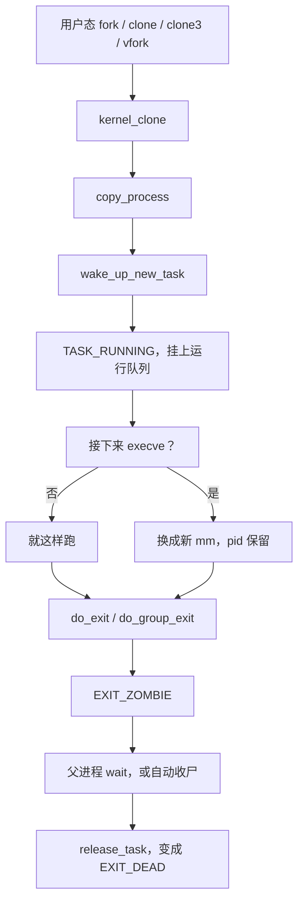

# 1. 总览与边界

**结论**：用户态说的「进程 / 线程」，在内核里是同一套 `task_struct`，只是 `clone` 时用 `CLONE_*` 决定共享还是复制。

## 1.1 进程 vs 线程（内核模型）

| 用户态说法 | 内核事实 |
|---|---|
| 进程 PID | `task_struct.tgid`（线程组 ID）。`getpid()` 返回的是 tgid |
| 线程 TID | `task_struct.pid`（这个任务自己的 ID）。`gettid()` 返回这个 |
| pthread 线程 | 用户态线程库常见组合：`CLONE_VM\|CLONE_FS\|CLONE_FILES\|CLONE_SIGHAND\|CLONE_THREAD\|CLONE_SYSVSEM\|CLONE_SETTLS\|CLONE_PARENT_SETTID\|CLONE_CHILD_CLEARTID`。这是库的用法，不是内核里写死的一行 |
| `fork` 出来的子进程 | 地址空间按写时复制做一份新的，新任务的 `tgid == pid` |

线程组：若干 `task_struct` 共用同一个 `signal_struct`。`group_leader` 指向组长（通常是组里第一个任务）。组长满足 `pid == tgid`。

`clone` 时如果带了 `CLONE_THREAD`（`kernel/fork.c:2576`）：子任务的 `group_leader` 和 `tgid` 都沿用调用者。不带这个标志时，子任务自己当组长，`tgid = pid`。

## 1.2 本章覆盖 / 不覆盖

| 覆盖 | 不覆盖（另章） |
|---|---|
| `task_struct` / PID / 命名空间 | MM 细节（页表、VMA、缺页） |
| fork / clone / exec / exit | VFS 打开文件的路径 |
| 调度入口与 `context_switch` | EEVDF / RT / DL 的选人算法 |
| 信号投递与 exit 的交叉 | 完整 ptrace 协议 |
| 观测命令模板 | cgroup 控制器细节 |

## 1.3 用户态 API ↔ 内核入口

行号都在 v6.6.160。`fork` / `vfork` / `clone` 是否编进内核，还要看架构有没有打开 `__ARCH_WANT_SYS_*`。

| 用户态 | 系统调用 | 内核入口 |
|---|---|---|
| `fork()` | `sys_fork` | `kernel/fork.c:3001` → `kernel_clone`（还要 `CONFIG_MMU`） |
| `vfork()` | `sys_vfork` | `:3017` → `kernel_clone`（`CLONE_VFORK\|CLONE_VM`） |
| `clone()` | 参数顺序按架构分几套 | `:3028` 起；x86-64 用默认五参数形式 `:3046` → `kernel_clone` |
| `clone3()` | `sys_clone3` | `:3204` → `kernel_clone` |
| `pthread_create` | 通常走 `clone` 或 `clone3` | 同上 |
| `execve` / `execveat` | `sys_execve` / `sys_execveat` | `fs/exec.c:2162` / `:2170` → `do_execveat_common`（`:1941`） |
| `exit` / `exit_group` | `sys_exit` / `sys_exit_group` | `kernel/exit.c:997` → `do_exit`；`:1041` → `do_group_exit` |
| `wait4` / `waitid` / `waitpid` | | `do_wait`（`exit.c:1593`） |
| `unshare` | `sys_unshare` | `ksys_unshare`（`kernel/fork.c:3394`，系统调用在 `:3516`） |
| `kill` / `tkill` / `tgkill` / `pidfd_send_signal` | | `kernel/signal.c:3842` / `:4039` / `:4023` / `:3917` |

## 1.4 `CLONE_*` 速查（`include/uapi/linux/sched.h`）

低 8 位 `CSIGNAL`（`0x000000ff`）不是「克隆资源」的标志，而是子进程退出时要发给父进程的信号号，`fork` 默认是 `SIGCHLD`。

| 标志 | 值 | 含义（共享 / 新建） |
|---|---|---|
| `CLONE_VM` | `0x00000100` | 共享 `mm_struct`（线程必备） |
| `CLONE_FS` | `0x00000200` | 共享 `fs_struct`（cwd / root / umask） |
| `CLONE_FILES` | `0x00000400` | 共享 `files_struct` |
| `CLONE_SIGHAND` | `0x00000800` | 共享 `sighand_struct`。必须同时带 `CLONE_VM` |
| `CLONE_PIDFD` | `0x00001000` | 给父进程一个指向子进程的 pidfd |
| `CLONE_PTRACE` | `0x00002000` | 子进程继续被 trace |
| `CLONE_VFORK` | `0x00004000` | 父进程堵到子进程 `exec` 或 `exit` |
| `CLONE_PARENT` | `0x00008000` | 新任务的父亲是调用者的父亲，不是调用者自己 |
| `CLONE_THREAD` | `0x00010000` | 放进同一个线程组。必须同时带 `CLONE_SIGHAND` |
| `CLONE_NEWNS` | `0x00020000` | 新的 mount 命名空间 |
| `CLONE_SYSVSEM` | `0x00040000` | 共享 System V 的 `SEM_UNDO` |
| `CLONE_SETTLS` | `0x00080000` | 给子任务设 TLS |
| `CLONE_PARENT_SETTID` | `0x00100000` | 把子 TID 写到父进程给的用户地址 |
| `CLONE_CHILD_CLEARTID` | `0x00200000` | 子任务退出时清掉这个 TID，并唤醒 futex（pthread 的 join 靠它） |
| `CLONE_DETACHED` | `0x00400000` | 头文件写着不用、忽略。和 `CLONE_PIDFD` 一起用会被 `copy_process` 拒绝；`clone3` 直接禁止这个 bit |
| `CLONE_UNTRACED` | `0x00800000` | 这次创建不向 ptracer 报 fork/clone/vfork 事件。内核线程会强制带上 |
| `CLONE_CHILD_SETTID` | `0x01000000` | 在子任务的地址空间里写下 TID |
| `CLONE_NEWCGROUP` | `0x02000000` | 新的 cgroup 命名空间 |
| `CLONE_NEWUTS` | `0x04000000` | 新的 uts 命名空间 |
| `CLONE_NEWIPC` | `0x08000000` | 新的 ipc 命名空间 |
| `CLONE_NEWUSER` | `0x10000000` | 新的 user 命名空间 |
| `CLONE_NEWPID` | `0x20000000` | 新的 pid 命名空间 |
| `CLONE_NEWNET` | `0x40000000` | 新的 net 命名空间 |
| `CLONE_IO` | `0x80000000` | 共享块层 `io_context` |
| `CLONE_NEWTIME` | `0x00000080` | 新的 time 命名空间。这个值和 `CSIGNAL` 重叠，只能给 `unshare` / `clone3` 用 |
| `CLONE_CLEAR_SIGHAND` | `0x100000000` | 把不是 `SIG_IGN` 的处理函数重置成 `SIG_DFL`。`clone3` 专用 |
| `CLONE_INTO_CGROUP` | `0x200000000` | 子进程直接放进 `clone_args.cgroup` 指着的那个 cgroup。`clone3` 专用 |

`copy_process` 开头的硬性检查在 `kernel/fork.c:2269` 起：

- `CLONE_NEWNS` 不能和 `CLONE_FS` 同时出现
- `CLONE_NEWUSER` 不能和 `CLONE_FS` 同时出现
- `CLONE_THREAD` 必须同时有 `CLONE_SIGHAND`，而 `CLONE_SIGHAND` 必须同时有 `CLONE_VM`
- 全局 init（`SIGNAL_UNKILLABLE`）不能用 `CLONE_PARENT` 给自己造兄弟
- `CLONE_THREAD` 不能再带 `CLONE_NEWUSER` 或 `CLONE_NEWPID`，也不能在「自己的 pid ns」和「子进程将用的 pid ns」不一致时使用
- `CLONE_PIDFD` 不能和 `CLONE_DETACHED` 或 `CLONE_THREAD` 一起用

`kernel_clone`（`:2888`）再加一条：`CLONE_PIDFD` 和 `CLONE_PARENT_SETTID` 不能指向同一块用户内存，否则 `-EINVAL`。

`clone3` 还会在 `clone3_args_valid`（`:3165`）里丢掉不认识的标志，并禁止 `CLONE_DETACHED`、禁止 `CLONE_SIGHAND` 配 `CLONE_CLEAR_SIGHAND`。

---

**导航**：[章节目录](./README.md) · [任务抽象：task_struct →](./02-task-struct.md)
