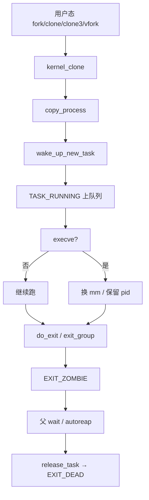

# 1. 总览与边界

**结论**：用户态「进程 / 线程」是资源共享策略的表象；内核统一用 `task_struct`，用 `CLONE_*` 决定共享还是复制。

## 1.1 进程 vs 线程（内核模型）

| 用户态说法 | 内核事实 |
|---|---|
| 进程 PID | `task_struct.tgid`（线程组 ID）；`getpid()` 返回的是 tgid |
| 线程 TID | `task_struct.pid`（内核内部的线程 ID）；`gettid()` 返回这个 |
| pthread 线程 | `clone(CLONE_VM\|CLONE_FS\|CLONE_FILES\|CLONE_SIGHAND\|CLONE_THREAD\|CLONE_SYSVSEM\|CLONE_SETTLS\|CLONE_PARENT_SETTID\|CLONE_CHILD_CLEARTID, …)` |
| fork 出来的子进程 | 几乎所有资源复制（mm 写时复制），新的 tgid == 新的 pid |

线程组：同一 `signal_struct` 上的一组 task，`group_leader` 指向组长（通常是第一个线程），组长的 `pid == tgid`。

## 1.2 本章覆盖 / 不覆盖

| 覆盖 | 不覆盖（另章） |
|---|---|
| `task_struct` / PID / ns | MM 细节（页表、VMA、fault） |
| fork/clone/exec/exit | VFS 打开文件路径 |
| 调度入口与 `context_switch` | EEVDF / RT / DL / sched_ext 选人算法 |
| 信号投递与 exit 交叉 | 完整 ptrace 协议 |
| 观测命令模板 | cgroup 控制器细节 |

## 1.3 用户态 API ↔ 内核入口

| 用户态 | 系统调用 | 内核入口 |
|---|---|---|
| `fork()` | `sys_fork` | `kernel/fork.c:2862` → `kernel_clone` |
| `vfork()` | `sys_vfork` | `:2878` → `kernel_clone`（`CLONE_VFORK\|CLONE_VM`） |
| `clone()` / `clone2` | 多架构变体 | `:2891` 起 → `kernel_clone` |
| `clone3()` | `sys_clone3` | `:3063` → `kernel_clone` |
| `pthread_create` | 通常走 `clone`/`clone3` | 同上 |
| `execve` / `execveat` | `sys_execve*` | `fs/exec.c` → `do_execveat_common` |
| `exit` / `exit_group` | `sys_exit` / `sys_exit_group` | `do_exit` / `do_group_exit` |
| `wait4` / `waitid` | | `do_wait` |
| `unshare` | `sys_unshare` | `ksys_unshare`（`kernel/fork.c:3251`） |
| `kill` / `tgkill` / `pidfd_send_signal` | | `kernel/signal.c` |

## 1.4 `CLONE_*` 速查（`include/uapi/linux/sched.h`）

| 标志 | 值 | 含义（共享 / 新建） |
|---|---|---|
| `CLONE_VM` | `0x00000100` | 共享 `mm_struct`（线程必备） |
| `CLONE_FS` | `0x00000200` | 共享 `fs_struct`（cwd/root/umask） |
| `CLONE_FILES` | `0x00000400` | 共享 `files_struct` |
| `CLONE_SIGHAND` | `0x00000800` | 共享 `sighand_struct`（要求同时 `CLONE_VM`） |
| `CLONE_PIDFD` | `0x00001000` | 给父进程返回 pidfd |
| `CLONE_PTRACE` | `0x00002000` | 子进程继续被 trace |
| `CLONE_VFORK` | `0x00004000` | 父进程阻塞到子进程 `exec`/`exit` |
| `CLONE_PARENT` | `0x00008000` | 与调用者同父 |
| `CLONE_THREAD` | `0x00010000` | 同一线程组（要求 `CLONE_SIGHAND`） |
| `CLONE_NEWNS` | `0x00020000` | 新 mount ns |
| `CLONE_SYSVSEM` | `0x00040000` | 共享 System V SEM_UNDO |
| `CLONE_SETTLS` | `0x00080000` | 设置 TLS |
| `CLONE_PARENT_SETTID` | `0x00100000` | 把子 TID 写到父地址 |
| `CLONE_CHILD_CLEARTID` | `0x00200000` | 子退出时清 TID 并 futex wake（pthread join） |
| `CLONE_DETACHED` | `0x00400000` | 历史遗留，现与 `CLONE_PIDFD` 互斥 |
| `CLONE_UNTRACED` | `0x00800000` | 不被强制 ptrace（内核线程） |
| `CLONE_CHILD_SETTID` | `0x01000000` | 子地址写 TID |
| `CLONE_NEWCGROUP` | `0x02000000` | 新 cgroup ns |
| `CLONE_NEWUTS` | `0x04000000` | 新 uts ns |
| `CLONE_NEWIPC` | `0x08000000` | 新 ipc ns |
| `CLONE_NEWUSER` | `0x10000000` | 新 user ns |
| `CLONE_NEWPID` | `0x20000000` | 新 pid ns |
| `CLONE_NEWNET` | `0x40000000` | 新 net ns |
| `CLONE_IO` | `0x80000000` | 共享 I/O context |
| `CLONE_NEWTIME` | `0x00000080` | 新 time ns |
| `CLONE_CLEAR_SIGHAND` | `1ULL<<32` | 重置信号 handler 为 `SIG_DFL`（不清 `SIG_IGN`） |
| `CLONE_PIDFD_AUTOKILL` | `1ULL<<36` | pidfd 关闭时杀子进程（较新） |

约束（`copy_process` 开头硬性检查，`kernel/fork.c:2038` 起）：

- `CLONE_THREAD` ⇒ 必须 `CLONE_SIGHAND`
- `CLONE_SIGHAND` ⇒ 必须 `CLONE_VM`
- `CLONE_NEWNS|CLONE_FS`、`CLONE_NEWUSER|CLONE_FS` 互斥
- `CLONE_THREAD` 不能同时 `CLONE_NEWUSER|CLONE_NEWPID`

---

---

**导航**：[章节目录](./README.md) · [任务抽象：task_struct →](./02-task-struct.md)
