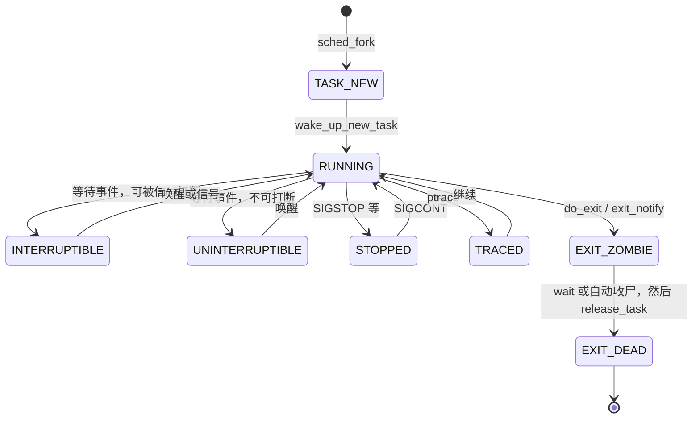

# 2. 任务抽象：`task_struct`

**结论**：`task_struct`（`include/linux/sched.h:746`）把调度、资源、身份和信号收在一个结构里。x86 在 `arch/x86/Kconfig` 里 `select THREAD_INFO_IN_TASK`，所以 `thread_info` 一定是第一个字段。

## 2.1 状态机（`__state` / `exit_state`）

定义在 `include/linux/sched.h:84` 起。活着的时候看 `__state`，退出路径另写 `exit_state`。两个字段用位或起来，再交给 `/proc` 显示。

| 宏 | 值 | 用途 / ps 字母 |
|---|---|---|
| `TASK_RUNNING` | `0x0000` | 可运行，不一定正在 CPU 上 → **R** |
| `TASK_INTERRUPTIBLE` | `0x0001` | 可被信号打断的睡眠 → **S** |
| `TASK_UNINTERRUPTIBLE` | `0x0002` | 不可打断的睡眠 → **D** |
| `__TASK_STOPPED` | `0x0004` | 作业控制停住。配上 `TASK_WAKEKILL` 才是 `TASK_STOPPED` → **T** |
| `__TASK_TRACED` | `0x0008` | 被 ptrace 停住 → **t** |
| `EXIT_DEAD` | `0x0010` | 正在销毁，写在 `exit_state` → **X** |
| `EXIT_ZOMBIE` | `0x0020` | 僵尸，等父进程 wait，写在 `exit_state` → **Z** |
| `EXIT_TRACE` | `EXIT_ZOMBIE \| EXIT_DEAD` | 两个退出位都算 |
| `TASK_PARKED` | `0x0040` | kthread 被 park → **P** |
| `TASK_DEAD` | `0x0080` | 调度器确认这具尸体不会再跑。不进 `TASK_REPORT` |
| `TASK_WAKEKILL` | `0x0100` | 致命信号可以把它叫醒 |
| `TASK_WAKING` | `0x0200` | 正在被唤醒 |
| `TASK_NOLOAD` | `0x0400` | 这种睡眠不算 loadavg |
| `TASK_NEW` | `0x0800` | `sched_fork` 刚造好，还不许进运行队列 |
| `TASK_RTLOCK_WAIT` | `0x1000` | 在等 rt 锁。`/proc` 把它谎报成 **D** |
| `TASK_FREEZABLE` | `0x2000` | 这次睡眠允许被系统休眠冻住 |
| `__TASK_FREEZABLE_UNSAFE` | `0x4000 * IS_ENABLED(CONFIG_LOCKDEP)` | 只有打开 lockdep 才占这个位 |
| `TASK_FROZEN` | `0x8000` | 已经冻住。`/proc` 同样谎报成 **D** |
| `TASK_STATE_MAX` | `0x10000` | 状态位的上界，不是一个能设进去的状态 |
| `TASK_KILLABLE` | `TASK_WAKEKILL \| TASK_UNINTERRUPTIBLE` | 平时像 D，致命信号可以叫醒 |
| `TASK_STOPPED` | `TASK_WAKEKILL \| __TASK_STOPPED` | 停住，但致命信号仍能进来 |
| `TASK_TRACED` | `__TASK_TRACED` | 给 `set_current_state` 用的写法 |
| `TASK_IDLE` | `TASK_UNINTERRUPTIBLE \| TASK_NOLOAD` | idle 和一部分内核睡眠 → **I**，不计 load |
| `TASK_NORMAL` | `TASK_INTERRUPTIBLE \| TASK_UNINTERRUPTIBLE` | `wake_up()` 默认能叫醒的两种睡眠 |
| `TASK_FREEZABLE_UNSAFE` | `TASK_FREEZABLE \| __TASK_FREEZABLE_UNSAFE` | 头文件写着不要再增加使用者 |

`/proc` 的文字在 `fs/proc/array.c:126` 的 `task_state_array[]`：`R (running)`、`S (sleeping)`、`D (disk sleep)`、`T (stopped)`、`t (tracing stop)`、`X (dead)`、`Z (zombie)`、`P (parked)`、`I (idle)`。下标由 `task_state_index()`（`sched.h:1709`）算出来：先把 `__state|exit_state` 收成 `TASK_REPORT` 里的那些位，再取最高那一位的位置。`TASK_IDLE` 单独映到 `I`。`TASK_RTLOCK_WAIT` 和 `TASK_FROZEN` 在这里被改报成 `D`。



## 2.2 `thread_info` 与内核栈

- x86 上 `thread_info` 嵌在 `task_struct` 头部（`sched.h:748` 一带，包在 `CONFIG_THREAD_INFO_IN_TASK` 里）。
- `stack` 指向一块 `THREAD_SIZE` 大小的内核栈。x86-64 上 `THREAD_SIZE` 在 `arch/x86/include/asm/page_64_types.h:16`。用户寄存器帧在栈顶附近，`task_pt_regs()`（`arch/x86/include/asm/processor.h:649`）从栈顶往回退一帧。
- `usage` 是 `task_struct` 的引用计数。`get_task_struct` / `put_task_struct` 在 `include/linux/sched/task.h:115` 和 `:124`。减到 0 之后走 `kernel/fork.c:975` 的 `__put_task_struct`。
- 随机化区从 `saved_state` 后面的 `randomized_struct_fields_start` 开始，到 `randomized_struct_fields_end` 结束。`thread` 在这个区**外面**，而且必须是最后一个成员：x86 的 `thread_struct` 末尾长度不固定。

## 2.3 字段（按 `sched.h:746` 的源码顺序）

下面是整份 `task_struct`。`#ifdef` 保留，打开对应配置才有那个成员。短注释写在行尾；需要多说一句的，写在成员上面。

```c
struct task_struct {
	/* --- A. 状态、栈、标志 --- */
#ifdef CONFIG_THREAD_INFO_IN_TASK
	struct thread_info		thread_info;	/* 底层 flags / 抢占计数；x86 上必须是第一个成员 */
#endif
	/*
	 * 活着的任务看这个字段。读写用 READ_ONCE / WRITE_ONCE，不要直接当普通整数乱写。
	 */
	unsigned int			__state;	/* 运行态，见本章状态表 */

	unsigned int			saved_state;	/* 等自旋锁时临时存下的 __state */

	randomized_struct_fields_start

	void				*stack;	/* 内核栈。x86 上用户寄存器帧靠近栈顶，用 task_pt_regs() 取 */
	refcount_t			usage;	/* task_struct 引用计数。get_task_struct / put_task_struct */
	unsigned int			flags;	/* PF_* 标志，定义在本文件后部 */
	unsigned int			ptrace;	/* ptrace 标志位 */

#ifdef CONFIG_SMP
	/* --- B. 唤醒与所在 CPU --- */
	int				on_cpu;	/* 非 0 表示正在某 CPU 上跑 */
	struct __call_single_node	wake_entry;	/* 跨 CPU 唤醒用的调用节点 */
	unsigned int			wakee_flips;	/* 最近把唤醒目标在 CPU 之间甩来甩去的次数 */
	unsigned long			wakee_flip_decay_ts;	/* 上面计数衰减的时间戳 */
	struct task_struct		*last_wakee;	/* 上次被本任务唤醒的那个任务 */

	/*
	 * 唤醒时会记「最近用过的 CPU」，方便先看看它是不是空的。
	 */
	int				recent_used_cpu;	/* 最近用过的 CPU */
	int				wake_cpu;	/* 希望被唤醒到的 CPU */
#endif
	/* --- C. 优先级、调度实体、亲和 --- */
	int				on_rq;	/* 是否已经挂在运行队列上 */

	int				prio;	/* 当前用来排队的动态优先级 */
	int				static_prio;	/* nice 换算来的静态优先级 */
	int				normal_prio;	/* 不考虑优先级继承时的正常优先级 */
	unsigned int			rt_priority;	/* 实时优先级 */

	struct sched_entity		se;	/* 公平调度实体。6.6 的公平类是 EEVDF */
	struct sched_rt_entity		rt;	/* 实时调度实体 */
	struct sched_dl_entity		dl;	/* SCHED_DEADLINE 实体 */
	const struct sched_class	*sched_class;	/* 当前调度类：fair / rt / dl / idle */

#ifdef CONFIG_SCHED_CORE
	struct rb_node			core_node;	/* core scheduling 的红黑树节点 */
	unsigned long			core_cookie;	/* 只有 cookie 相同的任务才能同时上兄弟超线程 */
	unsigned int			core_occupation;	/* core scheduling 占用计数 */
#endif

#ifdef CONFIG_CGROUP_SCHED
	struct task_group		*sched_task_group;	/* cpu cgroup 对应的 task_group */
#endif

#ifdef CONFIG_UCLAMP_TASK
	struct uclamp_se		uclamp_req[UCLAMP_CNT];	/* 用户请求的利用率钳位 */
	struct uclamp_se		uclamp[UCLAMP_CNT];	/* 真正生效的利用率钳位 */
#endif

	struct sched_statistics         stats;	/* 调度统计。CONFIG_SCHEDSTATS 关掉时里面是空的 */

#ifdef CONFIG_PREEMPT_NOTIFIERS
	struct hlist_head		preempt_notifiers;	/* 抢占通知链 */
#endif

#ifdef CONFIG_BLK_DEV_IO_TRACE
	unsigned int			btrace_seq;	/* blktrace 序号 */
#endif

	unsigned int			policy;	/* SCHED_NORMAL / FIFO / RR / BATCH / IDLE / DEADLINE */
	int				nr_cpus_allowed;	/* cpus_mask 里允许的 CPU 个数 */
	const cpumask_t			*cpus_ptr;	/* 当前亲和掩码，通常指着下面的 cpus_mask */
	cpumask_t			*user_cpus_ptr;	/* 用户通过 sched_setaffinity 设的掩码 */
	cpumask_t			cpus_mask;	/* 亲和掩码本体 */
	void				*migration_pending;	/* 正在等待的迁移 */
#ifdef CONFIG_SMP
	unsigned short			migration_disabled;	/* 迁移禁用计数。非 0 时不要把任务搬走 */
#endif
	unsigned short			migration_flags;	/* 迁移相关标志 */

#ifdef CONFIG_PREEMPT_RCU
	/* --- D. RCU --- */
	int				rcu_read_lock_nesting;	/* 可抢占 RCU 的读侧嵌套层数 */
	union rcu_special		rcu_read_unlock_special;	/* 这次 rcu_read_unlock 还要做额外工作 */
	struct list_head		rcu_node_entry;	/* 挂在 rcu_node 的阻塞任务链表上 */
	struct rcu_node			*rcu_blocked_node;	/* 本任务正堵在哪个 rcu_node */
#endif

#ifdef CONFIG_TASKS_RCU
	unsigned long			rcu_tasks_nvcsw;	/* Tasks RCU 用来观察自愿切换 */
	u8				rcu_tasks_holdout;	/* 宽限期里还没通过静止状态 */
	u8				rcu_tasks_idx;	/* Tasks RCU 的回调批次 */
	int				rcu_tasks_idle_cpu;	/* 在哪个 CPU 上进入过空闲 */
	struct list_head		rcu_tasks_holdout_list;	/* holdout 链表节点 */
	int				rcu_tasks_exit_cpu;	/* 退出时所在 CPU */
	struct list_head		rcu_tasks_exit_list;	/* 退出链表节点 */
#endif

#ifdef CONFIG_TASKS_TRACE_RCU
	int				trc_reader_nesting;	/* Tasks Trace RCU 读侧嵌套 */
	int				trc_ipi_to_cpu;	/* 需要发 IPI 去的 CPU */
	union rcu_special		trc_reader_special;	/* 读侧解锁时的特殊状态 */
	struct list_head		trc_holdout_list;	/* trace 宽限期 holdout 链表 */
	struct list_head		trc_blkd_node;	/* 堵在读侧临界区时的链表节点 */
	int				trc_blkd_cpu;	/* 堵在读侧临界区时的 CPU */
#endif

	/* --- E. 链表与地址空间 --- */
	struct sched_info		sched_info;	/* 调度延迟统计。要开 CONFIG_SCHED_INFO */

	struct list_head		tasks;	/* 挂在 init_task.tasks 这条全局链表上 */
#ifdef CONFIG_SMP
	struct plist_node		pushable_tasks;	/* 可以推到别的 CPU 的实时任务 */
	struct rb_node			pushable_dl_tasks;	/* 可以推到别的 CPU 的 deadline 任务 */
#endif

	struct mm_struct		*mm;	/* 用户地址空间。内核线程是 NULL */
	struct mm_struct		*active_mm;	/* 真正在用的 mm。内核线程借用上一个用户 mm（lazy TLB） */
	struct address_space		*faults_disabled_mapping;	/* 禁止在这个 address_space 里再缺页，避免递归 */

	/* --- F. 退出、作业控制、personality --- */
	int				exit_state;	/* EXIT_ZOMBIE / EXIT_DEAD。活着时是 0 */
	int				exit_code;	/* 退出码。do_exit 写入 */
	int				exit_signal;	/* 退出时通知父亲用的信号。线程是 -1，进程通常是 SIGCHLD */
	int				pdeath_signal;	/* 父亲死时要发给自己的信号 */
	unsigned long			jobctl;	/* JOBCTL_*。停止、ptrace 都放这里，siglock 保护 */

	unsigned int			personality;	/* 模拟旧 ABI 的人格位 */

	/* --- G. 每任务 bitfield --- */
	unsigned			sched_reset_on_fork:1;	/* fork 之后把调度策略打回普通 */
	unsigned			sched_contributes_to_load:1;	/* 这种睡眠要不要算进 load */
	unsigned			sched_migrated:1;	/* 刚被迁走过 */
	unsigned			sched_task_hot:1;	/* 公平类负载均衡用来记「还烫不烫」 */

	unsigned			:0;	/* 把后面的位域推到下一个字，避免和调度位挤在一起 */

	/*
	 * 这个位不和上面的调度位放同一个字。跨 CPU 唤醒路径会写它，必须能单独看见。
	 */
	unsigned			sched_remote_wakeup:1;	/* 远程唤醒路径用 */

	unsigned			user_dumpable:1;	/* mm 被拆掉之后还记着原来可不可 dump */

	unsigned			in_execve:1;	/* 正在 execve，给 LSM 看 */
	unsigned			in_iowait:1;	/* 堵在 IO 上，会计入 iowait */
#ifndef TIF_RESTORE_SIGMASK
	unsigned			restore_sigmask:1;	/* 从内核返回前要把 saved_sigmask 装回去 */
#endif
#ifdef CONFIG_MEMCG
	unsigned			in_user_fault:1;	/* memcg 记账时标记这是用户缺页 */
#endif
#ifdef CONFIG_LRU_GEN
	unsigned			in_lru_fault:1;	/* 这次访问能不能走 MGLRU */
#endif
#ifdef CONFIG_COMPAT_BRK
	unsigned			brk_randomized:1;	/* 堆的起点已经随机化过 */
#endif
#ifdef CONFIG_CGROUPS
	unsigned			no_cgroup_migration:1;	/* 不许用户态发起 cgroup 迁移 */
	unsigned			frozen:1;	/* cgroup freezer 把它冻住了 */
#endif
#ifdef CONFIG_BLK_CGROUP
	unsigned			use_memdelay:1;	/* 块层限流时把延迟算进 memdelay */
#endif
#ifdef CONFIG_PSI
	unsigned			in_memstall:1;	/* PSI：因为缺内存而停滞 */
#endif
#ifdef CONFIG_PAGE_OWNER
	unsigned			in_page_owner:1;	/* page_owner 跟踪里防止递归 */
#endif
#ifdef CONFIG_EVENTFD
	unsigned			in_eventfd:1;	/* eventfd_signal 防止递归 */
#endif
#ifdef CONFIG_IOMMU_SVA
	unsigned			pasid_activated:1;	/* IOMMU 的 PASID 已经激活 */
#endif
#ifdef	CONFIG_CPU_SUP_INTEL
	unsigned			reported_split_lock:1;	/* 这颗 CPU 上的 split lock 已经报过 */
#endif
#ifdef CONFIG_TASK_DELAY_ACCT
	unsigned                        in_thrashing:1;	/* 内存抖动造成的延迟 */
#endif

	unsigned long			atomic_flags;	/* 必须用原子位操作的标志，见后面的 PFA_* */

	struct restart_block		restart_block;	/* 被信号打断后用来重启系统调用的参数 */

	/* --- H. 身份与亲缘 --- */
	pid_t				pid;	/* 本任务的线程 ID */
	pid_t				tgid;	/* 线程组 ID，用户态看到的进程 PID */

#ifdef CONFIG_STACKPROTECTOR
	unsigned long			stack_canary;	/* -fstack-protector 的栈金丝雀 */
#endif

	struct task_struct __rcu	*real_parent;	/* 亲生父亲。被 ptrace 时它不变 */

	struct task_struct __rcu	*parent;	/* 接收 SIGCHLD、被 wait 看到的父亲。被 trace 时是 tracer */

	struct list_head		children;	/* 亲生子任务链表头 */
	struct list_head		sibling;	/* 自己挂在父亲 children 上的节点 */
	struct task_struct		*group_leader;	/* 线程组组长。组长的 pid == tgid */

	struct list_head		ptraced;	/* 本任务正在 ptrace 的那些任务 */
	struct list_head		ptrace_entry;	/* 自己挂在 tracer->ptraced 上的节点 */

	struct pid			*thread_pid;	/* 本线程的 struct pid */
	struct hlist_node		pid_links[PIDTYPE_MAX];	/* 按 PID/TGID/PGID/SID 挂进 struct pid 的哈希 */
	struct list_head		thread_group;	/* 把同组线程串起来。组长当链表头 */
	struct list_head		thread_node;	/* 挂在 signal->thread_head 上 */

	struct completion		*vfork_done;	/* vfork 的 completion。子任务 exec/exit 时完成它 */

	int __user			*set_child_tid;	/* CLONE_CHILD_SETTID 要写的用户地址 */

	int __user			*clear_child_tid;	/* CLONE_CHILD_CLEARTID。退出时清掉并 futex 唤醒 */

	void				*worker_private;	/* kthread 或 IO worker 的私有数据 */

	/* --- I. 时间与缺页 --- */
	u64				utime;	/* 用户态 CPU 时间，纳秒 */
	u64				stime;	/* 内核态 CPU 时间，纳秒 */
#ifdef CONFIG_ARCH_HAS_SCALED_CPUTIME
	u64				utimescaled;	/* 按频率缩放后的用户时间 */
	u64				stimescaled;	/* 按频率缩放后的内核时间 */
#endif
	u64				gtime;	/* 在客户机里跑的时间 */
	struct prev_cputime		prev_cputime;	/* 上次对用户/内核时间做调整时的快照 */
#ifdef CONFIG_VIRT_CPU_ACCOUNTING_GEN
	struct vtime			vtime;	/* 无 tick 记账用的虚拟时间 */
#endif

#ifdef CONFIG_NO_HZ_FULL
	atomic_t			tick_dep_mask;	/* 哪些原因迫使本任务所在 CPU 不能停 tick */
#endif
	unsigned long			nvcsw;	/* 自愿上下文切换次数 */
	unsigned long			nivcsw;	/* 非自愿上下文切换次数 */

	u64				start_time;	/* 任务诞生的单调时钟，纳秒 */

	u64				start_boottime;	/* 按启动时钟算的诞生时间，含休眠 */

	unsigned long			min_flt;	/* 不需要 IO 的缺页次数 */
	unsigned long			maj_flt;	/* 需要 IO 的缺页次数 */

	struct posix_cputimers		posix_cputimers;	/* 本线程的 POSIX CPU 定时器。配置关掉时是空结构 */

#ifdef CONFIG_POSIX_CPU_TIMERS_TASK_WORK
	struct posix_cputimers_work	posix_cputimers_work;	/* 用 task_work 跑 CPU 定时器 */
#endif

	/* --- J. 凭证、名字、System V --- */
	const struct cred __rcu		*ptracer_cred;	/* tracer 附上来时它自己的凭证 */

	const struct cred __rcu		*real_cred;	/* 客观凭证。写时复制，RCU 保护 */

	const struct cred __rcu		*cred;	/* 当前生效的主观凭证。可以临时盖住 real_cred */

#ifdef CONFIG_KEYS
	struct key			*cached_requested_key;	/* 密钥子系统缓存的最近请求 */
#endif

	/*
	 * 短名，不含路径。最长 TASK_COMM_LEN（含结尾 0）。exec 时 begin_new_exec 调用 __set_task_comm 写入。
	 */
	char				comm[TASK_COMM_LEN];	/* 短名 */

	struct nameidata		*nameidata;	/* 路径查找走到一半时的现场 */

#ifdef CONFIG_SYSVIPC
	struct sysv_sem			sysvsem;	/* System V 信号量的 UNDO 名单 */
	struct sysv_shm			sysvshm;	/* 本任务挂着的 System V 共享内存 */
#endif
#ifdef CONFIG_DETECT_HUNG_TASK
	unsigned long			last_switch_count;	/* hung task 检测用的切换计数 */
	unsigned long			last_switch_time;	/* 上次切换的时间 */
#endif
	/* --- K. 文件、命名空间、信号 --- */
	struct fs_struct		*fs;	/* 根目录、cwd、umask。CLONE_FS 时共享 */

	struct files_struct		*files;	/* 打开文件表。CLONE_FILES 时共享 */

#ifdef CONFIG_IO_URING
	struct io_uring_task		*io_uring;	/* 本任务的 io_uring 状态 */
#endif

	struct nsproxy			*nsproxy;	/* uts/ipc/mnt/net/time/cgroup 以及「子进程用的 pid ns」 */

	struct signal_struct		*signal;	/* 整个线程组共用的 signal_struct */
	struct sighand_struct __rcu		*sighand;	/* 信号处理函数表。CLONE_SIGHAND 时共享 */
	sigset_t			blocked;	/* 当前屏蔽的信号 */
	sigset_t			real_blocked;	/* 临时改 blocked 时留下的原屏蔽 */
	sigset_t			saved_sigmask;	/* set_restore_sigmask() 之后要恢复的屏蔽 */
	struct sigpending		pending;	/* 只属于本线程的挂起信号 */
	unsigned long			sas_ss_sp;	/* 信号备用栈的用户地址 */
	size_t				sas_ss_size;	/* 备用栈长度 */
	unsigned int			sas_ss_flags;	/* 备用栈标志，比如 SS_AUTODISARM */

	struct callback_head		*task_works;	/* 返回用户态前要跑的 task_work 链表 */

#ifdef CONFIG_AUDIT
#ifdef CONFIG_AUDITSYSCALL
	/* --- L. 审计、安全、锁 --- */
	struct audit_context		*audit_context;	/* 系统调用审计上下文 */
#endif
	kuid_t				loginuid;	/* 登录 uid */
	unsigned int			sessionid;	/* 审计会话号 */
#endif
	struct seccomp			seccomp;	/* seccomp 模式和过滤器 */
	struct syscall_user_dispatch	syscall_dispatch;	/* 把系统调用拦给用户态处理的开关 */

	u64				parent_exec_id;	/* 父亲的 self_exec_id，用来发现父亲已经 exec 过 */
	u64				self_exec_id;	/* 自己 exec 的次数。每次 begin_new_exec 加一 */

	spinlock_t			alloc_lock;	/* 保护 fs、files、mm、凭证等分配关系的自旋锁 */

	raw_spinlock_t			pi_lock;	/* 保护优先级继承数据，也串起对 __state 的特殊写 */

	struct wake_q_node		wake_q;	/* 唤醒队列节点，避免在锁里直接 wake_up */

#ifdef CONFIG_RT_MUTEXES
	struct rb_root_cached		pi_waiters;	/* 堵在本任务所持 rt_mutex 上的等待者 */
	struct task_struct		*pi_top_task;	/* 优先级继承链的顶端任务 */
	struct rt_mutex_waiter		*pi_blocked_on;	/* 本任务正堵在哪个 rt_mutex 的 waiter 上 */
#endif

#ifdef CONFIG_DEBUG_MUTEXES
	struct mutex_waiter		*blocked_on;	/* 调试用：堵在哪个 mutex waiter 上 */
#endif

#ifdef CONFIG_DEBUG_ATOMIC_SLEEP
	/* --- M. 锁调试 --- */
	int				non_block_count;	/* 原子睡眠调试：这段代码不许睡觉 */
#endif

#ifdef CONFIG_TRACE_IRQFLAGS
	struct irqtrace_events		irqtrace;	/* 硬中断 / 软中断开关追踪 */
	unsigned int			hardirq_threaded;	/* 当前硬中断是不是线程化的 */
	u64				hardirq_chain_key;	/* lockdep 用的硬中断链键 */
	int				softirqs_enabled;	/* 软中断是否打开 */
	int				softirq_context;	/* 正处在软中断上下文的嵌套 */
	int				irq_config;	/* 中断状态追踪的配置 */
#endif
#ifdef CONFIG_PREEMPT_RT
	int				softirq_disable_cnt;	/* PREEMPT_RT 上软中断关闭计数 */
#endif

#ifdef CONFIG_LOCKDEP
# define MAX_LOCK_DEPTH			48UL
	u64				curr_chain_key;	/* lockdep：当前持锁链的哈希 */
	int				lockdep_depth;	/* 当前拿了多少把锁 */
	unsigned int			lockdep_recursion;	/* lockdep 自身递归深度 */
	struct held_lock		held_locks[MAX_LOCK_DEPTH];	/* 当前持有的锁，深度上限 MAX_LOCK_DEPTH */
#endif

#if defined(CONFIG_UBSAN) && !defined(CONFIG_UBSAN_TRAP)
	unsigned int			in_ubsan;	/* UBSAN 报告里防止递归 */
#endif

	/* --- N. IO、ptrace、记账 --- */
	void				*journal_info;	/* 日志文件系统正在做的事务 */

	struct bio_list			*bio_list;	/* 正在提交的 bio 链表 */

	struct blk_plug			*plug;	/* 块层攒着的请求 */

	struct reclaim_state		*reclaim_state;	/* 回收路径上的临时记账 */

	struct io_context		*io_context;	/* 块层 IO 上下文。CLONE_IO 时共享 */

#ifdef CONFIG_COMPACTION
	struct capture_control		*capture_control;	/* 内存规整时直接抓住空闲页 */
#endif
	unsigned long			ptrace_message;	/* 给 tracer 看的 ptrace 消息 */
	kernel_siginfo_t		*last_siginfo;	/* 最近一次信号的 siginfo */

	struct task_io_accounting	ioac;	/* 本任务的 IO 记账 */
#ifdef CONFIG_PSI
	unsigned int			psi_flags;	/* PSI 压力状态 */
#endif
#ifdef CONFIG_TASK_XACCT
	u64				acct_rss_mem1;	/* 进程记账累计的 RSS */
	u64				acct_vm_mem1;	/* 进程记账累计的虚拟内存 */
	u64				acct_timexpd;	/* 上次更新之后新增加的 CPU 时间 */
#endif
#ifdef CONFIG_CPUSETS
	/* --- O. cpuset、cgroup、futex、NUMA --- */
	nodemask_t			mems_allowed;	/* cpuset 允许的内存节点。alloc_lock 保护 */
	seqcount_spinlock_t		mems_allowed_seq;	/* 读者用 seqcount 看 mems_allowed 有没有改 */
	int				cpuset_mem_spread_rotor;	/* 页缓存在允许节点上轮转的游标 */
	int				cpuset_slab_spread_rotor;	/* slab 在允许节点上轮转的游标 */
#endif
#ifdef CONFIG_CGROUPS
	struct css_set __rcu		*cgroups;	/* 本任务所在的 css_set */
	struct list_head		cg_list;	/* 挂在 css_set 的任务链表上 */
#endif
#ifdef CONFIG_X86_CPU_RESCTRL
	u32				closid;	/* resctrl 的 CLOSID */
	u32				rmid;	/* resctrl 的监控 ID */
#endif
#ifdef CONFIG_FUTEX
	struct robust_list_head __user	*robust_list;	/* 用户态 robust futex 链表 */
#ifdef CONFIG_COMPAT
	struct compat_robust_list_head __user *compat_robust_list;	/* 32 位兼容的 robust futex 链表 */
#endif
	struct list_head		pi_state_list;	/* 本任务持有的 futex PI 状态 */
	struct futex_pi_state		*pi_state_cache;	/* 缓存一个 futex_pi_state，免得每次分配 */
	struct mutex			futex_exit_mutex;	/* 退出时和 futex 清理互斥 */
	unsigned int			futex_state;	/* futex 退出状态机 */
#endif
#ifdef CONFIG_PERF_EVENTS
	struct perf_event_context	*perf_event_ctxp;	/* perf 事件上下文 */
	struct mutex			perf_event_mutex;	/* 保护本任务的 perf 事件链表 */
	struct list_head		perf_event_list;	/* 挂在本任务上的 perf 事件 */
#endif
#ifdef CONFIG_DEBUG_PREEMPT
	unsigned long			preempt_disable_ip;	/* 谁关的抢占，调试用 */
#endif
#ifdef CONFIG_NUMA
	struct mempolicy		*mempolicy;	/* NUMA 内存策略。alloc_lock 保护 */
	short				il_prev;	/* 上次 interleave 用的节点 */
	short				pref_node_fork;	/* fork 时希望子任务去的节点 */
#endif
#ifdef CONFIG_NUMA_BALANCING
	int				numa_scan_seq;	/* 已经跟上的 mm 扫描序号 */
	unsigned int			numa_scan_period;	/* NUMA 扫描周期。本地访问多就拉长 */
	unsigned int			numa_scan_period_max;	/* 扫描周期上限 */
	int				numa_preferred_nid;	/* 当前偏好的 NUMA 节点 */
	unsigned long			numa_migrate_retry;	/* 下次允许迁移的 jiffies */
	u64				node_stamp;	/* 上次扫描对应的运行时间，用来限频 */
	u64				last_task_numa_placement;	/* 上次做放置决策的时间 */
	u64				last_sum_exec_runtime;	/* 上次放置时的累计运行时间 */
	struct callback_head		numa_work;	/* NUMA 扫描的 task_work */

	/*
	 * 只有 current 在系统调用或缺页里改它，销毁任务时也会改。RCU 读侧可以读。
	 */
	struct numa_group __rcu		*numa_group;	/* NUMA 分组 */

	/*
	 * 四段：faults_memory、faults_cpu，以及这两段的当前扫描缓冲。放置看 memory 的衰减均值。
	 */
	unsigned long			*numa_faults;	/* 按节点计的 NUMA 缺页 */
	unsigned long			total_numa_faults;	/* 上面那些缺页的合计 */

	unsigned long			numa_faults_locality[3];	/* 上一窗口：[0] 远程 [1] 本地 [2] 迁移失败 */

	unsigned long			numa_pages_migrated;	/* 已经迁走的页数 */
#endif

#ifdef CONFIG_RSEQ
	/* --- P. rseq、mm_cid 与杂项 --- */
	struct rseq __user *rseq;	/* 用户态 restartable sequences 区域 */
	u32 rseq_len;	/* 这块区域的长度 */
	u32 rseq_sig;	/* rseq 的签名，用来认出 abort */
	unsigned long rseq_event_mask;	/* 抢占、迁移等事件。要原子改 */
#endif

#ifdef CONFIG_SCHED_MM_CID
	int				mm_cid;	/* 本任务在这个 mm 里的并发 ID */
	int				last_mm_cid;	/* 最近用过的 mm_cid */
	int				migrate_from_cpu;	/* mm_cid 从哪颗 CPU 迁来 */
	int				mm_cid_active;	/* cid 位图是否在用 */
	struct callback_head		cid_work;	/* mm_cid 的回调 */
#endif

	struct tlbflush_unmap_batch	tlb_ubc;	/* 批量解映射时推迟的 TLB 刷新 */

	struct pipe_inode_info		*splice_pipe;	/* splice 用过的最后一根管道 */

	struct page_frag		task_frag;	/* 本任务缓存的一页碎片，给网络等小分配用 */

#ifdef CONFIG_TASK_DELAY_ACCT
	struct task_delay_info		*delays;	/* 调度、IO、交换等延迟记账 */
#endif

#ifdef CONFIG_FAULT_INJECTION
	int				make_it_fail;	/* 故障注入：下次分配故意失败 */
	unsigned int			fail_nth;	/* 第 N 次才注入失败 */
#endif
	int				nr_dirtied;	/* 本任务弄脏的页数 */
	int				nr_dirtied_pause;	/* 脏页到这个数就去 balance_dirty_pages */
	unsigned long			dirty_paused_when;	/* 这一轮写然后暂停是什么时候开始的 */

#ifdef CONFIG_LATENCYTOP
	int				latency_record_count;	/* LatencyTOP 记下了几条 */
	struct latency_record		latency_record[LT_SAVECOUNT];	/* LatencyTOP 的记录 */
#endif
	u64				timer_slack_ns;	/* poll / select 超时可以松这么多纳秒 */
	u64				default_timer_slack_ns;	/* fork 重置调度策略时用的默认松弛 */

#if defined(CONFIG_KASAN_GENERIC) || defined(CONFIG_KASAN_SW_TAGS)
	/* --- Q. 调试器与覆盖率 --- */
	unsigned int			kasan_depth;	/* KASAN 递归深度 */
#endif

#ifdef CONFIG_KCSAN
	struct kcsan_ctx		kcsan_ctx;	/* KCSAN 的每任务上下文 */
#ifdef CONFIG_TRACE_IRQFLAGS
	struct irqtrace_events		kcsan_save_irqtrace;	/* KCSAN 临时存下的中断追踪 */
#endif
#ifdef CONFIG_KCSAN_WEAK_MEMORY
	int				kcsan_stack_depth;	/* 弱内存模型检查用的栈深 */
#endif
#endif

#ifdef CONFIG_KMSAN
	struct kmsan_ctx		kmsan_ctx;	/* KMSAN 的每任务上下文 */
#endif

#if IS_ENABLED(CONFIG_KUNIT)
	struct kunit			*kunit_test;	/* 当前线程正在跑的 KUnit 测试 */
#endif

#ifdef CONFIG_FUNCTION_GRAPH_TRACER
	int				curr_ret_stack;	/* 函数图追踪的返回栈下标 */
	int				curr_ret_depth;	/* 函数图追踪的当前深度 */

	struct ftrace_ret_stack		*ret_stack;	/* 返回地址栈 */

	unsigned long long		ftrace_timestamp;	/* 上次调度的追踪时间戳 */

	atomic_t			trace_overrun;	/* 因为太深而没记下来的函数个数 */

	atomic_t			tracing_graph_pause;	/* 暂停函数图追踪 */
#endif

#ifdef CONFIG_TRACING
	unsigned long			trace_recursion;	/* 追踪递归的位图和计数 */
#endif

#ifdef CONFIG_KCOV

	unsigned int			kcov_mode;	/* 覆盖率收集模式。0 表示关 */

	unsigned int			kcov_size;	/* kcov_area 能放多少条 */

	void				*kcov_area;	/* 覆盖率缓冲区 */

	struct kcov			*kcov;	/* 挂在本任务上的 kcov 描述符 */

	u64				kcov_handle;	/* 远程覆盖率的句柄 */

	int				kcov_sequence;	/* kcov 序号 */

	unsigned int			kcov_softirq;	/* 也从软中断里收集 */

	unsigned int			kcov_saved_mode;	/* 远程收集被抢占时存下的模式 */
	unsigned int			kcov_saved_size;	/* 远程收集被抢占时存下的大小 */
	void				*kcov_saved_area;	/* 远程收集被抢占时存下的缓冲 */
	struct kcov			*kcov_saved_kcov;	/* 远程收集被抢占时存下的描述符 */
	int				kcov_saved_sequence;	/* 远程收集被抢占时存下的序号 */

#endif

#ifdef CONFIG_MEMCG
	/* --- R. 内存控制组与结构体尾部 --- */
	struct mem_cgroup		*memcg_in_oom;	/* OOM 时要通知的 memcg */
	gfp_t				memcg_oom_gfp_mask;	/* 触发这次 OOM 的分配标志 */
	int				memcg_oom_order;	/* 触发这次 OOM 的分配阶 */

	unsigned int			memcg_nr_pages_over_high;	/* 回到用户态时要回收的页数 */

	struct mem_cgroup		*active_memcg;	/* 定向扣费用的 memcg */
#endif

#ifdef CONFIG_BLK_CGROUP
	struct gendisk			*throttle_disk;	/* 正在被哪块盘限流 */
#endif

#ifdef CONFIG_UPROBES
	struct uprobe_task		*utask;	/* uprobes 的每任务状态 */
#endif
#if defined(CONFIG_BCACHE) || defined(CONFIG_BCACHE_MODULE)
	unsigned int			sequential_io;	/* bcache 看是不是顺序 IO */
	unsigned int			sequential_io_avg;	/* bcache 的顺序 IO 滑动平均 */
#endif
	struct kmap_ctrl		kmap_ctrl;	/* kmap_local 的嵌套控制 */
#ifdef CONFIG_DEBUG_ATOMIC_SLEEP
	unsigned long			task_state_change;	/* 谁改了 __state。原子睡眠调试用 */
# ifdef CONFIG_PREEMPT_RT
	unsigned long			saved_state_change;	/* 等 rt 锁时存下的 task_state_change */
# endif
#endif
	struct rcu_head			rcu;	/* 延迟释放 task_struct 用的 RCU 头 */
	refcount_t			rcu_users;	/* RCU 使用者计数。减到 0 才 call_rcu */
	int				pagefault_disabled;	/* 非 0 时缺页处理程序必须失败，不能睡眠 */
#ifdef CONFIG_MMU
	struct task_struct		*oom_reaper_list;	/* OOM reaper 待收割链表 */
	struct timer_list		oom_reaper_timer;	/* OOM reaper 的定时器 */
#endif
#ifdef CONFIG_VMAP_STACK
	struct vm_struct		*stack_vm_area;	/* vmalloc 内核栈对应的 vm_struct */
#endif
#ifdef CONFIG_THREAD_INFO_IN_TASK
	refcount_t			stack_refcount;	/* 内核栈引用计数。活任务自己占 1 */
#endif
#ifdef CONFIG_LIVEPATCH
	int patch_state;	/* livepatch 补丁状态 */
#endif
#ifdef CONFIG_SECURITY
	void				*security;	/* LSM 挂在任务上的安全数据 */
#endif
#ifdef CONFIG_BPF_SYSCALL
	struct bpf_local_storage __rcu	*bpf_storage;	/* BPF 的任务本地存储 */
	struct bpf_run_ctx		*bpf_ctx;	/* 正在跑的 BPF 程序上下文 */
#endif

#ifdef CONFIG_GCC_PLUGIN_STACKLEAK
	unsigned long			lowest_stack;	/* stackleak：见过的最低栈指针 */
	unsigned long			prev_lowest_stack;	/* stackleak：上一次的最低栈指针 */
#endif

#ifdef CONFIG_RANDOMIZE_KSTACK_OFFSET
	u32				kstack_offset;	/* 系统调用入口栈的随机偏移 */
#endif

#ifdef CONFIG_X86_MCE
	void __user			*mce_vaddr;	/* 机器检查要处理的用户虚拟地址 */
	__u64				mce_kflags;	/* 机器检查标志 */
	u64				mce_addr;	/* 机器检查的物理地址 */
	__u64				mce_ripv : 1,	/* 发生检查时 RIP 是否有效 */
					mce_whole_page : 1,	/* 整页都要当作中毒 */
					__mce_reserved : 62;	/* 补齐位域，留给以后 */
	struct callback_head		mce_kill_me;	/* 用户态访问中毒页时用来杀掉本任务的回调 */
	int				mce_count;	/* 本任务碰上的机器检查次数 */
#endif

#ifdef CONFIG_KRETPROBES
	struct llist_head               kretprobe_instances;	/* 正在执行的 kretprobe 实例 */
#endif
#ifdef CONFIG_RETHOOK
	struct llist_head               rethooks;	/* return hook 实例 */
#endif

#ifdef CONFIG_ARCH_HAS_PARANOID_L1D_FLUSH
	struct callback_head		l1d_flush_kill;	/* L1D 刷新策略要杀掉本任务时的回调 */
#endif

#ifdef CONFIG_RV
	union rv_task_monitor		rv[RV_PER_TASK_MONITORS];	/* 每个任务一份的运行时验证监视器 */
#endif

#ifdef CONFIG_USER_EVENTS
	struct user_event_mm		*user_event_mm;	/* user_events 跟踪用的 mm */
#endif

	randomized_struct_fields_end

	/*
	 * CPU 相关的现场，寄存器、段、FPU 都在这里。x86 上 thread_struct 末尾变长，所以它必须是 task_struct 的最后一个成员。
	 */
	struct thread_struct		thread;	/* 架构线程状态 */

};
```

`PF_*` 和 `PFA_*` 不在结构体里面，定义紧跟在后面。

## 2.4 `PF_*`（`sched.h:1748` 起）

这些是 `task_struct.flags` 里的位。中间空出来的洞（`PF__HOLE__*`）没有含义，表里不列。

| 标志 | 值 | 含义 |
|---|---|---|
| `PF_VCPU` | `0x00000001` | 这是一个虚拟 CPU 线程 |
| `PF_IDLE` | `0x00000002` | idle 线程 |
| `PF_EXITING` | `0x00000004` | 正在退出。`exit_signals` 设置 |
| `PF_POSTCOREDUMP` | `0x00000008` | coredump 应当忽略这个任务 |
| `PF_IO_WORKER` | `0x00000010` | io_uring 的 IO worker |
| `PF_WQ_WORKER` | `0x00000020` | workqueue worker |
| `PF_FORKNOEXEC` | `0x00000040` | fork 之后还没 exec。`copy_process` 置上，`begin_new_exec` 清掉 |
| `PF_MCE_PROCESS` | `0x00000080` | 机器检查按进程策略处理 |
| `PF_SUPERPRIV` | `0x00000100` | 用过超级用户权限 |
| `PF_DUMPCORE` | `0x00000200` | 正在或已经 dump core |
| `PF_SIGNALED` | `0x00000400` | 被信号杀死 |
| `PF_MEMALLOC` | `0x00000800` | 正处于内存分配路径，回收时要让路 |
| `PF_NPROC_EXCEEDED` | `0x00001000` | 已经超过 `RLIMIT_NPROC` |
| `PF_USED_MATH` | `0x00002000` | FPU 状态用过，不能再懒初始化 |
| `PF_USER_WORKER` | `0x00004000` | 从用户线程 clone 出来的内核侧 worker |
| `PF_NOFREEZE` | `0x00008000` | 系统休眠时不要冻它 |
| `PF_KCOMPACTD` | `0x00010000` | 这是 kcompactd |
| `PF_KSWAPD` | `0x00020000` | 这是 kswapd |
| `PF_MEMALLOC_NOFS` | `0x00040000` | 本任务的分配都带 `GFP_NOFS` |
| `PF_MEMALLOC_NOIO` | `0x00080000` | 本任务的分配都带 `GFP_NOIO` |
| `PF_LOCAL_THROTTLE` | `0x00100000` | 写回限流只针对自己正在写的那块设备 |
| `PF_KTHREAD` | `0x00200000` | 内核线程 |
| `PF_RANDOMIZE` | `0x00400000` | 地址空间要随机化 |
| `PF_NO_SETAFFINITY` | `0x04000000` | 用户态不许改 `cpus_mask` |
| `PF_MCE_EARLY` | `0x08000000` | 机器检查尽早杀掉 |
| `PF_MEMALLOC_PIN` | `0x10000000` | 分配只能来自允许长期钉住的 zone |
| `PF_SUSPEND_TASK` | `0x80000000` | 正在调用 `freeze_processes()` 的线程，自己不能被冻 |

`is_user_task()`（`sched.h:1819`）要求 `mm` 非空，并且没有 `PF_KTHREAD` 和 `PF_USER_WORKER`。内核线程、io_uring 的 user worker 都不是普通用户任务。

`atomic_flags` 上的 `PFA_*`（`sched.h:1825` 起）是另一组必须原子改的位：`PFA_NO_NEW_PRIVS`、`PFA_SPREAD_PAGE`、`PFA_SPREAD_SLAB`，以及几条推测执行开关（`PFA_SPEC_SSB_*`、`PFA_SPEC_IB_*`）。

## 2.5 挂在任务上的资源对象

| 对象 | 头文件 | 和 task 的关系 |
|---|---|---|
| `mm_struct` | `include/linux/mm_types.h` | 地址空间。线程之间共享 |
| `fs_struct` | `include/linux/fs_struct.h` | cwd / root / umask |
| `files_struct` | `include/linux/fdtable.h` | 文件描述符表 |
| `nsproxy` | `include/linux/nsproxy.h` | uts、ipc、mnt、net、time、cgroup，外加「子进程用的 pid ns」 |
| `signal_struct` | `include/linux/sched/signal.h` | 线程组级的信号、统计、rlimit |
| `sighand_struct` | 同上 | `action[_NSIG]`，每个信号一个处理动作 |
| `cred` | `include/linux/cred.h` | uid、gid、能力 |
| `pid` | `include/linux/pid.h` | 能跨命名空间的 ID |
| `css_set` | cgroup | 本任务所在的控制组集合 |

### `nsproxy`（`include/linux/nsproxy.h:31`）

```c
struct nsproxy {
	refcount_t count;				/* 多少个任务拿着这份 nsproxy */
	struct uts_namespace *uts_ns;			/* 主机名那套 UTS 命名空间 */
	struct ipc_namespace *ipc_ns;			/* System V IPC 命名空间 */
	struct mnt_namespace *mnt_ns;			/* 挂载命名空间 */
	struct pid_namespace *pid_ns_for_children;	/* 以后 fork 的子进程用的 pid ns，不是自己的 */
	struct net *net_ns;				/* 网络命名空间 */
	struct time_namespace *time_ns;			/* 本任务看到的 time 命名空间 */
	struct time_namespace *time_ns_for_children;	/* 子进程将用的 time 命名空间 */
	struct cgroup_namespace *cgroup_ns;		/* cgroup 命名空间 */
};
```

任务**自己**落在哪个 pid 命名空间，看 `task_active_pid_ns()`（它读 `thread_pid`）。`nsproxy->pid_ns_for_children` 只影响**新创建**的子进程。头文件 `:19` 附近把这件事写明了。

### `fs_struct`（`include/linux/fs_struct.h:9`）

```c
struct fs_struct {
	int users;			/* 几个任务共享它。CLONE_FS 时 users++ */
	spinlock_t lock;		/* 保护 users、root、pwd */
	seqcount_spinlock_t seq;	/* 读者不用一直拿 lock，靠 seqcount 看 root/pwd */
	int umask;			/* 新建文件的权限掩码 */
	int in_exec;			/* 正在 exec。copy_fs 看见它就返回 -EAGAIN */
	struct path root, pwd;		/* 根目录和当前工作目录 */
} __randomize_layout;
```

### `files_struct`（`include/linux/fdtable.h:48`）

```c
struct files_struct {
	/* 很少写的部分 */
	atomic_t count;			/* CLONE_FILES 时加一 */
	bool resize_in_progress;		/* fd 表正在扩大 */
	wait_queue_head_t resize_wait;		/* 等扩大结束 */

	struct fdtable __rcu *fdt;		/* 可以扩大的那张 fd 表 */
	struct fdtable fdtab;			/* 嵌在结构里的初始表 */

	/* 常写的部分，SMP 上单独占一条缓存行 */
	spinlock_t file_lock ____cacheline_aligned_in_smp; /* 保护整张 fd 表 */
	unsigned int next_fd;			/* 下一个可以分配的 fd */
	unsigned long close_on_exec_init[1];	/* 初始的 close-on-exec 位图 */
	unsigned long open_fds_init[1];		/* 初始的「已打开」位图 */
	unsigned long full_fds_bits_init[1];	/* 哪些字已经没有空闲 fd，查找时跳过 */
	struct file __rcu *fd_array[NR_OPEN_DEFAULT]; /* 初始 file 指针。NR_OPEN_DEFAULT 等于 BITS_PER_LONG */
};
```

`copy_files`（`kernel/fork.c:1780`）：父任务没有文件表就直接返回；`args->no_files` 时子任务 `files = NULL`；`CLONE_FILES` 则 `atomic_inc(&oldf->count)`；否则 `dup_fd` 做一份新表。

## 2.6 关键函数

| 文件 | 函数 | 行号 | 作用 |
|---|---|---|---|
| `include/linux/sched.h` | `task_is_running` | 130 | `__state == TASK_RUNNING` |
| `include/linux/sched.h` | `task_state_index` | 1709 | 把状态收成 `/proc` 用的下标 |
| `include/linux/sched.h` | `task_state_to_char` | 1723 | 下标再变成 `RSDTtXZPI` 里的一个字母 |
| `include/linux/sched.h` | `is_user_task` | 1819 | 普通用户任务：有 mm，且不是 kthread / user worker |
| `include/linux/sched/task.h` | `get_task_struct` | 115 | `usage` 加一 |
| `include/linux/sched/task.h` | `put_task_struct` | 124 | `usage` 减一，到 0 就释放 |
| `fs/proc/array.c` | `get_task_state` | 142 | `/proc/pid/status` 里的状态字符串 |
| `fs/proc/array.c` | `proc_pid_status` | 439 | 拼出整个 `status` 文件 |
| `kernel/fork.c` | `dup_task_struct` | 1111 | 分配并复制 `task_struct` 和内核栈 |
| `kernel/fork.c` | `__put_task_struct` | 975 | 引用归零后的释放 |
| `kernel/fork.c` | `free_task` | 602 | 真正把 task 和栈还回去 |

---

**导航**：[章节目录](./README.md) · [← 总览与边界](./01-overview.md) · [PID 与命名空间 →](./03-pid-namespaces.md)
