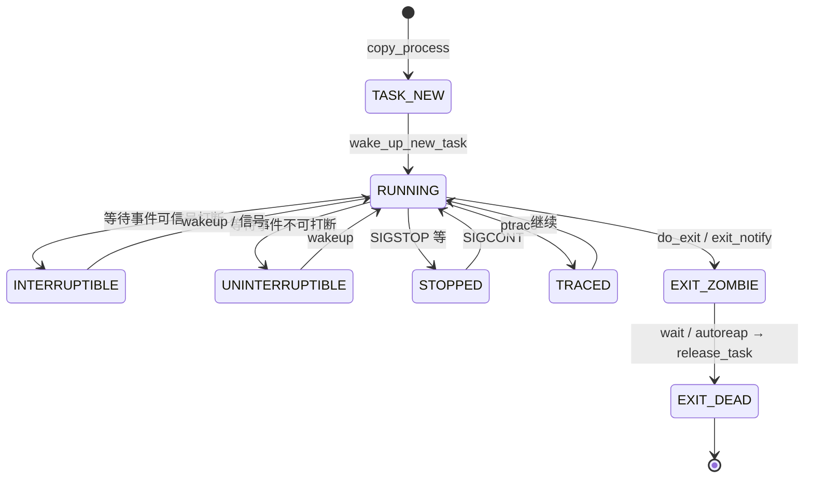

# 2. 任务抽象：`task_struct`

**结论**：`task_struct`（`include/linux/sched.h:835`）是调度、资源、身份、信号的总枢纽；开了 `CONFIG_THREAD_INFO_IN_TASK`（x86 默认）时，`thread_info` 必须是第一个字段。

## 2.1 状态机（`__state` / `exit_state`）

定义在 `include/linux/sched.h:107-141`。运行态与退出态分字段：活着的任务看 `__state`，退出路径写入 `exit_state`。

| 宏 | 值 | 用途 / ps 字母 |
|---|---|---|
| `TASK_RUNNING` | `0x0` | 可运行（未必正在 CPU 上）→ **R** |
| `TASK_INTERRUPTIBLE` | `0x1` | 可被信号打断的睡眠 → **S** |
| `TASK_UNINTERRUPTIBLE` | `0x2` | 不可打断睡眠 → **D** |
| `__TASK_STOPPED` | `0x4` | 作业控制停止（配合 `TASK_WAKEKILL`）→ **T** |
| `__TASK_TRACED` | `0x8` | 被 trace 停下 → **t** |
| `EXIT_DEAD` | `0x10` | 正在销毁 → **X**（在 `exit_state`） |
| `EXIT_ZOMBIE` | `0x20` | 僵尸，等父 wait → **Z** |
| `TASK_PARKED` | `0x40` | kthread park → **P** |
| `TASK_DEAD` | `0x80` | 调度侧确认死亡 |
| `TASK_WAKEKILL` | `0x100` | 致命信号可唤醒 |
| `TASK_WAKING` | `0x200` | 正在被唤醒 |
| `TASK_NOLOAD` | `0x400` | 不计入 loadavg |
| `TASK_NEW` | `0x800` | `copy_process` 尚未唤醒 |
| `TASK_KILLABLE` | `WAKEKILL\|UNINTERRUPTIBLE` | 可被致命信号杀的 D 睡 |
| `TASK_STOPPED` | `WAKEKILL\|__TASK_STOPPED` | |
| `TASK_IDLE` | `UNINTERRUPTIBLE\|NOLOAD` | idle/部分内核睡 → **I**，不计 load |

`/proc` 显示映射：`fs/proc/array.c:127` 的 `task_state_array[]`，索引由 `task_state_index()`（`sched.h:1731`）从 `__state`+`exit_state` 算出。`TASK_IDLE` 被特殊映射到 `TASK_REPORT_IDLE`。



## 2.2 `thread_info` 与内核栈

- x86：`CONFIG_THREAD_INFO_IN_TASK=y` 时 `thread_info` 嵌在 `task_struct` 头部（`sched.h:836-841`）。
- 内核栈：`task_struct.stack` 指向 `THREAD_SIZE` 大小的栈；用户寄存器帧在栈顶附近，用 `task_pt_regs(p)` 取。
- `usage`：`task_struct` 引用计数；`get_task_struct` / `put_task_struct`。

## 2.3 字段分组（按源码顺序，CONFIG 已标注）

下面按 `sched.h:835` 起的真实字段分组。超大结构不整段粘贴，**按组给出带注释的源码片段**；未列的多为调试/arch 边角，需要时对照 elixir。

### A. 状态 / 栈 / 标志

```c
/* --- A. 状态 / 栈 / 标志 --- */
#ifdef CONFIG_THREAD_INFO_IN_TASK
	struct thread_info		thread_info;	/* 底层 flags；必须是第一个字段 */
#endif
	unsigned int			__state;	/* 任务状态，用 READ_ONCE/WRITE_ONCE */
	unsigned int			saved_state;	/* spinlock sleeper 保存的状态 */
	void				*stack;		/* 内核栈基 */
	refcount_t			usage;		/* task_struct 引用计数 */
	unsigned int			flags;		/* PF_* 每任务标志 */
	unsigned int			ptrace;		/* ptrace 标志位 */
#ifdef CONFIG_MEM_ALLOC_PROFILING
	struct alloc_tag		*alloc_tag;	/* 分配剖析标签 */
#endif
```

### B. 调度位置与唤醒亲和

```c
/* --- B. 调度位置与唤醒亲和 --- */
	u8				on_cpu;		/* 是否正在某 CPU 上执行 */
	u8				on_rq;		/* 是否在 runqueue 上 */
	u8				is_blocked;	/* 阻塞标记 */
	/* 此处省略本组未记录的成员 */
	struct __call_single_node	wake_entry;	/* 跨 CPU 唤醒用的 CSD 节点 */
	unsigned int			wakee_flips;	/* 唤醒目标翻转次数 */
	unsigned long			wakee_flip_decay_ts; /* 翻转衰减时间戳 */
	struct task_struct		*last_wakee;	/* 上次唤醒的任务 */
	int				recent_used_cpu; /* 最近用过的 CPU */
	int				wake_cpu;	/* 唤醒目标 CPU */
```

### C. 优先级与调度实体

```c
/* --- C. 优先级与调度实体 --- */
	int				prio;		/* 动态优先级 */
	int				static_prio;	/* 静态优先级 */
	int				normal_prio;	/* 正常优先级 */
	unsigned int			rt_priority;	/* RT 优先级 */
	struct sched_entity		se;		/* CFS/EEVDF 实体 */
	struct sched_rt_entity		rt;		/* RT 实体 */
	struct sched_dl_entity		dl;		/* Deadline 实体 */
	struct sched_dl_entity		*dl_server;	/* Deadline server */
#ifdef CONFIG_SCHED_CLASS_EXT
	struct sched_ext_entity		scx;		/* sched_ext 实体 */
#endif
	const struct sched_class	*sched_class;	/* 当前调度类指针 */
#ifdef CONFIG_SCHED_CORE
	struct rb_node			core_node;	/* 核心调度红黑树节点 */
	unsigned long			core_cookie;	/* 核心调度 cookie */
	unsigned int			core_occupation; /* 核心调度占用 */
#endif
#ifdef CONFIG_CGROUP_SCHED
	struct task_group		*sched_task_group; /* cgroup 调度组 */
	/* 此处省略本组未记录的成员 */
#endif
#ifdef CONFIG_UCLAMP_TASK
	struct uclamp_se		uclamp_req[UCLAMP_CNT]; /* 请求的 util clamp */
	struct uclamp_se		uclamp[UCLAMP_CNT]; /* 生效的 util clamp */
#endif
	struct sched_statistics		stats;		/* sched_statistics */
	/* 此处省略本组未记录的成员 */
	unsigned int			policy;		/* SCHED_* 策略 */
	unsigned long			max_allowed_capacity; /* 亲和范围内的最大 CPU 容量 */
	int				nr_cpus_allowed; /* 允许的 CPU 个数 */
	const cpumask_t			*cpus_ptr;	/* 当前亲和掩码 */
	cpumask_t			*user_cpus_ptr;	/* 用户设置的亲和 */
	cpumask_t			cpus_mask;	/* 亲和掩码存储 */
	void				*migration_pending; /* 正在等待的迁移 */
	unsigned short			migration_disabled; /* 迁移禁用计数 */
	unsigned short			migration_flags; /* 迁移标志 */
	/* 此处省略本组未记录的成员 */
	struct sched_info		sched_info;	/* 调度延迟统计 */
	struct list_head		tasks;		/* 全局进程链表节点 */
	struct plist_node		pushable_tasks;	/* 可推送的 RT 任务 */
	struct rb_node			pushable_dl_tasks; /* 可推送的 DL 任务 */
```

### D. 地址空间

```c
/* --- D. 地址空间 --- */
	struct mm_struct		*mm;		/* 用户地址空间；内核线程为 NULL */
	struct mm_struct		*active_mm;	/* 当前借用的 mm（lazy TLB：kthread 借上一个用户 mm） */
	struct task_exec_state __rcu	*exec_state;	/* exec 相关状态（RCU） */
```

### E. 退出 / 作业控制 / personality

```c
/* --- E. 退出 / 作业控制 / personality --- */
	int				exit_state;	/* EXIT_ZOMBIE / EXIT_DEAD */
	int				exit_code;	/* 退出码 */
	int				exit_signal;	/* 通知父进程用的信号（通常 SIGCHLD） */
	int				pdeath_signal;	/* 父死时发给自己的信号 */
	unsigned long			jobctl;		/* JOBCTL_*（stop/trace） */
	unsigned int			personality;	/* 人格/ABI 模拟 */
```

### F. 调度相关 bitfield（节选）

```c
/* --- F. 调度相关 bitfield（节选） --- */
	unsigned			sched_reset_on_fork:1; /* fork 后重置调度属性 */
	unsigned			sched_contributes_to_load:1; /* 是否计入 load */
	unsigned			sched_migrated:1; /* 迁移标记 */
	unsigned			sched_task_hot:1; /* 热度标记 */
	/* 此处省略本组未记录的成员 */
	unsigned			sched_remote_wakeup:1; /* 远程唤醒路径标记 */
	/* 此处省略本组未记录的成员 */
	unsigned			in_execve:1;	/* 正在 exec */
	unsigned			in_iowait:1;	/* 在 iowait */
	/* 此处省略本组未记录的成员 */
#ifdef CONFIG_CGROUPS
	/* 此处省略本组未记录的成员 */
	unsigned			frozen:1;	/* cgroup freezer */
#endif
	/* 此处省略本组未记录的成员 */
#ifdef CONFIG_PSI
	unsigned			in_memstall:1;	/* PSI 内存停滞 */
#endif
	/* 此处省略本组未记录的成员 */
	unsigned long			atomic_flags;	/* 需原子访问的标志 */
	struct restart_block		restart_block;	/* 重启系统调用块 */
```

### G. 身份与亲缘

```c
/* --- G. 身份与亲缘 --- */
	pid_t				pid;		/* 线程 ID（内核） */
	pid_t				tgid;		/* 线程组 ID，用户态进程 PID */
#ifdef CONFIG_STACKPROTECTOR
	unsigned long			stack_canary;	/* 栈金丝雀 */
#endif
	struct task_struct __rcu	*real_parent;	/* 亲生父任务 */
	/* 当前接收 SIGCHLD/wait 的父（被 trace 时是 tracer） */
	struct task_struct __rcu	*parent;
	struct list_head		children;	/* 子链表 */
	struct list_head		sibling;	/* 挂在父 children 上的节点 */
	struct task_struct		*group_leader;	/* 线程组组长 */
	struct list_head		ptraced;	/* 本任务正在 ptrace 的对象 */
	struct list_head		ptrace_entry;	/* 挂在 tracer 的 ptraced 上 */
	struct pid			*thread_pid;	/* 指向本线程的 struct pid */
	struct hlist_node		pid_links[PIDTYPE_MAX]; /* 挂到各类 pid hash */
	struct list_head		thread_node;	/* 挂在 signal->thread_head */
	struct completion		*vfork_done;	/* vfork completion */
	int __user			*set_child_tid;	/* CLONE_CHILD_SETTID 用户地址 */
	int __user			*clear_child_tid; /* CLONE_CHILD_CLEARTID 用户地址 */
	void				*worker_private; /* kthread / IO worker 私有数据 */
```

### H. 时间与统计

```c
/* --- H. 时间与统计 --- */
	u64				utime;		/* 用户态 CPU 时间 */
	u64				stime;		/* 内核态 CPU 时间 */
	/* 此处省略本组未记录的成员 */
	u64				gtime;		/* guest 时间 */
	struct prev_cputime		prev_cputime;	/* 前回 CPU 时间 */
#ifdef CONFIG_VIRT_CPU_ACCOUNTING_GEN
	struct vtime			vtime;		/* 虚拟时间记账 */
#endif
	/* 此处省略本组未记录的成员 */
	unsigned long			nvcsw;		/* 自愿上下文切换次数 */
	unsigned long			nivcsw;		/* 非自愿上下文切换次数 */
	u64				start_time;	/* 单调时钟开始时间 */
	u64				start_boottime;	/* 启动基准开始时间 */
	unsigned long			min_flt;	/* 小缺页 */
	unsigned long			maj_flt;	/* 大缺页 */
	struct posix_cputimers		posix_cputimers; /* POSIX CPU 定时器 */
```

### I. 凭证与名字

```c
/* --- I. 凭证与名字 --- */
	/* 此处省略本组未记录的成员 */
	const struct cred __rcu		*ptracer_cred; /* tracer 附着时的凭证 */
	const struct cred __rcu		*real_cred;	/* 客观/真实主观凭证（COW） */
	const struct cred __rcu		*cred;		/* 有效主观凭证（COW，RCU） */
#ifdef CONFIG_KEYS
	struct key			*cached_requested_key; /* 密钥缓存 */
#endif
	char				comm[TASK_COMM_LEN]; /* 短名（set_task_comm / begin_new_exec） */
```

### J. 文件 / 命名空间 / 信号（进程管理核心资源）

```c
/* --- J. 文件 / 命名空间 / 信号（进程管理核心资源） --- */
	/* 此处省略本组未记录的成员 */
	struct fs_struct		*real_fs;	/* 真实的根/cwd */
	struct fs_struct		*fs;		/* 当前根/cwd，多数时候与 real_fs 相同 */
	struct files_struct		*files;		/* 打开文件表 */
#ifdef CONFIG_IO_URING
	struct io_uring_task		*io_uring;	/* 本任务的 io_uring 状态 */
	struct io_restriction		*io_uring_restrict; /* 本任务的 io_uring 限制 */
#endif
	struct nsproxy			*nsproxy;	/* 各命名空间集合 */
	struct signal_struct		*signal;	/* 线程组共享的 signal_struct */
	struct sighand_struct __rcu	*sighand;	/* 信号处理函数表（可共享） */
	sigset_t			blocked;	/* 当前信号屏蔽 */
	sigset_t			real_blocked;	/* 临时改 blocked 时留下的原屏蔽 */
	sigset_t			saved_sigmask;	/* set_restore_sigmask() 之后恢复 */
	struct sigpending		pending;	/* 本线程私有挂起信号 */
	unsigned long			sas_ss_sp;	/* 信号交替栈指针 */
	size_t				sas_ss_size;	/* 交替栈长度 */
	unsigned int			sas_ss_flags;	/* 交替栈标志 */
```

### K. cgroup / 安全 / 杂项（重要组）

```c
/* --- K. cgroup / 安全 / 杂项（重要组） --- */
	/* 此处省略本组未记录的成员 */
	struct seccomp			seccomp;	/* seccomp */
	struct syscall_user_dispatch	syscall_dispatch; /* 系统调用用户分发 */
	u64				parent_exec_id;	/* 父的 exec 世代 */
	u64				self_exec_id;	/* 自己的 exec 世代，用于信号安全域 */
	spinlock_t			alloc_lock;	/* 资源分配锁 */
	raw_spinlock_t			pi_lock;	/* PI 锁 */
	/* 此处省略本组未记录的成员 */
#ifdef CONFIG_RT_MUTEXES
	struct rb_root_cached		pi_waiters;	/* 持有的 rt_mutex 上的 PI 等待者 */
	struct task_struct		*pi_top_task;	/* PI 链顶端任务 */
	struct rt_mutex_waiter		*pi_blocked_on;	/* 本任务正堵着的 rt_mutex waiter */
#endif
	struct mutex			*blocked_on;	/* 正堵着的普通锁 */
	raw_spinlock_t			blocked_lock;	/* 保护阻塞追踪 */
	struct task_struct		*blocked_donor;	/* 正在 boosting 本任务的 donor */
	/* 此处省略本组未记录的成员 */
	unsigned long			ptrace_message;	/* ptrace 消息 */
	kernel_siginfo_t		*last_siginfo;	/* 最近信号信息 */
	struct task_io_accounting	ioac;		/* IO 记账 */
	/* 此处省略本组未记录的成员 */
#ifdef CONFIG_CPUSETS
	nodemask_t			mems_allowed;	/* cpuset 允许的内存节点 */
	/* 此处省略本组未记录的成员 */
#endif
#ifdef CONFIG_CGROUPS
	struct css_set __rcu		*cgroups;	/* css_set */
	struct list_head		cg_list;	/* 挂在 css_set 上的节点 */
#endif
	/* 此处省略本组未记录的成员 */
#ifdef CONFIG_NUMA
	struct mempolicy		*mempolicy;	/* NUMA 策略 */
	/* 此处省略本组未记录的成员 */
#endif
#ifdef CONFIG_NUMA_BALANCING
	int				numa_scan_seq;	/* 已跟上的 mm 扫描序号 */
	unsigned int			numa_scan_period; /* 扫描周期，本地访问多就拉长 */
	unsigned int			numa_scan_period_max; /* 扫描周期上限 */
	int				numa_preferred_nid; /* 首选 NUMA 节点 */
	unsigned long			numa_migrate_retry; /* 下次允许迁移的 jiffies */
	/* 上次扫描对应的 sum_exec_runtime，用来限频 */
	u64				node_stamp;
	u64				last_task_numa_placement; /* 上次放置周期的 exec_start */
	u64				last_sum_exec_runtime; /* 上次放置时的 sum_exec_runtime */
	struct callback_head		numa_work;	/* NUMA 扫描的 task_work */
	/*
	 * 只在 current 的 syscall/缺页，以及任务销毁时修改。
	 * RCU 读侧、current，或任务不在跑且 rq 锁住时可读。
	 */
	struct numa_group __rcu		*numa_group;
	/*
	 * 四段：faults_memory、faults_cpu，以及二者的当前扫描 buffer。
	 * 放置看 memory 的衰减均值；buffer 在扫描结束时并入。
	 */
	unsigned long			*numa_faults;
	unsigned long			total_numa_faults; /* 上述 fault 的合计 */
	/* 上次窗口：[0] 远程 [1] 本地 [2] 迁移失败 */
	unsigned long			numa_faults_locality[3];
	unsigned long			numa_pages_migrated; /* 已经迁走的页数 */
#endif
	/* 此处省略本组未记录的成员 */
	u64				timer_slack_ns;	/* poll/select 超时松弛 */
	/* 此处省略本组未记录的成员 */
	struct thread_struct		thread;		/* 架构线程状态 */
```

`thread` 在随机化区内，`randomized_struct_fields_end`（约 `:1690`）紧跟其后。完整字段以源码为准。


## 2.4 常用 `PF_*`（`sched.h:1796` 起）

| 标志 | 含义 |
|---|---|
| `PF_IDLE` | idle 线程 |
| `PF_EXITING` | 正在退出（`exit_signals` 设置） |
| `PF_IO_WORKER` | IO worker |
| `PF_WQ_WORKER` | workqueue worker |
| `PF_FORKNOEXEC` | fork 后尚未 exec |
| `PF_SIGNALED` | 被信号杀死 |
| `PF_USER_WORKER` | 从用户线程 clone 出的内核侧 worker（io_uring） |
| `PF_KTHREAD` | 内核线程 |
| `PF_NOFREEZE` | 不被 freeze |
| `PF_KSWAPD` / `PF_KCOMPACTD` | 特定内核守护 |

## 2.5 关联对象一览

| 对象 | 头文件 | 与 task 关系 |
|---|---|---|
| `mm_struct` | `mm_types.h` | 地址空间；线程共享 |
| `fs_struct` | `fs_struct.h` | cwd/root/umask |
| `files_struct` | `fdtable.h` | fd 表 |
| `nsproxy` | `nsproxy.h` | uts/ipc/mnt/pid_for_children/net/time/cgroup |
| `signal_struct` | `sched/signal.h` | 线程组级信号/统计/rlimit |
| `sighand_struct` | 同上 | `action[_NSIG]` |
| `cred` | `cred.h` | uid/cap |
| `pid` | `pid.h` | 命名空间感知的 ID |
| `css_set` | cgroup | 控制组 |

`nsproxy` 关键成员（`include/linux/nsproxy.h:32`）：

```c
struct nsproxy {
	refcount_t count;			/* 持有引用的任务数 */
	struct uts_namespace *uts_ns;		/* UTS 命名空间 */
	struct ipc_namespace *ipc_ns;		/* SysV IPC 命名空间 */
	struct mnt_namespace *mnt_ns;		/* 挂载命名空间 */
	struct pid_namespace *pid_ns_for_children; /* 子进程用的 pidns，不是自己的 */
	struct net *net_ns;			/* 网络命名空间 */
	struct time_namespace *time_ns;		/* 本任务的 time 命名空间 */
	struct time_namespace *time_ns_for_children; /* 子进程将用的 time ns */
	struct cgroup_namespace *cgroup_ns;	/* cgroup 命名空间 */
};
```

注意：任务**自己**所在的 pid ns 来自 `task_active_pid_ns()`（看 `thread_pid`），`nsproxy->pid_ns_for_children` 只影响**新创建**的子进程。

### `fs_struct`（`include/linux/fs_struct.h:11`）

```c
struct fs_struct {
	int users;		/* 共享此 fs 的任务数（CLONE_FS） */
	seqlock_t seq;		/* 保护 root 与 pwd */
	int umask;		/* 新建文件的权限掩码 */
	int in_exec;		/* exec 进行中；copy_fs 见此会 -EAGAIN */
	struct path root, pwd;	/* 根目录与当前工作目录 */
} __randomize_layout;
```

### `files_struct`（`include/linux/fdtable.h:38`）

```c
struct files_struct {
	atomic_t count;		/* CLONE_FILES 时 ++ */
	bool resize_in_progress;	/* fd 表正在扩展 */
	wait_queue_head_t resize_wait;	/* 等扩展结束 */
	struct fdtable __rcu *fdt;	/* 可扩展 fd 表 */
	struct fdtable fdtab;		/* 内嵌初始表 */
	spinlock_t file_lock ____cacheline_aligned_in_smp; /* 保护 fd 表 */
	unsigned int next_fd;		/* 下一个可分配的 fd */
	unsigned long close_on_exec_init[1]; /* 初始 close-on-exec 位图 */
	unsigned long open_fds_init[1];	/* 初始已打开 fd 位图 */
	unsigned long full_fds_bits_init[1]; /* 已无空闲 fd 的字，用来加速查找 */
	struct file __rcu *fd_array[NR_OPEN_DEFAULT]; /* 内嵌的初始 file 指针 */
};
```

`copy_files`（`fork.c:1669`）：`CLONE_FILES` 则 `atomic_inc(&oldf->count)`；否则 `dup_fd`。`args->no_files` 时可让子任务 `files=NULL`。


## 2.6 关键函数表

| 文件 | 函数 | 作用 |
|---|---|---|
| `include/linux/sched.h` | `task_is_running` / `task_state_index` / `task_state_to_char` | 状态查询 |
| `fs/proc/array.c` | `get_task_state` | `/proc/pid/status` 状态字符串 |
| `kernel/fork.c` | `dup_task_struct` | 分配并复制 `task_struct`+栈 |
| `include/linux/sched/task.h` | `get_task_struct` / `put_task_struct` | 引用计数 |

---

---

**导航**：[章节目录](./README.md) · [← 总览与边界](./01-overview.md) · [PID 与命名空间 →](./03-pid-namespaces.md)
