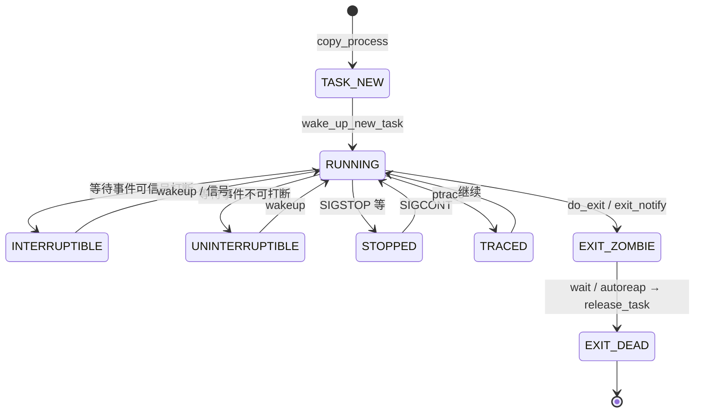

# 2. 任务抽象：`task_struct`

**结论**：`task_struct`（`include/linux/sched.h:835`）是调度、资源、身份、信号的总枢纽；开了 `CONFIG_THREAD_INFO_IN_TASK`（x86 默认）时，`thread_info` 必须是第一个字段。

## 2.1 状态机（`__state` / `exit_state`）

定义在 `include/linux/sched.h:107-141`。运行态与退出态分字段：活着的任务看 `__state`，退出路径写入 `exit_state`。

| 宏 | 值 | 用途 / ps 字母 |
|---|---|---|
| `TASK_RUNNING` | `0x0` | 可运行（未必正在 CPU 上）→ **R** |
| `TASK_INTERRUPTIBLE` | `0x1` | 可被信号打断的睡眠 → **S** |
| `TASK_UNINTERRUPTIBLE` | `0x2` | 不可打断睡眠 → **D** |
| `__TASK_STOPPED` | `0x4` | 作业控制停止（配合 `TASK_WAKEKILL`）→ **T** |
| `__TASK_TRACED` | `0x8` | 被 trace 停下 → **t** |
| `EXIT_DEAD` | `0x10` | 正在销毁 → **X**（在 `exit_state`） |
| `EXIT_ZOMBIE` | `0x20` | 僵尸，等父 wait → **Z** |
| `TASK_PARKED` | `0x40` | kthread park → **P** |
| `TASK_DEAD` | `0x80` | 调度侧确认死亡 |
| `TASK_WAKEKILL` | `0x100` | 致命信号可唤醒 |
| `TASK_WAKING` | `0x200` | 正在被唤醒 |
| `TASK_NOLOAD` | `0x400` | 不计入 loadavg |
| `TASK_NEW` | `0x800` | `copy_process` 尚未唤醒 |
| `TASK_KILLABLE` | `WAKEKILL\|UNINTERRUPTIBLE` | 可被致命信号杀的 D 睡 |
| `TASK_STOPPED` | `WAKEKILL\|__TASK_STOPPED` | |
| `TASK_IDLE` | `UNINTERRUPTIBLE\|NOLOAD` | idle/部分内核睡 → **I**，不计 load |

`/proc` 显示映射：`fs/proc/array.c:127` 的 `task_state_array[]`，索引由 `task_state_index()`（`sched.h:1731`）从 `__state`+`exit_state` 算出。`TASK_IDLE` 被特殊映射到 `TASK_REPORT_IDLE`。



## 2.2 `thread_info` 与内核栈

- x86：`CONFIG_THREAD_INFO_IN_TASK=y` 时 `thread_info` 嵌在 `task_struct` 头部（`sched.h:836-841`）。
- 内核栈：`task_struct.stack` 指向 `THREAD_SIZE` 大小的栈；用户寄存器帧在栈顶附近，用 `task_pt_regs(p)` 取。
- `usage`：`task_struct` 引用计数；`get_task_struct` / `put_task_struct`。

## 2.3 字段分组（按源码顺序，CONFIG 已标注）

下面按 `sched.h:835` 起的真实字段分组。超大结构不整段粘贴，**按组列表 + 中文含义**；未列的多为调试/arch 边角，需要时对照 elixir。

### A. 状态 / 栈 / 标志

| 成员 | 含义 |
|---|---|
| `thread_info` | 底层 flags（`CONFIG_THREAD_INFO_IN_TASK`） |
| `__state` | 任务状态，用 `READ_ONCE`/`WRITE_ONCE` |
| `saved_state` | spinlock sleeper 保存的状态 |
| `stack` | 内核栈基 |
| `usage` | `task_struct` 引用计数 |
| `flags` | `PF_*` 每任务标志 |
| `ptrace` | ptrace 标志位 |
| `alloc_tag` | 分配剖析标签（`CONFIG_MEM_ALLOC_PROFILING`） |

### B. 调度位置与唤醒亲和

| 成员 | 含义 |
|---|---|
| `on_cpu` | 是否正在某 CPU 上执行 |
| `on_rq` | 是否在 runqueue 上 |
| `is_blocked` | 阻塞标记 |
| `wake_entry` | 跨 CPU 唤醒用的 CSD 节点 |
| `wakee_flips` / `wakee_flip_decay_ts` / `last_wakee` | 唤醒亲和统计 |
| `recent_used_cpu` / `wake_cpu` | 最近/目标 CPU |

### C. 优先级与调度实体

| 成员 | 含义 |
|---|---|
| `prio` / `static_prio` / `normal_prio` | 动态/静态/正常优先级 |
| `rt_priority` | RT 优先级 |
| `se` | CFS/EEVDF 实体 `sched_entity` |
| `rt` | RT 实体 `sched_rt_entity` |
| `dl` / `dl_server` | Deadline 实体 |
| `scx` | sched_ext 实体（`CONFIG_SCHED_CLASS_EXT`） |
| `sched_class` | 当前调度类指针 |
| `core_node` / `core_cookie` / `core_occupation` | 核心调度（`CONFIG_SCHED_CORE`） |
| `sched_task_group` | cgroup 调度组（`CONFIG_CGROUP_SCHED`） |
| `uclamp_req` / `uclamp` | util clamp（`CONFIG_UCLAMP_TASK`） |
| `stats` | `sched_statistics` |
| `policy` | `SCHED_*` 策略 |
| `max_allowed_capacity` | 容量限制相关 |
| `nr_cpus_allowed` / `cpus_ptr` / `user_cpus_ptr` / `cpus_mask` | CPU 亲和 |
| `migration_pending` / `migration_disabled` / `migration_flags` | 迁移控制 |
| `sched_info` | 调度延迟统计 |
| `tasks` | 全局进程链表节点 |
| `pushable_tasks` / `pushable_dl_tasks` | 可推送任务 |

### D. 地址空间

| 成员 | 含义 |
|---|---|
| `mm` | 用户地址空间；内核线程为 `NULL` |
| `active_mm` | 当前借用的 mm（lazy TLB：kthread 借上一个用户 mm） |
| `exec_state` | exec 相关状态（RCU） |

### E. 退出 / 作业控制 / personality

| 成员 | 含义 |
|---|---|
| `exit_state` | `EXIT_ZOMBIE` / `EXIT_DEAD` |
| `exit_code` | 退出码 |
| `exit_signal` | 通知父进程用的信号（通常 `SIGCHLD`） |
| `pdeath_signal` | 父死时发给自己的信号 |
| `jobctl` | `JOBCTL_*`（stop/trace） |
| `personality` | 人格/ABI 模拟 |

### F. 调度相关 bitfield（节选）

| 成员 | 含义 |
|---|---|
| `sched_reset_on_fork` | fork 后重置调度属性 |
| `sched_contributes_to_load` | 是否计入 load |
| `sched_migrated` / `sched_task_hot` | 迁移/热度 |
| `sched_remote_wakeup` | 远程唤醒路径标记 |
| `in_execve` / `in_iowait` | 正在 exec / 在 iowait |
| `frozen` | cgroup freezer（`CONFIG_CGROUPS`） |
| `in_memstall` | PSI 内存停滞（`CONFIG_PSI`） |
| `atomic_flags` | 需原子访问的标志 |
| `restart_block` | 重启系统调用块 |

### G. 身份与亲缘

| 成员 | 含义 |
|---|---|
| `pid` | 线程 ID（内核） |
| `tgid` | 线程组 ID = 用户态「进程 PID」 |
| `stack_canary` | 栈金丝雀（`CONFIG_STACKPROTECTOR`） |
| `real_parent` | 亲生父任务 |
| `parent` | 当前接收 `SIGCHLD`/wait 的父（被 trace 时是 tracer） |
| `children` / `sibling` | 子链表 / 挂在父 `children` 上的节点 |
| `group_leader` | 线程组组长 |
| `ptraced` / `ptrace_entry` | ptrace 关系 |
| `thread_pid` | 指向本线程的 `struct pid` |
| `pid_links[PIDTYPE_MAX]` | 挂到各类 pid hash |
| `thread_node` | 挂在 `signal->thread_head` |
| `vfork_done` | vfork completion |
| `set_child_tid` / `clear_child_tid` | CLONE_*SETTID/CLEARTID 用户地址 |
| `worker_private` | kthread / IO worker 私有数据 |

### H. 时间与统计

| 成员 | 含义 |
|---|---|
| `utime` / `stime` / `gtime` | 用户/系统/guest 时间 |
| `prev_cputime` / `vtime` | 前回值 / 虚拟时间记账 |
| `nvcsw` / `nivcsw` | 自愿/非自愿上下文切换次数 |
| `start_time` / `start_boottime` | 单调/启动基准开始时间 |
| `min_flt` / `maj_flt` | 小/大缺页 |
| `posix_cputimers` | POSIX CPU 定时器 |

### I. 凭证与名字

| 成员 | 含义 |
|---|---|
| `ptracer_cred` | tracer 附着时的凭证 |
| `real_cred` | 客观/真实主观凭证（COW） |
| `cred` | 有效主观凭证（COW，RCU） |
| `cached_requested_key` | 密钥缓存（`CONFIG_KEYS`） |
| `comm[TASK_COMM_LEN]` | 短名（`set_task_comm` / `begin_new_exec`） |

### J. 文件 / 命名空间 / 信号（进程管理核心资源）

| 成员 | 含义 |
|---|---|
| `real_fs` / `fs` | 文件系统根/cwd；多数时候二者相同 |
| `files` | 打开文件表 |
| `io_uring` / `io_uring_restrict` | io_uring（`CONFIG_IO_URING`） |
| `nsproxy` | 各命名空间集合 |
| `signal` | 线程组共享的 `signal_struct` |
| `sighand` | 信号处理函数表（可共享） |
| `blocked` / `real_blocked` / `saved_sigmask` | 信号屏蔽 |
| `pending` | 本线程私有挂起信号 |
| `sas_ss_sp` / `sas_ss_size` / `sas_ss_flags` | 信号交替栈 |

### K. cgroup / 安全 / 杂项（重要组）

| 成员 | 含义 |
|---|---|
| `seccomp` / `syscall_dispatch` | seccomp / 系统调用用户分发 |
| `parent_exec_id` / `self_exec_id` | exec 世代，用于信号安全域判断 |
| `alloc_lock` / `pi_lock` | 资源分配锁 / PI 锁 |
| `pi_waiters` / `pi_top_task` / `pi_blocked_on` | RT mutex PI（`CONFIG_RT_MUTEXES`） |
| `blocked_on` / `blocked_lock` / `blocked_donor` | 普通阻塞追踪 |
| `last_siginfo` / `ptrace_message` | 最近信号信息 / ptrace 消息 |
| `ioac` | IO 记账 |
| `cgroups` / `cg_list` | css_set（`CONFIG_CGROUPS`） |
| `mems_allowed` | cpuset 内存节点（`CONFIG_CPUSETS`） |
| `mempolicy` | NUMA 策略（`CONFIG_NUMA`） |
| `numa_*` | NUMA balancing 一整组（`CONFIG_NUMA_BALANCING`） |
| `timer_slack_ns` | poll/select 超时松弛 |
| `thread` | 架构线程状态（x86 在 `sched.h` 末尾 `thread_struct`） |

`task_struct` 在 `randomized_struct_fields_end`（约 `:1690`）结束随机化区；其后还有 `thread_struct thread` 等。完整字段以源码为准。

## 2.4 常用 `PF_*`（`sched.h:1796` 起）

| 标志 | 含义 |
|---|---|
| `PF_IDLE` | idle 线程 |
| `PF_EXITING` | 正在退出（`exit_signals` 设置） |
| `PF_IO_WORKER` | IO worker |
| `PF_WQ_WORKER` | workqueue worker |
| `PF_FORKNOEXEC` | fork 后尚未 exec |
| `PF_SIGNALED` | 被信号杀死 |
| `PF_USER_WORKER` | 从用户线程 clone 出的内核侧 worker（io_uring） |
| `PF_KTHREAD` | 内核线程 |
| `PF_NOFREEZE` | 不被 freeze |
| `PF_KSWAPD` / `PF_KCOMPACTD` | 特定内核守护 |

## 2.5 关联对象一览

| 对象 | 头文件 | 与 task 关系 |
|---|---|---|
| `mm_struct` | `mm_types.h` | 地址空间；线程共享 |
| `fs_struct` | `fs_struct.h` | cwd/root/umask |
| `files_struct` | `fdtable.h` | fd 表 |
| `nsproxy` | `nsproxy.h` | uts/ipc/mnt/pid_for_children/net/time/cgroup |
| `signal_struct` | `sched/signal.h` | 线程组级信号/统计/rlimit |
| `sighand_struct` | 同上 | `action[_NSIG]` |
| `cred` | `cred.h` | uid/cap |
| `pid` | `pid.h` | 命名空间感知的 ID |
| `css_set` | cgroup | 控制组 |

`nsproxy` 关键成员（`include/linux/nsproxy.h:32`）：

```c
struct nsproxy {
	refcount_t count;
	struct uts_namespace *uts_ns;
	struct ipc_namespace *ipc_ns;
	struct mnt_namespace *mnt_ns;
	struct pid_namespace *pid_ns_for_children; /* 子进程用的 pidns，不是自己的 */
	struct net *net_ns;
	struct time_namespace *time_ns;
	struct time_namespace *time_ns_for_children;
	struct cgroup_namespace *cgroup_ns;
};
```

注意：任务**自己**所在的 pid ns 来自 `task_active_pid_ns()`（看 `thread_pid`），`nsproxy->pid_ns_for_children` 只影响**新创建**的子进程。

### `fs_struct`（`include/linux/fs_struct.h:11`）

```c
struct fs_struct {
	int users;           /* 中文：共享此 fs 的任务数（CLONE_FS） */
	seqlock_t seq;
	int umask;
	int in_exec;         /* 中文：exec 进行中；copy_fs 见此会 -EAGAIN */
	struct path root, pwd;
};
```

### `files_struct`（`include/linux/fdtable.h:38`）

```c
struct files_struct {
	atomic_t count;                /* 中文：CLONE_FILES 时 ++ */
	bool resize_in_progress;
	wait_queue_head_t resize_wait;
	struct fdtable __rcu *fdt;     /* 中文：可扩展 fd 表 */
	struct fdtable fdtab;          /* 中文：内嵌初始表 */
	spinlock_t file_lock;
	unsigned int next_fd;
	unsigned long close_on_exec_init[1];
	unsigned long open_fds_init[1];
	unsigned long full_fds_bits_init[1];
	struct file __rcu *fd_array[NR_OPEN_DEFAULT];
};
```

`copy_files`（`fork.c:1669`）：`CLONE_FILES` 则 `atomic_inc(&oldf->count)`；否则 `dup_fd`。`args->no_files` 时可让子任务 `files=NULL`。


## 2.6 关键函数表

| 文件 | 函数 | 作用 |
|---|---|---|
| `include/linux/sched.h` | `task_is_running` / `task_state_index` / `task_state_to_char` | 状态查询 |
| `fs/proc/array.c` | `get_task_state` | `/proc/pid/status` 状态字符串 |
| `kernel/fork.c` | `dup_task_struct` | 分配并复制 `task_struct`+栈 |
| `include/linux/sched/task.h` | `get_task_struct` / `put_task_struct` | 引用计数 |

---

---

**导航**：[章节目录](./README.md) · [← 总览与边界](./01-overview.md) · [PID 与命名空间 →](./03-pid-namespaces.md)
