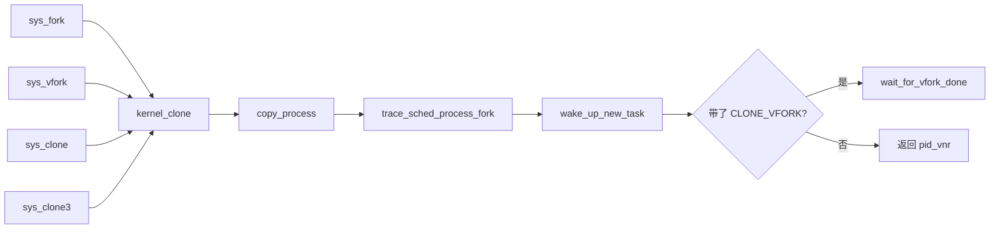

# 4. 创建路径：fork / clone / clone3 / vfork

**结论**：`fork`、`vfork`、`clone`、`clone3` 都进 `kernel_clone`，再进 `copy_process`，最后 `wake_up_new_task`。`CLONE_*` 在每个 `copy_*` 里决定是「引用加一」还是「做一份新的」。

## 4.1 调用链



`kernel_clone`（`kernel/fork.c:2878`）做这几件事：

1. `CLONE_PIDFD` 和 `CLONE_PARENT_SETTID` 如果指向同一块用户内存，返回 `-EINVAL`（`:2896`）。
2. 没带 `CLONE_UNTRACED` 时，按 vfork / clone / fork 挑一个 ptrace 事件；当前进程没打开对应事件就把 trace 清成 0（`:2907`）。
3. `p = copy_process(NULL, trace, NUMA_NO_NODE, args)`（`:2919`）。
4. `trace_sched_process_fork(current, p)`（`:2929`）。这个 tracepoint 的字段是 `parent_comm`、`parent_pid`、`child_comm`、`child_pid`（`include/trace/events/sched.h:372`）。
5. `get_task_pid` + `pid_vnr` 得到当前 ns 里的子进程号（`:2931`）。
6. 带了 `CLONE_PARENT_SETTID` 就把这个号写回父进程给的地址（`:2934`）。
7. 带了 `CLONE_VFORK` 就让子任务的 `vfork_done` 指着栈上的 completion（`:2937`）。
8. `wake_up_new_task(p)`（`:2950`）。
9. 若是 vfork，父进程在 `wait_for_vfork_done` 里堵到子进程 exec 或 exit（`:2956`）。

`clone3` 先把用户态的 `struct clone_args` 抄进来（`copy_clone_args_from_user`，`:3068`）。这个结构和版本长度在 `include/uapi/linux/sched.h:92`：

```c
struct clone_args {
	__aligned_u64 flags;		/* CLONE_*。CSIGNAL 和 CLONE_DETACHED 不算合法 */
	__aligned_u64 pidfd;		/* CLONE_PIDFD 时，内核把 fd 写到这个用户地址 */
	__aligned_u64 child_tid;	/* CLONE_CHILD_SETTID / CLONE_CHILD_CLEARTID 用的地址 */
	__aligned_u64 parent_tid;	/* CLONE_PARENT_SETTID 用的地址 */
	__aligned_u64 exit_signal;	/* 子进程退出时发给父进程的信号，不再塞在 flags 低 8 位 */
	__aligned_u64 stack;		/* 子栈最低地址。内核自己按 stack_size 决定生长方向 */
	__aligned_u64 stack_size;
	__aligned_u64 tls;		/* CLONE_SETTLS 时的 TLS */
	__aligned_u64 set_tid;		/* pid_t 数组。第 0 个是最内层 pid ns 的号 */
	__aligned_u64 set_tid_size;	/* 数组长度，不能超过嵌套层数 */
	__aligned_u64 cgroup;		/* CLONE_INTO_CGROUP 时，目标 cgroup 的 fd */
};
```

`CLONE_ARGS_SIZE_VER0` 是 64，`VER1` 是 80，`VER2` 是 88（`:107`）。用户可以传更短的旧结构，多出来的字段当 0。

## 4.2 `copy_process` 主序（`kernel/fork.c:2252`）

签名是 `copy_process(struct pid *pid, int trace, int node, struct kernel_clone_args *args)`。普通创建传入的 `pid` 是 `NULL`；`fork_idle` 传入 `init_struct_pid`，表示不要再分配新号。

标志检查见 [§1.4](./01-overview.md#clone-flags)，代码从 `:2269` 到 `:2318`。

| 顺序 | 调用 | 行号 | 说明 |
|---|---|---|---|
| 1 | `dup_task_struct` | 2339 | 新 `task_struct` 加内核栈。此时还没改成 `TASK_NEW` |
| 2 | 按 `args` 打标志 | 2342 | `kthread` → `PF_KTHREAD`；`user_worker` → `PF_USER_WORKER`，并只留 `SIGKILL`/`SIGSTOP`；`io_thread` → `PF_IO_WORKER` |
| 3 | `copy_creds` | 2373 | 凭证 |
| 4 | `sched_fork` | 2480 | 调度实体初始化，**把 `__state` 写成 `TASK_NEW`**，不入队 |
| 5 | `perf_event_init_task` | 2484 | perf |
| 6 | `audit_alloc` | 2487 | 审计 |
| 7 | `security_task_alloc` | 2492 | LSM |
| 8 | `copy_semundo` | 2495 | System V 信号量 |
| 9 | `copy_files` | 2498 | fd 表 |
| 10 | `copy_fs` | 2501 | cwd / root |
| 11 | `copy_sighand` | 2504 | 信号处理表 |
| 12 | `copy_signal` | 2507 | 线程组的 `signal_struct`。`CLONE_THREAD` 则直接共享 |
| 13 | `copy_mm` | 2510 | 地址空间 |
| 14 | `copy_namespaces` | 2513 | `nsproxy`。实现在 `kernel/nsproxy.c:151` |
| 15 | `copy_io` | 2516 | 块层 `io_context`。内联函数在 `include/linux/iocontext.h:122` |
| 16 | `copy_thread` | 2519 | 架构相关的第一次返回帧。x86 在 `arch/x86/kernel/process.c:164` |
| 17 | `alloc_pid` | 2527 | 分配 `struct pid`。传入的已经是 `init_struct_pid` 就跳过 |
| 18 | `__pidfd_prepare` | 2542 | 仅 `CLONE_PIDFD` |
| 19 | `cgroup_can_fork` | 2606 | cgroup 是否允许这次 fork |
| 20 | `sched_cgroup_fork` | 2619 | 放进 cpu cgroup，选定 CPU。仍不唤醒 |
| 21 | 拿 `tasklist_lock`，挂亲缘，`attach_pid` | 2636 | 从这里起别的 CPU 找得到它 |
| 22 | `copy_seccomp` | 2680 | 在「不再有失败路径」之后、锁里面做 |

`sched_fork` 才把状态写成 `TASK_NEW`（`kernel/sched/core.c:4748`）。注释说：这样没有人能真的跑它，信号也不能把它提前塞进运行队列。

## 4.3 共享还是复制

| 资源 | 共享条件 | 共享时做什么 | 不共享时做什么 |
|---|---|---|---|
| mm | `CLONE_VM` | `mmget(oldmm)` | `dup_mm`，页表写时复制 |
| fs | `CLONE_FS` | `fs->users++`。若 `fs->in_exec` 则 `-EAGAIN` | `copy_fs_struct` |
| files | `CLONE_FILES` | `atomic_inc(&oldf->count)` | `dup_fd` |
| sighand | `CLONE_SIGHAND` | `refcount_inc` | 新 `sighand_struct`，拷贝 `action[]` |
| signal | `CLONE_THREAD` | 继续用父亲的 `signal_struct` | 新分配并初始化 |
| nsproxy | 没有 `CLONE_NEW*` | 引用加一 | `copy_namespaces` 按标志拆开 |
| io_context | `CLONE_IO` | `active_ref` 加一，指针共享 | 父进程的 ioprio 有效时新建一个，只拷贝 ioprio |

`copy_mm`（`fork.c:1722`）的核心：

```c
oldmm = current->mm;
if (!oldmm)
	return 0;		/* 父亲是内核线程：子任务的 mm 保持 NULL */

if (clone_flags & CLONE_VM) {
	mmget(oldmm);		/* 线程：只加引用 */
	mm = oldmm;
} else {
	mm = dup_mm(tsk, current->mm);	/* 进程：写时复制一份 mm */
	if (!mm)
		return -ENOMEM;
}

tsk->mm = mm;
tsk->active_mm = mm;
sched_mm_cid_fork(tsk);		/* 调度器用的 mm cid，fork 时接着初始化 */
return 0;
```

### `copy_sighand` / `copy_signal`

```c
/* fork.c:1810 */
static int copy_sighand(u64 clone_flags, struct task_struct *tsk)
{
	struct sighand_struct *sig;

	if (clone_flags & CLONE_SIGHAND) {
		refcount_inc(&current->sighand->count); /* 线程：共用一张处理函数表 */
		return 0;
	}
	sig = kmem_cache_alloc(sighand_cachep, GFP_KERNEL);
	RCU_INIT_POINTER(tsk->sighand, sig);
	if (!sig)
		return -ENOMEM;

	refcount_set(&sig->count, 1);
	spin_lock_irq(&current->sighand->siglock);	/* 拷贝期间别人不能改 action[] */
	memcpy(sig->action, current->sighand->action, sizeof(sig->action));
	spin_unlock_irq(&current->sighand->siglock);

	/* 不是 SIG_IGN 的处理函数改回 SIG_DFL。SIG_IGN 保留 */
	if (clone_flags & CLONE_CLEAR_SIGHAND)
		flush_signal_handlers(tsk, 0);

	return 0;
}

/* fork.c:1859 */
static int copy_signal(unsigned long clone_flags, struct task_struct *tsk)
{
	struct signal_struct *sig;

	if (clone_flags & CLONE_THREAD)
		return 0;	/* 同组：不新建 signal_struct */

	sig = kmem_cache_zalloc(signal_cachep, GFP_KERNEL);
	tsk->signal = sig;
	if (!sig)
		return -ENOMEM;	/* 分配失败就停，下面的初始化不会跑 */

	sig->nr_threads = 1;
	sig->quick_threads = 1;
	atomic_set(&sig->live, 1);
	refcount_set(&sig->sigcnt, 1);
	/* 后面还初始化 wait_chldexit、rlimit、posix timer、oom_score_adj */
	return 0;
}
```

线程要同时满足：`CLONE_THREAD` 共享 `signal`，`CLONE_SIGHAND` 共享 `sighand`。`copy_process` 开头已经强制这两条得一起出现，并且还得有 `CLONE_VM`。进程两条都不带，于是两份结构都是新的。

## 4.4 `copy_thread`（x86，`arch/x86/kernel/process.c:164`）

子任务第一次被调度时，不从「调用 `clone` 的那条指令」返回，而从内核栈上预先放好的帧返回。帧的返回地址是 `ret_from_fork_asm`（`:180`）。

```c
frame->ret_addr = (unsigned long) ret_from_fork_asm;
p->thread.sp = (unsigned long) fork_frame;

/* 内核线程：寄存器清零，帧里放 fn 和参数 */
if (unlikely(p->flags & PF_KTHREAD)) {
	memset(childregs, 0, sizeof(struct pt_regs));
	kthread_frame_init(frame, args->fn, args->fn_arg);
	return 0;
}

*childregs = *current_pt_regs();
childregs->ax = 0;		/* 子进程看到的 fork 返回值是 0 */
if (sp)
	childregs->sp = sp;	/* 用户指定的新栈，线程走这里 */

if (unlikely(args->fn)) {
	/* 带 fn 的用户线程：先在内核里跑 fn，fn 可以再 kernel_execve */
	childregs->sp = 0;
	childregs->ip = 0;
	kthread_frame_init(frame, args->fn, args->fn_arg);
	return 0;
}
if (clone_flags & CLONE_SETTLS)
	ret = set_new_tls(p, tls);
```

`kthread_frame_init` 在 `arch/x86/include/asm/switch_to.h:79`：函数指针放进 `bx`，参数在 64 位上放进 `r12`。`ret_from_fork`（`process.c:145`）先 `schedule_tail`，如果帧里有 `fn` 就调用它；从 `fn` 返回后把 `regs->ax` 写成 0，再 `syscall_exit_to_user_mode`。

## 4.5 `sched_fork` / `wake_up_new_task`

- `sched_fork`（`kernel/sched/core.c:4740`）：`__state = TASK_NEW`（`:4748`）。deadline 策略在这里直接返回 `-EAGAIN`（`:4779`）；实时策略选 `rt_sched_class`，其余选 `fair_sched_class`，然后 `init_entity_runnable_average`。**不挂运行队列**。
- `sched_cgroup_fork`（`:4804`）才 `__set_task_cpu`。
- `wake_up_new_task`（`:4861`）：把 `__state` 改成 `TASK_RUNNING`（`:4867`），选 CPU，入队。这之后才可能被挑中。

## 4.6 `unshare`

`ksys_unshare`（`kernel/fork.c:3394`），系统调用 `sys_unshare` 在 `:3516`。它改的是**当前**任务，把以前共享的资源拆成一份新的。函数开头把几条连带关系写进同一组标志（这些位在这里的意思是「把这项也拆开」）：

- 拆 user 命名空间（`CLONE_NEWUSER`）时，同时拆线程组（`CLONE_THREAD`）和 cwd / root（`CLONE_FS`）
- 拆地址空间（`CLONE_VM`）时，同时拆信号处理表（`CLONE_SIGHAND`）
- 拆信号处理表时，同时拆信号队列（`CLONE_THREAD`）
- 拆 mount 命名空间（`CLONE_NEWNS`）时，同时拆 cwd / root（`CLONE_FS`）

容器运行时常见的做法是先 `unshare` 出新的 mount / pid / net 命名空间，再 `fork`。

## 4.7 关键函数

| 文件 | 函数 | 行号 | 作用 |
|---|---|---|---|
| `kernel/fork.c` | `kernel_clone` | 2878 | 创建总入口 |
| | `copy_process` | 2252 | 真正造 task |
| | `dup_task_struct` | 1111 | 分配 task 和栈 |
| | `copy_mm` | 1722 | 地址空间 |
| | `copy_fs` | 1760 | cwd / root |
| | `copy_files` | 1780 | fd 表 |
| | `copy_sighand` | 1810 | 信号处理表 |
| | `copy_signal` | 1859 | 线程组信号结构 |
| | `copy_seccomp` | 1912 | seccomp 过滤器 |
| | `fork_idle` | 2827 | 每 CPU 的 idle |
| | `create_io_thread` | 2853 | io_uring worker |
| | `kernel_thread` | 2968 | 内核线程 |
| | `user_mode_thread` | 2987 | 会回到用户态的内核创建线程 |
| | `sys_fork` / `sys_vfork` / `sys_clone` / `sys_clone3` | 3001 / 3017 / 3046 / 3204 | 系统调用 |
| | `ksys_unshare` / `sys_unshare` | 3394 / 3516 | 拆开共享 |
| `kernel/nsproxy.c` | `copy_namespaces` | 151 | 命名空间 |
| `block/blk-ioc.c` | `__copy_io` | 296 | `CLONE_IO` 的真正实现 |
| `kernel/sched/core.c` | `sched_fork` | 4740 | 置 `TASK_NEW` |
| | `sched_cgroup_fork` | 4804 | 放进 cgroup 并选 CPU |
| | `wake_up_new_task` | 4861 | 入队 |
| `arch/x86/kernel/process.c` | `copy_thread` | 164 | 子任务的第一帧 |
| | `ret_from_fork` | 145 | 第一次被调度时的入口 |

---

**导航**：[章节目录](./README.md) · [← PID 与命名空间](./03-pid-namespaces.md) · [内核线程与特殊任务 →](./05-kernel-threads.md)
