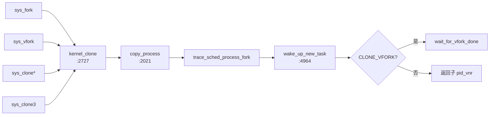

# 4. 创建路径：fork / clone / clone3 / vfork

**结论**：所有创建最终进 `kernel_clone` → `copy_process` → `wake_up_new_task`；`CLONE_*` 在每一步 `copy_*` 里决定「引用 +1」还是「深拷贝」。

## 4.1 调用链



`kernel_clone`（`kernel/fork.c:2727`）要点：

1. 处理 `CLONE_EMPTY_MNTNS` → 隐含 `CLONE_NEWNS`
2. `CLONE_PIDFD` 与 `CLONE_PARENT_SETTID` 指向同一用户地址则 `-EINVAL`
3. 决定 ptrace 事件类型（VFORK/CLONE/FORK）
4. `p = copy_process(...)`
5. `wake_up_new_task(p)`
6. 若 `CLONE_VFORK`，父进程 `wait_for_vfork_done`

## 4.2 `copy_process` 主序（`kernel/fork.c:2021`）

前置：大量 `CLONE_*` 合法性检查（见 [§1.4](./01-overview.md#clone-flags)）。

关键步骤（调用点行号）：

| 顺序 | 调用 | 行号 | 说明 |
|---|---|---|---|
| 1 | `dup_task_struct` | 2142 | 新 `task_struct` + 内核栈；置 `TASK_NEW` |
| 2 | `copy_creds` | 2183 | 凭证 |
| 3 | `sched_fork` | 2289 | 调度实体初始化、选 CPU，**不入队** |
| 4 | `copy_semundo` | 2304 | SysV SEM |
| 5 | `copy_files` | 2307 | fd 表 |
| 6 | `copy_fs` | 2310 | cwd/root |
| 7 | `copy_sighand` | 2315 | 信号处理表 |
| 8 | `copy_signal` | 2318 | 线程组信号结构（`CLONE_THREAD` 则共享） |
| 9 | `copy_mm` | 2321 | 地址空间 |
| 10 | `copy_namespaces` | 2324 | nsproxy |
| 11 | `copy_io` | 2327 | io_context |
| 12 | `copy_thread` | 2330 | 架构栈帧（x86 见下） |
| 13 | `alloc_pid` | 2337 | 分配 `struct pid` |
| 14 | 可选 `pidfd_prepare` | 2362 | `CLONE_PIDFD` |
| 15 | `copy_seccomp` 等 | 2517+ | seccomp / cgroup / … |
| 16 | 挂 tasklist、`attach_pid` | 后部 | 对世界可见 |

`user_worker` 时会打 `PF_USER_WORKER`（约 `:2161`）。

## 4.3 共享 vs 复制对照

| 资源 | 共享条件 | 共享时 | 复制时 |
|---|---|---|---|
| mm | `CLONE_VM` | `mmget(oldmm)` | `dup_mm`（COW 页表） |
| fs | `CLONE_FS` | `fs->users++` | `copy_fs_struct` |
| files | `CLONE_FILES` | 引用 +1 | `dup_fd` |
| sighand | `CLONE_SIGHAND` | 引用 +1 | 新 `sighand_struct`，拷贝 `action[]` |
| signal | `CLONE_THREAD` | 共用父的 `signal_struct` | 新分配并初始化 |
| nsproxy | 无 NEW* 标志 | 引用 +1 | `copy_namespaces` 按标志拆 |
| IO | `CLONE_IO` | 共享 `io_context` | 新 |

`copy_mm` 核心（`:1591-1601`）：

```c
if (clone_flags & CLONE_VM) {
	mmget(oldmm);          /* 中文：线程 —— 只加引用 */
	mm = oldmm;
} else {
	mm = dup_mm(tsk, current->mm); /* 中文：进程 —— COW 复制 mm */
	if (!mm)
		return -ENOMEM;
}
tsk->mm = mm;
tsk->active_mm = mm;
```

内核线程：`current->mm == NULL` 时 `copy_mm` 直接返回 0，子任务 `mm` 保持 NULL。

## 4.3.1 `copy_sighand` / `copy_signal` 摘录

```c
/* fork.c:1699 */
static int copy_sighand(u64 clone_flags, struct task_struct *tsk)
{
	if (clone_flags & CLONE_SIGHAND) {
		refcount_inc(&current->sighand->count); /* 中文：线程共享 handler 表 */
		return 0;
	}
	sig = kmem_cache_alloc(sighand_cachep, GFP_KERNEL);
	RCU_INIT_POINTER(tsk->sighand, sig);
	memcpy(sig->action, current->sighand->action, sizeof(sig->action));
	if (clone_flags & CLONE_CLEAR_SIGHAND)
		flush_signal_handlers(tsk, 0); /* 中文：clone3 可清成默认 */
	return 0;
}

/* fork.c:1748 */
static int copy_signal(u64 clone_flags, struct task_struct *tsk)
{
	if (clone_flags & CLONE_THREAD)
		return 0; /* 中文：同组 —— 不新建 signal_struct，沿用 leader */
	sig = kmem_cache_zalloc(signal_cachep, GFP_KERNEL);
	tsk->signal = sig;
	/* 初始化 live、nr_threads、rlim、posix timers、wait_chldexit … */
}
```

线程：`CLONE_THREAD` ⇒ 共享 `signal`；通常同时 `CLONE_SIGHAND` ⇒ 共享 `sighand`。进程：两者都新建。

## 4.4 `copy_thread`（x86，`arch/x86/kernel/process.c:170`）

```c
int copy_thread(struct task_struct *p, const struct kernel_clone_args *args)
{
	/* ... 准备 fork_frame / inactive_task_frame ... */
	frame->ret_addr = (unsigned long) ret_from_fork_asm; /* 中文：第一次调度从这里「返回」 */
	p->thread.sp = (unsigned long) fork_frame;

	if (unlikely(p->flags & PF_KTHREAD)) {
		memset(childregs, 0, sizeof(*childregs));
		kthread_frame_init(frame, args->fn, args->fn_arg); /* 中文：内核线程跑 fn */
		return 0;
	}

	*childregs = *current_pt_regs();
	childregs->ax = 0;   /* 中文：子进程 fork 返回值 = 0 */
	if (sp)
		childregs->sp = sp; /* 中文：用户指定的新栈（线程） */

	if (unlikely(args->fn)) {
		/* 中文：user_worker / 带 fn 的特殊任务 */
		kthread_frame_init(frame, args->fn, args->fn_arg);
		return 0;
	}
	if (clone_flags & CLONE_SETTLS)
		ret = set_new_tls(p, tls);
	/* ... */
}
```

## 4.5 `sched_fork` / `wake_up_new_task`

- `sched_fork`（`kernel/sched/core.c:4826`）：初始化 `se`/`rt`/`dl`，设初始优先级，绑定 CPU，**此时仍是 `TASK_NEW`，不挂 runqueue**。
- `wake_up_new_task`（`:4964`）：把新任务设为可运行并入队，之后可能被挑中执行。

## 4.6 `unshare`

`ksys_unshare`（`kernel/fork.c:3251`）/ `sys_unshare`（`:3373`）：对**当前**任务按标志拆开先前共享的资源（等价于「先 clone 再让父进程用新副本」的逆向操作）。容器运行时常用 `unshare(CLONE_NEWNS|…)` 再 `fork`。

## 4.7 关键函数表

| 文件 | 函数 | 作用 |
|---|---|---|
| `kernel/fork.c` | `kernel_clone` | 创建总入口 |
| | `copy_process` | 真正造 task |
| | `dup_task_struct` | 分配 task+栈 |
| | `copy_mm` / `copy_fs` / `copy_files` / `copy_sighand` / `copy_signal` / `copy_namespaces` / `copy_io` | 资源 |
| | `ksys_unshare` | 拆共享 |
| `kernel/sched/core.c` | `sched_fork` / `wake_up_new_task` | 调度侧出生 |
| `arch/x86/kernel/process.c` | `copy_thread` | 子任务首次返回帧 |

---

---

**导航**：[章节目录](./README.md) · [← PID 与命名空间](./03-pid-namespaces.md) · [内核线程与特殊任务 →](./05-kernel-threads.md)
