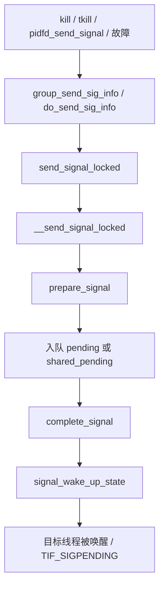

# 9. 信号与进程

**结论**：信号分「线程私有 pending」和「线程组 shared_pending」；投递时可能唤醒/打断睡眠；退出路径通过 `do_notify_parent` 与 `SIGCHLD` 咬合。

## 9.1 核心结构

### `sighand_struct`（`include/linux/sched/signal.h:21`）

```c
struct sighand_struct {
	spinlock_t siglock;              /* 中文：信号子系统主锁 */
	refcount_t count;
	wait_queue_head_t signalfd_wqh;
	struct k_sigaction action[_NSIG]; /* 中文：每个信号的处理动作 */
};
```

`CLONE_SIGHAND` / 线程：共享同一张 `action[]`。

### `sigpending`（`include/linux/signal_types.h:32`）

```c
struct sigpending {
	struct list_head list;  /* sigqueue 链表 */
	sigset_t signal;        /* 挂起位图 */
};
```

- 每线程：`task_struct.pending`
- 线程组：`signal_struct.shared_pending`

### `signal_struct`（`sched/signal.h:94`，线程组共享）

| 成员 | 含义 |
|---|---|
| `sigcnt` / `live` / `nr_threads` | 引用、活线程数、线程总数 |
| `thread_head` | 组内线程链表 |
| `wait_chldexit` | `wait4` 等待队列 |
| `curr_target` | 组信号负载均衡目标线程 |
| `shared_pending` | 组级挂起信号 |
| `multiprocess` | fork 期间延迟的多进程信号 |
| `group_exit_code` / `notify_count` / `group_exec_task` | 组退出 / exec |
| `group_stop_count` / `flags` | 作业控制停止；`SIGNAL_*` |
| `core_state` | coredump |
| `is_child_subreaper` / `has_child_subreaper` / `autoreap` | 收尸与自收 |
| `posix_timers` / `real_timer` / `it[]` / `cputimer` | 定时器（`CONFIG_POSIX_TIMERS`） |
| `pids[PIDTYPE_MAX]` | 组关联的 pid 对象 |
| `tty` / `leader` | 控制终端 / session leader |
| `rlim[RLIM_NLIMITS]` | 资源限制 |
| `utime,stime,cutime,…` | 累计 CPU/故障/IO 统计 |
| `oom_score_adj` / `oom_mm` | OOM |
| `exec_update_lock` | exec 时凭证更新锁 |
| `cred_guard_mutex` | 废弃，勿新用 |

`SIGNAL_*` 标志（`:261` 起）：`SIGNAL_STOP_STOPPED`、`SIGNAL_GROUP_EXIT`、`SIGNAL_UNKILLABLE`（init）、`SIGNAL_CLD_*` 等。

### 每任务信号字段（回顾）

`blocked` / `real_blocked` / `saved_sigmask` / `pending` / `sas_ss_*`（交替栈）。

## 9.2 投递路径（简化）



| 函数 | 位置 | 作用 |
|---|---|---|
| `prepare_signal` | `signal.c:877` | 是否丢弃、是否干掉组停止等 |
| `__send_signal_locked` | `:1061` | 入队 |
| `complete_signal` | `:969` | 选中受害者线程并唤醒 |
| `signal_wake_up_state` | `:727` | 唤醒 |
| `do_send_sig_info` | `:1296` | 对单 task 发 |
| `group_send_sig_info` | `:1452` | 对线程组发 |
| `kill_pid_info` / `kill_pid` | `:1514` / `:1932` | 经 `struct pid` |
| `force_sig*` | `:1678` 起 | 不可忽略的故障信号 |
| `dequeue_signal` | `:624` | 取信号 |
| `get_signal` | `:2876` | 返回用户态前取信号并决定处理 |

用户态返回路径上：`get_signal` → 若有 handler 则架构相关的 `handle_signal` 摆帧；若默认动作是终止则 `do_group_exit`。

## 9.2.1 收信号：`get_signal`

返回用户态前（或内核循环里）调用 `get_signal`（`signal.c:2876`）：

1. 从 `shared_pending` 与本线程 `pending` **dequeue**（`dequeue_signal`）
2. 若作业控制 stop / coredump / 组退出，走相应分支
3. 默认动作：忽略 / 停止 / 终止（`do_group_exit`） / coredump
4. 有用户 handler：填 `ksignal`，交给架构层摆信号帧，返回用户 handler

`signal_wake_up_state`（`:727`）保证目标线程看到 `TIF_SIGPENDING` 并从可打断睡眠中起来。

## 9.3 与 exit 的交叉：`SIGCHLD`

`do_notify_parent`（`signal.c:2241`）：

1. `do_notify_pidfd(tsk)`
2. 填 `kernel_siginfo`（pid/uid/utime/stime/`CLD_EXITED|KILLED|DUMPED`）
3. 若父对 `SIGCHLD` 为 `SIG_IGN` 或 `SA_NOCLDWAIT` → 返回「请自收尸」（不进持久僵尸）
4. 否则把 `SIGCHLD` 发给 `tsk->parent`，并 `signal_wake_up` 父进程（让 `wait` 从 `wait_chldexit` 醒来）

因此：**僵尸不是信号本身造成的，而是「父没 reap」的生命周期状态**；信号只是通知。

## 9.4 信号与睡眠

- `TASK_INTERRUPTIBLE`：普通信号可唤醒
- `TASK_KILLABLE`：仅致命信号
- `TASK_UNINTERRUPTIBLE`：一般不响应（除非 `WAKEKILL` 等特殊）
- 被信号打断的系统调用返回 `-EINTR` / 重启（`SA_RESTART`）

## 9.5 关键函数表

| 文件 | 函数 | 作用 |
|---|---|---|
| `kernel/signal.c` | `__send_signal_locked` / `complete_signal` / `get_signal` / `do_notify_parent` | 投递与收取 |
| `include/linux/sched/signal.h` | 结构体与 `SIGNAL_*` | 数据定义 |
| `kernel/fork.c` | `copy_sighand` / `copy_signal` | 创建时共享/复制 |
| `kernel/exit.c` | `exit_signals` | 退出时封信号 |

---

---

**导航**：[章节目录](./README.md) · [← 上下文切换（进程管理视角）](./08-context-switch.md) · [观测与调试清单 →](./10-observability.md)
