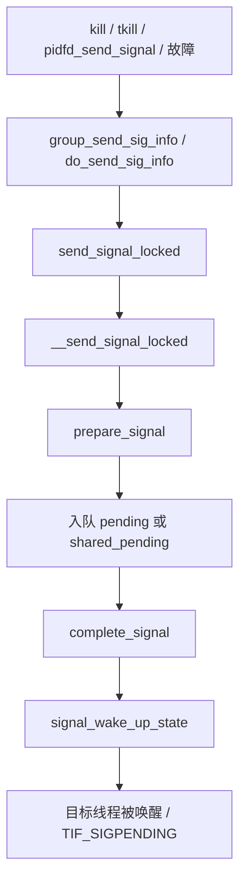

# 9. 信号与进程

**结论**：信号分「线程私有 pending」和「线程组 shared_pending」；投递时可能唤醒/打断睡眠；退出路径通过 `do_notify_parent` 与 `SIGCHLD` 咬合。

## 9.1 核心结构

### `sighand_struct`（`include/linux/sched/signal.h:21`）

```c
struct sighand_struct {
	spinlock_t siglock;              /* 中文：信号子系统主锁 */
	refcount_t count;                /* 共享计数，CLONE_SIGHAND 时增加 */
	wait_queue_head_t signalfd_wqh;  /* signalfd 等待队列 */
	struct k_sigaction action[_NSIG]; /* 中文：每个信号的处理动作 */
};
```

`CLONE_SIGHAND` / 线程：共享同一张 `action[]`。

### `sigpending`（`include/linux/signal_types.h:32`）

```c
struct sigpending {
	struct list_head list;  /* sigqueue 链表 */
	sigset_t signal;        /* 挂起位图 */
};
```

- 每线程：`task_struct.pending`
- 线程组：`signal_struct.shared_pending`

### `signal_struct`（`sched/signal.h:94`，线程组共享）

分组节选，不是全部成员。下面按源码顺序；表里把 `rlim` 写在累计统计前面，源码里统计在前。

```c
/* --- 引用、线程与共享挂起 --- */
	refcount_t		sigcnt;		/* 引用计数 */
	atomic_t		live;		/* 活线程数 */
	int			nr_threads;	/* 线程总数 */
	/* 此处省略本组未记录的成员 */
	struct list_head	thread_head;	/* 组内线程链表 */
	wait_queue_head_t	wait_chldexit;	/* wait4 等待队列 */
	struct task_struct	*curr_target;	/* 组信号负载均衡目标线程 */
	struct sigpending	shared_pending;	/* 组级挂起信号 */
	struct hlist_head	multiprocess;	/* fork 期间延迟的多进程信号 */
```

```c
/* --- 组退出、停止、coredump 与收尸 --- */
	int			group_exit_code;	/* 组退出码 */
	int			notify_count;		/* 降到不大于 0 时叫醒 group_exec_task */
	struct task_struct	*group_exec_task;	/* exec 期间等同伴退出的线程 */
	int			group_stop_count;	/* 作业控制停止计数 */
	unsigned int		flags;			/* SIGNAL_* */
	struct core_state	*core_state;		/* coredump */
	bool			is_child_subreaper;	/* 孤儿来这里，不到 init */
	bool			has_child_subreaper;	/* 退出时要往祖先找 subreaper */
	unsigned int		autoreap:1;		/* CLONE_AUTOREAP：退出时自收尸 */
```

```c
/* --- 定时器（CONFIG_POSIX_TIMERS） --- */
#ifdef CONFIG_POSIX_TIMERS
	/* 此处省略本组未记录的成员 */
	struct hlist_head	posix_timers;		/* POSIX 间隔定时器 */
	/* 此处省略本组未记录的成员 */
	struct hrtimer		real_timer;		/* ITIMER_REAL */
	/* 此处省略本组未记录的成员 */
	struct cpu_itimer	it[2];			/* ITIMER_PROF 与 ITIMER_VIRTUAL */
	struct thread_group_cputimer cputimer;		/* 线程组 CPU 定时器累计 */
#endif
```

```c
/* --- 组 pid 与控制终端 --- */
	/* 此处省略本组未记录的成员 */
	struct pid		*pids[PIDTYPE_MAX];	/* 组关联的 pid 对象 */
	/* 此处省略本组未记录的成员 */
	int			leader;			/* 非 0 表示 session leader */
	struct tty_struct	*tty;			/* 控制终端，没有则为 NULL */
```

```c
/* --- 累计 CPU / 故障 / IO，以及 rlimit --- */
	/* 此处省略本组未记录的成员 */
	/*
	 * 已退出线程在 __exit_signal 累加进来。
	 * 带 c 的字段是已回收子进程；活线程仍记在自己的 task_struct 上。
	 */
	u64			utime;		/* 已退出线程累计的用户时间 */
	u64			stime;		/* 已退出线程累计的系统时间 */
	u64			cutime;		/* 已回收子进程的用户时间 */
	u64			cstime;		/* 已回收子进程的系统时间 */
	u64			gtime;		/* 已退出线程累计的 guest 时间 */
	u64			cgtime;		/* 已回收子进程的 guest 时间 */
	struct prev_cputime	prev_cputime;	/* cputime_adjust 用的前回值 */
	unsigned long		nvcsw;		/* 已退出线程的自愿切换 */
	unsigned long		nivcsw;		/* 已退出线程的非自愿切换 */
	unsigned long		cnvcsw;		/* 已回收子进程的自愿切换 */
	unsigned long		cnivcsw;	/* 已回收子进程的非自愿切换 */
	unsigned long		min_flt;	/* 已退出线程的小缺页 */
	unsigned long		maj_flt;	/* 已退出线程的大缺页 */
	unsigned long		cmin_flt;	/* 已回收子进程的小缺页 */
	unsigned long		cmaj_flt;	/* 已回收子进程的大缺页 */
	unsigned long		inblock;	/* 已退出线程读入的块数 */
	unsigned long		oublock;	/* 已退出线程写出的块数 */
	unsigned long		cinblock;	/* 已回收子进程读入的块数 */
	unsigned long		coublock;	/* 已回收子进程写出的块数 */
	unsigned long		maxrss;		/* 本线程组 RSS 高水位 */
	unsigned long		cmaxrss;	/* 已回收子进程的 RSS 高水位 */
	struct task_io_accounting ioac;		/* 退出线程与子进程的累计 IO */
	/* 已退出线程的调度 CPU 时间（纳秒），不含僵尸组长 */
	unsigned long long	sum_sched_runtime;
	struct rlimit		rlim[RLIM_NLIMITS];	/* 资源限制 */
```

```c
/* --- OOM 与 exec 凭证锁 --- */
	/* 此处省略本组未记录的成员 */
	short			oom_score_adj;	/* OOM 杀分调整 */
	/* 此处省略本组未记录的成员 */
	struct mm_struct	*oom_mm;	/* 被 OOM 杀掉时记下的 mm */
	/* 废弃，勿新用；挡住 ptrace 等外来方影响凭证计算 */
	struct mutex		cred_guard_mutex;
	/* exec 时凭证更新锁 */
	struct rw_semaphore	exec_update_lock;
```

`SIGNAL_*` 标志（`:261` 起）：`SIGNAL_STOP_STOPPED`、`SIGNAL_GROUP_EXIT`、`SIGNAL_UNKILLABLE`（init）、`SIGNAL_CLD_*` 等。

### 每任务信号字段（回顾）

`blocked` / `real_blocked` / `saved_sigmask` / `pending` / `sas_ss_*`（交替栈）。

## 9.2 投递路径（简化）



| 函数 | 位置 | 作用 |
|---|---|---|
| `prepare_signal` | `signal.c:877` | 是否丢弃、是否干掉组停止等 |
| `__send_signal_locked` | `:1061` | 入队 |
| `complete_signal` | `:969` | 选中受害者线程并唤醒 |
| `signal_wake_up_state` | `:727` | 唤醒 |
| `do_send_sig_info` | `:1296` | 对单 task 发 |
| `group_send_sig_info` | `:1452` | 对线程组发 |
| `kill_pid_info` / `kill_pid` | `:1514` / `:1932` | 经 `struct pid` |
| `force_sig*` | `:1678` 起 | 不可忽略的故障信号 |
| `dequeue_signal` | `:624` | 取信号 |
| `get_signal` | `:2876` | 返回用户态前取信号并决定处理 |

用户态返回路径上：`get_signal` → 若有 handler 则架构相关的 `handle_signal` 摆帧；若默认动作是终止则 `do_group_exit`。

## 9.2.1 收信号：`get_signal`

返回用户态前（或内核循环里）调用 `get_signal`（`signal.c:2876`）：

1. 从 `shared_pending` 与本线程 `pending` **dequeue**（`dequeue_signal`）
2. 若作业控制 stop / coredump / 组退出，走相应分支
3. 默认动作：忽略 / 停止 / 终止（`do_group_exit`） / coredump
4. 有用户 handler：填 `ksignal`，交给架构层摆信号帧，返回用户 handler

`signal_wake_up_state`（`:727`）保证目标线程看到 `TIF_SIGPENDING` 并从可打断睡眠中起来。

## 9.3 与 exit 的交叉：`SIGCHLD`

`do_notify_parent`（`signal.c:2241`）：

1. `do_notify_pidfd(tsk)`
2. 填 `kernel_siginfo`（pid/uid/utime/stime/`CLD_EXITED|KILLED|DUMPED`）
3. 若父对 `SIGCHLD` 为 `SIG_IGN` 或 `SA_NOCLDWAIT` → 返回「请自收尸」（不进持久僵尸）
4. 否则把 `SIGCHLD` 发给 `tsk->parent`，并 `signal_wake_up` 父进程（让 `wait` 从 `wait_chldexit` 醒来）

因此：**僵尸不是信号本身造成的，而是「父没 reap」的生命周期状态**；信号只是通知。

## 9.4 信号与睡眠

- `TASK_INTERRUPTIBLE`：普通信号可唤醒
- `TASK_KILLABLE`：仅致命信号
- `TASK_UNINTERRUPTIBLE`：一般不响应（除非 `WAKEKILL` 等特殊）
- 被信号打断的系统调用返回 `-EINTR` / 重启（`SA_RESTART`）

## 9.5 关键函数表

| 文件 | 函数 | 作用 |
|---|---|---|
| `kernel/signal.c` | `__send_signal_locked` / `complete_signal` / `get_signal` / `do_notify_parent` | 投递与收取 |
| `include/linux/sched/signal.h` | 结构体与 `SIGNAL_*` | 数据定义 |
| `kernel/fork.c` | `copy_sighand` / `copy_signal` | 创建时共享/复制 |
| `kernel/exit.c` | `exit_signals` | 退出时封信号 |

---

---

**导航**：[章节目录](./README.md) · [← 上下文切换（进程管理视角）](./08-context-switch.md) · [观测与调试清单 →](./10-observability.md)
