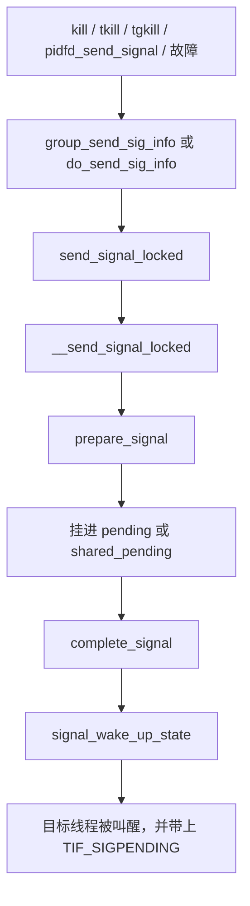

# 9. 信号与进程

**结论**：信号分两处挂起。线程自己的在 `task_struct.pending`，整组共享的在 `signal_struct.shared_pending`。投递时可能把线程从可打断的睡眠里叫醒。子进程退出时，`do_notify_parent` 用 `SIGCHLD` 通知父亲，僵尸本身是「还没被 wait」的状态，不是信号。

## 9.1 核心结构

### `sighand_struct`（`include/linux/sched/signal.h:20`）

```c
struct sighand_struct {
	spinlock_t		siglock;		/* 信号子系统的主锁 */
	refcount_t		count;			/* 几个任务共享它。CLONE_SIGHAND 时加一 */
	wait_queue_head_t	signalfd_wqh;		/* signalfd 堵在这里 */
	struct k_sigaction	action[_NSIG];		/* 每个信号一个处理动作 */
};
```

带 `CLONE_SIGHAND` 的线程共用这一张 `action[]`。exec 如果发现 `count != 1`，会先 `unshare_sighand` 再改表，避免改到别人。

### `sigpending`（`include/linux/signal_types.h:32`）

```c
struct sigpending {
	struct list_head list;	/* 排队的 sigqueue。实时信号可以有多份 */
	sigset_t signal;	/* 哪些信号号已经挂起，一位一个 */
};
```

标准信号（非实时）同一个号只留一份，位图就够了。实时信号还要沿着 `list` 把 `sigqueue` 排起来，里面有 `siginfo`。

- 每条线程：`task_struct.pending`
- 整个线程组：`signal_struct.shared_pending`

### `signal_struct`（`sched/signal.h:93`）

同一线程组的每条 `task_struct` 指着同一份。它没有自己的锁：共享 `signal_struct` 就一定共享 `sighand_struct`，拿 `sighand->siglock` 就够了。

```c
struct signal_struct {
	/* --- 引用、线程、共享挂起 --- */
	refcount_t		sigcnt;		/* 引用计数 */
	atomic_t		live;		/* 还活着的线程数。do_exit 里减，减到 0 就是 group_dead */
	int			nr_threads;	/* 组里的线程数，含还没摘掉的 */
	int			quick_threads;	/* 退出路径上更快的计数。synchronize_group_exit 减它 */
	struct list_head	thread_head;	/* 组内线程链表。task 用 thread_node 挂上来 */
	wait_queue_head_t	wait_chldexit;	/* 父进程 wait 堵在这里 */
	struct task_struct	*curr_target;	/* 组信号轮询的下一个线程 */
	struct sigpending	shared_pending;	/* 组级挂起信号 */
	struct hlist_head	multiprocess;	/* fork 期间先攒着的多进程信号 */

	/* --- 组退出、停止、coredump --- */
	int			group_exit_code;	/* 整组退出码 */
	/* notify_count 降到不大于 0 时，去叫醒 group_exec_task */
	int			notify_count;
	struct task_struct	*group_exec_task;	/* 正在 exec、等同伴退出的那条线程 */
	int			group_stop_count;	/* 作业控制：还要停住几条线程 */
	unsigned int		flags;			/* SIGNAL_*，见下表 */
	struct core_state	*core_state;		/* 正在 coredump */

	/*
	 * is_child_subreaper：自己愿意收养孤儿（服务管理器）。
	 * has_child_subreaper：祖先里有这样的人，退出时要往上找，而不是直接给 init。
	 */
	unsigned int		is_child_subreaper:1;
	unsigned int		has_child_subreaper:1;

	/* --- 定时器。关掉 CONFIG_POSIX_TIMERS 就没有前面那一截 --- */
#ifdef CONFIG_POSIX_TIMERS
	unsigned int		next_posix_timer_id;	/* 下一个 POSIX 定时器 id */
	struct list_head	posix_timers;		/* 间隔定时器链表 */
	struct hrtimer		real_timer;		/* ITIMER_REAL */
	ktime_t			it_real_incr;		/* ITIMER_REAL 的间隔 */
	/* [0] 是 ITIMER_PROF，[1] 是 ITIMER_VIRTUAL。下标就是 CPUCLOCK_PROF / VIRT */
	struct cpu_itimer	it[2];
	struct thread_group_cputimer cputimer;		/* 组里的 CPU 时间累计 */
#endif
	/* 配置关掉时这是个空结构 */
	struct posix_cputimers	posix_cputimers;

	/* --- 组 pid 与控制终端 --- */
	struct pid		*pids[PIDTYPE_MAX];	/* 组的 TGID / PGID / SID */
#ifdef CONFIG_NO_HZ_FULL
	atomic_t		tick_dep_mask;		/* 哪些原因不让本组所在 CPU 停 tick */
#endif
	struct pid		*tty_old_pgrp;		/* 旧的前台进程组 */
	int			leader;			/* 非 0：会话首领 */
	struct tty_struct	*tty;			/* 控制终端。没有就是 NULL */
#ifdef CONFIG_SCHED_AUTOGROUP
	struct autogroup	*autogroup;		/* 自动分组调度 */
#endif

	/* --- 已退出线程和已回收子进程的累计数 --- */
	/*
	 * 活着的线程把数记在自己的 task_struct 上。
	 * __exit_signal 再加到这里。带 c 的字段来自已经 wait 掉的子进程。
	 * 读的时候用 stats_lock 配成一对。
	 */
	seqlock_t		stats_lock;
	u64			utime, stime, cutime, cstime;
	u64			gtime;		/* 已退出线程的 guest 时间 */
	u64			cgtime;		/* 已回收子进程的 guest 时间 */
	struct prev_cputime	prev_cputime;
	unsigned long		nvcsw, nivcsw, cnvcsw, cnivcsw;
	unsigned long		min_flt, maj_flt, cmin_flt, cmaj_flt;
	unsigned long		inblock, oublock, cinblock, coublock;
	unsigned long		maxrss, cmaxrss;	/* 本组和子进程的 RSS 高水位 */
	struct task_io_accounting ioac;
	/* 已退出线程的调度 CPU 时间，纳秒。不含僵尸组长 */
	unsigned long long	sum_sched_runtime;

	/*
	 * rlimit。getrlimit / setrlimit 拿的是 task_lock(group_leader)，
	 * 不是 siglock：它们不需要关中断。
	 */
	struct rlimit		rlim[RLIM_NLIMITS];

#ifdef CONFIG_BSD_PROCESS_ACCT
	struct pacct_struct	pacct;		/* BSD 进程记账 */
#endif
#ifdef CONFIG_TASKSTATS
	struct taskstats	*stats;
#endif
#ifdef CONFIG_AUDIT
	unsigned		audit_tty;
	struct tty_audit_buf	*tty_audit_buf;
#endif

	/* --- OOM 与 exec 凭证锁 --- */
	bool			oom_flag_origin;	/* OOM 时优先考虑这个组 */
	short			oom_score_adj;		/* OOM 分数调整 */
	short			oom_score_adj_min;	/* 下限。只有 CAP_SYS_RESOURCE 能改 */
	/* 组被 OOM 杀掉时记下的 mm，好让后面还能记账 */
	struct mm_struct	*oom_mm;
	/*
	 * 挡住 ptrace 这类外来者干扰凭证计算。
	 * 头文件写着不要在新代码里用，改用下面的 exec_update_lock。
	 */
	struct mutex		cred_guard_mutex;
	/* exec 更新 task 期间拿着。这段时间权限看起来可能不一致 */
	struct rw_semaphore	exec_update_lock;
} __randomize_layout;
```

`SIGNAL_*`（`signal.h:253` 起）就是上面 `flags` 的位：

| 标志 | 值 | 含义 |
|---|---|---|
| `SIGNAL_STOP_STOPPED` | `0x00000001` | 作业控制停止已经生效 |
| `SIGNAL_STOP_CONTINUED` | `0x00000002` | 自上次 `WCONTINUED` 以来收到过 `SIGCONT` |
| `SIGNAL_GROUP_EXIT` | `0x00000004` | 整组正在退出 |
| `SIGNAL_CLD_STOPPED` | `0x00000010` | 还没告诉父亲「停住了」 |
| `SIGNAL_CLD_CONTINUED` | `0x00000020` | 还没告诉父亲「继续了」 |
| `SIGNAL_CLD_MASK` | 上面两个通知位 | `get_signal` 看见它就调用 `do_notify_parent_cldstop` |
| `SIGNAL_UNKILLABLE` | `0x00000040` | init（以及容器 init）忽略它不想要的致命信号 |
| `SIGNAL_STOP_MASK` | 停止位和两个 CLD 位 | `signal_set_stop_flags` 一次改这一组 |

每条线程自己还有：`blocked`、`real_blocked`、`saved_sigmask`、`pending`，以及备用栈 `sas_ss_sp` / `sas_ss_size` / `sas_ss_flags`。

## 9.2 投递



| 函数 | 位置 | 作用 |
|---|---|---|
| `sys_kill` | `signal.c:3842` | 按进程号发，作用到线程组 |
| `sys_tkill` | `:4039` | 按线程号发，只打一条线程 |
| `sys_tgkill` | `:4023` | 同时核对 tgid 和 tid，避免号被复用 |
| `sys_pidfd_send_signal` | `:3917` | 按 pidfd 发，不靠会被复用的数字 |
| `prepare_signal` | `:913` | 这个信号该不该丢掉，组停止要不要被取消 |
| `__send_signal_locked` | `:1085` | 真正入队 |
| `send_signal_locked` | `:1226` | 上一层包装 |
| `complete_signal` | `:1005` | 挑一条线程来扛这个信号，并唤醒它 |
| `signal_wake_up_state` | `:770` | 置 `TIF_SIGPENDING`，再 `wake_up_state` |
| `do_send_sig_info` | `:1309` | 发给指定的那条 task |
| `group_send_sig_info` | `:1465` | 发给线程组 |
| `kill_pid_info` | `:1500` | 从 `struct pid` 发 |
| `kill_pid` | `:1947` | `kill_pid_info` 的薄封装 |
| `force_sig` | `:1681` | 不可忽略的故障信号，从这里进入一组 `force_sig_*` |
| `dequeue_synchronous_signal` | `:717` | 故障类信号优先取出，好让信号帧里的指令指针还指着出错的那条 |
| `dequeue_signal` | `:636` | 从本线程 `pending` 和组的 `shared_pending` 取一个 |
| `do_notify_parent_cldstop` | `:2196` | 告诉父亲「停住了」或「继续了」 |
| `get_signal` | `:2695` | 返回用户态之前决定怎么处理 |
| `do_notify_pidfd` | `:2069` | 唤醒堵在 `pid->wait_pidfd` 上的 poll |
| `do_notify_parent` | `:2085` | 子进程死了，通知父亲 |
| `exit_signals` | `:3010` | 退出时封上普通信号 |
| `zap_other_threads` | `:1383` | 组退出时给同伴发致命信号 |

`kill` 进共享队列，`tkill` / `tgkill` 进那条线程自己的 `pending`。组里谁来处理共享信号，由 `complete_signal` 挑。

### 收信号：`get_signal`

返回用户态前（或内核里显式调用时）进入 `get_signal`（`:2695`）：

1. 先跑挂着的 `task_work`。没有 `TIF_SIGPENDING` 就返回。`uprobe_deny_signal` 为真也返回。然后 `try_to_freeze`。
2. `SIGNAL_CLD_MASK`：告诉父亲「停住了」或「继续跑了」（`do_notify_parent_cldstop`）。
3. `SIGNAL_GROUP_EXIT` 或 `group_exec_task` 已经设上：当成 `SIGKILL`，走致命分支。
4. `JOBCTL_STOP_PENDING`：`do_signal_stop`。ptrace 的 trap、cgroup 冻结也在这个循环里处理。
5. 先 `dequeue_synchronous_signal`（故障类信号要先于普通信号，这样信号帧里的指令指针还指着出错的那条），再 `dequeue_signal`，从本线程 `pending` 和组的 `shared_pending` 取。
6. `SIG_IGN`：丢掉，继续看下一个。
7. 用户自己的处理函数：填好 `ksignal`，返回给架构层去摆栈帧。`SA_ONESHOT` 会把处理函数改回 `SIG_DFL`。
8. 默认动作：内核认为该忽略的就忽略；`SIGNAL_UNKILLABLE` 的 init 丢掉它不想要的；停止类进 `do_signal_stop`；其余是致命的。
9. 致命：置 `PF_SIGNALED`。需要 core 就 `do_coredump`。`PF_USER_WORKER` 自己退出，不在这里 `do_group_exit`。其他任务 `do_group_exit`。

`signal_wake_up_state` 保证目标线程看得到 `TIF_SIGPENDING`，并从 `TASK_INTERRUPTIBLE`（以及调用者传入的那些状态）里起来。叫不醒就 `kick_process`，让它在返回用户态的路上自己看见标志。

## 9.3 和 exit 交汇：`SIGCHLD`

`do_notify_parent`（`signal.c:2085`）在 `exit_notify` 里被调用，调用时已经拿着 `tasklist_lock`：

1. `do_notify_pidfd(tsk)`，叫醒 pidfd 的等待者。
2. 如果退出信号不是 `SIGCHLD`，但父亲的 `self_exec_id` 已经和子进程记下的 `parent_exec_id` 不同，说明父亲 exec 过了，信号改回 `SIGCHLD`。
3. 填 `kernel_siginfo`：父亲命名空间里的 pid、uid、utime、stime，以及 `CLD_EXITED` / `CLD_KILLED` / `CLD_DUMPED`。
4. 父亲对 `SIGCHLD` 是 `SIG_IGN`，或带 `SA_NOCLDWAIT`：返回真，表示「请自收尸」。`SIG_IGN` 时连 `SIGCHLD` 都不发。`SA_NOCLDWAIT` 仍然发。
5. 否则 `__send_signal_locked` 把信号发给 `tsk->parent`，并 `__wake_up_parent`，让堵在 `wait_chldexit` 上的 `wait` 醒来。

所以僵尸是「父进程还没 reap」的生命周期，不是信号本身。信号只负责通知。父进程忽略了通知，`exit_notify` 就把 `exit_state` 从 `EXIT_ZOMBIE` 改成 `EXIT_DEAD`，随即 `release_task`。

## 9.4 信号和睡眠

| 睡眠 | 谁能叫醒 |
|---|---|
| `TASK_INTERRUPTIBLE` | 普通信号。`signal_wake_up_state` 总会带上这一位 |
| `TASK_KILLABLE`（`TASK_WAKEKILL \| TASK_UNINTERRUPTIBLE`） | 致命信号。调用者把 `TASK_WAKEKILL` 传进 `signal_wake_up_state` |
| `TASK_UNINTERRUPTIBLE` | 一般不响应。等的是磁盘一类必须做完的事 |
| `TASK_STOPPED` / `TASK_TRACED` | 注释写明：`TASK_WAKEKILL` 也能把停住的任务叫醒来处理死亡信号 |

被信号打断的系统调用返回 `-EINTR`，或者在 `SA_RESTART` 时用 `restart_block` 重做。这个位在 `k_sigaction` 里，不在 `task_struct` 上。

## 9.5 关键函数

上一节的表就是投递和收取的全部入口。创建时的共享和复制在 `copy_sighand`（`kernel/fork.c:1810`）和 `copy_signal`（`:1859`）。退出时封信号的是 `exit_signals`。

---

**导航**：[章节目录](./README.md) · [← 上下文切换（进程管理视角）](./08-context-switch.md) · [观测与调试清单 →](./10-observability.md)
