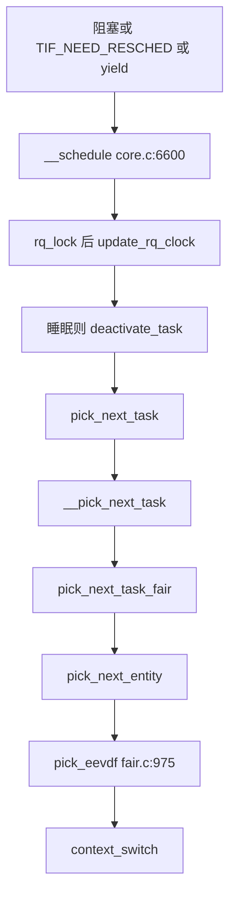

# 1. 总览与边界

**结论**：调度器回答三件事——**谁可以跑（策略类）**、**在哪个 CPU 的队列里等（`rq`）**、**这一次选谁上（`sched_class->pick_next_task`）**。绝大多数业务线程走 **fair / EEVDF**；RT/DL 是「插队权」；`stop`/`idle` 是机器自己用的两端。进程章已经讲清「怎么进 `__schedule`、怎么切上下文」——本章从 **选人** 开始。

---

## 1.1 调度类链条（v6.6.160）

链接脚本把各类按地址从低到高放进 `__sched_class_highest` … `__sched_class_lowest`（`include/asm-generic/vmlinux.lds.h:129`）。比较用 `sched_class_above(a, b) := (a < b)`（地址越小优先级越高），见 `kernel/sched/sched.h:2348`。启动时自检（`kernel/sched/core.c:9990`）：

```text
stop  >  dl  >  rt  >  fair  >  idle
```

| 类 | 符号 | 典型用途 |
|---|---|---|
| stop | `stop_sched_class` | 停机/迁移 stopper，最高；`CONFIG_SMP` 才参与上面的 `BUG_ON` |
| deadline | `dl_sched_class` | `SCHED_DEADLINE` |
| rt | `rt_sched_class` | `SCHED_FIFO` / `SCHED_RR` |
| fair | `fair_sched_class` | `SCHED_NORMAL` / `BATCH` / `IDLE`（EEVDF） |
| idle | `idle_sched_class` | 每 CPU idle 线程 |

`for_each_class`（`sched.h:2345`）从最高类走到最低类，逐个调用。本笔记主线：**fair/EEVDF**。其它类见 [06](./06-other-classes.md)。

---

## 1.2 与进程管理章的分界

| 在 process-management/08 | 在本章 |
|---|---|
| 谁调用 `__schedule`（阻塞 / 抢占 / yield / exit） | `__schedule` 里 `pick_next_task` 之后 |
| `context_switch`：mm / `switch_to` | `put_prev_task` / `set_next_task`、fair 记账 |
| 不展开「选谁」 | EEVDF、`sched_entity`、唤醒入队、负载均衡 |

入口锚点：`__schedule` → `kernel/sched/core.c:6600`。选人有两层：

- 没编 `CONFIG_SCHED_CORE` 时，`pick_next_task`（`core.c:6536`）直接转 `__pick_next_task`（`:6004`）。
- 编了 core scheduling 时，`pick_next_task`（`:6081`）在 `sched_core_enabled(rq)` 为假时同样转 `__pick_next_task`（`:6093`）。

日常读 fair，先看 `__pick_next_task` 里的快路径：前一个任务不高于 fair，且 `rq->nr_running == rq->cfs.h_nr_running` 时，直接 `pick_next_task_fair`（`fair.c:8433`）。

---

## 1.3 一张热路径图



唤醒反向路径：`try_to_wake_up`（`core.c:4213`）→ 选 CPU → `ttwu_do_activate` / enqueue → `wakeup_preempt` 里可能 `resched_curr`。见 [04](./04-enqueue-wakeup.md)。

---

## 1.4 性能视角预习（后面各节回扣）

读调度代码时，眼里要同时盯四类数：

| 问题 | 直觉指标 | 本章落点 |
|---|---|---|
| **唤醒延迟** | wakeup → 首次 running | [04](./04-enqueue-wakeup.md)、[08](./08-observability.md)、[09](./09-perf-analysis.md) |
| **抢占 / 调度延迟** | 可跑却没上 CPU 的等待 | `sched_info` / `sched_stat_wait`、perf sched |
| **CPU 利用率 vs 饱和** | 忙但不干活 vs 真算满 | `/proc/stat`、PSI、火焰图误判 |
| **负载不均** | 有核闲、有核打满 | [05](./05-load-balance.md)、绑核/cpuset |

**先定性再下钻**：是「睡太多（锁/IO）」还是「排队太久（竞争 CPU）」还是「被 cgroup 节流」——三者源码路径完全不同。

---

## 1.5 本章覆盖 / 不覆盖

| 覆盖 | 不覆盖（另章） |
|---|---|
| EEVDF 选人与实体记账 | 完整 mm 切换、缺页 |
| 入队/唤醒、NEED_RESCHED | 完整中断/softirq 入口 |
| 负载均衡与亲和概要 | 完整拓扑 / energy / cpufreq |
| cgroup cpu 衔接 | memory/io 控制器深挖 |
| 观测 + 性能配方 | 通用 perf 百科（可再开 performance/） |

---

## 1.6 关键函数表（总览级）

| 文件 | 符号 | 行号 | 作用 |
|---|---|---|---|
| `kernel/sched/core.c` | `__schedule` | 6600 | 调度主入口 |
| | `__pick_next_task` | 6004 | 快路径 fair，否则按类 `pick_next_task` |
| | `pick_next_task` | 6536 / 6081 | 无 core / 有 core 的包装 |
| | `try_to_wake_up` | 4213 | 唤醒 |
| | `resched_curr` | 1055 | 给当前任务打 `TIF_NEED_RESCHED` |
| `kernel/sched/fair.c` | `pick_next_task_fair` | 8433 | fair 选下一个 task |
| | `pick_eevdf` | 975 | EEVDF 选实体 |
| | `enqueue_task_fair` / `dequeue_task_fair` | 6750 / 6843 | fair 任务入队/出队 |
| | `load_balance` | 11332 | 一个调度域里的负载均衡 |
| `kernel/sched/sched.h` | `struct rq` / `cfs_rq` / `sched_class` | 963 / 547 / 2247 | 核心对象 |

---

**导航**：[章节目录](./README.md) · [核心对象 →](./02-core-objects.md)
