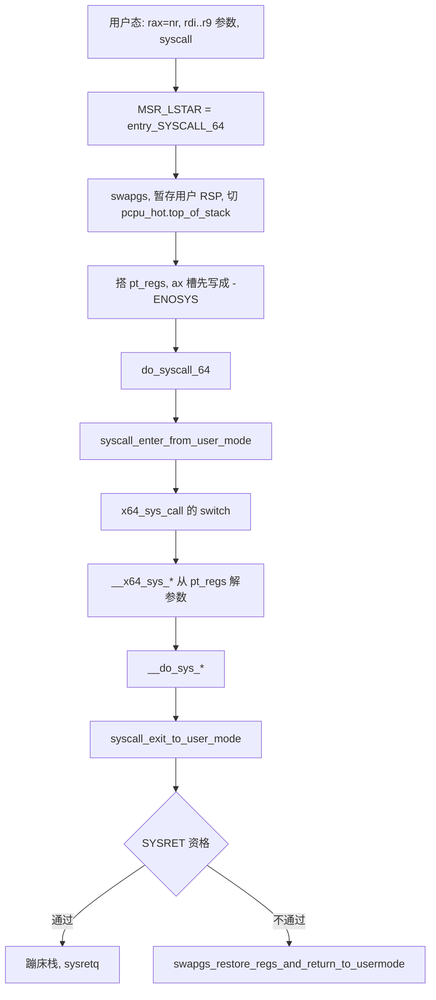

# 1. 总览与边界

**结论**：libc 把系统调用号放进 `rax`，六个参数放进 `rdi` / `rsi` / `rdx` / `r10` / `r8` / `r9`，然后执行 `syscall`。硬件把用户 `RIP` 存进 `rcx`、`RFLAGS` 存进 `r11`，跳到 `MSR_LSTAR`。内核在线程内核栈上搭好 `pt_regs`，热路径用 `x64_sys_call` 的 `switch` 调到 `__x64_sys_*`，返回值留在 `pt_regs->ax`。

> 硬件在进入时改写的两个寄存器，源码注释写在 `arch/x86/entry/entry_64.S:62`：`SYSCALL` 把 `rip` 存进 `rcx`，清掉 `rflags.RF`，再把 `rflags` 存进 `r11`，然后从事先写好的 MSR 装入新的 `ss` / `cs` / `rip`。它不往栈上存任何东西，也不改 `rsp`。

C 新手把 `struct pt_regs` 当成「内核栈顶的一张寄存器表」。系统调用号在 `orig_ax`，参数在 `di` / `si` / `dx` / `r10` / `r8` / `r9`。用户态第四个参数用 `r10`，因为硬件已经占用了 `rcx`。

---

## 1.1 用户态看见什么

返回值约定是：成功时 `rax` 是非负结果；失败时 `rax` 是负数的 errno（例如 `-EFAULT`）。glibc 的包装函数把负数翻成正的 `errno` 并返回 `-1`。内核内部还有一组用户看不见的重启码（512 起），在回到用户态之前会被改写成 `-EINTR` 或「再执行一次 `syscall`」。那部分在 [08](./08-restart.md)。

`include/linux/errno.h:9` 的注释写明：`ERESTART*` 不该被用户程序看见。ptrace 在系统调用退出跟踪时可以观察到它们，但被调试的进程自己看不到留下的这些码。

能不陷入就完成的调用走 vDSO，见 [06](./06-vdso-and-vvar.md)。`clock_gettime(CLOCK_MONOTONIC)` 在本机上 libc 路径比 `syscall` 指令短一截，数字在 [11](./11-perf-analysis.md)。

---

## 1.2 总图



`do_syscall_64` 在 `arch/x86/entry/common.c:69`。开关在 `arch/x86/entry/syscall_64.c:27`。进入工作的固定顺序在 [04](./04-enter-exit-work.md)。

---

## 1.3 `pt_regs`（x86-64）

栈向下生长，最后一条 `push` 落在最低地址，也就是这个结构体的第一个成员。`PUSH_AND_CLEAR_REGS`（`arch/x86/entry/calling.h:122`）先压 `di`…`r15`，所以 `r15` 在结构体开头。

```c
/* arch/x86/include/asm/ptrace.h:103  CONFIG_X86_64 这一份 */
struct pt_regs {
	/* C ABI 里这些是被调用者保存的。系统调用入口也会把它们压进来再清掉。 */
	unsigned long r15;
	unsigned long r14;
	unsigned long r13;
	unsigned long r12;
	unsigned long bp;
	unsigned long bx;
	/* 这些是调用者保存的。入口总会压。 */
	unsigned long r11;             /* 硬件留下的用户 RFLAGS */
	unsigned long r10;             /* 第 4 个参数（arg3） */
	unsigned long r9;              /* 第 6 个参数（arg5） */
	unsigned long r8;              /* 第 5 个参数（arg4） */
	unsigned long ax;              /* 入口先写成 -ENOSYS，返回值后来覆盖这里 */
	unsigned long cx;              /* 硬件留下的用户 RIP */
	unsigned long dx;              /* 第 3 个参数 */
	unsigned long si;              /* 第 2 个参数 */
	unsigned long di;              /* 第 1 个参数 */
	/*
	 * 系统调用入口：系统调用号。
	 * 异常：CPU 压入的 error code。
	 * 设备中断：向量号，随后被改成 -1。
	 */
	unsigned long orig_ax;
	/* IRET 帧从这里开始 */
	unsigned long ip;
	union {
		u16 cs;                /* CS 选择子 */
		u64 csx;               /* 同一个 64 位槽 */
		struct fred_cs fred_cs;
	};
	unsigned long flags;
	unsigned long sp;              /* 用户栈 */
	union {
		u16 ss;
		u64 ssx;
		struct fred_ss fred_ss;
	};
};
```

字段顺序与 v6.6.160 的这份头文件一致。`cs` / `fred_cs`、`ss` / `fred_ss` 是同一块内存上的不同看法，系统调用入口压进去的是 `__USER_CS` 和 `__USER_DS`（`entry_64.S:101`、`:104`）。

访问器在 `arch/x86/include/asm/syscall.h`，语义说明在 `include/asm-generic/syscall.h`：

| 访问器 | 行号 | 读什么 |
|---|---|---|
| `syscall_get_nr` | `asm/syscall.h:36` | `regs->orig_ax`，类型是 `int` |
| `syscall_get_arguments` | `:100` | 64 位：`di, si, dx, r10, r8, r9` |
| `syscall_get_return_value` | `:66` | `regs->ax` |
| `syscall_get_error` | `:47` | `ax` 落在 errno 范围时返回它，否则 0 |
| `syscall_rollback` | `:41` | `ax = orig_ax` |

`include/asm-generic/syscall.h:23` 写明：任务正在做系统调用或正要做时，`syscall_get_nr` 返回号；堵在缺页或信号里、并不是系统调用时，返回 `-1`。x86 的实现直接返回 `orig_ax`。设备中断桩会把 `ORIG_RAX` 改成 `-1`（[interrupts/02](../interrupts/02-x86-entry.md) §2.2），这样信号重启逻辑不会把一次中断当成系统调用。

`syscall_get_arguments` 在 `TS_COMPAT` 置位时改读 `bx, cx, dx, si, di, bp`（`asm/syscall.h:105`）。那是 32 位入口，见 [07](./07-compat.md)。

---

## 1.4 和邻章的分工

本章只封口「用户态怎么进来、返回值怎么离开」。

| 邻章已经写了 | 本章补上 |
|---|---|
| [interrupts/02](../interrupts/02-x86-entry.md) 的 IDT、`common_interrupt`、中断栈、`irqentry_*` | `entry_SYSCALL_64` 与 `SYSRET`。`pt_regs` 是同一结构，搭栈的指令不同 |
| [process-management/09](../process-management/09-signals.md) 的投递和 `get_signal` | 四种 `-ERESTART*` 与 `restart_block` |
| [containerization/10](../containerization/10-seccomp-caps-lsm.md) 的过滤器与 `RET_*` | 入口上 `SYSCALL_WORK_SECCOMP` 这一拍 |
| [memory-management/07](../memory-management/07-page-fault.md) 的缺页 | 系统调用上下文里的 `copy_*_user` |
| [vfs/](../vfs/README.md) 从已经进入内核的 `sys_read` 往下 | 号怎样变成 `__x64_sys_read` |

---

## 1.5 关键函数

| 文件 | 符号 | 行号 | 作用 |
|---|---|---|---|
| `arch/x86/kernel/cpu/common.c` | `syscall_init` | 2199 | 写 `MSR_LSTAR` 等 |
| `arch/x86/entry/entry_64.S` | `entry_SYSCALL_64` | 87 | `syscall` 指令的目标 |
| `arch/x86/entry/common.c` | `do_syscall_64` | 69 | 进入工作、分派、退出工作 |
| `arch/x86/entry/syscall_64.c` | `x64_sys_call` | 27 | `switch (nr)` |
| `kernel/entry/common.c` | `syscall_enter_from_user_mode` | 113 | 开中断并跑进入挂钩 |
| `kernel/entry/common.c` | `syscall_exit_to_user_mode` | 302 | 退出挂钩后回到用户态上下文 |

---

**导航**：[目录](./README.md) · [`entry_SYSCALL_64` →](./02-x86-entry.md)
