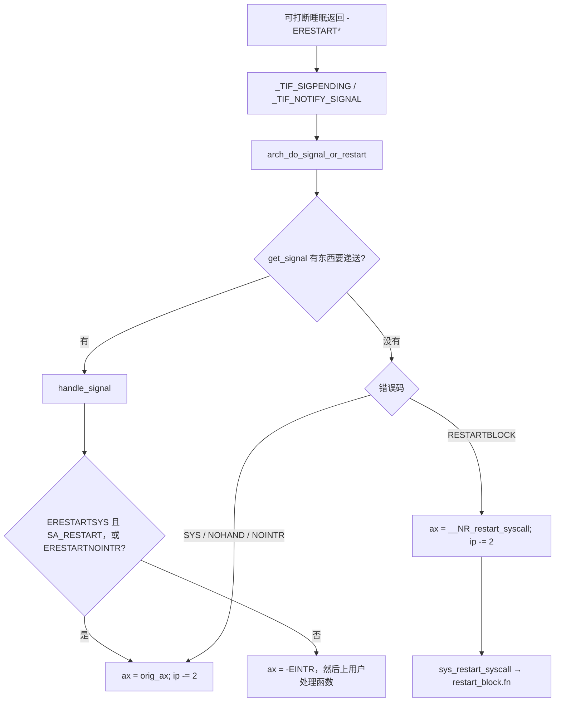

# 8. `-ERESTART*` 与 `restart_block`

**结论**：内核里有四个用户看不见的错误码，用来表示「这次系统调用被信号打断，回到用户态之前再决定是重做还是 `-EINTR`」。决定点是 `arch_do_signal_or_restart`。有信号要递送时走 `handle_signal`；没有则按错误码把 `ax` 设回原来的号或 `restart_syscall` 的号，并把 `ip` 减 2，让 SYSRET/IRET 重新执行 `syscall` 指令。

> 错误码在 `include/linux/errno.h:14`。状态机在 `arch/x86/kernel/signal.c:228` 的 `handle_signal` 和 `:306` 的 `arch_do_signal_or_restart`。谁把信号选出来是 `get_signal`（`kernel/signal.c:2695`），见 [process-management/09-signals.md](../process-management/09-signals.md)。

调用点在 `exit_to_user_mode_loop`：`_TIF_SIGPENDING` 或 `_TIF_NOTIFY_SIGNAL` 置位时（`kernel/entry/common.c:176`）下一行调用 `arch_do_signal_or_restart`（`:177`）。

---

## 8.1 四个码

`include/linux/errno.h:9` 的注释：这些码不该被用户程序看见；返回它们的人必须已经让 `signal_pending()` 为真。ptrace 可以在退出跟踪时看到原值。

| 值 | 宏 | 行号 | 有处理函数要跑 | 没有要递送的信号 |
|---|---|---|---|---|
| 512 | `ERESTARTSYS` | 14 | 带 `SA_RESTART` 则重做，否则 `ax = -EINTR` | 重做 |
| 513 | `ERESTARTNOINTR` | 15 | 总是重做 | 重做 |
| 514 | `ERESTARTNOHAND` | 16 | `ax = -EINTR` | 重做 |
| 516 | `ERESTART_RESTARTBLOCK` | 18 | `ax = -EINTR` | `ax` 改成 `restart_syscall` 的号，再重做 |

515 是 `ENOIOCTLCMD`，夹在中间，不是重启码。

「重做」在 x86 上是两行（`signal.c:252` 和 `:324`）：

```c
regs->ax = regs->orig_ax;   /* 或 get_nr_restart_syscall */
regs->ip -= 2;              /* 回到 syscall / int80 那条指令 */
```

`entry_64.S:62` 说明 `syscall` 把当时的 `rip` 放进 `rcx`，入口又把它写进 `pt_regs->ip`。那条指令本身是 2 字节，减 2 之后下一次返回用户态会再执行它，寄存器里已经放好了原来的号。`ERESTART_RESTARTBLOCK` 把号换成 `restart_syscall`，所以重做的是另一条系统调用，由 `restart_block.fn` 接着干。

---

## 8.2 两支

```c
/* arch/x86/kernel/signal.c:306 */
void arch_do_signal_or_restart(struct pt_regs *regs)
{
	struct ksignal ksig;

	if (get_signal(&ksig)) {
		handle_signal(&ksig, regs);    /* 真的要递送 */
		return;
	}
	/* 没有要递送的信号：若这是一次系统调用，按错误码重启 */
	if (syscall_get_nr(current, regs) != -1) {
		switch (syscall_get_error(current, regs)) {
		case -ERESTARTNOHAND:
		case -ERESTARTSYS:
		case -ERESTARTNOINTR:
			regs->ax = regs->orig_ax;
			regs->ip -= 2;
			break;
		case -ERESTART_RESTARTBLOCK:
			regs->ax = get_nr_restart_syscall(regs);
			regs->ip -= 2;
			break;
		}
	}
	restore_saved_sigmask();
}
```

`syscall_get_nr` 返回 `orig_ax`。设备中断把 `orig_ax` 写成 `-1`，这里不会把中断返回地址减 2。`syscall_get_error`（`asm/syscall.h:47`）只在 `ax` 是负数的 errno 范围时把它交出来，否则当成功，`switch` 对不上，寄存器保持原样。

`handle_signal`（`:228`）在 `syscall_get_nr != -1` 时：

```text
-ERESTART_RESTARTBLOCK
-ERESTARTNOHAND          → ax = -EINTR
-ERESTARTSYS             → 没有 SA_RESTART 则 ax = -EINTR
                         → 有 SA_RESTART 则落到下面
-ERESTARTNOINTR          → ax = orig_ax; ip -= 2
```

有处理函数时，`ERESTART_RESTARTBLOCK` 也变成 `-EINTR`，不会去调用 `restart_block.fn`。`SA_RESTART` 只影响 `ERESTARTSYS`。这个标志在 `k_sigaction` 里，进程章已经写过它不在 `task_struct` 上。

然后 `setup_rt_frame`（`:209`）把帧放到用户栈。帧没搭好就 `signal_setup_done` 报告失败。处理函数返回之后，用户态看到的 `eax`/`rax` 是上面改过的值：要么 `-EINTR`，要么会重新执行系统调用、根本不进入处理函数之前的那个返回值。

`get_nr_restart_syscall`（`:288`）：`restart_block.arch_data & TS_COMPAT` 时返回 ia32 的号（`syscall_32.tbl` 里是 0）；x32 时把 `__NR_restart_syscall` 或上 `orig_ax` 里的 `__X32_SYSCALL_BIT`；否则就是 64 位的 `__NR_restart_syscall`，tbl 里是 219（`syscall_64.tbl:230`）。

```c
/* kernel/signal.c:3069 */
SYSCALL_DEFINE0(restart_syscall)
{
	struct restart_block *restart = &current->restart_block;
	return restart->fn(restart);
}
```

`do_no_restart_syscall`（`:3075`）直接返回 `-EINTR`。没人把 `fn` 设成具体重启函数时，默认就是它。`set_restart_fn`（`include/linux/thread_info.h:68`）把 `fn` 填上并返回 `-ERESTART_RESTARTBLOCK`。x86 的 `arch_set_restart_data`（`asm/thread_info.h:223`）在 `CONFIG_COMPAT` 下把当时的 `status`（含 `TS_COMPAT`）抄进 `restart->arch_data`，供上面的 `get_nr_restart_syscall` 使用。

---

## 8.3 `restart_block`

挂在 `task_struct` 上（`include/linux/sched.h:973`），每个任务一份。

```c
/* include/linux/restart_block.h:25 */
struct restart_block {
	unsigned long arch_data;                 /* x86：抄来的 thread_info.status */
	long (*fn)(struct restart_block *);
	union {
		struct {                         /* futex_wait / futex_wait_requeue_pi */
			u32 __user *uaddr;
			u32 val;
			u32 flags;
			u32 bitset;
			u64 time;
			u32 __user *uaddr2;
		} futex;
		struct {                         /* nanosleep */
			clockid_t clockid;
			enum timespec_type type; /* TT_NONE / TT_NATIVE / TT_COMPAT */
			union {
				struct __kernel_timespec __user *rmtp;
				struct old_timespec32 __user *compat_rmtp;
			};
			u64 expires;
		} nanosleep;
		struct {                         /* poll */
			struct pollfd __user *ufds;
			int nfds;
			int has_timeout;
			unsigned long tv_sec;
			unsigned long tv_nsec;
		} poll;
	};
};
```

同一时刻只用联合体里的一支，由 `fn` 决定。futex 的绝对超时被信号打断时，等待参数写进 `current->restart_block`，`set_restart_fn(..., futex_wait_restart)`。`futex_wait_restart` 再调用 `futex_wait`。队列、哈希桶和这两行的行号在 [locks-and-ds/09-futex.md](../locks-and-ds/09-futex.md)。nanosleep / poll 同理：剩余时间或原来的 fd 集放在联合体里，`restart_syscall` 不靠用户重新传参。



09 章回答「信号交给谁、处理函数从哪来」。本章回答「系统调用的 `rax` 和 `rip` 在那之前被改成什么样」。

---

## 8.4 本机采样

`demos/03-restart-eintr.c` 在空管道上 `read`。`SIGALRM` 的间隔定时器设成 80 ms，另一个线程在 200 ms 时写入一字节。sampled on 6.12.113+，连续两次都是：

```text
uname.release=6.12.113+
no_SA_RESTART n=-1 errno=4 (Interrupted system call) byte=0x00 elapsed_ms=80
SA_RESTART n=1 errno=0 (-) byte=0x5a elapsed_ms=200
```

没有 `SA_RESTART` 时，`read` 在定时器那一拍返回 `EINTR`（errno 4）。有 `SA_RESTART` 时，内核把 `read` 重做，直到那一字节到达，`n=1`，耗时落在写入延迟上。

v6.6.160 里空管道的这次等待在 `pipe_read`（`fs/pipe.c:231`）。什么都还没读到、`wait_event_interruptible_exclusive` 被信号打断时，函数直接 `return -ERESTARTSYS`（`:380`）。这和上面的用户态差别对得上：`ERESTARTSYS` 看 `SA_RESTART`。本机内核是 6.12.113+，返回码和耗时是在那颗内核上测的；行号仍是 v6.6.160。

---

## 8.5 关键函数

| 文件 | 符号 | 行号 | 作用 |
|---|---|---|---|
| `include/linux/errno.h` | `ERESTARTSYS` 等 | 14–18 | 四个内部错误码 |
| `include/linux/restart_block.h` | `struct restart_block` | 25 | `fn` + futex/nanosleep/poll |
| `include/linux/thread_info.h` | `set_restart_fn` | 68 | 填 `fn` 并返回 `-ERESTART_RESTARTBLOCK` |
| `kernel/entry/common.c` | `exit_to_user_mode_loop` | 156 | `:177` 调用 `arch_do_signal_or_restart` |
| `arch/x86/kernel/signal.c` | `handle_signal` | 228 | 有处理函数时改 `ax`/`ip` |
| `arch/x86/kernel/signal.c` | `arch_do_signal_or_restart` | 306 | 无递送时的重启 |
| `arch/x86/kernel/signal.c` | `get_nr_restart_syscall` | 288 | compat / x32 / 64 位号 |
| `kernel/signal.c` | `restart_syscall` | 3069 | 调用 `restart_block.fn` |
| `kernel/signal.c` | `get_signal` | 2695 | 选信号，见进程章 |

---

**导航**：[← compat](./07-compat.md) · [目录](./README.md) · [挂钩面 →](./09-hooks.md)
