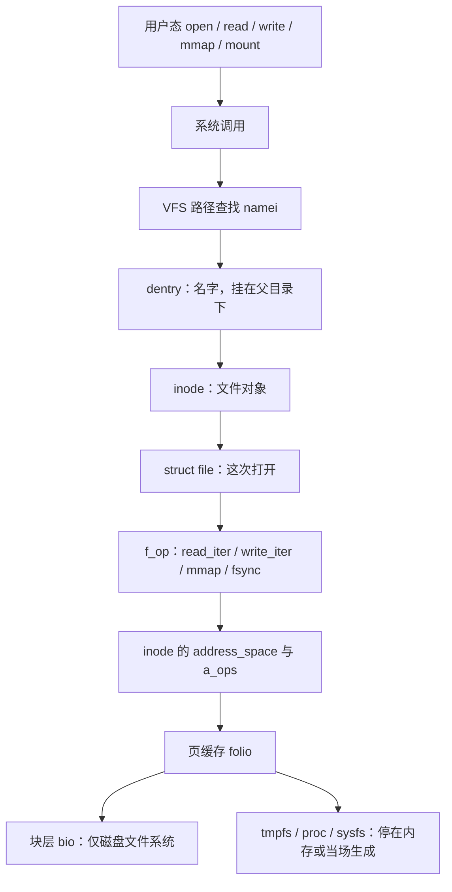

# 1. 总览

**结论**：一次 `open`/`read`/`write`/`mmap` 先进入 VFS，用 `dentry` 找到 `inode`，用 `struct file` 记住这次打开，再调用该文件系统填好的函数表；缓冲读写把数据交给页缓存，磁盘文件系统才继续进块层。

> 主路径锚点：`fs/open.c` 的 `do_sys_openat2`（`:1406`），`fs/namei.c` 的 `path_openat`（`:3836`），`fs/read_write.c` 的 `vfs_read`（`:450`）。

C 新手先记四个名词。`super_block` 是一个已挂上的文件系统实例。`dentry` 是目录树里的一个名字。`inode` 是这个名字背后的文件对象（权限、大小、页缓存都挂在它上面）。`struct file` 是进程这次打开所拿到的那张「打开记录」，文件描述符只是它在进程表里的下标。

---

## 1.1 一张总图



读图时抓住三件事：

1. **VFS 不认识磁盘布局**。它只认 `dentry`、`inode`、`file` 和几张函数表。ext4 的 extent、tmpfs 的页、procfs 当场拼出来的文本，都从这些函数指针后面分出去。
2. **页缓存是内存章的对象**。`inode->i_mapping` 指向 `struct address_space`（通常就是嵌在 inode 里的 `i_data`）。folio 怎么进 xarray、脏页怎么限速，见 [memory-management/08](../memory-management/08-page-cache-and-writeback.md) §8.1–§8.3。本章写到「VFS 把 `kiocb` 交出去」为止。
3. **块层是下一步，不是本章**。`a_ops->read_folio` / `a_ops->direct_IO` 对磁盘文件系统会提交 bio。tmpfs 的 `read_iter` 走 `shmem_get_folio`，没有 bio。`io_uring` 另走 `file_operations.uring_cmd`，留给以后的 block-io 章。

---

## 1.2 和别的章怎么接

| 本章写到哪 | 别章接着写 |
|---|---|
| `read_iter` 进入 `generic_file_read_iter` / `filemap_read` | 页缓存查找、预读、回写：[MM §08](../memory-management/08-page-cache-and-writeback.md) |
| `mmap` 装上 `vm_ops->fault = filemap_fault` | `do_fault` → `filemap_fault` 的缺页分发：[MM §07](../memory-management/07-page-fault.md) |
| 超级块 shrinker `s_shrink` | `shrink_slab` 何时被调用：[MM §10.1](../memory-management/10-01-overview.md) |
| `current->files` 这张 fd 表 | `task_struct` 字段：[process-management/02](../process-management/02-task-struct.md) |
| 路径查找里的 `rcu_read_lock` | RCU 的读侧规则：[locks-and-ds/07](../locks-and-ds/07-rcu.md) |

---

## 1.3 四条时间线

**打开**（进程上下文，可以睡眠）：

```text
openat                         fs/open.c:1448
  do_sys_open                  :1434
  do_sys_openat2               :1406
    get_unused_fd_flags        fs/file.c:550
    do_filp_open               fs/namei.c:3875
      path_openat              :3836     先带 LOOKUP_RCU，失败再普通走
        link_path_walk         :2260     逐个路径分量
        open_last_lookups      :3567     最后一个分量，可能创建
        do_open                :3651
          do_dentry_open       fs/open.c:873
    fd_install                 fs/file.c:590
```

**读**（已经有 fd）：

```text
read                           fs/read_write.c:621
  ksys_read                    :602
    vfs_read                   :450
      f_op->read               老接口，一次一块用户缓冲
      或 new_sync_read         :379      包成 kiocb + iov_iter
        f_op->read_iter
          通用实现 generic_file_read_iter   mm/filemap.c:2828
            缓冲：filemap_read              :2655
            O_DIRECT：a_ops->direct_IO
```

**映射**：

```text
mmap                           arch/x86/kernel/sys_x86_64.c:86 起的 SYSCALL
  do_mmap                      mm/mmap.c:1219
    mmap_region 里 mmap_file   mm/mmap.c:2798
      call_mmap                include/linux/fs.h:2022
        f_op->mmap
          普通文件常是 generic_file_mmap   mm/filemap.c:3714
            vma->vm_ops = generic_file_vm_ops
              fault = filemap_fault        :3293
```

缺页之后的页表填写在 [MM §07](../memory-management/07-page-fault.md)。`filemap_fault` 的分支在 [06](./06-mmap-and-file.md) 按 VFS 视角再走一遍，并链回那一节的行号。

**挂载**：

```text
mount                          fs/namespace.c:3966
  do_mount                     :3771
    path_mount                 :3692
      do_new_mount             :3365    旧 mount(2)，内部仍建 fs_context
或
fsopen / fsconfig / fsmount    fs/fsopen.c:121、:358；fsmount 在 namespace.c:4034
```

---

## 1.4 关键函数表（总览级）

| 文件 | 符号 | 行号 | 作用 |
|---|---|---|---|
| `fs/open.c` | `do_sys_openat2` | 1406 | `open` / `openat` / `openat2` 的公共尾部 |
| `fs/namei.c` | `do_filp_open` | 3875 | 先 RCU 走路径，失败再退回引用计数走 |
| `fs/namei.c` | `path_openat` | 3836 | 分配空 `struct file`，走完路径再打开 |
| `fs/open.c` | `do_dentry_open` | 873 | 填 `f_inode`、`f_op`，调用文件系统 `open` |
| `fs/read_write.c` | `vfs_read` / `vfs_write` | 450 / 564 | 校验权限后调 `f_op` |
| `mm/filemap.c` | `generic_file_read_iter` | 2828 | 缓冲读与 Direct IO 的分叉 |
| `mm/filemap.c` | `filemap_fault` | 3293 | 文件映射缺页找页缓存 |
| `fs/namespace.c` | `path_mount` | 3692 | 旧 `mount(2)` 按标志分发 |
| `fs/super.c` | `super_cache_scan` | 184 | 每个超级块的 dentry/inode shrinker |

---

## 1.5 本章覆盖 / 不覆盖

| 覆盖 | 不覆盖 |
|---|---|
| 对象、路径查找、fd、读写交接、mmap 钩子、挂载与传播、dcache/icache、锁与通知、tmpfs 走读、proc/sysfs/debugfs | ext4 的盘上格式 |
| 缓冲 IO 与 Direct IO 在 VFS 层的分叉 | 块层调度、`io_uring` 环 |
| 负 dentry、挂载传播四种类型 | FUSE 守护进程协议、overlay 的 copy-up |

---

**导航**：[章节目录](./README.md) · [对象 →](./02-core-objects.md)
